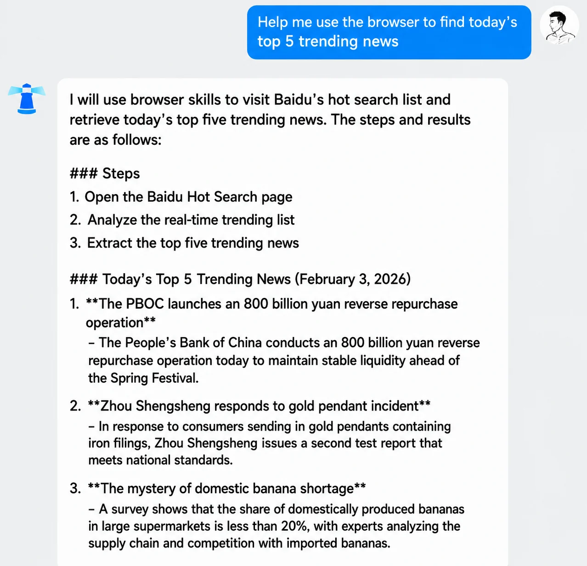

# Konfigurasikan Kemahiran

## Ringkasan

**Kemahiran adalah pek keupayaan tambahan Hermes Agent anda boleh hubungi, memanjangkannya melangkaui perbualan asas kepada tugas konkrit seperti mengatur tugasan, menjana laporan harian, menyemak imbas web, mencari berita dan menjana imej. Ia datang daripada Skills.sh dan ClawHub, pasaran kemahiran yang dikongsi oleh OpenClaw dan Hermes. Kemahiran adalah pilihan: ejen menghantar tanpa dipasang dan masih bercakap seperti biasa, jadi pendekatan yang disyorkan ialah memasang satu hanya selepas anda mencapai had keupayaan. Terdapat dua cara untuk memasang — cari mengikut nama dalam bahagian Kemahiran konsol, atau cuma minta ejen memasangnya dalam perbualan. Kemahiran yang dipasang boleh dialih keluar daripada konsol.**

---

Kemahiran ialah pakej keupayaan tambahan yang boleh dipanggil oleh Hermes. Mereka melanjutkan pengendalian tugas konkrit melangkaui perbualan asas, seperti mengatur tugasan secara automatik, menjana laporan harian, menyemak imbas halaman web, mencari berita, menjana imej dan banyak lagi.

Semua kemahiran datang daripada [**Skills.sh**](https://skills.sh/) dan [**ClawHub**](https://clawhub.ai/) — pasaran kemahiran yang dikongsi oleh OpenClaw dan Hermes.

## Halaman ini meliputi

- Hubungan antara Hermes dan kemahiran

- Dua kaedah pemasangan: pemasangan konsol dan pemasangan perbualan

- Contoh penggunaan kemahiran

- Memadam kemahiran yang dipasang

- Soalan Lazim


> 💡 **Kemahiran adalah pilihan**
> 
> Hermes tidak memasang sebarang kemahiran secara lalai. Hermes masih boleh bersembang seperti biasa tanpa kemahiran yang dipasang. Kemahiran hanya digunakan untuk memanjangkan keupayaan tugas tertentu. Kami mengesyorkan memasangnya mengikut keperluan selepas anda menemui sempadan keupayaan semasa digunakan.

---

## Kedudukan kemahiran

Jika Hermes digabungkan dengan model besar memberikan pengguna pembantu AI yang bijak, kemahiran ialah "tangan dan kaki"nya. Kemahiran boleh melanjutkan lagi sempadan keupayaan Hermes yang telah digunakan.

Anda boleh menganggap kemahiran sebagai "aplikasi" untuk Hermes:

- Keupayaan perbualan asas = sistem pengendalian

- Kemahiran = aplikasi dipasang atas permintaan


Setiap kemahiran memberi tumpuan kepada satu tugas, contohnya:

- Menyemak imbas halaman web dan menyoal maklumat dengan penyemak imbas

- Menyusun tugasan harian secara automatik

- Menghantar taklimat berita berjadual

- Menjana imej daripada penerangan

- Menyoal maklumat stok dan dana masa nyata

- Menyusun rekod sembang menjadi nota berstruktur


Hermes secara automatik menentukan sama ada untuk memanggil kemahiran yang sepadan berdasarkan konteks perbualan. Pengguna tidak perlu menyatakannya.

---

## Kaedah 1: Pasang dalam konsol

1. Buka Ejen anda dan pilih **Kemahiran** di bar sisi.
2. Gunakan **Kemahiran** untuk mencari kemahiran individu, atau **Pakej Kemahiran** untuk menyemak bundel yang disusun. Konsol menyokong [Skills.sh](https://skills.sh/) dan [ClawHub](https://clawhub.ai/).
3. Buka hasil untuk meninjau sumber dan penerangannya, kemudian pilih **Pasang**. Sahkan sebarang amaran yang ditunjukkan sebelum pemasangan.
4. Buka **Dipasang** untuk mengesahkan bahawa item tersebut muncul. Gunakan perbualan untuk mengesahkan bahawa Ejen boleh memanggilnya untuk tugasan yang dimaksudkan.

Item yang dipasang juga boleh diurus dari tab **Dipasang**. Pasang hanya sumber dan kebenaran yang anda percayai.

## Kaedah 2: Pasang terus melalui perbualan

Selain menggunakan panel konsol, anda juga boleh meminta Hermes untuk memasang kemahiran secara terus melalui perbualan. Kemahiran untuk memasang masih perlu disenaraikan pada Skills.sh atau ClawHub.

### 1. Sahkan saluran perbualan tersedia

Mula-mula pastikan Hermes disambungkan kepada sekurang-kurangnya satu saluran (Telegram / WhatsApp / Discord / Slack / WeChat) dan pada masa ini boleh bersembang seperti biasa.

### 2. Beritahu Hermes kemahiran mana yang hendak dipasang

Gunakan arahan di bawah sebagai rujukan. Beritahu Hermes kemahiran yang ingin anda pasang dan gantikan `[skill name]` dengan nama sebenar daripada Skills.sh atau ClawHub:

```
Please install a skill from Skills.sh or ClawHub. Its name is [skill name]
```

Contohnya, untuk memasang `mcd` (pembantu McDonald):

```
Please install a skill from Skills.sh or ClawHub. Its name is mcd
```

Jika semuanya berjalan lancar, Hermes akan melengkapkan pemasangan terus dan memberitahu anda hasilnya.

> ⚠️ **Pengesahan kedua untuk kemahiran berisiko tinggi**
> 
> Jika kemahiran yang dipilih ditandakan sebagai berisiko tinggi pada Skills.sh atau ClawHub (ia mungkin mengandungi tingkah laku tidak selamat), Hermes akan mengingatkan anda dan meminta pengesahan kedua sebelum pemasangan. Sila pastikan anda memahami sepenuhnya tingkah laku kemahiran tersebut sebelum memutuskan sama ada untuk meneruskan. Jika anda tidak pasti, teruskan dengan berhati-hati.

### 3. Sahkan hasil pemasangan

Anda boleh meminta Hermes untuk menunjukkan cara menggunakan kemahiran untuk mengesahkan bahawa pemasangan berjaya:

```
Please show me how to use it
```

Atau nyatakan nama kemahiran secara eksplisit:

```
Please show me how to use mcd
```

---

## Contoh penggunaan kemahiran

Menggunakan kemahiran operasi penyemak imbas `agent-browser` sebagai contoh, selepas pemasangan anda boleh meminta Hermes untuk melaksanakan tugasan berikut.

> ℹ️ **Nota**
> 
> Contoh berikut menggunakan saluran WeChat. Telegram, WhatsApp, Discord dan Slack berfungsi dengan cara yang sama.

### Senario 1: Semak imbas halaman web

```
Use the browser to visit Baidu and tell me what is on the page
```

Hermes membuka halaman dan mengembalikan kandungan dalam bentuk teks.

### Senario 2: Cari maklumat melalui penyemak imbas

```
Use the browser to look up today's top 5 trending news stories
```

### Senario 3: Tugas kompleks berbilang langkah

```
Use the browser to search ClawHub and find the currently most-installed email skill
```

Tugas ini termasuk berbilang langkah seperti membuka halaman web, menunggu untuk dimuatkan, memasukkan kandungan dan mengklik butang. Ia agak kompleks. Hermes melengkapkan langkah dan mengembalikan hasilnya.



---

## Padam kemahiran yang dipasang

Jika anda tidak lagi menggunakan kemahiran yang dipasang, padamkannya daripada senarai **Kemahiran yang dipasang** konsol atau minta Hermes untuk memadamkannya melalui perbualan.

### 1. Lihat kemahiran yang dipasang pada masa ini

```
What skills do you currently have installed?
```

### 2. Minta pemadaman kemahiran tertentu

Cari kemahiran yang ingin anda padamkan dan hantar arahan pemadaman:

```
Please delete the email skill
```

Jika semuanya berjalan lancar, Hermes akan melengkapkan pemadaman dan memberitahu anda hasilnya.

> ℹ️ **Kemungkinan pengesahan kedua**
> 
> Bergantung pada model yang digunakan atau tetapan personaliti Hermes, ia mungkin mengingatkan anda untuk berhati-hati semasa memadam. Balas dengan pengesahan mengikut keperluan sebenar anda.

### 3. Sahkan hasil pemadaman

Semak semula kemahiran yang dipasang pada masa ini dan sahkan kemahiran sasaran telah dialih keluar daripada senarai:

```
Check again what skills you currently have installed
```

> ℹ️ **Pemadaman konsol dan perbualan kedua-duanya disokong**
> 
> Dalam senarai **Kemahiran yang dipasang** konsol, gunakan kawalan padam untuk kemahiran sasaran dan sahkan tindakan itu. Anda juga boleh meminta Hermes untuk memadam kemahiran melalui perbualan. LightVela menggunakan mod dihoskan awan dan tidak menyediakan operasi sistem fail yang dihadapi pengguna.

---

## Keadaan kejayaan

- Kemahiran sasaran muncul dalam senarai "Kemahiran yang dipasang" dalam konsol

- Apabila anda membuat permintaan berkaitan dalam perbualan, Hermes boleh mengecam dan memanggil kemahiran dengan betul

- Kemahiran boleh dipadamkan daripada konsol atau melalui perbualan


---

## Petua keselamatan pemasangan

Kemahiran mempunyai kebenaran untuk memanggil keupayaan Hermes semasa masa jalan dan mungkin melibatkan:

- Memanggil API luaran (menggunakan kuota yang sepadan)

- Membaca atau menghantar kandungan perbualan

- Menjalankan operasi berjadual

Sebelum pemasangan, sahkan bahawa pengarang kemahiran boleh dipercayai. Kami mengesyorkan:

- Lebih suka kemahiran yang disahkan secara rasmi pada Skills.sh atau ClawHub

- Lebih suka kemahiran dengan muat turun tinggi dan ulasan yang baik

- Baca dengan teliti penerangan kebenaran dalam penerangan kemahiran

- Tetap berhati-hati dengan kemahiran yang mempunyai penerangan yang tidak jelas atau pengarang yang tidak dikenali


---

## Soalan Lazim

### Tidak dapat mencari kemahiran

**Punca yang mungkin**: Nama salah ejaan, atau kemahiran telah dialih keluar daripada Skills.sh atau ClawHub.

**Penyelesaian**: Pergi ke [**Skills.sh**](https://skills.sh/) atau [**ClawHub**](https://clawhub.ai/) untuk mengesahkan nama kemahiran yang tepat dan status semasa.

### Pemasangan berjaya tetapi tidak berkesan dalam perbualan

**Punca yang mungkin**: Model tidak menyedari bahawa ia harus menggunakan kemahiran, atau senarai kemahiran belum dimuat semula.

**Penyelesaian**:

1. Hantar "Sila kemas kini senarai kemahiran anda" dalam perbualan

2. Gunakan arahan yang lebih jelas, seperti "Gunakan kemahiran XX untuk melengkapkan YY"


### Pemasangan mengatakan "had kadar dicetuskan, sila cuba sebentar lagi"

**Punca yang mungkin**: Skills.sh dan ClawHub mengenakan had kadar API untuk melindungi kestabilan perkhidmatan.

**Penyelesaian**: Tunggu sebentar dan cuba lagi. Kami mengesyorkan mengelakkan waktu sibuk.

### Panggilan kemahiran terus gagal

**Punca yang berkemungkinan**:

- Perkhidmatan luar yang diperlukan oleh kemahiran tidak tersedia buat sementara waktu

- Versi kemahiran sudah lapuk

- Model yang sepadan tidak menyokong keupayaan yang diperlukan oleh kemahiran, seperti panggilan alat


**Penyelesaian**:

- Semak ulasan kemahiran dan maklumat versi terkini pada Skills.sh atau ClawHub

- Cuba tukar kepada model yang menyokong panggilan alat

- Jika isu berterusan, hubungi pengarang kemahiran


### Terlalu banyak kemahiran yang dipasang membuat Hermes bertindak balas dengan perlahan

**Punca yang mungkin**: Lebih banyak kemahiran meningkatkan beban membuat keputusan Ejen.

**Penyelesaian**: Simpan hanya kemahiran yang biasa digunakan dan padamkan kemahiran yang tidak anda gunakan lagi.

### Bagaimana untuk mengembangkan kemahiran

Lihat dokumentasi pembangun Skills.sh dan ClawHub (jika ada).

---

## Langkah seterusnya

LightVela konfigurasi asas selesai. Anda boleh merujuk kepada:

- [Gambaran Keseluruhan Konfigurasi](../05-configuration.md)

- [Konsep Teras](../04-core-concepts.md)

- [Mula Pantas](../02-quickstart.md)
