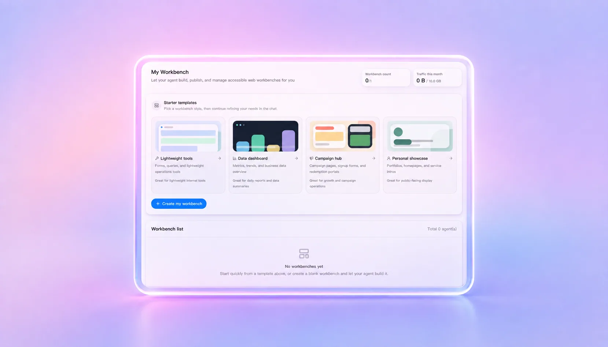
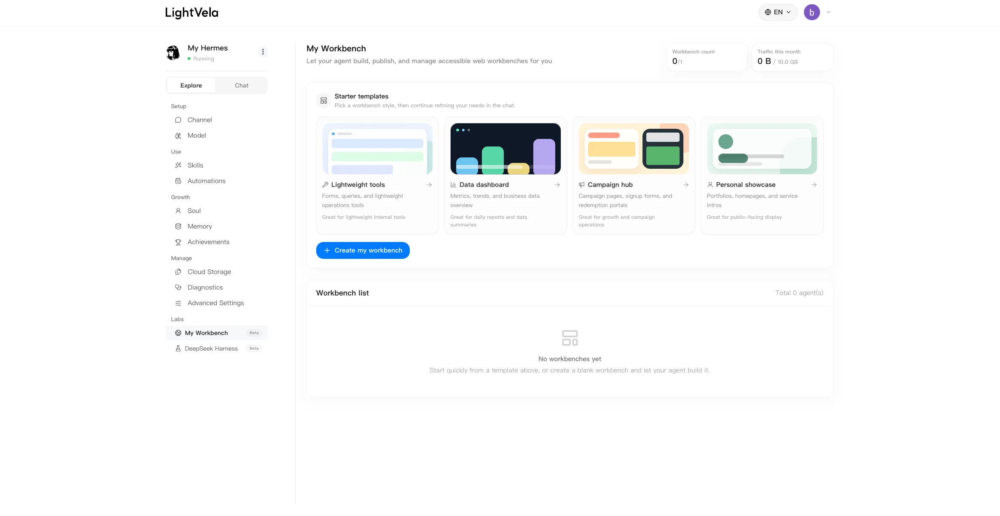
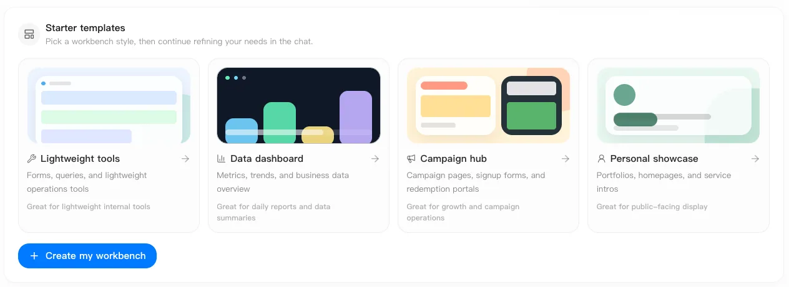
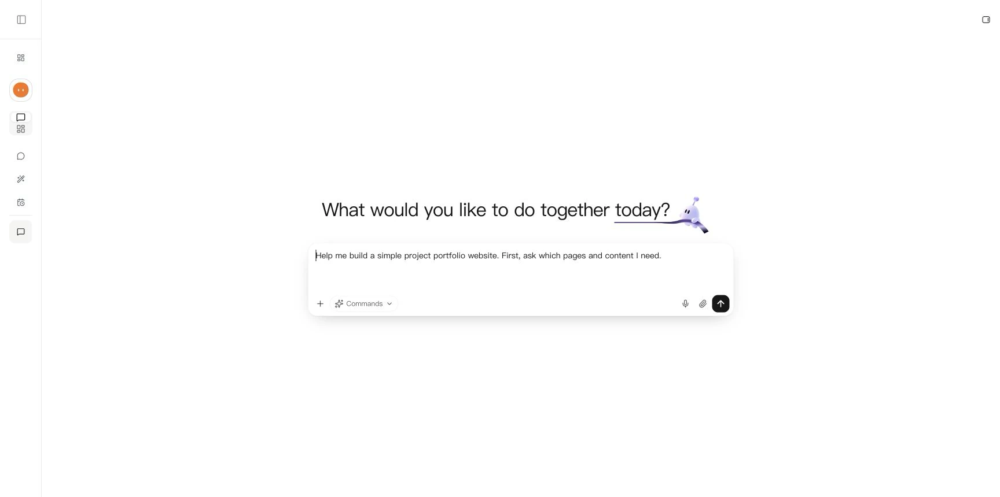
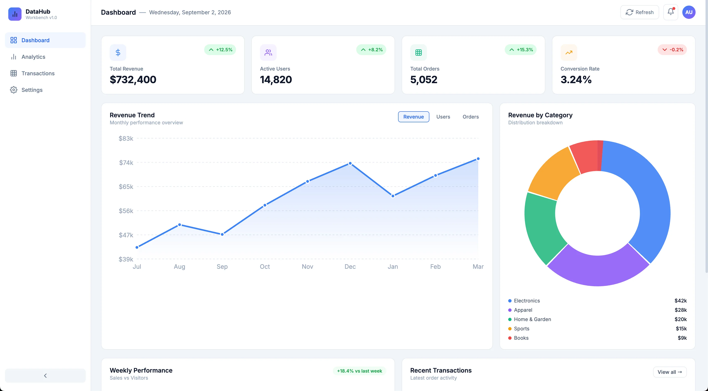

# Meja kerja

## Ringkasan

**Meja Kerja Saya membolehkan anda menggunakan Ejen AI untuk membina, menggunakan dan mengurus tapak web statik dalam LightVela. Pilih templat permulaan atau huraikan tapak web dari awal, kemudian bekerjasama dengan Ejen untuk memperhalusi dan menerbitkannya.**

Selepas penggunaan, anda boleh melihat alamat awam, menyemak status semasa dan mengurus meja kerja sedia ada anda dari satu tempat.

Notis Beta: Meja Kerja Saya ialah ciri Beta, jadi aliran kerja penjanaan dan penggunaan mungkin berubah apabila ciri itu berkembang.

## Perkara Meja Kerja Saya

Meja Kerja Saya menghubungkan sembang ejen anda dengan aliran kerja tapak web statik terurus.
Anda boleh memulakan "tapak kerja" meja kerja anda sendiri atau memilih salah satu templat yang disediakan, berinteraksi dengan Ejen untuk memperhalusinya dan pratonton tapak anda dengan pautan khusus anda sendiri.

LightVela menguruskan proses pengehosan, jadi anda tidak perlu mengkonfigurasi pelayan pengehosan atau akaun awan yang berasingan.

## Buka Meja Kerja Saya

1. Buka [https://lightvela.ai/agents/](https://lightvela.ai/agents/).
2. Dalam navigasi kiri, buka Meja Kerja Saya.

Halaman Meja Kerja menunjukkan penggunaan semasa anda, templat tersedia dan meja kerja sedia ada.

## Pilih Templat Permulaan

Templat pemula membantu anda bermula dengan arah yang jelas.
Anda boleh memilih templat berdasarkan jenis tapak web yang ingin anda bina:

- Papan Pemuka Utiliti Bersih: Borang, carian maklumat atau alatan dalaman yang ringan.
- Papan Pemuka Data: Metrik teras, arah aliran, gambaran keseluruhan perniagaan atau laporan harian.
- Halaman Pendaratan Kempen: Halaman aktiviti, halaman pendaftaran atau penyertaan penebusan.
- Pameran Peribadi: Portfolio, halaman utama peribadi atau pengenalan perkhidmatan.

Pilih templat untuk membuka sembang Ejen dengan permintaan yang disediakan.

Anda juga boleh memilih pilihan kosong dan biarkan Ejen menjelaskan keperluan dengan anda langkah demi langkah.

## Buat Meja Kerja dengan Sembang Ejen

1. Pilih templat pemula, atau mulakan dengan meja kerja kosong.
2. Terangkan tujuan tapak web, khalayak, kandungan dan arah visual.
3. Jawab soalan Ejen kerana ia menjelaskan keperluan.
4. Semak hasil yang dijana dan minta Ejen membuat perubahan.
5. Apabila laman web sudah siap, minta Ejen menerbitkan versi terkini.

Aliran kerja semasa menggunakan React, TypeScript, Tailwind CSS dan perpustakaan UI biasa untuk tapak web yang dijana.

Ejen juga diarahkan untuk memastikan kandungan boleh diedit, mengelakkan data perniagaan olok-olok pratetap dan menggunakan storan tempatan penyemak imbas apabila data tempatan sementara adalah sesuai.

## Semak Status Meja Kerja

Setiap meja kerja mempunyai status penempatan supaya anda boleh melihat sama ada meja itu sedia untuk dilawati.

| Status | Penerangan |
| --- | --- |
| Bangunan | Laman web sedang dijana atau disediakan. |
| Menerbitkan | Versi terkini sedang diterbitkan. |
| Dalam talian | Laman web ini boleh didapati di alamat awamnya. |
| Kemas kini gagal | Percubaan generasi atau penerbitan terkini gagal. |
| Luar talian | Tapak web tidak tersedia atau telah dialih keluar. |

Apabila meja kerja berada dalam talian dan mempunyai alamat awam, pilih Lawati untuk membukanya.

Jika meja kerja masih membina atau menerbitkan, tunggu proses selesai dan muat semula halaman jika perlu.

## Uruskan Meja Kerja Sedia Ada

Senarai meja kerja sedia ada menunjukkan nama tapak web, alamat awam, tarikh penciptaan dan status semasa.

Untuk mengemas kini meja kerja, kembali ke sembang Ejen dan huraikan perubahan yang anda inginkan.
Selepas menyemak perubahan, minta Ejen menerbitkan versi yang dikemas kini.

Untuk mengalih keluar meja kerja:

1. Cari meja kerja dalam senarai.
2. Pilih tindakan padam.
3. Sahkan pemadaman.

Memadamkan meja kerja serta-merta membawanya ke luar talian dan mengalih keluar fail berkaitannya.
Tindakan ini tidak boleh dibuat asal.

## Kuota Meja Kerja dan Had Pengehosan

Had Meja Kerja anda bergantung pada rancangan anda.

- Pelan pelancaran: Buat 1 meja kerja.
- Pelan peringkat lebih tinggi: Cipta sehingga 5 meja kerja.

Jika anda mencapai had anda, padamkan meja kerja sedia ada sebelum membuat yang baharu atau tingkatkan rancangan anda.

## Masalah Biasa

| Masalah | Kemungkinan punca | Apa yang perlu dilakukan |
| --- | --- | --- |
| Halaman Workbench meminta anda melog masuk | Sesi anda telah tamat tempoh. | Log masuk semula dan buka semula Meja Kerja Saya. |
| Anda tidak boleh mencipta meja kerja lain | Anda mungkin telah mencapai had pelan anda. | Semak penggunaan anda atau alih keluar meja kerja yang tidak digunakan. |
| Status kekal Membina atau Menerbitkan | Kerahan masih diproses. | Tunggu sebentar, kemudian muat semula halaman. |
| Tindakan Lawatan tidak tersedia | Meja kerja belum lagi dalam talian. | Tunggu sehingga status bertukar kepada Dalam Talian. |
| Status bertukar kepada Kemas kini gagal | Percubaan generasi atau penerbitan terkini gagal. | Semak respons Ejen, buat perubahan yang diperlukan dan cuba lagi. |
| Data tapak web hilang dalam pelayar lain | Data telah disimpan dalam storan tempatan penyemak imbas. | Gunakan perkhidmatan bahagian belakang jika tapak web memerlukan data yang dikongsi atau berterusan. |
| Meja kerja yang dipadam masih muncul dalam senarai | Pemadaman masih diproses. | Tunggu pembersihan selesai dan muat semula halaman. |

## Sempadan Semasa

Meja Kerja Saya bertujuan untuk mencipta dan mengehos tapak web statik melalui sembang Agen.
Ia tidak menyediakan storan sebelah pelayan, pangkalan data terurus, pengendalian borang yang berterusan, akaun kongsi atau perkhidmatan bahagian belakang sewenang-wenangnya.
Kiraan meja kerja, trafik, storan, saiz pakej dan kiraan fail bergantung pada pelan aktif anda.

## Soalan Lazim

### Apakah jenis tapak web yang boleh saya buat?

Anda boleh membuat papan pemuka, alatan dalaman, halaman kempen, portfolio, halaman pendaratan dan tapak web bahagian hadapan statik yang lain.

### Adakah saya memerlukan pengalaman pengekodan?

Tidak.
Anda boleh menerangkan perkara yang anda inginkan dalam bahasa semula jadi dan biarkan Ejen membimbing anda melalui keperluan, penjanaan dan proses penerbitan.

### Bolehkah saya mengemas kini meja kerja sedia ada?

ya.
Kembali ke sembang Ejen, huraikan perubahan, semak keputusan dan minta Ejen menerbitkan versi yang dikemas kini.

### Bolehkah tapak web saya menyimpan data?

Tapak web statik boleh menyimpan data buat sementara waktu dalam penyemak imbas semasa dengan storan setempat.
LightVela tidak menyediakan storan berterusan sebelah pelayan untuk tapak web Workbench.

### Adakah saya memerlukan akaun pengehosan yang berasingan?

Tidak.
LightVela menyediakan aliran kerja pengehosan untuk meja kerja statik anda.

### Mengapa meja kerja saya tidak tersedia dengan serta-merta?

Penjanaan dan penerbitan boleh mengambil sedikit masa.
Semak status semasa dan tunggu sehingga ia berubah kepada Dalam Talian sebelum membuka alamat awam.
