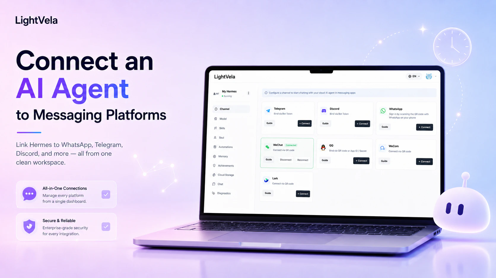
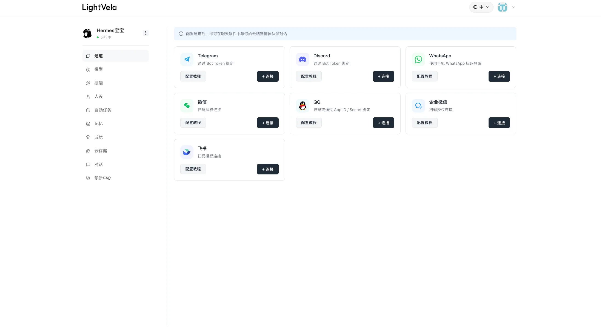
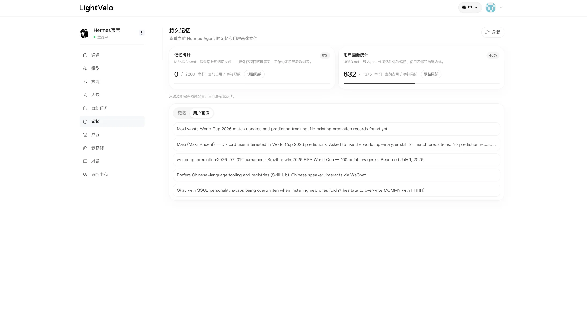

# Cara Menghubungkan Ejen AI kepada Platform Pemesejan

## Ringkasan

**Menghubungkan a Hermes Agent kepada platform pemesejan bergantung pada satu idea: saluran ialah pintu masuk dan Ejen ialah perkara yang berfungsi. Satu Ejen awan berkongsi model, kemahiran dan memori yang sama merentas setiap saluran yang disambungkan, jadi tidak perlu bot berasingan bagi setiap platform.** Aliran ini mempunyai empat langkah: sahkan saluran tersedia di rantau anda (rantau global menyokong Telegram, WhatsApp, Discord, Slack, WeChat, QQ, WeCom, dan Lark; wilayah China menyokong WeChat, QQ, WeCom, Lark, dan DingTalk); kebenaran lengkap di bahagian platform untuk mendapatkan kelayakan; sambung dalam konsol dan sahkan saluran menunjukkan sebagai disambungkan; kemudian hantar mesej ujian dan sahkan balasan diterima dalam perbualan yang sama yang anda hantar mesej. Bukti kelayakan adalah sensitif - jangan sekali-kali menulisnya dalam konteks jangka panjang atau menampalnya ke dalam sembang.



## Untuk siapa ini

Panduan ini adalah untuk sesiapa sahaja yang ingin bercakap dengannya Hermes daripada apl pemesejan dan bukannya dari konsol web sahaja. Ia juga membantu jika anda mahukan seorang pembantu tersedia di lebih daripada satu tempat - contohnya, Telegram untuk kegunaan peribadi dan Discord untuk sesebuah komuniti.

Mulakan dengan satu saluran. Tambahkan satu lagi hanya apabila ia menyajikan konteks, khalayak atau tabiat peranti yang berbeza.

## Prasyarat

- A LightVela akaun dengan a Hermes Agent yang sedang berjalan. Gunakan [Quickstart](../02-quickstart.md) jika anda perlu mencipta satu.

- Konfigurasi model yang berfungsi atau kredit percubaan, jadi Hermes boleh membalas selepas saluran disambungkan.

- Akses kepada platform yang ingin anda sambungkan. Sesetengah platform menggunakan aliran kebenaran kod QR, manakala yang lain memerlukan token bot atau bukti kelayakan platform.

- Mesej ujian yang boleh anda hantar sebaik sahaja persediaan selesai.

## Langkah / konsep utama

### 1. Pilih saluran yang sepadan dengan perbualan

Pilih berdasarkan tempat anda sebenarnya akan menggunakan pembantu, bukan pada berapa banyak platform yang anda boleh sambungkan. Telegram, WhatsApp, Discord, Slack dan WeChat ialah pilihan biasa:

| Saluran | Sesuai untuk |
| --- | --- |
| Telegram | Pemesejan peribadi, rutin ringan dan perbualan langsung |
| WhatsApp | Komunikasi dan pemberitahuan setiap hari di mana WhatsApp sudah menjadi lalai anda |
| Discord | Komuniti, kumpulan pembangun dan ruang perbincangan yang teratur |
| Slack | Kerjasama pasukan, pemberitahuan ruang kerja dan aliran kerja saluran |
| WeChat | Perbualan peribadi untuk orang yang menggunakan WeChat setiap hari |

LightVela juga menyediakan halaman persediaan untuk saluran lain yang disokong. Halaman Saluran dalam konsol ialah sumber kebenaran untuk perkara yang tersedia pada masa ini untuk Hermes Agent anda.

### 2. Lengkapkan aliran sambungan khusus platform

Buka kawasan Saluran dalam konsol, pilih platform dan ikuti kebenaran atau aliran kelayakannya. Gunakan panduan yang sepadan dan bukannya menyalin bukti kelayakan daripada platform yang tidak berkaitan:

- [Telegram](../configuration/channel-telegram.md)
- [WhatsApp](../configuration/channel-whatsapp.md)
- [Discord](../configuration/channel-discord.md)
- [Slack](../configuration/channel-slack.md)
- [WeChat](../configuration/channel-wechat.md)

Rawat token bot, ID aplikasi dan rahsia seperti kata laluan. Jangan tampalkannya ke dalam sembang kumpulan, dokumen awam atau mesej kepada orang lain. Jika bukti kelayakan terdedah, putarkannya dalam platform yang mengeluarkannya sebelum menyambung semula Hermes.



### 3. Sahkan sambungan dengan perbualan mudah

Selepas konsol menunjukkan saluran sebagai disambungkan, cari bot atau perbualan dalam platform itu dan hantar mesej ringkas:

```text
Hi Hermes. Please reply with the channel you received this from.
```

Ini menyemak laluan penuh: platform boleh menghantar mesej, Hermes mempunyai model yang berfungsi dan balasan boleh kembali ke tempat yang sama. Jika ia tidak berfungsi, semak status bersambung dahulu, kemudian sahkan model aktif dalam [Konfigurasi Model](../configuration/model.md).

### 4. Tentukan perkara yang harus kekal dikongsi merentas saluran

Apabila lebih daripada satu saluran bersambung kepada Hermes Agent yang sama, ia adalah pintu yang berbeza ke dalam pembantu yang sama. Ini bermakna Ejen boleh menyimpan memori yang sama, pilihan kerja dan kemahiran yang dipasang merentas saluran yang disokong.

Gunakan [Pengurusan Memori](../configuration/memory.md) untuk menyemak konteks jangka panjang yang anda mahu Hermes kekalkan. Jika satu saluran adalah untuk khalayak yang berbeza atau memerlukan peranan yang sangat berbeza, pertimbangkan untuk memisahkan kes penggunaan dan bukannya mencampurkan jangkaan yang tidak berkaitan ke dalam satu sejarah perbualan.



Jika Discord ialah saluran yang anda mahu gunakan untuk komuniti, teruskan dengan [Temui LightVela untuk Discord: Ejen AI Anda Discord Bot Melayan Saluran Anda](./discord-community-agent.md).

## Soalan Lazim

### Bolehkah saya menyambungkan beberapa platform pemesejan kepada satu Hermes Agent?

ya. Saluran yang disokong boleh menghala ke Ejen yang sama, yang membolehkan anda mencapainya daripada lebih daripada satu apl pemesejan sambil mengekalkan gelagat dan memori yang dikonfigurasikan yang sama.

### Saluran manakah yang harus saya sambungkan dahulu?

Pilih yang paling kerap anda gunakan. Pembantu peribadi lebih berkemungkinan menjadi berguna apabila mesej pertama mudah dihantar. Telegram, WhatsApp, Discord, Slack dan WeChat masing-masing mempunyai panduan persediaan terperinci.

### Mengapakah saluran dipaparkan sebagai disambungkan tetapi Hermes tidak membalas?

Hantar mesej ujian ringkas, kemudian semak sama ada model aktif atau kredit percubaan tersedia. Jika isu berterusan, sambungkan semula saluran dan gunakan [Diagnostik](../configuration/diagnostics.md) untuk menyemak pilihan penyelenggaraan dan log terkini.

### Bolehkah saya berkongsi satu kelayakan bot merentas berbilang Hermes Agent?

Elakkan berbuat demikian melainkan platform dan aliran kerja yang anda maksudkan dengan jelas menyokongnya. Memastikan satu bukti kelayakan dilampirkan pada satu tujuan yang jelas menjadikan penyelesaian masalah dan kawalan akses lebih mudah.

## Langkah seterusnya

- [Konfigurasikan Model](../configuration/model.md) - sahkan Hermes mempunyai model sedia untuk dijawab.

- [Pengurusan Memori](../configuration/memory.md) - urus konteks yang dikongsi oleh saluran anda yang disambungkan.

- [Tugas Berjadual](../configuration/automation.md) - hantar kemas kini berjadual kepada saluran yang disambungkan apabila sesuai.
