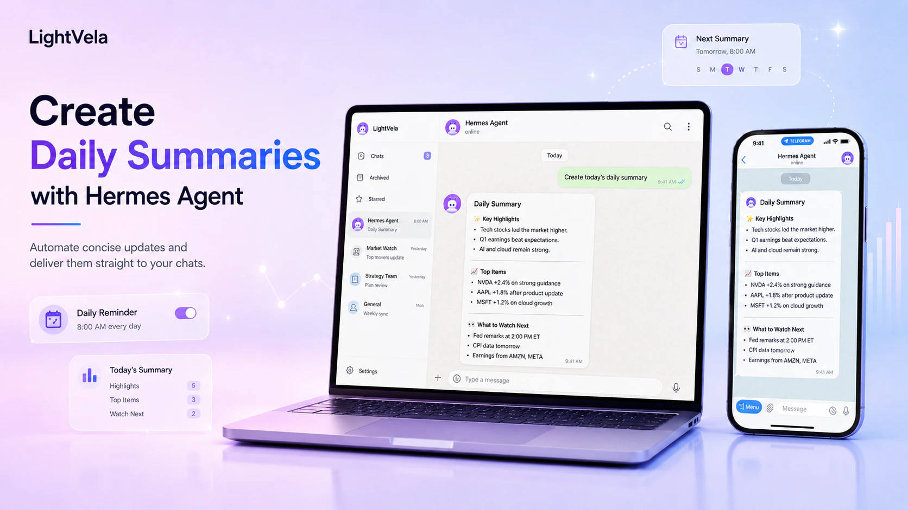
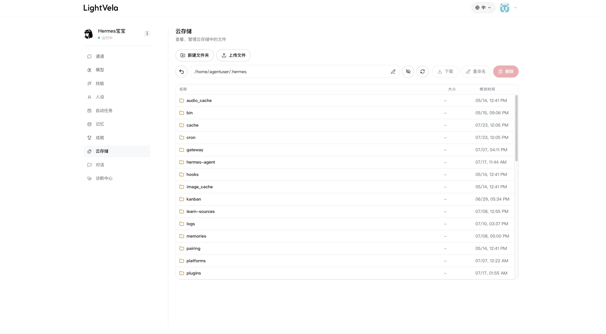

# Cara Membuat Ringkasan Harian dengan Hermes Agent

## Ringkasan

**Ringkasan harian memperoleh nilainya bukan dengan panjang tetapi dengan memberikan konteks yang betul kepada anda sebelum anda memintanya, dan cara untuk sampai ke sana ialah menukar semakan manual kepada tugasan berjadual yang disimpan.** Anda memerlukan empat perkara: awan Hermes Agent dengan model yang dikonfigurasikan, saluran yang disambungkan untuk menerima hasil, kemahiran pilihan untuk mengumpul maklumat dan tugas berjadual, jadual waktu, tetingkap salurannya yang aktif dan tetingkap pemberitahuannya Kejayaan bergantung pada arahan tugasan: memandangkan tiada sesiapa yang hadir untuk menjelaskan pada masa jalankan, gesaan mesti membawa matlamatnya sendiri, sempadan skop (julat masa dan had item), format output dan perkara yang perlu dilakukan apabila tiada apa-apa untuk dilaporkan. Uji gesaan secara manual dalam sembang dahulu, kemudian buat tugasan yang dijadualkan dan semak output selepas larian sebenar pertamanya.



## Untuk siapa ini

Kes penggunaan ini adalah untuk orang yang kerap mengimbas kemas kini daripada projek, nota, fail atau perbualan berulang dan mahukan titik permulaan yang lebih pendek. Ia boleh sesuai dengan taklimat pagi peribadi, rekap projek harian, log pembelajaran atau senarai susulan yang difokuskan.

Ringkasan pertama yang terbaik mempunyai tujuan yang sempit. "Ringkaskan segala-galanya" biasanya terlalu luas; "serlahkan perubahan, keputusan, penyekat dan tindakan seterusnya untuk projek ini" adalah lebih mudah untuk dinilai dan diperbaiki.

## Prasyarat

- Hermes Agent dan saluran bersambung yang sedang berjalan di mana anda ingin menerima ringkasan.

- Konfigurasi model yang berfungsi atau kredit percubaan. Lihat [Konfigurasikan Model](../configuration/model.md) jika Hermes tidak dapat bertindak balas.

- Sumber konteks yang jelas. Ini mungkin bahan yang anda tampalkan ke dalam perbualan, fail yang anda urus dalam Storan Awan atau maklumat yang boleh diakses oleh kemahiran yang dipercayai dan berkaitan.

- Jadual tugas berjadual pilihan jika anda mahu ringkasan dijalankan tanpa gesaan manual.

## Langkah / konsep utama

### 1. Tentukan satu keputusan yang rumusan harus membantu anda buat

Mulakan dengan menamakan saat ringkasan menyokong. Contohnya: memutuskan perkara yang perlu diusahakan terlebih dahulu, menyemak sama ada projek disekat atau mengejar selepas tiada selama sehari.

Berikan Hermes arahan yang mentakrifkan kedua-dua sumber dan bentuk output:

```text
When I share project updates, summarize them in four sections:
what changed, decisions made, blockers, and the three next actions.
Keep it under 250 words and flag anything urgent.
```

Ini menukar permintaan umum kepada format berulang yang boleh anda bandingkan hari demi hari.

### 2. Jadikan bahan sumber sengaja

Hermes hanya boleh meringkaskan maklumat yang boleh diterima atau akses melalui keupayaan yang anda konfigurasikan. Untuk aliran kerja manual, tampal atau majukan kemas kini yang berkaitan ke dalam perbualan anda. Untuk kerja berasaskan fail, pastikan bahan tersusun dalam [Cloud Storage](../configuration/files.md) dan beritahu Hermes dokumen atau folder mana yang penting untuk semakan semasa.

Jika anda memerlukan sumber data luar, pilih kemahiran yang sesuai daripada sumber yang dipercayai dan sahkan kelakuannya sebelum menggunakannya. [Konfigurasikan Kemahiran](../configuration/skill.md) menerangkan cara kemahiran memanjangkan Hermes melebihi sembang biasa.



### 3. Uji output dalam perbualan biasa dahulu

Sebelum menjadualkan apa-apa, minta Hermes untuk ringkasan secara manual. Semak sama ada bahagian itu berguna, sama ada nadanya cukup ringkas dan sama ada butiran penting tiada.

Penambahbaikan berguna termasuk:

```text
Put deadlines first.
```

```text
Do not repeat completed work unless it affects a next action.
```

```text
End with one question I should answer before tomorrow.
```

Halaman [Sembang](../configuration/agent-chat.md) ialah tempat yang baik untuk mengulangi arahan sebelum mengubahnya menjadi tugasan berulang.

### 4. Jadualkan versi yang sudah berfungsi

Apabila gesaan manual menghasilkan hasil yang anda percayai, buat tugas berjadual. Beri masa tertentu dan arahan yang jelas, kemudian pilih saluran pemberitahuan yang disambungkan jika anda mahu keputusan dihantar ke sana.

```text
Every weekday at 6:00 PM, prepare a daily project summary from the
updates I shared today. Include changes, blockers, and the three most
important next actions. Send it as concise bullet points.
```

Sediakan ini dalam [Tugas Berjadual](../configuration/automation.md). Semak beberapa larian pertama dan laraskan perkataan jika ringkasan terlalu luas, terlalu panjang atau tiada konteks yang betul.


## Soalan Lazim

### Bolehkah Hermes meringkaskan sebarang maklumat secara automatik?

Hanya maklumat yang Hermes boleh terima dalam perbualan, akses melalui fail dan kemahiran yang telah anda konfigurasikan atau peroleh melalui aliran kerja yang anda sediakan. Pastikan sumber yang jelas dan gunakan kemahiran yang dipercayai untuk sebarang akses luaran.

### Mengapakah ringkasan saya terlalu generik?

Arahan itu mungkin terlalu luas. Namakan bahagian khalayak, sumber, julat masa dan output. Meminta keputusan, penyekat dan tindakan seterusnya biasanya menghasilkan hasil yang lebih boleh diambil tindakan daripada meminta rekap umum.

### Perlukah saya menjadualkan ringkasan dengan segera?

Tidak. Uji gesaan secara manual dahulu. Sebaik sahaja anda dapat mengenali hasil yang baik, menjadualkannya menjimatkan masa tanpa mengunci dalam format yang tidak membantu.

### Bagaimana jika ringkasan tidak sampai?

Semak status tugasan yang dijadualkan dan saluran pemberitahuan, kemudian sahkan bahawa Hermes masih boleh membalas dalam perbualan biasa. Jika perlu, semak [Diagnostik](../configuration/diagnostics.md) sebelum membuat tugasan lain.

## Langkah seterusnya

- [Cloud Storage](../configuration/files.md) — susun fail yang menyokong semakan berulang.

- [Konfigurasikan Kemahiran](../configuration/skill.md) — tambahkan keupayaan yang dipercayai apabila ringkasan anda memerlukan sumber maklumat tertentu.

- [Tugas Berjadual](../configuration/automation.md) — hantar ringkasan ujian anda mengikut jadual.
