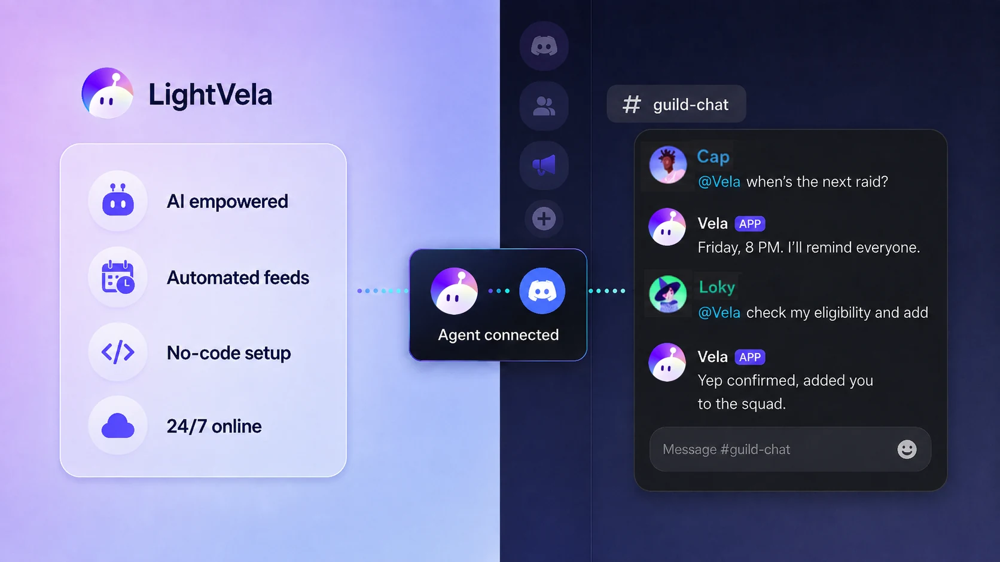
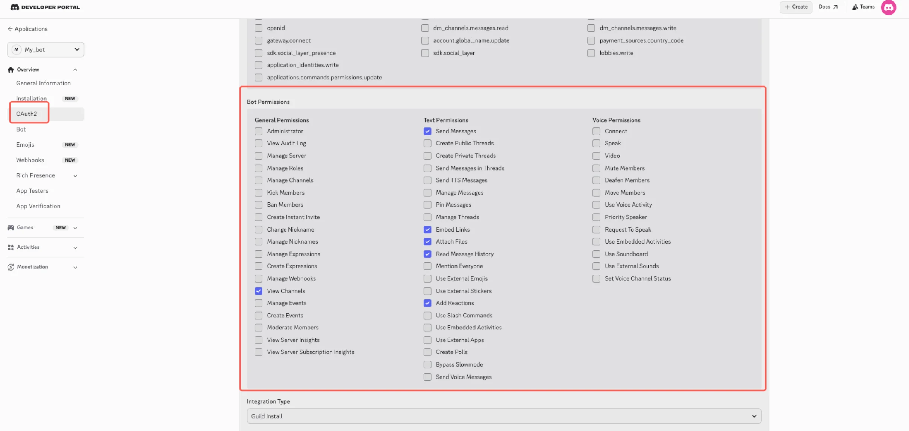

# Temui LightVela untuk Discord: Ejen AI Anda Discord Bot Melayan Saluran Anda

## Ringkasan

**LightVela membolehkan anda menyambungkan yang dihoskan awan Hermes Agent kepada Discord, berikan konteks komuniti dan sempadan operasi yang diluluskan, serta sediakannya untuk soalan berulang, onboarding dan sokongan acara.** Laluan minimum adalah untuk mencipta Ejen, mengkonfigurasi arahannya, menyambungkan Discord saluran, jemput bot dan uji soalan sebenar dalam soalan yang disokong Discord perbualan.

Produk ejen kongsi terkini seperti [Claude Teg](https://www.anthropic.com/news/introducing-claude-tag) dan [Viktor](https://slack.com/marketplace/A0A2VN5TR5K-viktor) tunjukkan sebab Ejen boleh menjadi lebih berguna apabila ia berfungsi di mana kumpulan sudah berkomunikasi.
LightVela membawa corak itu kepada Discord komuniti tanpa memerlukan anda membina dan mengehoskan aplikasi bot yang berasingan terlebih dahulu.



## Untuk siapa ini dan hasil yang dijangkakan

Kes penggunaan ini adalah untuk komuniti permainan, komuniti pembangun, kumpulan minat dan pelayan acara yang mahukan pembantu AI yang boleh dipercayai dalam ruang perbualan yang telah mereka gunakan.

Hasil yang diharapkan adalah taklimat yang baik Discord Ejen yang boleh menjawab soalan yang diluluskan, mengarahkan ahli ke saluran atau maklumat acara yang betul, menyokong onboarding dan menghantar peringatan yang dikonfigurasikan apabila Tugas Berjadual sesuai.

Ia bukan pengganti untuk moderator manusia.
Keputusan penyederhanaan sensitif, tindakan akaun, pertikaian dan apa-apa sahaja di luar sempadan pengetahuan yang diluluskan harus diserahkan kepada manusia.

## Prasyarat

- Ejen LightVela Hermes berjalan dengan model yang dikonfigurasikan.

- Akaun Discord dan pelayan yang anda mempunyai kebenaran untuk menambah bot.

- Bahan sumber yang diluluskan seperti peraturan pelayan, Soalan Lazim, butiran acara, tujuan saluran dan hubungan eskalasi.

- Sempadan yang jelas untuk perkara yang mungkin dijawab oleh Ejen, perkara yang mesti ditolak dan bila ia perlu meningkat.

- [Discord panduan konfigurasi saluran](../configuration/channel-discord.md) dan [Panduan Tugas Berjadual](../configuration/automation.md) tersedia untuk rujukan.

## Langkah

### 1. Buat Ejen sebelum anda menjemput bot

Mulakan dengan peranan dan hasil Ejen dan bukannya dengan kelayakan Discord.
Bot Discord ialah titik masuk ke Hermes, jadi arahan dan model yang dikonfigurasikan dalam LightVela menentukan bagaimana ia berkelakuan selepas ia disambungkan.

Tuliskan soalan paling biasa komuniti dan jawapan terkecil yang berguna untuk setiap soalan.
Contohnya, senaraikan halaman peraturan, saluran sokongan, jadual acara, proses pendaftaran dan laluan peningkatan moderator.

### 2. Berikan konteks komuniti yang diluluskan oleh Agen

Konfigurasikan Ejen dengan maklumat yang dibenarkan untuk digunakan dan sempadan yang mesti diikuti.
Arahan permulaan yang berguna mungkin kelihatan seperti ini:

```text
You are the community assistant for this Discord server.

Answer questions using approved information.
Help members find the right channel or event details.
Be friendly and concise.
Escalate sensitive moderation issues to human moderators.
Never invent rules, announcements, or event times.
If the approved information does not answer a question, say that you do not know and point the member to a human moderator.
```

Kekalkan pilihan operasi yang tahan lama dalam konteks yang dikonfigurasikan Ejen.
Teruskan menukar jadual, pengumuman dan bahan acara dalam aliran kerja yang boleh disemak sebelum Ejen menggunakannya.
Jangan letakkan token bot, kata laluan atau maklumat peribadi yang tidak diperlukan dalam konteks jangka panjang.

### 3. Sambungkan Discord dan jemput bot

Dalam LightVela, buka konfigurasi saluran dan pilih Discord.
Cipta atau pilih Aplikasi Discord, tambah Bot, jana tokennya dan tampal token ke dalam kad sambungan Discord.

Dalam Discord Portal Pembangun, dayakan Niat Kandungan Mesej yang diperlukan untuk membaca kandungan mesej.
Gunakan set terkecil skop bot dan kebenaran yang diperlukan pelayan anda, seperti melihat saluran, menghantar mesej dan membaca sejarah mesej.
Kemudian jana pautan jemputan dan tambahkan bot pada pelayan yang dimaksudkan.

Ikuti [Discord langkah persediaan](../configuration/channel-discord.md) yang lengkap untuk aliran kebenaran dan kebenaran semasa.



### 4. Uji Ejen dengan soalan komuniti sebenar

Selepas konsol menunjukkan Discord sebagai disambungkan, hantar beberapa soalan wakil daripada perbualan Discord yang disokong.
Gunakan soalan yang menguji kedua-dua jawapan yang berguna dan ketidakpastian yang selamat:

```text
Where can I find the event schedule?

Which channel should I use for technical support?

I am new here. What should I read first?

What is the rule for an issue that is not covered in the FAQ?
```

Hasil yang diharapkan bukan sekadar jawapan yang lancar.
Ejen harus menggunakan maklumat yang diluluskan, pastikan jawapan ringkas, elakkan mencipta peraturan, dan meningkat apabila soalan memerlukan moderator.

Jika bot tidak membalas, mula-mula sahkan saluran Discord menunjukkan sebagai bersambung, model tersedia, bot mempunyai kebenaran untuk membaca dan menghantar mesej, dan Niat Kandungan Mesej didayakan.

### 5. Tambahkan sokongan berulang hanya selepas laluan teras berfungsi

Setelah jawapan soalan boleh dipercayai, tambahkan Tugas Berjadual yang sempit untuk kerja berulang seperti peringatan pendaftaran, kira detik acara atau ringkasan penyederhana.
LightVela Tugasan Berjadual menyokong larian sekali, hari bekerja tetap atau selang masa tetap, dengan tetingkap berkesan pilihan dan saluran pemberitahuan.

Sebagai contoh, anda boleh mengkonfigurasi:

```text
Every Thursday at 18:00, remind the event channel about Saturday's tournament.
Use only the approved schedule and rules.
Include the start time, time zone, registration deadline, and the channel for questions.
If any detail is missing, say which detail needs a moderator update instead of guessing.
```

Mulakan dengan satu peringatan dan semak outputnya sebelum menambah lebih banyak kerja berjadual.
Lihat [Tugas Berjadual](../configuration/automation.md) untuk tetapan jadual dan pemberitahuan yang tersedia.

## Senarai semak praktikal

| Pentas | Tindakan | LightVela komponen | Hasil yang dijangkakan atau isyarat kegagalan |
| --- | --- | --- | --- |
| Takrifkan | Tulis peranan komuniti, fakta yang diluluskan dan peraturan peningkatan | Arahan ejen | Seorang moderator boleh menerangkan perkara yang mungkin dan tidak boleh dijawab oleh Ejen |
| Sambung | Tambahkan token Discord Bot dan jemput bot dengan keizinan paling sedikit | Discord saluran | Discord muncul sebagai disambungkan dan bot hadir dalam pelayan |
| Ujian | Tanya soalan FAQ yang diketahui dan soalan yang tidak diketahui atau sensitif | Discord perbualan | Yang pertama mendapat jawapan yang berasas dan yang kedua ditolak atau dinaikkan |
| Ulang | Tambahkan satu peringatan atau ringkasan dengan jadual sempit | Tugas Berjadual | Mesej tiba dalam saluran pemberitahuan yang dipilih pada masa yang dijangkakan |
| Semakan | Semak jawapan, jadual dan maklumat acara yang diubah | Pengurusan Agen dan Tugas Berjadual | Peraturan dan pengumuman lapuk diperbetulkan sebelum menyebabkan kekeliruan |

## Apa yang dikongsi Discord Ejen boleh membantu

### Jawab soalan semua orang

Setiap komuniti mengulangi satu set soalan kecil:

- Di manakah jadual acara?

- Saluran manakah untuk sokongan?

- Bagaimanakah cara saya menyertai kejohanan?

- Di manakah peraturan pelayan?

Ahli boleh bertanya kepada Ejen dalam perbualan Discord yang disokong dan bukannya menunggu moderator berada dalam talian.
Jawapannya kekal konsisten apabila maklumat yang diluluskan adalah jelas, dan Ejen boleh mengatakan ia tidak tahu bila maklumat itu hilang.

### Bantu jalankan acara tanpa menjadi pengurus acara

Acara mencipta banyak soalan kecil tentang pendaftaran, zon waktu, peringatan peraturan dan perubahan saat akhir.
Ejen boleh mengendalikan soalan berulang dan menyampaikan peringatan yang dikonfigurasikan sementara penganjur mengawal maklumat sumber dan keputusan akhir.

### Berikan ahli baharu jam pertama yang lebih baik

Ahli baharu boleh bermula dengan soalan mudah seperti:

```text
I am new here. Where should I start?
```

Ejen boleh menunjukkan mereka ke saluran yang betul, menerangkan asas komuniti yang diluluskan dan menawarkan satu langkah seterusnya.
Itu menjadikan interaksi pertama berguna tanpa meminta Ejen membuat keputusan sederhana.

## Berbanding dengan pengekodan bot Discord dari awal

Bot Discord tersuai ialah pilihan yang tepat apabila anda memerlukan perintah yang ditempah secara mendalam atau aliran kerja khusus produk.
Ini juga bermakna memiliki logik aplikasi, bukti kelayakan, penggunaan dan penyelenggaraan yang berterusan.
LightVela bermula dengan Ejen dan membolehkan anda menerangkan kelakuannya dalam konsol.

| Bot berkod standard | LightVela untuk Discord |
| --- | --- |
| Tulis arahan dan pengendali acara | Huraikan perkara yang perlu dilakukan oleh Ejen |
| Simpan Soalan Lazim dan peraturan dalam kod atau pangkalan data | Berikan konteks dan sempadan yang diluluskan oleh Agen |
| Bina penjadual untuk peringatan | Buat Tugasan Berjadual dalam konsol |
| Sebarkan perubahan tingkah laku | Kemas kini arahan Ejen dan semak keputusan |
| Kekalkan infrastruktur dan logik bot | Fokus pada operasi komuniti dan kesederhanaan |

Ini tidak menjadikan setiap bot tersuai tidak diperlukan.
Ia memberi komuniti cara praktikal untuk melancarkan Discord Ejen yang berguna sebelum membina keseluruhan produk bot.

## Pengesahan dan sempadan

Sahkan senario dengan sekurang-kurangnya satu soalan yang diketahui, satu soalan maklumat yang tiada dan satu soalan penyederhanaan yang sensitif.
Semak sama ada Ejen menggunakan jawapan yang diluluskan, mengakui ketidakpastian dan meningkat daripada membuat improvisasi.

Panduan persediaan Discord mendokumentasikan kebenaran Bot, interaksi pelayan dan saluran, akses kandungan mesej dan mesej proaktif pada lapisan saluran.
Ia juga mendokumenkan had semasa di sekitar sokongan sembang kumpulan.
Jika pelancaran anda bergantung pada sebutan ahli umum atau mod perbualan berbilang pengguna tertentu, sahkan tingkah laku itu dalam pelayan sasaran sebelum pelancaran awam.

Penyederhana manusia tetap bertanggungjawab terhadap larangan, laporan penyalahgunaan, pertikaian, perubahan dasar dan pengumuman yang belum ditambahkan pada konteks yang diluluskan.

## Soalan Lazim

### Adakah saya perlu mengekodkan bot Discord?

Tidak untuk kes penggunaan ini.
Anda mengkonfigurasi Hermes dalam LightVela, sambungkan saluran Discord dan menjemput Bot yang terhasil ke pelayan anda.
Kod tersuai masih sesuai untuk arahan atau aliran kerja yang sangat khusus yang tidak diberikan oleh LightVela.

### Bolehkah Ejen menjawab soalan tentang peraturan pelayan?

Ya, apabila peraturan dimasukkan dalam konteks yang diluluskan dan gesaan memberitahunya untuk tidak mencipta atau mengatasinya.
Minta ia menunjukkan ahli kepada penyederhana manusia apabila peraturan itu tidak jelas atau isu itu sensitif.

### Bolehkah ia menghantar peringatan acara secara automatik?

Ya, dokumentasi saluran Discord menyenaraikan mesej proaktif seperti yang disokong pada lapisan saluran.
Gunakan [Tugas Berjadual](../configuration/automation.md) untuk menentukan jadual, arahan tugas, tetingkap berkesan dan saluran pemberitahuan.

### Patutkah Ejen membuat keputusan sederhana?

Tidak.
Gunakannya untuk penjelasan, penghalaan, peringatan dan ringkasan, manakala penyederhana manusia mengekalkan kuasa ke atas penguatkuasaan dan kes sensitif.

## Kesimpulan

Buat Hermes Agent, berikan konteks komuniti yang diluluskan, sambungkan Discord, jemput bot dan uji dengan soalan sebenar sebelum menambah Tugasan Berjadual.
Urutan itu menjadikan Ejen AI peribadi menjadi pembantu yang berguna untuk menghadapi komuniti sambil mengekalkan peraturan, kebenaran dan sempadan peningkatan manusia di bawah kawalan anda.

Untuk versi yang lebih fokus bagi corak ini, lihat [Empower your Discord Event Bot dengan AI-Agentic Capabilities](./discord-event-agent.md).
