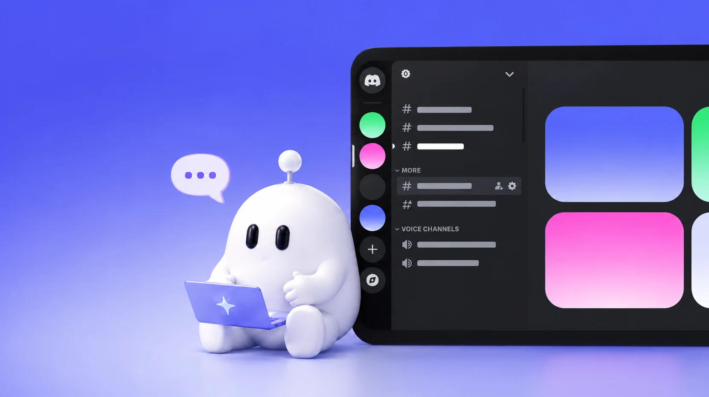
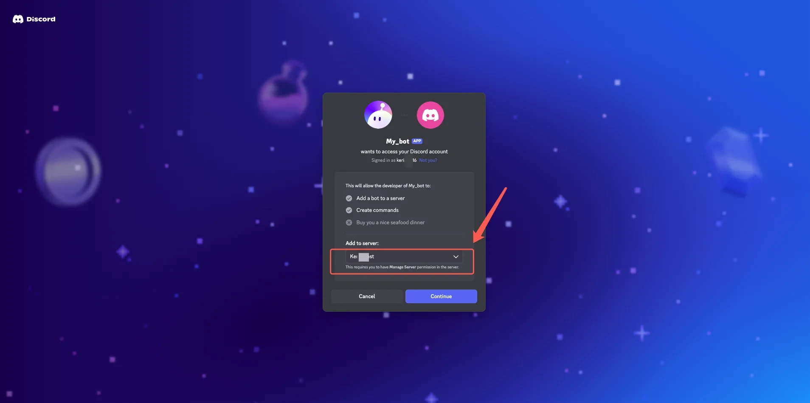
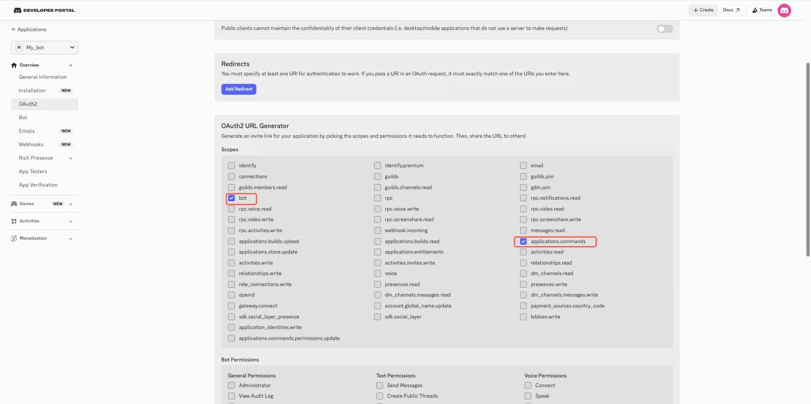
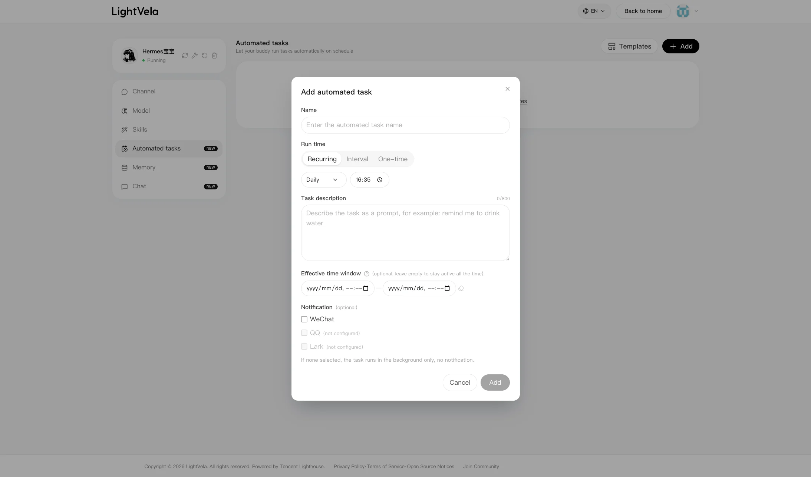
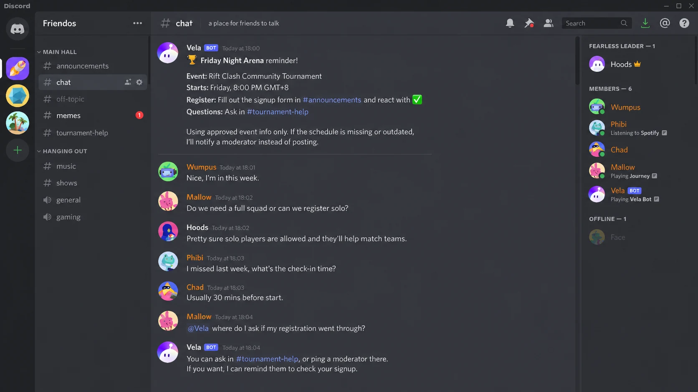

# Perkasakan Discord Bot Acara anda dengan Keupayaan AI-Agentic

## Ringkasan

**Bot acara Discord menjadi lebih berguna apabila ia boleh menerangkan maklumat acara yang diluluskan, menjawab soalan ulangan, menyokong onboarding dan menghantar peringatan berjadual daripada satu Hermes Agent yang dikonfigurasikan.** Dalam LightVela, laluan praktikal adalah untuk menyambung Discord, berikan Ejen acara ringkas dan soalan keselamatan dan tambahkan sempadan tugasan yang dikonfigurasikan, mengujinya dengan menyempitkan atau menyempitkan peserta, mengujinya dengan menyempitkan atau menyempitkan peserta. ringkasan.

Corak ini adalah yang terbaik untuk kejohanan berulang, serbuan, kumpulan belajar, pelancaran komuniti dan acara lain di mana maklumat yang sama mesti diulang dalam banyak perbualan.



## Untuk siapa ini dan hasil yang dijangkakan

Kes penggunaan ini adalah untuk penganjur acara yang menghabiskan terlalu banyak masa menjawab soalan tentang tarikh, zon masa, pendaftaran, peraturan, lokasi dan peringatan saat akhir.

Hasil yang diharapkan ialah pembantu acara yang memastikan jawapan konsisten dan membantu penganjur mengulangi maklumat yang betul pada masa yang tepat.
Ia harus mengurangkan kerja penyelarasan berulang tanpa menjadi sumber kebenaran untuk keputusan yang hanya boleh dibuat oleh penganjur manusia.

## Prasyarat

- Ejen LightVela Hermes berjalan dengan model yang dikonfigurasikan.

- Pelayan Discord tempat anda boleh menambah dan mengkonfigurasi Bot.

- Ringkas acara yang disemak yang mengandungi nama acara, tarikh, zon waktu, langkah pendaftaran, peraturan, pautan dan saluran hubungan.

- Moderator atau penganjur yang memiliki kemas kini jadual dan meluluskan pengumuman.

- [Discord panduan konfigurasi saluran](../configuration/channel-discord.md) dan [Panduan Tugasan Berjadual](../configuration/automation.md).

## Langkah

### 1. Tukar ringkasan acara menjadi panduan pengendalian Ejen

Mulakan dengan memisahkan fakta yang mungkin diulangi oleh Ejen daripada tindakan yang memerlukan kelulusan penganjur.
Kategori pertama termasuk masa mula diterbitkan, tarikh akhir pendaftaran, peraturan kelayakan dan lokasi saluran.
Kategori kedua termasuk perubahan jadual, pertikaian, bayaran balik, larangan, keputusan hadiah dan pengecualian.

Berikan Ejen panduan operasi ringkas seperti:

```text
You are the event assistant for this Discord community.

Use the approved event brief for dates, time zones, registration, rules, and channel directions.
Answer in short steps and include the exact time zone when discussing schedules.
Never invent a time, rule, registration status, or announcement.
If event information is missing or has changed, direct the member to the event organizer.
Escalate disputes, moderation issues, eligibility exceptions, and prize questions to a human.
```

Pastikan acara ringkas terkini.
Ejen AI boleh membuat jawapan berulang lebih mudah, tetapi ia tidak boleh membuat jadual yang lapuk betul.

### 2. Sambungkan Bot Discord dan pilih permukaan operasi yang sempit

Dalam LightVela, sambungkan saluran Discord dan lengkapkan aliran kebenaran Discord Portal Pembangun.
Gunakan [Discord panduan persediaan](../configuration/channel-discord.md) untuk melengkapkan persediaan:

1. Buat Bot.

2. Dayakan Niat Kandungan Mesej.

3. Konfigurasikan kebenaran keistimewaan paling rendah.

4. Jemput bot dengan kebenaran minimum: Lihat Saluran, Hantar Mesej dan Baca Sejarah Mesej.



Untuk pelancaran pertama, pilih satu saluran acara atau satu perbualan Discord yang disokong dan uji di sana sebelum mengembangkan aliran kerja.
Ini memudahkan untuk memeriksa jawapan, gelagat kebenaran dan penghantaran pemberitahuan.



### 3. Uji soalan yang sebenarnya akan ditanya oleh peserta

Uji Ejen dengan set kecil soalan peserta:

```text
When does the tournament start in UTC+8?

What do I need to do before joining tonight's raid?

Where do I register and when does registration close?

The schedule changed. Can you announce the new time?
```

Tiga soalan pertama harus menghasilkan jawapan yang ringkas dan berasaskan jika ringkasan acara mengandungi maklumat yang diperlukan.
Soalan akhir tidak seharusnya menyebabkan Ejen mencipta pengumuman atau menukar jadual secara senyap.
Ia harus menunjuk kepada penganjur atau proses kemas kini yang diluluskan.

### 4. Gunakan Ejen untuk sokongan peserta

Setelah jawapan teras boleh dipercayai, gunakan Ejen untuk sokongan peserta berulang:

- Terangkan jadual acara dalam zon waktu yang diminta oleh peserta.

- Arahkan ahli baharu kepada pendaftaran, peraturan dan saluran sokongan.

- Ringkaskan langkah-langkah yang diperlukan sebelum menyertai acara.

- Jawab soalan tentang peraturan kelayakan yang diterbitkan.

- Halakan isu sensitif kepada penganjur manusia.

Contoh gesaan mungkin kelihatan seperti ini:

```text
@YourEventBot What do I need to prepare before tonight's raid?

@YourEventBot I am new here. Which channel has the tournament rules?

@YourEventBot Can you summarize the registration steps in three bullets?
```

Gunakan kaedah sebutan atau perbualan yang disokong oleh persediaan Discord sasaran anda.
Jangan menganggap bahawa setiap saluran pelayan atau mod sembang kumpulan mempunyai tingkah laku yang sama.

### 5. Tambahkan peringatan dan ringkasan yang dijadualkan

Gunakan Tugasan Berjadual apabila acara mempunyai kaden yang boleh diramal.
LightVela menyokong larian sekali, hari bekerja tetap dan selang masa tetap, serta tetingkap berkesan pilihan dan saluran pemberitahuan.
Anda boleh memilih hari bekerja tetap, selang masa tetap atau pelaksanaan sekali.
Anda juga boleh menjeda, mengedit atau memadam tugasan yang dijadualkan kemudian.



```text
One day before the tournament, remind the event channel about the start time, time zone, registration deadline, and rules channel.
Use only the approved event brief.
If the brief is missing a detail, tell the organizer which detail needs review.
```

Dalam contoh ini, bot menjalankan tugas berjadual "Peringatan kejohanan permainan".



Anda juga boleh menjadualkan ringkasan selepas acara untuk penganjur:

```text
After the event, summarize the published results, unanswered participant questions, and issues that need moderator review.
Do not infer winners, penalties, or policy decisions from incomplete information.
```

Semak output berjadual pertama sebelum menambah satu siri peringatan.
[Panduan konfigurasi Tugas Berjadual](../configuration/automation.md) menerangkan tempat untuk menetapkan jadual, arahan tugas, tetingkap berkesan dan tetapan pemberitahuan.

## Senarai semak praktikal

| Peringkat acara | Tindakan | LightVela komponen | Hasil yang dijangkakan atau isyarat kegagalan |
| --- | --- | --- | --- |
| Sebelum pelancaran | Tambahkan jadual yang disemak, zon waktu, peraturan, pautan dan laluan peningkatan | Konteks ejen | Peserta boleh mendapatkan jawapan yang diluluskan yang sama |
| Sambungan | Jemput Bot dan uji ia dalam perbualan yang dimaksudkan | Discord saluran | Bot membalas dan hanya mempunyai kebenaran yang diperlukan |
| Sokongan peserta | Tanya jadual, pendaftaran, dan soalan penyediaan | Hermes Agent | Jawapan adalah ringkas, khusus dan berdasarkan ringkasan |
| Peringatan | Jadualkan satu mesej pra-acara | Tugas Berjadual | Mesej tiba dalam saluran yang dipilih pada masa yang dijangkakan |
| Selepas acara | Hasilkan ringkasan untuk penganjur | Tugas Berjadual atau Sembang | Ringkasan ini memisahkan keputusan yang diketahui, soalan terbuka dan susulan manusia |

## Pengesahan dan sempadan

Sahkan aliran kerja acara dengan empat ujian:

1. Minta butiran jadual yang diketahui dan sahkan zon waktu adalah eksplisit.

2. Minta langkah pendaftaran dan sahkan Ejen menunjukkan saluran atau pautan yang betul.

3. Tanya tentang peraturan yang sengaja hilang dan sahkan Ejen mengaku tidak tahu.

4. Minta perubahan jadual atau keputusan penyederhanaan dan sahkan Ejen meningkat daripada membuat keputusan.

Dokumentasi saluran Discord semasa meliputi kebenaran Bot, interaksi pelayan dan saluran, akses kandungan mesej dan mesej proaktif pada lapisan saluran.
Ia juga mencatatkan had semasa di sekitar sokongan sembang kumpulan.
Sahkan sebutan tepat dan tingkah laku interaksi berbilang pengguna dalam pelayan sasaran anda sebelum menjanjikan pembantu acara berasaskan @sebutan yang luas.

Ejen tidak boleh dipercayai untuk meluluskan peserta, mengeluarkan penalti, menyelesaikan pertikaian, mengumumkan perubahan jadual yang belum disemak atau mengendalikan rahsia.
Penganjur manusia tetap bertanggungjawab ke atas sumber kebenaran rasmi acara itu.

## Soalan Lazim

### Bolehkah Ejen menjawab soalan acara dalam zon waktu yang berbeza?

Ia boleh menerangkan masa acara yang diterbitkan apabila ringkasan acara termasuk zon waktu sumber dan peserta menyediakan zon waktu sasaran.
Minta ia memasukkan kedua-dua masa asal dan masa yang ditukar supaya peserta boleh mengesahkan keputusan.

### Bolehkah Tugas Berjadual menghantar peringatan acara Discord?

Ya, dokumentasi saluran Discord menyenaraikan mesej proaktif seperti yang disokong pada lapisan saluran.
Buat Tugasan Berjadual dengan teks peringatan, jadual, tetingkap berkesan dan saluran pemberitahuan, kemudian uji penghantaran pertama sebelum bergantung padanya untuk tarikh akhir yang kritikal.

### Bolehkah Ejen mengemas kini jadual acara dengan sendirinya?

Tidak.
Ia harus mengulangi jadual yang diluluskan dan mengarahkan perubahan yang dicadangkan kepada penganjur.
Kemas kini ringkasan acara dan semak respons seterusnya sebelum menerbitkan masa yang diubah.

### Adakah ini pengganti untuk bot acara tersuai?

Bukan selalu.
LightVela sesuai apabila keperluan utama ialah Soal Jawab bahasa semula jadi, panduan acara berasaskan dan komunikasi berjadual.
Bot tersuai mungkin lebih baik untuk arahan yang sangat khusus, pendaftaran yang disokong pangkalan data, pengurusan kurungan atau aliran kerja tiket luaran.

## Kesimpulan

Berikan Ejen ringkasan acara yang disemak, sambungkannya ke Discord, uji soalan peserta sebenar dan tambah satu Tugasan Berjadual yang sempit untuk peringatan atau ringkasan.
Urutan itu menambahkan gelagat ejen AI yang berguna pada bot acara sambil menyerahkan kuasa acara, perubahan dasar dan keputusan sensitif kepada penganjur manusia.

Untuk corak komuniti yang lebih luas, lihat [Bertemu LightVela untuk Discord: Ejen AI Anda Discord Bot Melayan Saluran Anda](./discord-community-agent.md).
