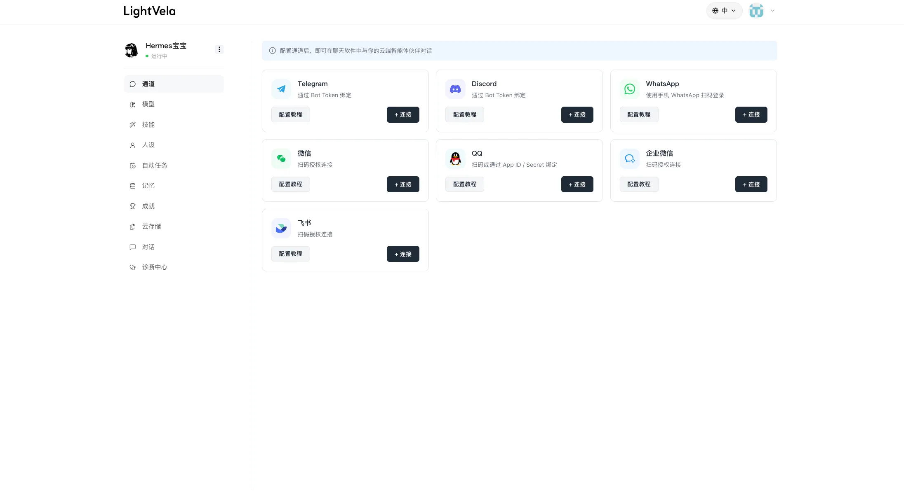
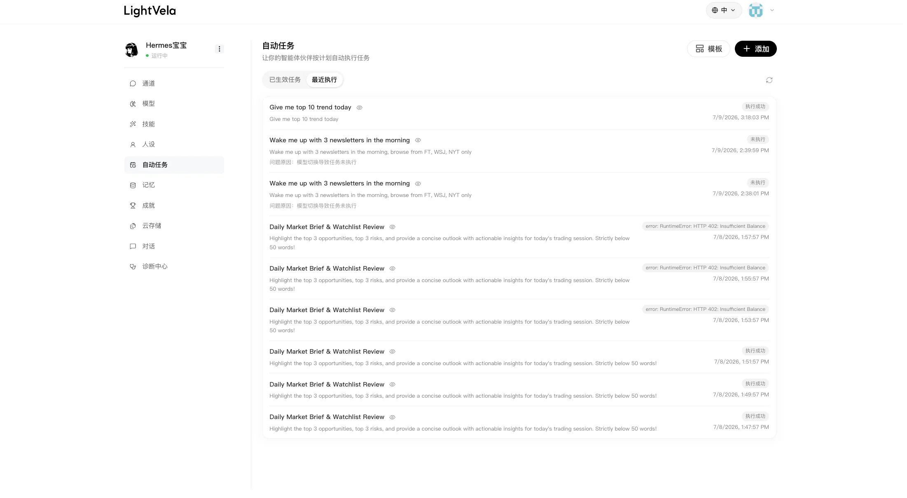

# Cara Mengekalkan Hermes Agent Dalam Talian 24/7

## Ringkasan

**A Hermes Agent kekal tersedia sepanjang masa kerana ia berjalan pada tika awan dan bukannya mesin tempatan anda. Setelah model dan sekurang-kurangnya satu saluran dikonfigurasikan, ia menggunakan memori dan gelagat yang sama tidak kira dari mana titik masuk anda menghantar mesej.** Tiga perkara mesti disediakan untuk ketersediaan jangka panjang yang tulen: model yang dikonfigurasikan dengan kuota akaun yang boleh digunakan (kredit percubaan yang kehabisan menyebabkan tiada balasan senyap), sekurang-kurangnya satu saluran dipaparkan sebagai disambungkan dan tugas yang dijadualkan untuk menampung kerja yang dijadualkan semasa anda tiada. Jangan menilai ketersediaan daripada status konsol sahaja — hantar mesej sebenar melalui saluran sebenar. Apabila sesuatu pecah, lihat dan eksport log terbaharu dalam Diagnostik (julat 1, 3, 6, 12 atau 24 jam yang boleh dipilih) untuk mencari punca.


## Untuk siapa ini

Gunakan corak ini jika anda mahukan pembantu yang boleh anda jangkau daripada telefon anda, saluran pasukan atau konsol tanpa memastikan komputer berjalan. Ia juga sesuai untuk rutin berjadual seperti taklimat harian, peringatan atau semakan status berulang.

Berada dalam talian tidak sama dengan tidak dijaga. Anda masih harus memilih kemahiran yang dipercayai, menyemak arahan berulang dan pastikan model dan saluran terus berfungsi seperti yang diharapkan.

## Prasyarat

- Hermes Agent yang sedang berjalan dalam konsol LightVela anda. [Quickstart](../02-quickstart.md) meliputi persediaan akaun dan penciptaan pertama.

- Konfigurasi model yang berfungsi atau kredit percubaan yang tersedia. Hermes memerlukan model sebelum ia boleh menjana balasan.

- Sekurang-kurangnya satu saluran yang disambungkan, seperti Telegram, WhatsApp, Discord, Slack, atau WeChat, jadi anda mempunyai cara yang praktikal untuk mencapainya.

- Tugasan berulang pilihan jika anda mahu Hermes untuk melakukan lebih daripada menunggu mesej.

## Langkah / konsep utama

### 1. Jadikan Ejen boleh dihubungi daripada saluran yang sebenarnya anda gunakan

Pilih satu saluran sebagai cara lalai anda untuk menghubungi Hermes. Untuk kegunaan peribadi, pilihan terbaik biasanya apl yang anda sudah semak beberapa kali sehari. Sambungkannya, hantar mesej ujian ringkas dan pastikan Hermes balasan sebelum menambahkan lagi persediaan.

Arahan terperinci tersedia untuk [Telegram](../configuration/channel-telegram.md), [WhatsApp](../configuration/channel-whatsapp.md), [Discord](../configuration/channel-discord.md), [Slack](../configuration/channel-slack.md), dan [WeChat](../configuration/channel-wechat.md).



### 2. Pastikan konfigurasi kerja mudah dan kelihatan

Bahagian penting ialah model aktif, saluran yang disambungkan, kemahiran yang dipasang, dan ingatan. Anda tidak perlu menukarnya dengan kerap, tetapi ia membantu untuk mengetahui di mana mereka tinggal apabila balasan tidak tiba atau tugas memerlukan keupayaan baharu.

Gunakan [Configure Models](../configuration/model.md) untuk mengesahkan model aktif dan simpan nota tentang pembekal atau situasi kredit percubaan. Jika anda memasang kemahiran, tambahkan kemahiran yang diperlukan sahaja untuk aliran kerja sebenar dan semak kemahiran tersebut dalam [Konfigurasikan Kemahiran](../configuration/skill.md).

### 3. Gunakan memori untuk memastikan pembantu berterusan

Pembantu sentiasa hidup menjadi lebih berguna apabila ia tidak bermula dari awal. Beritahu Hermes keutamaan dan konteks kerja yang anda ingin bawa ke dalam perbualan akan datang, kemudian semaknya dari semasa ke semasa dalam [Pengurusan Memori](../configuration/memory.md).

Contohnya:

```text
Remember that I prefer updates in bullet points and that urgent work
should be labeled clearly.
```

Ini membolehkan mesej yang dihantar daripada peranti lain atau saluran yang disokong meneruskan hubungan kerja yang sama dan bukannya bermula dengan halaman kosong.

### 4. Tambahkan tugas berjadual apabila ketersediaan harus membawa kepada tindakan

Hermes dalam talian boleh menunggu mesej anda, tetapi tugas berjadual kecil membolehkannya memulakan rutin yang diketahui pada masa yang sesuai. Mulakan dengan satu tugas yang mempunyai syarat kejayaan yang jelas:

```text
Every weekday at 8:30 AM, prepare a short briefing with today’s
calendar priorities, open follow-ups, and the first action to take.
```

Cipta jadual dalam [Tugas Berjadual](../configuration/automation.md), pilih saluran pemberitahuan jika sesuai dan semak beberapa larian pertama. Jika keputusan terlalu luas, jadikan arahan itu lebih khusus daripada menambah tugas berjadual lain dengan segera.



## Soalan Lazim

### Adakah Hermes memerlukan komputer riba saya untuk terus hidup?

Tidak. Hermes berjalan dalam persekitaran awan LightVela, jadi anda boleh menutup peranti tempatan anda selepas Ejen dan salurannya dikonfigurasikan.

### Mengapa Hermes dalam talian tetapi tidak membalas?

Mula-mula sahkan sambungan saluran dan model aktif atau status kredit percubaan. Jika anda menukar konfigurasi baru-baru ini, benarkan kemas kini selesai, kemudian hantar mesej ujian ringkas sekali lagi. Halaman [Diagnostik](../configuration/diagnostics.md) boleh membantu dengan penyelenggaraan dan log terkini.

### Bolehkah saya menyambung lebih daripada satu saluran?

ya. Saluran yang disokong boleh menghala ke Hermes Agent yang sama. Mereka berkongsi gelagat dan ingatan Ejen yang sama, jadi pilih satu saluran lalai dan tambahkan yang lain hanya apabila mereka menyelesaikan keperluan akses sebenar.

### Adakah Ejen 24/7 selamat untuk diautomasikan?

Gunakan hanya arahan yang berskop baik dan kemahiran yang dipercayai. Mulakan dengan rutin baca sahaja atau berisiko rendah, semak output dan elakkan memberi kuasa tugas berjadual untuk melakukan tindakan yang anda tidak mahu berulang secara automatik.

## Langkah seterusnya

- [Tugas Berjadual](../configuration/automation.md) — jadualkan kerja yang sepatutnya dilakukan tanpa gesaan manual.

- [Pengurusan Memori](../configuration/memory.md) — pastikan pilihan berguna tersedia merentas perbualan.

- [Diagnostik](../configuration/diagnostics.md) — menyiasat isu saluran atau model apabila Hermes tidak bertindak balas.
