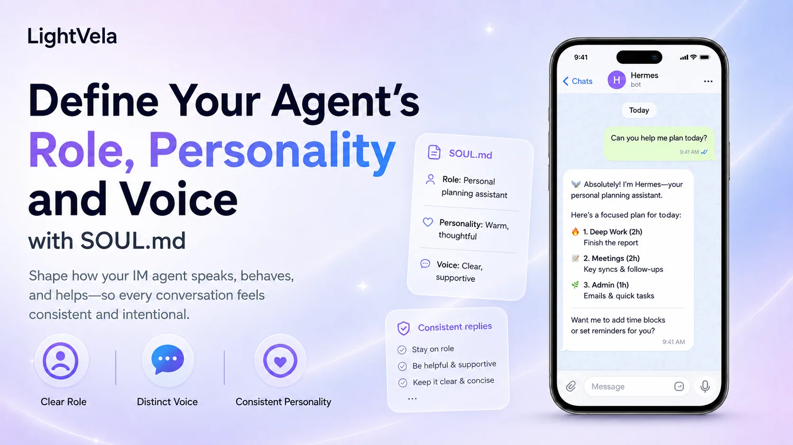

# Cara Menentukan Peranan, Personaliti dan Suara Ejen IM dengan SOUL.md

## Ringkasan

**Sama ada Ejen IM berasa seperti "orang yang sama" bergantung pada personanya, bukan pada saluran mana yang dilaluinya. `SOUL.md` membawa peranan, nada, keutamaan, tingkah laku dan had, dan ia merupakan fail persona teras dalam masa jalan Hermes.** Pada LightVela anda tidak sekali-kali menyentuh sistem fail awan secara langsung — bahagian Persona pada halaman tetapan Ejen menawarkan dua titik masuk, melukis persona secara rawak atau menjawab kuiz pendek. Semak nota peranan, nada dan tingkah laku kad persona, kemudian pilih Inject Persona untuk menerapkannya. Tulis prinsip yang boleh dinilai dan bukannya fakta khusus: "memimpin dengan kesimpulan", "nyatakan ketidakpastian secara eksplisit", dan "sahkan sebelum menghantar mesej luar" adalah peraturan persona, manakala nama projek dan port tergolong dalam ingatan jangka panjang. Selepas menyuntik, sahkan nada dan had dengan satu perbualan sebenar.



## Untuk siapa ini

Panduan ini adalah untuk orang yang ingin memberikan Ejen IM peranan yang stabil, seperti pembantu peribadi, rakan kongsi penyelidikan, teman belajar atau pembantu komunikasi pelanggan setiap hari.
Jika anda belum memilih saluran pemesejan lagi, mulakan dengan [Cara Menghubungkan Ejen AI ke Platform Pemesejan](./chinese-messaging-channels.md).

## Fahami tiga lapisan konteks dahulu

### `SOUL.md`: siapa Ejen dan cara ia berfungsi

`SOUL.md` adalah yang terbaik untuk peraturan persona yang stabil, termasuk peranan, suara, keutamaan, tingkah laku dan sempadan.
Peraturan seperti "berikan kesimpulan dahulu", "nyatakan ketidakpastian dengan jelas", dan "tanya sebelum menghantar mesej luar" ada di sini.

### Profil pengguna: siapa anda dan bagaimana anda mahu dilayan

Profil pengguna adalah yang terbaik untuk bahasa, zon waktu, identiti, latar belakang dan pilihan komunikasi anda.
Contohnya, "Saya di Singapura", "gunakan bahasa Inggeris secara lalai", dan "tunjukkan tarikh akhir dahulu" biasanya merupakan pilihan pengguna, bukan peraturan identiti Ejen.

### Ingatan jangka panjang: apa yang telah anda wujudkan bersama

Memori jangka panjang adalah yang terbaik untuk keadaan projek, keputusan dan konteks boleh guna semula daripada kerja kongsi anda.
Ia berkembang melalui perbualan berterusan dan boleh disemak atau diuruskan kapasiti dalam [Pengurusan Memori](../configuration/memory.md).

Mencampurkan ketiga-tiganya menjadikan identiti Ejen, pilihan pengguna dan konteks projek sementara mengganggu satu sama lain.
Mengekalkan mereka berasingan membolehkan personaliti kekal stabil sementara perbualan menyesuaikan diri dengan pengguna dan kerja sebenar.

## Prasyarat

- Ejen LightVela Hermes yang sedang berjalan.
  Jika anda belum menciptanya lagi, mulakan dengan [Mula Pantas](../02-quickstart.md).

- Model yang dikonfigurasikan dan sekurang-kurangnya satu saluran perbualan yang tersedia.

- Ringkas persona yang pendek.
  Tentukan siapa yang Ejen berkhidmat, apa yang dilakukan terutamanya, bagaimana ia sepatutnya berbunyi, dan tindakan mana yang sentiasa memerlukan pengesahan.

## Langkah / konsep utama

### 1. Tentukan matlamat persona dengan lima soalan

Sebelum memilih Jiwa, jawab lima soalan ini:

- Siapa Ejen?

- Siapa yang membantu terutamanya?

- Bagaimanakah ia sepatutnya berbunyi?

- Apakah yang perlu dilakukan apabila maklumat tidak pasti?

- Tindakan luar yang manakah memerlukan pengesahan terlebih dahulu?

Tukar jawapan menjadi ringkasan perancangan seperti ini:

```text
Role: A research assistant for personal projects
Audience: A user who wants reliable conclusions quickly
Voice: Concise, professional, friendly, conclusion first, evidence second
Behavior: Break down questions, flag uncertainty, and ask only one key question when needed
Boundaries: Never send external messages, change files, or take high-risk actions without confirmation
```

Templat ini membantu anda memilih dan menentukur persona.
Ini tidak bermakna LightVela mendedahkan editor tujuan umum untuk fail awan sewenang-wenangnya.

### 2. Buka Personaliti dalam tetapan Ejen

Dalam konsol LightVela, buka sasaran Hermes tetapan ejen dan pilih "Personaliti".
Tapak antarabangsa menyediakan kedua-dua titik masuk "Draw random soul" dan "Soul personality test".

Gunakan cabutan rawak untuk meneroka gaya peranan yang berbeza.
Gunakan ujian personaliti apabila anda inginkan Jiwa yang lebih sepadan dengan pilihan komunikasi dan tingkah laku anda.

Semak perihalan peranan, suara dan tingkah laku pada setiap kad, kemudian pilih yang paling sepadan dengan ringkasan perancangan anda.

### 3. Suntikan Jiwa yang dipilih ke dalam `SOUL.md`

Pilih Jiwa dan klik "Suntikan jiwa".
LightVela menulis Jiwa yang dipilih ke Hermes Agent `SOUL.md` semasa dan menyimpan sandaran sebelum menggantikan fail sedia ada.

Hanya satu personaliti yang aktif untuk Ejen pada satu masa.
Jika anda ingin menukar peranan, semak sempadan kad baharu sebelum menyuntiknya semula.

Selepas suntikan berjaya, kembali ke saluran IM anda dan hantar:

```text
/new
```

Hermes Agent membaca `SOUL.md` baharu apabila perbualan baharu bermula.
Ini penting kerana perbualan sedia ada mungkin masih menyimpan petikan persona sebelumnya.

### 4. Tambah pilihan pengguna dan fakta tahan lama melalui perbualan

Jangan masukkan setiap maklumat ke dalam `SOUL.md`.
Pastikan persona yang stabil pendek, dan biarkan profil pengguna dan ingatan jangka panjang mengendalikan pilihan peribadi dan fakta projek.

Sebagai contoh, beritahu Hermes:

```text
Remember that I am in Singapore time and want a concise weekday plan at 8:00 AM, with deadlines listed first.
```

Atau:

```text
Forget the Friday evening reminder preference I mentioned earlier. Do not schedule it again.
```

Hermes mengendalikan ingat dan lupakan permintaan melalui perbualan.
Gunakan [Pengurusan Memori](../configuration/memory.md) untuk menyemak kandungan dan kapasiti Memori dan Profil Pengguna.

### 5. Pasang kemahiran hanya untuk kerja sebenar

Personaliti mentakrifkan cara Ejen berfungsi, tetapi ia tidak secara automatik menambah keupayaan luaran.
Jika anda mahu ia menyemak imbas, menyusun bahan, mencari maklumat atau melaksanakan tugas konkrit lain, pasang kemahiran yang sesuai dan semak sumber dan kebenarannya terlebih dahulu.

Mulakan dengan [Konfigurasikan Kemahiran](../configuration/skill.md).
Kemahiran dan keperibadian harus menguatkan satu sama lain, bukan menggunakan kemahiran berisiko tinggi untuk mengimbangi sempadan persona yang tidak jelas.

## Sahkan bahawa personaliti itu aktif

Selepas memulakan perbualan baharu, lakukan lebih daripada sekadar meminta pengenalan diri.
Uji sekurang-kurangnya empat kes ini:

```text
What is your current role, main job, and default voice?
```

```text
How do you respond when you are uncertain about a fact?
```

```text
If I ask you to send a message to an external service, what do you do first?
```

```text
Turn this material into conclusions, evidence, and questions that still need confirmation.
```

Semak sama ada Ejen mengekalkan peranan, suara dan sempadan keselamatan, dan sama ada ia masih boleh menggunakan konteks yang berkaitan daripada profil pengguna dan ingatan jangka panjang.
Jika tingkah laku tidak stabil, mudahkan peraturan persona sebelum memilih atau menyuntik Jiwa yang lain.

## Soalan Lazim

### Adakah saya perlu mengedit awan `SOUL.md` secara manual?

Selalunya tidak.
Entri Personaliti LightVela menjana dan menyuntik Jiwa, jadi penggunaan biasa tidak memerlukan operasi sistem fail awan langsung.

### Adakah perubahan `SOUL.md` menjejaskan setiap saluran pemesejan?

Ia mempengaruhi tingkah laku peringkat Ejen untuk Hermes Agent yang sama.
Jika Ejen itu disambungkan ke Telegram dan WhatsApp, kedua-dua saluran menggunakan personaliti dalam perbualan baharu, manakala setiap saluran masih mempunyai kebenaran sendiri, format mesej dan had keupayaan.

### Bolehkah `SOUL.md` menggantikan memori?

Tidak.
`SOUL.md` harus menerangkan peraturan identiti dan tingkah laku yang stabil, manakala ingatan harus mengekalkan fakta yang berubah, konteks projek dan pengalaman dikongsi.

### Bolehkah seorang Ejen mempunyai beberapa personaliti aktif pada masa yang sama?

Pada masa ini, seorang Ejen mempunyai satu personaliti aktif pada satu masa.
Jika anda memerlukan peranan yang sama sekali berbeza, cipta Ejen berasingan dan bukannya berulang kali menimpa Jiwa pada satu Ejen.

### Bilakah saya perlu menghantar `/new`?

Hantar `/new` dalam saluran IM selepas menyuntik personaliti baharu.
Ini menjadikannya jelas bahawa Jiwa baharu harus dimuatkan semasa permulaan perbualan.

## Langkah seterusnya

- [Cara Mengkonfigurasi Hermes Agent dengan Personaliti Terbeza dalam Telegram](./telegram-persona-agent.md) - Gunakan personaliti pada perbualan 1-ke-1 Telegram.

- [Cara Mengkonfigurasi Hermes Agent dengan Personaliti Terbeza dalam WhatsApp](./whatsapp-persona-agent.md) - Gunakan personaliti pada perbualan 1-ke-1 WhatsApp.

- [Dari Mana Hermes Personaliti Ejen Berasal](../hermes-agent/10-persona-user-memory.md) - Fahami Persona, pilihan pengguna dan ingatan jangka panjang dengan lebih mendalam.

- [Cloud Storage](../configuration/files.md) - Urus bahan rujukan dan fail kerja yang boleh digunakan oleh Ejen.
