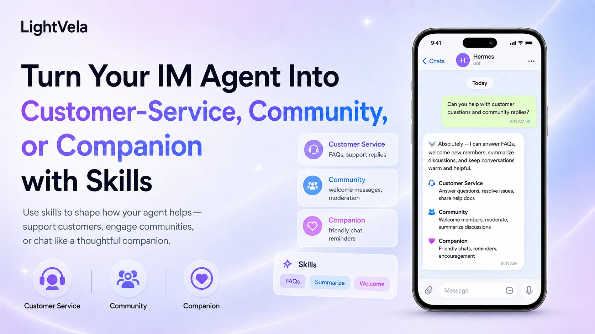

# Cara Mengubah Ejen IM menjadi Pembantu Khidmat Pelanggan, Komuniti atau Rakan dengan Kemahiran

## Ringkasan

**Menukarkan satu Ejen IM menjadi ejen sokongan, pembantu komuniti atau sahabat AI berpunca daripada pembahagian antara Kemahiran dan persona: Kemahiran memanjangkan perkara yang boleh dilakukannya, manakala `SOUL.md` mentakrifkan siapa itu dan dalam had yang ia bertindak.** Kedua-duanya diperlukan — Kemahiran tanpa persona menghasilkan jawapan yang tidak konsisten, dan persona tanpa Kemahiran tidak mempunyai kaedah yang boleh digunakan semula. Pada LightVela, kemahiran datang daripada pasaran awam Skills.sh dan ClawHub; hari ini anda memasang atau mengalih keluarnya dengan memberitahu Hermes dalam perbualan (pemasangan panel konsol akan datang tidak lama lagi), kemudian sahkan ketersediaan dalam sembang. Tiga senario berbeza terutamanya dalam reka bentuk sempadan: sokongan memerlukan syarat peningkatan yang jelas, pembantu komuniti perlu mengetahui masa untuk berdiam diri dan penggunaan teman memerlukan topik luar had yang jelas. Bekerja melalui senarai semak keselamatan sebelum disiarkan secara langsung.

## Untuk siapa ini

Panduan ini adalah untuk orang yang telah menyambungkan Telegram, WhatsApp atau saluran pemesejan lain dan ingin menggunakan Ejen untuk aliran kerja konkrit.

Ia amat berguna untuk petunjuk sokongan, pengendali komuniti dan individu yang mahukan pendamping AI yang boleh bekerja dengan mereka dari semasa ke semasa.

## Prasyarat

- Ejen LightVela Hermes yang sedang berjalan.
  Jika anda belum menciptanya lagi, mulakan dengan [Mula Pantas](../02-quickstart.md).

- Saluran pemesejan yang sudah boleh mengendalikan perbualan biasa.
  Anda boleh mulakan dengan [Cara Mengkonfigurasi Hermes Agent dengan Personaliti Terbeza dalam Telegram](./telegram-persona-agent.md) atau [Cara Mengkonfigurasi Hermes Agent dengan Personaliti Terbeza dalam WhatsApp](./whatsapp-persona-agent.md).

- Takrifan pertama aliran kerja sasaran, tindakan yang dibenarkan dan situasi yang memerlukan penyerahan manusia.

- Kemahiran dipercayai dipilih daripada [Skills.sh](https://skills.sh/) atau [ClawHub](https://clawhub.ai/).

## Memahami sempadan antara Kemahiran dan personaliti

Kemahiran ialah pakej keupayaan boleh panggil, seperti penyemakan imbas web, organisasi kandungan, ringkasan harian atau aliran kerja khusus.

SOUL.md adalah lebih baik untuk menerangkan siapa Ejen itu, cara ia bercakap, cara ia membuat keputusan dan tindakan yang memerlukan pengesahan.

Profil pengguna dan ingatan jangka panjang adalah untuk identiti, keutamaan, fakta yang disahkan dan konteks berterusan anda.

Jangan letakkan skrip pelanggan, peraturan kumpulan dan kebenaran berisiko tinggi ke dalam satu perihalan personaliti yang tidak dibezakan.

## Langkah

### 1. Tentukan senario utama Ejen

Senario yang berbeza memerlukan kombinasi Kemahiran dan sempadan keselamatan yang berbeza.

| Senario | Matlamat utama | Arah kemahiran | Sempadan untuk menentukan dahulu |
|---|---|---|---|
| Perkhidmatan pelanggan | Jawab soalan biasa dan laluan permintaan kompleks | Pengambilan pengetahuan, organisasi tiket, carian pesanan | Meningkatkan ketidakpastian dan jangan sekali-kali menjanjikan bayaran balik atau menukar pesanan tanpa kebenaran |
| Pembantu komuniti | Selamat datang ahli, jawab Soalan Lazim, rumuskan perbincangan | Pengambilan semula kandungan, ringkasan, peringatan berjadual | Elakkan spam, lindungi maklumat ahli dan jangan buat keputusan penyederhanaan untuk pentadbir |
| Rakan AI | Tawarkan persahabatan yang konsisten, peringatan dan kerjasama jangka panjang | Organisasi memori, penjadualan, penjanaan kandungan | Hormati penolakan dan privasi, elakkan tingkah laku membina pergantungan dan nyatakan ketidakpastian |

Mulakan dengan satu senario utama dan bukannya memasang banyak Kemahiran sekaligus.

### 2. Sediakan bahan rujukan dan ringkasan personaliti

Untuk perkhidmatan pelanggan, sediakan Soalan Lazim produk, waktu perkhidmatan, laluan peningkatan dan butiran hubungan manusia.

Untuk operasi komuniti, sediakan mesej alu-aluan, soalan lazim, peraturan komuniti dan format ringkasan.

Untuk rakan AI, tuliskan nama pilihan, suara, tahap inisiatif dan topik yang sepatutnya berada di luar skop.

Letakkan bahan rujukan yang Hermes perlu merujuk dalam [Cloud Storage](../configuration/files.md), dan letakkan peraturan personaliti yang stabil ke dalam SOUL.md melalui [Personaliti dan SOUL.md](./im-agent-persona-soul-md.md).

### 3. Pilih dan pasang Kemahiran

LightVela kini menyokong meminta Hermes memasang Kemahiran daripada Skills.sh atau ClawHub melalui perbualan.

Hantar permintaan seperti ini dalam saluran yang disambungkan:

Sila pasang Skill yang sesuai untuk mengatur Soalan Lazim perkhidmatan pelanggan daripada Skills.sh atau ClawHub, dan mula-mula terangkan kebenaran yang diperlukannya.

Jika anda sudah mengetahui nama Skill, nyatakan:

Sila pasang [Nama kemahiran]. Mula-mula beritahu saya apa yang akan dibaca, perkhidmatan luaran yang akan dipanggil dan sama ada ia boleh menghantar mesej proaktif.

Entri pemasangan Kemahiran visual konsol masih tertakluk pada status halaman semasa, jadi lihat [Konfigurasikan Kemahiran](../configuration/skill.md) untuk aliran pemasangan yang disokong.

Kemahiran berisiko tinggi boleh meminta pengesahan kedua sebelum pemasangan.

Sebelum mengesahkan, semak sumber Kemahiran, kebenaran, panggilan API luaran dan tingkah laku proaktif.

### 4. Sahkan Kemahiran untuk senarionya

Uji Kemahiran baharu dalam perbualan 1 lawan 1 sebelum mendedahkannya kepada khalayak yang ramai.

Untuk perkhidmatan pelanggan, mulakan dengan:

Jawab soalan ini menggunakan FAQ yang disediakan. Jika bahan tidak mengandungi jawapan, nyatakan dengan jelas dan cadangkan serahan manusia.

Untuk pembantu komuniti, mulakan dengan:

Ringkaskan perbincangan ini dalam tidak lebih daripada lima perkara dan senaraikan soalan yang masih belum ada kesimpulan.

Untuk rakan AI, mulakan dengan:

Gunakan suara saya yang dikonfigurasikan untuk memberi saya daftar masuk singkat untuk hari ini, dan terangkan butiran yang akan disimpan sebagai ingatan jangka panjang.

Semak sama ada Ejen memanggil Kemahiran yang diharapkan, menggunakan bahan rujukan yang betul dan berhenti untuk menerangkan had apabila ia tidak pasti.

### 5. Gunakan tugas berjadual untuk kerja berulang

Mesej alu-aluan, Soalan Lazim, ringkasan dan peringatan boleh menggunakan pencetus yang berbeza.

Gunakan [Tugas Berjadual](../configuration/automation.md) untuk kerja yang sepatutnya dijalankan pada masa yang ditetapkan, seperti menghantar ringkasan komuniti harian atau mengingatkan pasukan sokongan tentang kes yang tidak dapat diselesaikan.

Sahkan kaedah pemberitahuan dan saluran sasaran untuk setiap tugas yang dijadualkan dan bukannya menganggap setiap saluran boleh menerima jenis mesej proaktif yang sama.

## Pengesyoran mengikut senario

### Pembantu perkhidmatan pelanggan

Biarkan Skill mendapatkan maklumat, mengatur konteks dan draf balasan, sementara SOUL.md memastikan Ejen profesional, jelas dan diukur.

Untuk bayaran balik, perubahan harga, semakan identiti, pemadaman data dan tindakan berisiko tinggi yang lain, memerlukan Ejen untuk menerangkan kesannya dan menunggu pengesahan manusia.

Apabila bahan rujukan tidak lengkap, pengguna semakin meningkat, atau permintaan di luar skop yang dibenarkan, serahkan dan bukannya meneka.

### Pembantu komuniti

Biarkan Skill mendapatkan Soalan Lazim, mengeluarkan perkara perbincangan dan draf peringatan, manakala ringkasan personaliti memastikan Ejen sejajar dengan nada komuniti dan peraturan pentadbir.

Akses kumpulan, pencetus @sebutan, kebenaran dan penghantaran mesej bergantung pada saluran, jadi baca dokumentasi saluran yang berkaitan sebelum mengkonfigurasi aliran kerja.

Jika saluran sasaran tidak menyokong sembang kumpulan pada masa ini, sahkan aliran kerja Kemahiran dan kandungan dalam perbualan 1-ke-1 dan bukannya menganggap artikel ini sebagai persediaan sembang kumpulan langsung.

### Rakan AI

Gunakan SOUL.md untuk gaya persahabatan yang stabil dan gunakan memori serta profil pengguna untuk pilihan yang disahkan dan konteks jangka panjang.

Peringatan proaktif harus mempunyai kekerapan yang jelas, kaedah jeda dan waktu senyap, supaya inisiatif tidak menjadi pemesejan tanpa had.

Jika anda mahu Hermes mengekalkan keutamaan, minta ia mengingati keutamaan dalam perbualan; jika anda tidak mahu ia dikekalkan lagi, minta ia melupakannya.

## Senarai semak keselamatan

- Sahkan sumber Kemahiran, kebenaran dan kebergantungan perkhidmatan luaran sebelum pemasangan.

- Gunakan perbualan 1-dengan-1 dan bahan berisiko rendah semasa ujian.

- Memerlukan pengesahan sebelum menghantar mesej luaran, menukar pesanan, memadam fail atau mengambil tindakan tidak boleh balik yang lain.

- Sediakan laluan penyerahan manusia untuk perkhidmatan pelanggan dan aliran kerja komuniti.

- Semak memori, profil pengguna dan Storan Awan secara berkala dan alih keluar maklumat yang tidak diperlukan lagi.

## Soalan Lazim

### Adakah pemasangan Skill akan mengubah personaliti Ejen secara automatik?

Tidak.

Kemahiran terutamanya mengembangkan perkara yang boleh dilakukan oleh Ejen, manakala personaliti ditakrifkan oleh SOUL.md dan konfigurasi yang berkaitan.

Arahan dan output kemahiran boleh menjejaskan gaya satu tugasan, tetapi ia tidak seharusnya menggantikan peranan stabil anda dan takrifan sempadan.

### Bolehkah proses Kemahiran perkhidmatan pelanggan membayar balik secara langsung?

Hanya pertimbangkan tindakan sedemikian apabila kebenaran sistem, peraturan perniagaan dan keperluan pengesahan manusia semuanya jelas.

Secara lalai, biarkan Ejen mencari dasar, draf pengesyoran dan tunggu pengesahan sebelum pelaksanaan.

### Bolehkah pembantu komuniti menyertai kumpulan Telegram secara langsung?

Telegram menyokong mesej kumpulan selepas anda melumpuhkan Privasi Kumpulan dalam BotFather, tambahkan Bot pada kumpulan dan sebutkannya dengan `@bot_username`.
Lihat [Cara Menggunakan Telegram Pembantu Komuniti AI Kumpulan](./telegram-group-community-assistant.md) untuk Soal Jawab kumpulan, ringkasan dan draf peringatan.

### Perlukah saya memasukkan semua bahan rujukan ke dalam ingatan?

Tidak.

Memori jangka panjang adalah untuk sejumlah kecil konteks yang stabil, manakala Soalan Lazim produk, peraturan komuniti dan set rujukan yang besar lebih baik diletakkan dalam [Cloud Storage](../configuration/files.md) atau dibaca atas permintaan oleh Skill.

## Langkah seterusnya

- [Konfigurasikan Kemahiran](../configuration/skill.md) - Semak pemasangan Kemahiran, pengesahan dan panduan keselamatan.

- [Cara Mentakrifkan Peranan, Personaliti dan Suara Ejen IM dengan SOUL.md](./im-agent-persona-soul-md.md) - Reka bentuk persona dan sempadan tingkah laku yang stabil.

- [Cara Menghubungkan Satu Ejen kepada Telegram dan WhatsApp Sambil Mengekalkan Satu Personaliti dan Ingatan Jangka Panjang](./multi-channel-personality-memory.md) - Lanjutkan keupayaan Ejen yang sama kepada berbilang pintu masuk.

- [Cara Menggunakan Telegram Pembantu Komuniti AI Kumpulan](./telegram-group-community-assistant.md) - Lengkapkan persediaan mesej kumpulan dan sediakan Kemahiran untuk Soal Jawab dan ringkasan kumpulan.
