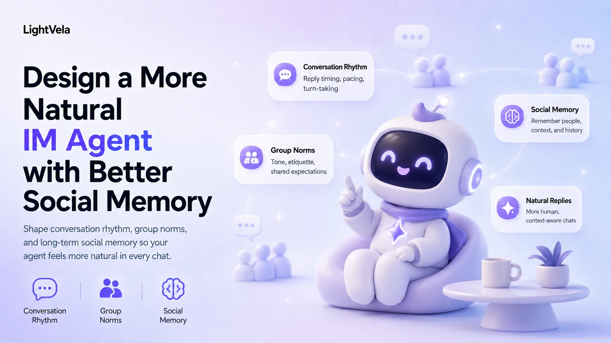

# Cara Reka Bentuk Ejen IM yang Lebih Semulajadi: Irama Perbualan, Norma Kumpulan dan Ingatan Sosial Jangka Panjang

## Ringkasan

**"Lebih seperti hidup" tidak bermakna menyamar sebagai orang sebenar. Ini bermakna mengekalkan tingkah laku yang stabil dan boleh difahami dalam ekspresi, tindak balas dan kerjasama jangka panjang, dan ia datang kepada tiga perkara: irama perbualan, norma kumpulan dan ingatan sosial jangka panjang.** Irama menentukan bila ia menjawab secara ringkas, apabila ia dihuraikan dan bila ia harus berhenti dan menunggu pengesahan. Norma kumpulan menentukan cara ia bercakap dalam ruang kongsi, cara ia memetik konteks dan cara ia menghormati sempadan ahli. Ingatan sosial jangka panjang memutuskan sama ada ia mengekalkan konteks perhubungan yang disahkan tanpa mengubah setiap mesej menjadi rekod kekal. Laksanakan ini secara berlapis: irama dan norma ialah peraturan tahap persona yang stabil, manakala ingatan hanya menyimpan fakta yang disahkan dan tahan lama. Gunakan senarai semak perbualan semula jadi dalam panduan ini untuk mengesahkan reka bentuk.

## Untuk siapa ini

Panduan ini adalah untuk mereka yang mahukan Ejen IM berasa lebih semula jadi dan konsisten sambil kekal telus dan terkawal.

Ia berfungsi untuk pembantu peribadi, rakan belajar, rakan kongsi penyelidikan dan pasukan mereka bentuk pembantu komuniti.

Telegram menyokong mesej kumpulan selepas anda melumpuhkan Privasi Kumpulan dalam BotFather, tambahkan Bot pada kumpulan dan sebutkannya dengan `@bot_username`.
WhatsApp keupayaan kumpulan kekal tertakluk kepada dokumentasi salurannya sendiri, jadi gunakan norma kumpulan ini pada Telegram selepas persediaan dan sahkan sokongan sebelum menggunakan saluran lain.

## Tentukan perkara yang harus kekal stabil

Pisahkan tingkah laku tahan lama Ejen kepada empat lapisan:

| Lapisan | Tanggungjawab | Konfigurasi yang disyorkan |
|---|---|---|
| Personaliti | Peranan, suara, prinsip dan sempadan | SOUL.md |
| Pilihan perhubungan | Nama, bahasa, tahap butiran dan tabiat interaksi | Profil pengguna |
| Memori sosial | Konteks kongsi yang disahkan, latar belakang projek dan perjanjian berterusan | Memori |
| Irama semasa | Konteks perbualan, panjang dan mendesak untuk tugasan ini | Sesi semasa dan gesaan tugas |

Jangan biarkan satu emosi sementara atau balasan yang tidak disengajakan mengubah personaliti yang tahan lama.

Jangan simpan setiap sapaan, setiap mesej ahli kumpulan, atau inferens yang belum disahkan sebagai ingatan sosial jangka panjang.

## Langkah

### 1. Tentukan peranan semula jadi tanpa penyamaran

Gunakan [SOUL.md panduan personaliti](./im-agent-persona-soul-md.md) untuk menentukan peranan, suara, tahap inisiatif dan batasan Ejen.

Mulakan dengan ringkas seperti ini:

Anda ialah rakan kongsi penyelidikan yang stabil, langsung dan mesra.
    Beri kesimpulan dahulu, kemudian tambah bukti dan perincian mengikut keperluan.
    Apabila permintaan itu samar-samar, tanyakan satu-satunya soalan penjelasan yang paling penting.
    Ingat keutamaan jangka panjang yang disahkan, tetapi jangan simpan maklumat sensitif atau kesimpulan yang tidak disahkan.
    Anda adalah pembantu AI. Jangan mengaku sebagai manusia atau berpura-pura mempunyai pengalaman dunia sebenar.

Ini mengekalkan suara yang koheren tanpa membina kepercayaan yang mengelirukan melalui identiti fiksyen.

### 2. Reka irama perbualan

Mulakan dengan peraturan seperti ini:

- Berikan jawapan terus dalam satu hingga tiga ayat untuk soalan fakta yang mudah.

- Nyatakan semula matlamat dan pecahkan langkah dan risiko sebelum mengendalikan tugas yang kompleks.

- Tanya hanya soalan yang paling penting apabila maklumat tiada dan bukannya menghantar borang yang panjang.

- Kurangkan tempoh respons apabila pengguna mengatakan mereka sibuk, tergesa-gesa, atau hanya mahukan kesimpulan.

- Kembangkan alasan apabila pengguna meminta terbitan, tutorial atau retrospektif.

- Berhenti dan tunggu pengesahan sebelum tindakan luaran, sensitif atau tidak boleh diubah.

Sahkan irama dengan tugas sebenar:

Berikan saya tiga tugas paling penting untuk hari ini dalam tiga ayat.

Beri saya kesimpulan dahulu, kemudian terangkan mengapa anda meletakkan mereka dengan cara ini.

Tindakan ini mengubah data luaran. Mula-mula beritahu saya kesan dan perkara yang memerlukan pengesahan.

Semak sama ada Ejen menukar panjang respons dengan tugas dan keutamaan pengguna sambil mengekalkan prinsip yang sama.

### 3. Letakkan pilihan perhubungan dalam profil pengguna

Profil pengguna sesuai untuk bahasa, nama, zon waktu, tahap butiran dan gaya kerja biasa.

Sebagai contoh, pengguna boleh memberitahu Hermes:

Ingat bahawa saya lebih suka balasan ringkas, langsung, kesimpulan-dahulukan.

Pilihan perhubungan harus meningkatkan kecekapan komunikasi, bukan menjadi label personaliti kekal yang tidak boleh diubah oleh pengguna.

Apabila pilihan berubah, minta Hermes untuk mengemas kini atau melupakannya dan bukannya mengedit fail personaliti berulang kali.

### 4. Reka bentuk ingatan sosial jangka panjang

Calon jangka panjang yang baik termasuk konteks projek yang disahkan, perjanjian kerjasama yang tahan lama, nama pilihan yang stabil dan keutamaan yang disahkan berulang kali.

Calon jangka panjang yang lemah termasuk kata laluan, kod pengesahan, maklumat pembayaran, butiran perubatan, pertimbangan psikologi yang tidak disahkan dan ceramah kecil sekali sahaja.

Minta Hermes secara eksplisit mengingati atau melupakan item, dan semak dan bersihkan secara berkala dalam [Pengurusan Memori](../configuration/memory.md).

Ingatan jangka panjang harus mengurangkan soalan berulang tanpa menghilangkan kawalan pengguna ke atas maklumat mereka.

### 5. Sediakan norma kumpulan untuk ruang kongsi

Telegram mesej kumpulan disokong.
Selepas melumpuhkan Privasi Kumpulan, menambahkan Bot pada kumpulan, dan menyebutnya dengan `@bot_username`, gunakan norma kumpulan pada perbualan langsung.

Sebelum menggunakan kumpulan, tentukan sekurang-kurangnya:

- Sama ada Bot membalas hanya selepas @sebutan atau perintah eksplisit.

- Sama ada pentadbir mesti mencetuskan mesej alu-aluan untuk ahli baharu.

- Had kekerapan untuk Soalan Lazim, ringkasan dan peringatan.

- Bagaimana untuk membezakan ahli, pentadbir dan mesej yang memerlukan penyerahan manusia.

- Sama ada mesej ahli memasuki memori kongsi dan cara ia dihalang daripada bocor kepada ahli lain.

- Cara pertikaian, aduan, cadangan penyederhanaan dan kandungan sensitif diserahkan kepada pentadbir.

Norma kumpulan tergolong dalam peraturan saluran dan operasi dan tidak seharusnya bergantung pada gesaan personaliti sahaja.

### 6. Gunakan tugas berjadual untuk mengawal irama proaktif

Mesej proaktif memerlukan kekerapan eksplisit, tetingkap masa, saluran sasaran dan kaedah jeda.

Gunakan [Tugas Berjadual](../configuration/automation.md) untuk peringatan peribadi, ringkasan dalaman atau semakan berkala.

Tetapkan waktu senyap untuk setiap tugas yang dijadualkan dan sahkan bahawa saluran sasaran menyokong kaedah penghantaran proaktif yang berkaitan.

Jangan wujudkan rasa persahabatan melalui mesej frekuensi tinggi dan jangan buat peringatan sukar untuk dihentikan.

## Senarai semak perbualan semula jadi

- Adakah Ejen menjawab soalan sebenar pengguna terlebih dahulu?

- Adakah ia melaraskan panjang kepada kerumitan tugas?

- Adakah ia bertanya soalan penjelasan yang berguna apabila diperlukan?

- Adakah ia mengingati keutamaan yang disahkan dan bukannya meneka psikologi pengguna?

- Adakah masih jelas bahawa ia adalah AI dan bukannya membayangkan identiti sebenar atau pengalaman luar talian?

- Adakah ia menjelaskan kesan dan menunggu pengesahan sebelum tindakan luar?

- Adakah ia menghormati waktu tenang, penolakan dan melupakan permintaan?

## Soalan Lazim

### Adakah menjadi lebih hidup bermakna menyembunyikan bahawa Ejen itu adalah AI?

Tidak.

Bahasa semula jadi, irama yang stabil dan konteks berterusan boleh meningkatkan pengalaman, tetapi Ejen tidak boleh mendakwa sebagai manusia atau mencipta pengalaman dunia sebenar.

### Patutkah saya menyimpan setiap perbualan sebagai ingatan sosial?

Tidak.

Simpan hanya maklumat yang disahkan yang membantu kerjasama masa hadapan, dan semak memori dan profil pengguna dengan kerap.

### Bolehkah saya menggunakan norma kumpulan dalam Telegram dan WhatsApp sekarang?

Anda boleh menggunakan norma kumpulan dalam panduan ini untuk Telegram mesej kumpulan.
Lumpuhkan Privasi Kumpulan, tambahkan Bot pada kumpulan dan sahkan personaliti, irama, Soalan Lazim dan peringatan dengan menyebutnya dengan `@bot_username`.
Untuk WhatsApp atau saluran lain, mula-mula sahkan skop sokongan kumpulan saluran itu sendiri.

### Mengapakah sesetengah Ejen membalas panjang dan yang lain pendek?

Panjang respons mencerminkan kerumitan tugas, gesaan semasa, output model dan pilihan pengguna.

Tetapkan keutamaan dalam profil pengguna, atau nyatakan dalam permintaan semasa bahawa anda hanya mahukan kesimpulan atau terbitan lengkap.

## Langkah seterusnya

- [Cara Mentakrifkan Peranan, Personaliti dan Suara Ejen IM dengan SOUL.md](./im-agent-persona-soul-md.md) - Stabilkan peranan, suara dan sempadan.

- [Pengurusan Memori](../configuration/memory.md) - Urus profil pengguna dan ingatan jangka panjang.

- [Cara Mengubah Ejen IM menjadi Khidmat Pelanggan, Komuniti atau Pembantu Rakan dengan Kemahiran](./im-agent-skill-scenarios.md) - Panjangkan perbualan semula jadi dengan keupayaan konkrit.

- [Cara Menggunakan Telegram Pembantu Komuniti AI Kumpulan](./telegram-group-community-assistant.md) - Lengkapkan persediaan mesej kumpulan dan gunakan norma kumpulan dalam amalan.
