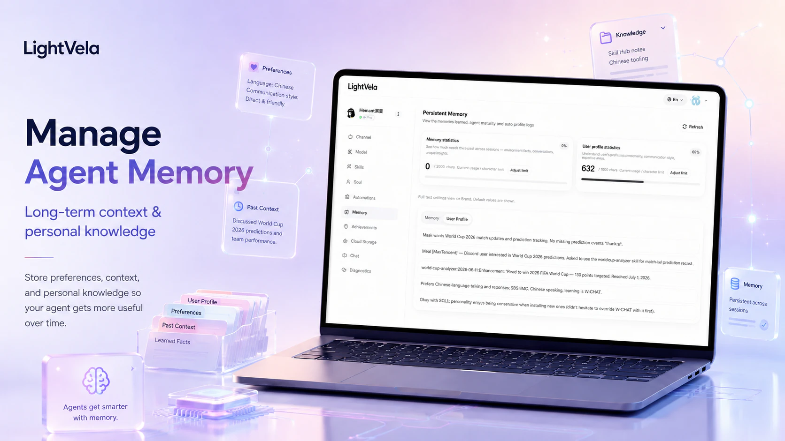
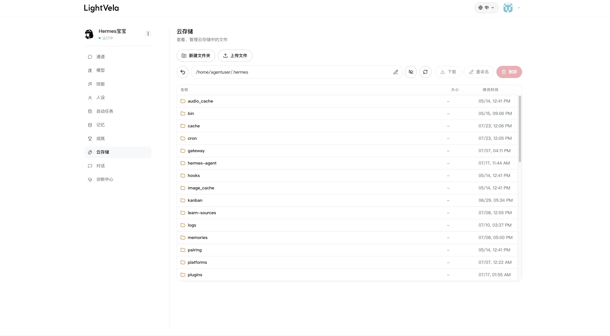
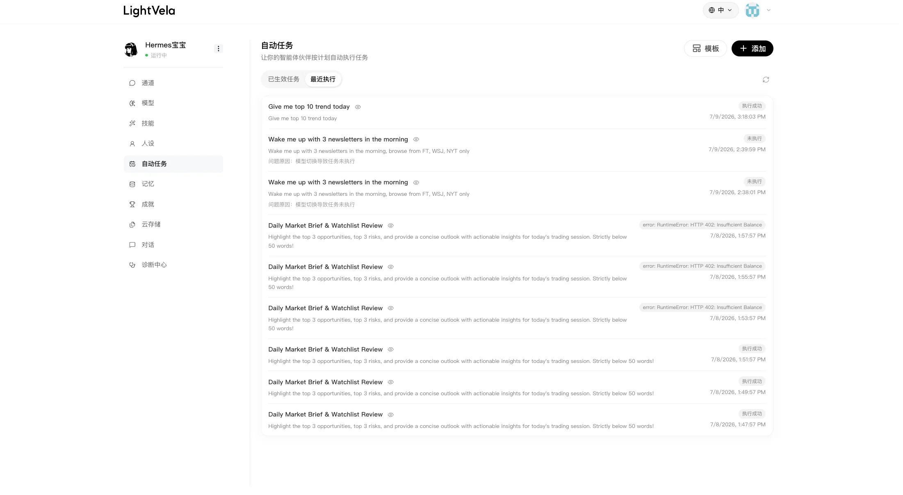

# Cara Mengurus Ingatan Jangka Panjang dan Pengetahuan Peribadi dengan Ejen

## Ringkasan

**Pengetahuan peribadi datang dalam dua bentuk yang mesti diuruskan secara berasingan: maklumat yang stabil tentang siapa anda dan cara anda bekerja berada dalam ingatan jangka panjang, manakala dokumen, nota dan bahan projek yang berkembang berada dalam storan awan.** Menguruskan kedua-duanya sebagai satu perkara yang memerlukan kestabilan dan kebolehtemuan pada masa yang sama. Pada LightVela, memori mengekalkan konteks merentas perbualan — halaman memori konsol menunjukkan perkara yang telah dikekalkan merentas tab Memori dan Profil Pengguna yang berasingan dan membolehkan anda melaraskan had kapasiti, manakala penambahan dan pengalihan keluar berlaku terutamanya melalui perbualan dengan Hermes. Storan awan ialah ruang kerja fail, menyokong muat naik, mencipta, menyusun, memuat turun, menamakan semula dan memadam, dengan had 1 GB setiap fail. Satu peraturan yang perlu dipegang: jangan sekali-kali menulis kata laluan, kunci atau data sensitif yang tidak diperlukan ke dalam ingatan jangka panjang.



## Untuk siapa ini

Corak ini adalah untuk orang yang mahu pembantu memahami keutamaan mereka dan kerja berulang tanpa memintanya untuk menghafal setiap dokumen. Ia berguna untuk projek yang sedang berjalan, penyelidikan peribadi, nota pembelajaran, kerja pelanggan dan sebarang aliran kerja yang konteks yang sama kembali dari semasa ke semasa.

Matlamatnya bukan untuk mencipta arkib yang sempurna. Ia adalah untuk menjadikan konteks penting mudah dicari dan memastikan Hermes sejajar dengan bahagian-bahagiannya yang sepatutnya berterusan.

## Prasyarat

- Hermes Agent yang sedang berjalan dan cara untuk bersembang dengannya melalui konsol atau saluran yang disambungkan.

- Pemahaman asas tentang dua tempat maklumat boleh hidup: [Pengurusan Memori](../configuration/memory.md) untuk konteks jangka panjang dan [Cloud Storage](../configuration/files.md) untuk fail dan folder.

- Satu set kecil bahan yang benar-benar anda kembalikan, bukannya tunggakan yang tidak ditapis bagi setiap fail yang anda miliki.

- Sempadan privasi yang jelas untuk perkara yang anda mahu Hermes untuk dikekalkan atau disemak.

## Langkah / konsep utama

### 1. Asingkan konteks stabil daripada bahan rujukan

Letakkan fakta yang sepatutnya membentuk perbualan masa depan ke dalam ingatan: gaya penulisan pilihan anda, zon masa, peranan berterusan, matlamat berulang atau peraturan tentang cara anda mahu projek dikendalikan. Teruskan menukar bahan—taklimat, nota mesyuarat, draf dan fail penyelidikan—dalam Cloud Storage.

Sebagai contoh, anda mungkin memberitahu Hermes:

```text
Remember that I prefer research notes to separate facts, assumptions,
and open questions. Use that structure whenever we review a project.
```

Maksudnya adalah untuk tidak menjadikan Hermes menyimpan setiap dokumen sumber sebagai ingatan. Intinya adalah untuk memberikannya cara yang tahan lama untuk memahami cara anda mahu dokumen tersebut dikendalikan.

### 2. Susun fail yang anda harapkan untuk dilawati semula

Buat struktur folder kecil dalam Cloud Storage yang sepadan dengan kerja sebenar anda. Gunakan nama yang bermakna dan simpan bahan berkaitan bersama-sama, seperti satu folder bagi setiap pelanggan, projek, kursus atau soalan penyelidikan.

Apabila anda mahukan bantuan dengan fail, beritahu Hermes perkara yang anda cuba lakukan dan kenal pasti bahan yang berkaitan. Contohnya:

```text
Help me prepare for this project review. Use the latest brief and my
meeting notes, then list unresolved decisions and questions.
```



### 3. Semak ingatan dan bukannya menganggap ia betul selama-lamanya

Buka Pengurusan Memori secara berkala untuk menyemak tab Memori dan Profil Pengguna. Profil pengguna ialah gambaran stabil tentang siapa anda; memori mempunyai pengalaman berguna dan konteks kerja daripada kerjasama anda dengan Hermes.

Jika pilihan berubah, nyatakan dengan jelas dalam perbualan:

```text
I no longer want long weekly updates. Please forget that preference
and keep weekly summaries to five bullets.
```

Memori berfungsi paling baik apabila ia kekal semasa. Alih keluar atau betulkan konteks yang akan membawa Hermes ke arah yang salah dan bukannya menambah arahan kedua yang bercanggah.

### 4. Tukar pengetahuan yang disemak menjadi perbualan yang berkesan

Gunakan halaman [Sembang](../configuration/agent-chat.md) atau saluran yang disambungkan untuk menukar dokumen dan memori menjadi langkah konkrit seterusnya. Minta perbandingan, garis besar, satu set soalan terbuka atau ringkasan untuk mesyuarat tertentu. Lebih spesifik hasil segera, lebih mudah untuk mengesahkan bahawa Hermes mempunyai konteks yang betul.

Jika ulasan anda mengikut rentak yang berulang, [Tugas Berjadual](../configuration/automation.md) boleh mengingatkan anda untuk melawat semula folder atau menyediakan rekap biasa. Mulakan dengan peringatan atau ringkasan ringkas dan bukannya memberikan tugasan yang luas dan terbuka.



## Soalan Lazim

### Apakah perbezaan antara memori dan Storan Awan?

Memori ialah konteks tahan lama yang membantu Hermes memahami anda dan kerjasama berterusan anda. Storan Awan adalah untuk fail dan folder yang anda urus. Ingatan harus menangkap peraturan dan keutamaan penting; fail hendaklah mengandungi bahan asas.

### Adakah Hermes secara automatik merawat setiap fail sebagai ingatan jangka panjang?

Tidak. Pastikan perbezaan itu disengajakan. Gunakan Pengurusan Memori untuk konteks yang berterusan dan gunakan Storan Awan untuk menyusun bahan yang ingin anda rujuk semasa kerja tertentu.

### Bolehkah saya meminta Hermes untuk melupakan sesuatu?

ya. Beritahu Hermes perkara yang tidak perlu disimpan lagi, kemudian semak memori yang berkaitan atau maklumat profil pengguna jika anda ingin mengesahkan perubahan itu.

### Apakah yang perlu saya letak dalam ingatan dahulu?

Mulakan dengan pilihan yang mengubah kualiti hampir setiap perbualan: zon waktu anda, gaya komunikasi, peranan, keutamaan aktif dan format yang anda sukai untuk kerja berulang.

## Langkah seterusnya

- [Pengurusan Memori](../configuration/memory.md) — semak konteks dan kapasiti jangka panjang.

- [Cloud Storage](../configuration/files.md) — pastikan dokumen di sebalik kerja anda yang sedang berjalan teratur.

- [Sembang](../configuration/agent-chat.md) — letakkan memori dan bahan projek untuk berfungsi dalam perbualan terfokus.
