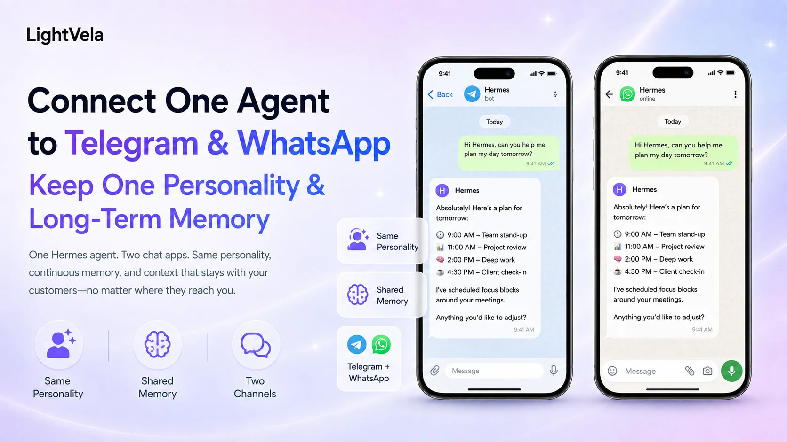

# Cara Menghubungkan Satu Ejen kepada Telegram dan WhatsApp Sambil Mengekalkan Satu Personaliti dan Ingatan Jangka Panjang

## Ringkasan

**Telegram dan WhatsApp boleh berfungsi sebagai dua pintu masuk kepada Hermes Agent yang sama. Selagi kedua-dua saluran bersambung kepada Ejen yang sama, mereka berkongsi persona peringkat Ejen, Kemahiran, tugas berjadual dan ingatan jangka panjang, tanpa konfigurasi untuk diduplikasi setiap platform.** Tetapi "bersatu" mempunyai skop yang ditentukan: perkara yang dikongsi ialah aset peringkat Ejen, manakala setiap saluran mengekalkan aliran kebenaran dan had mesejnya sendiri, jadi menyambungkannya ialah dua langkah kebenaran bebas. Cara paling langsung untuk mengesahkan perkongsian adalah dengan menyatakan sesuatu pada satu saluran dan bertanya tentangnya pada saluran yang lain — jawapan yang betul membuktikan kedua-dua titik masuk itu diselesaikan kepada Ejen yang sama. Selepas menyambung, sahkan juga balasan tiba dalam perbualan yang anda hantar mesej dan bukannya perbualan lain.

## Untuk siapa ini

Panduan ini adalah untuk orang yang ingin bertukar antara apl pemesejan sambil mengekalkan satu identiti pembantu AI.

Ia berguna apabila anda berpindah antara Telegram dan WhatsApp, atau apabila anda ingin mengurus pembantu peribadi, rakan kongsi penyelidik atau pembantu penggubalan sokongan dari satu tempat.

## Fahami maksud "satu Ejen".

Satu Ejen tidak bermakna bahawa kedua-dua saluran berkongsi setiap bahagian transkrip sembang langsung dalam masa nyata.

Dua titik masuk berkongsi konfigurasi peringkat Ejen dan konteks tahan lama, manakala setiap perbualan semasa masih tergolong dalam sesi salurannya sendiri.

Jika anda mahu saluran lain mengetahui fakta yang disahkan, minta Hermes mengingatinya dan kemudian mengesahkannya dari titik masuk yang lain.

Persona, memori jangka panjang dan Kemahiran tergolong dalam lapisan Ejen, manakala token Bot, kebenaran QR, titik kemasukan perbualan dan format mesej tergolong dalam lapisan saluran.

## Prasyarat

- Ejen LightVela Hermes yang sedang berjalan.
  Jika anda belum menciptanya lagi, mulakan dengan [Mula Pantas](../02-quickstart.md).

- Konfigurasi model yang berfungsi atau kredit percubaan yang tersedia.

- Akaun Telegram dan Bot yang boleh anda gunakan seperti biasa.

- Akaun WhatsApp yang boleh anda gunakan seperti biasa.

- Pemahaman tentang Telegram persediaan kumpulan-mesej: lumpuhkan Privasi Kumpulan dalam BotFather, tambahkan Bot pada kumpulan, kemudian mulakan perbualan dengan `@bot_username`.
- Pemahaman bahawa WhatsApp sokongan kumpulan tetap tertakluk kepada dokumentasi salurannya sendiri.

## Langkah

### 1. Pilih satu sasaran Agen

Buka konsol LightVela dan tentukan tunggal Hermes Agent mana yang harus menerima kedua-dua sambungan Telegram dan WhatsApp.

Jangan buat satu Ejen setiap saluran melainkan anda dengan sengaja mahukan persona, kenangan dan Kemahiran yang berbeza.

### 2. Sambung Telegram

Ikuti [Konfigurasi Saluran - Telegram](../configuration/channel-telegram.md) untuk mencipta Bot dan tampal token HTTP API ke dalam tetapan saluran Telegram untuk Agen sasaran.

Hantar mesej ujian dalam Telegram, sahkan bahawa konsol menunjukkan saluran sebagai disambungkan dan sahkan bahawa balasan kembali kepada Bot yang dijangkakan.

Jika anda juga mahukan personaliti Telegram yang berbeza, lihat [Cara Mengkonfigurasi Hermes Agent dengan Personaliti Terbeza dalam Telegram](./telegram-persona-agent.md).

### 3. Sambung WhatsApp

Dalam tetapan saluran untuk Hermes Agent yang sama, pilih WhatsApp dan lengkapkan keizinan QR dengan mengikuti [Konfigurasikan Saluran - WhatsApp](../configuration/channel-whatsapp.md).

Buka kenalan bot yang sepadan dalam WhatsApp, hantar mesej ujian dan sahkan bahawa balasan kembali seperti biasa.

Jika anda juga mahukan personaliti WhatsApp yang berbeza, lihat [Cara Mengkonfigurasi Hermes Agent dengan Personaliti Terbeza dalam WhatsApp](./whatsapp-persona-agent.md).

### 4. Konfigurasikan satu personaliti peringkat Agen

Buka bahagian "Peribadi" Agen sasaran dan sahkan bahawa peranan, suara, keutamaan dan sempadan tingkah laku dalam SOUL.md berfungsi untuk kedua-dua saluran.

Kerana personaliti berada di lapisan Ejen, anda tidak perlu mengkonfigurasi dua salinan dalam Telegram dan WhatsApp.

Jika anda perlu menukar personaliti, lihat [Cara Mentakrifkan Peranan, Personaliti dan Suara Ejen IM dengan SOUL.md](./im-agent-persona-soul-md.md).

Selepas perubahan, mulakan perbualan baharu dalam setiap saluran dan jalankan semakan kendiri pantas untuk mengesahkan bahawa personaliti baharu itu aktif.

### 5. Konfigurasikan memori peringkat Ejen dan profil pengguna

Buka "Memori" dalam konsol dan sahkan bahawa memori Ejen dan kapasiti profil pengguna sesuai dengan aliran kerja anda.

Telegram dan WhatsApp berkongsi memori jangka panjang Agen awan yang sama, jadi anda tidak perlu memasukkan identiti, bahasa dan pilihan yang sama dua kali.

Dalam mana-mana saluran, anda boleh menghantar:

Ingat bahawa saya mahu setiap taklimat harian bermula dengan kesimpulan dan kemudian memberikan tiga perkara utama bukti.

Kemudian tukar ke saluran lain dan hantar:

Gunakan format taklimat harian yang saya tetapkan sebelum ini dan tunjukkan contoh ringkas.

Jika saluran berkelakuan berbeza, mula-mula sahkan bahawa ia bersambung kepada Ejen yang sama, kemudian semak sama ada perbualan semasa memerlukan /baharu.

### 6. Pasang Kemahiran dikongsi sekali

Kemahiran tergolong dalam konfigurasi keupayaan Ejen, jadi anda tidak memerlukan satu pemasangan untuk Telegram dan satu lagi untuk WhatsApp.

Minta Hermes memasang Kemahiran melalui perbualan dalam mana-mana saluran, kemudian minta ia mengemas kini senarai Kemahiran dan mengesahkan Kemahiran dengan tugas berisiko rendah.

Lihat [Konfigurasikan Kemahiran](../configuration/skill.md) untuk aliran terperinci dan semak sumber Kemahiran, kebenaran dan kebergantungan perkhidmatan luaran sebelum mengesahkan pemasangan.

### 7. Uji perbezaan khusus saluran

Jalankan gesaan yang sama dalam kedua-dua saluran:

Terangkan peranan semasa anda dan cara anda menangani ketidakpastian.

Gunakan pilihan saya yang disimpan untuk menukar kandungan ini kepada tiga perkara utama.

Kemudian uji tingkah laku yang dimiliki oleh saluran, seperti mesej media, peringatan proaktif atau cara kenalan Bot muncul.

Personaliti dan ingatan jangka panjang harus kekal konsisten, tetapi format mesej, keupayaan media, kebenaran dan had penghantaran proaktif mungkin berbeza.

## Struktur berguna untuk satu Ejen dan dua pintu masuk

Seorang Hermes Agent
    ├── satu SOUL.md
    ├── satu memori Ejen dan profil pengguna
    ├── satu set Kemahiran yang dipasang
    ├── satu set tugas yang dijadualkan
    ├── Telegram pintu masuk
    └── WhatsApp pintu masuk

Kaedah pemberitahuan Tugas Berjadual masih memerlukan saluran sasaran yang jelas.

Jangan menganggap bahawa Ejen yang dikongsi menyebabkan setiap peringatan dihantar kepada Telegram dan WhatsApp.

## Soalan Lazim

### Adakah sesuatu yang saya tanya Hermes untuk diingati dalam Telegram akan muncul dalam WhatsApp?

Ya, apabila kedua-dua saluran bersambung kepada Hermes Agent yang sama dan maklumat disimpan ke memori Ejen atau profil pengguna.

Setiap mesej dalam perbualan Telegram semasa tidak menjadi transkrip langsung WhatsApp secara automatik.

### Mengapakah kedua-dua saluran tidak berbunyi sama?

Format mesej saluran, keupayaan media, keadaan sesi dan output model boleh menjejaskan butiran.

Mula-mula sahkan bahawa kedua-dua saluran bersambung kepada Ejen yang sama, kemudian hantar /baharu apabila diperlukan supaya SOUL.md baharu dimuatkan semasa perbualan bermula.

### Bolehkah saya mengkonfigurasi personaliti yang berbeza untuk Telegram dan WhatsApp?

Apabila kedua-dua saluran bersambung kepada satu Ejen, mereka menggunakan personaliti peringkat Ejen yang sama secara lalai.

Jika anda memerlukan peranan dan kenangan yang berbeza, cipta Ejen yang berbeza dan sambungkan saluran secara berasingan.

### Bolehkah WhatsApp kumpulan berkongsi memori dengan Telegram?

Dokumentasi WhatsApp semasa mengatakan sembang kumpulan tidak disokong.
Telegram menyokong mesej kumpulan selepas anda melumpuhkan Privasi Kumpulan, tambahkan Bot pada kumpulan dan mulakan perbualan dengan `@bot_username`.

Perkongsian berbilang saluran memastikan lapisan Ejen konsisten, tetapi ia tidak mengubah keadaan persediaan atau sempadan keupayaan setiap saluran sendiri.

### Adakah tugasan berjadual akan dihantar ke kedua-dua saluran secara automatik?

Tidak.

Apabila anda membuat atau mengedit tugasan yang dijadualkan, sahkan kaedah pemberitahuan dan saluran sasarannya, kemudian uji hasil penghantaran secara berasingan.

## Langkah seterusnya

- [Bagaimana Hermes Agent Menghubungkan Berbilang Saluran Pemesejan](../hermes-agent/07-message-gateway.md) - Fahami hubungan antara saluran, get laluan dan lapisan Ejen.

- [Pengurusan Memori](../configuration/memory.md) - Semak memori Ejen dan pengurusan profil pengguna.

- [Konfigurasikan Saluran - Telegram](../configuration/channel-telegram.md) - Lengkapkan Telegram Persediaan bot.

- [Konfigurasikan Saluran - WhatsApp](../configuration/channel-whatsapp.md) - Lengkapkan pengesahan WhatsApp.
