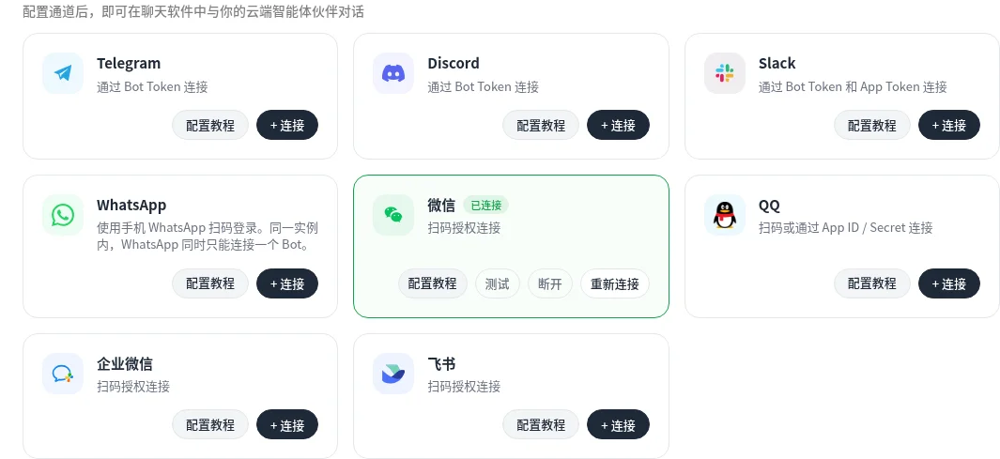
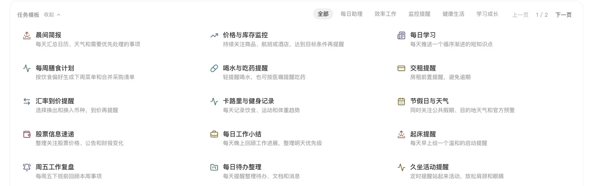

# Cara Membina Pembantu AI Peribadi dengan LightVela

## Ringkasan

**Mulakan pembantu AI peribadi dengan mencipta dan memilih satu Bot, kemudian uji balasan dalam sembang web menggunakan kredit model yang tersedia atau model yang dikonfigurasi. Sambungkan saluran pemesejan hanya jika mahu menggunakan aplikasi itu. Seterusnya, uji keutamaan tetap dalam perbualan baharu, tambah kemahiran untuk tugas tertentu, dan jadualkan tugas selepas arahannya berjaya. Memori, kemahiran, saluran, dan tugas diurus untuk Bot yang dipilih.**


## Untuk siapa ini

Persediaan ini berfungsi dengan baik jika anda mahukan seorang pembantu untuk perancangan harian, penyelidikan susulan, peringatan dan soalan yang mendapat manfaat daripada mengetahui pilihan anda. Anda tidak memerlukan aliran kerja yang rumit. Mulakan dengan satu Hermes Agent dan satu saluran yang anda sudah semak dengan kerap.

Ia amat berguna apabila anda mendapati diri anda mengulangi konteks seperti zon waktu anda, format yang anda sukai untuk ringkasan, projek yang anda sedang kerjakan atau jenis bantuan yang anda inginkan setiap pagi.

## Prasyarat

- Akaun LightVela dan Hermes Agent yang sedang berjalan. Jika anda belum menciptanya lagi, mulakan dengan [Mula Pantas](../02-quickstart.md).

- Sembang web mencukupi untuk bermula. Jika anda lebih suka aplikasi pemesejan, sambungkan saluran mengikut panduan berikut.

- Konfigurasi model yang berfungsi atau kredit percubaan yang tersedia. Lihat [Konfigurasikan Model](../configuration/model.md) jika Hermes tidak boleh membalas lagi.

- Idea ringkas tentang perkara yang anda mahukan bantuan dahulu. Satu rutin, seperti merancang hari anda atau mengumpul susulan, sudah memadai.

## Langkah / konsep utama

### 1. Memberi Hermes tempat dalam rutin harian anda

Pilih avatar Bot yang dikehendaki pada bar Bot. Pada skrin sempit, buka panel navigasi terlebih dahulu. Semak namanya sebelum mengubah model, memori, kemahiran, saluran, atau tugas berjadual. Sembang web dan senarai perbualan mengikut Bot yang dipilih; Bot tambahan juga boleh menggunakan sembang web. Sembang web tidak memerlukan saluran pemesejan.

Sembang web mencukupi untuk bermula. Jika anda lebih suka aplikasi pemesejan, sambungkan saluran mengikut panduan berikut.

Jika mahu menggunakan aplikasi pemesejan, sambungkan satu saluran dan pastikan Bot membalas di situ. Ikuti panduan untuk [Telegram](../configuration/channel-telegram.md), [WhatsApp](../configuration/channel-whatsapp.md), [Discord](../configuration/channel-discord.md), [WeChat](../configuration/channel-wechat.md), [Slack](../configuration/channel-slack.md).



Mulakan dengan pengenalan yang jelas dan bukannya permintaan yang luas. Contohnya:

```text
I want you to be my personal planning assistant. I am in Singapore time.
Keep daily plans short, call out deadlines first, and ask one follow-up question when something is unclear.
```

### 2. Biarkan ingatan membawa konteks yang berulang

Hermes membina konteks yang berguna dari semasa ke semasa, jadi anda tidak perlu menyatakan semula setiap pilihan dalam setiap perbualan. Beritahu fakta dan pilihan kerja yang sepatutnya kekal berguna: zon waktu anda, cara anda mahu taklimat berstruktur, nama projek penting, atau hari yang anda lebih suka untuk merancang lebih awal.

Anda juga boleh menyatakan permintaan secara langsung:

```text
Remember that I prefer a concise weekday briefing at 8:00 AM,
with meetings, deadlines, and the three most important next actions.
```

Gunakan halaman [Pengurusan Memori](../configuration/memory.md) untuk menyemak memori dan maklumat profil pengguna yang Hermes telah terkumpul. Ingatan harus mengurangkan pengulangan, bukan menjadi tempat pembuangan untuk setiap butiran yang berlalu.

Mengingati keutamaan ringkasan hari bekerja pada 8:00 pagi tidak mencipta tugas berjadual. Tetapkan jadual secara berasingan, semak pelaksanaan pertama, dan pastikan hasil dihantar melalui saluran pemberitahuan yang dipilih.

### 3. Tambahkan kemahiran hanya apabila tugas sebenar memerlukannya

Hermes boleh berbual tanpa kemahiran tambahan. Tambahkan satu apabila anda boleh menamakan kerja praktikal yang sepatutnya membantu, seperti mencari maklumat, mengatur senarai tugasan atau menyediakan laporan berulang. Ini memastikan pembantu mudah difahami dan lebih mudah dipercayai.


Semak imbas pilihan yang sesuai dalam ClawHub, kemudian gunakan [Konfigurasikan Kemahiran](https://lightvela.ai/docs/configuration/skill) untuk memasangnya. Sebelum anda memasang apa-apa, baca penerangannya dan pilih sumber yang anda percayai.

### 4. Tukar perbualan yang berguna menjadi daftar masuk berulang

Setelah gesaan boleh dipercayai berguna, tentukan sama ada ia harus dijalankan mengikut jadual. Tugasan berjadual mudah boleh meminta Hermes untuk rancangan pagi, semakan akhir hari atau tetapan semula mingguan tanpa anda ingat untuk memulakan perbualan.

Contohnya:

```text
Every weekday at 8:00 AM, prepare a concise plan for today.
Start with deadlines and meetings, then suggest three focused next actions.
```

Tetapkan jadual dan saluran pemberitahuan dalam [Tugas Berjadual](../configuration/automation.md). Pastikan tugas yang dijadualkan pertama kecil; anda boleh memperhalusi arahan selepas anda melihat beberapa hasil sebenar.



## Semak setiap lapisan

| Lapisan | Semakan | Batasan |
| --- | --- | --- |
| Bot dan sembang web | Pilih Bot yang dikehendaki dan hantar mesej ringkas | Balasan memerlukan Bot dalam talian serta kredit atau konfigurasi model yang boleh digunakan |
| Memori | Nyatakan keutamaan tetap, buka perbualan baharu, dan semak | Perbualan baharu tidak memadam memori jangka panjang |
| Tugas berjadual | Semak jadual, saluran pemberitahuan, dan hasil | Penciptaan atau penyalinan Bot tidak menyalin tugas berjadual atau sambungan saluran |

## Sahkan hasil

Pastikan sembang web membalas sebelum menyambungkan saluran. Uji keutamaan yang diingati dalam perbualan baharu dan semak hasil tugas berjadual pertama. Jika saluran atau tugas gagal, semak Bot yang dipilih, konfigurasi, dan statusnya sebelum menambah ciri.

## Soalan Lazim

### Adakah saya perlu mengkonfigurasi setiap ciri sebelum Hermes berguna?

Sembang web mencukupi untuk bermula. Jika anda lebih suka aplikasi pemesejan, sambungkan saluran mengikut panduan berikut.

### Adakah Hermes akan mengingati setiap mesej yang saya hantar?

Tidak. Memori bertujuan untuk maklumat yang kekal berguna merentas perbualan, seperti pilihan, kerja berulang dan konteks yang stabil. Anda boleh meminta Hermes untuk mengingati atau melupakan maklumat apabila diperlukan, kemudian menyemaknya dalam Pengurusan Memori.

### Bolehkah saya menggunakan pembantu yang sama daripada lebih daripada satu saluran?

Ya, jika saluran tersebut disambungkan kepada Bot yang sama. Memori jangka panjang dan keutamaan adalah milik Bot itu. Bot lain mempunyai ruang kerja sendiri: penyalinan hanya menyediakan keadaan awal, bukan penyegerakan perubahan selepas itu.

### Apakah yang perlu saya automatikkan dahulu?

Pilih tugasan yang telah anda ulangi pada masa yang boleh diramal. Perancangan pagi, semakan harian pendek atau semakan keutamaan mingguan adalah calon pertama yang baik kerana anda boleh mengetahui dengan cepat sama ada output itu membantu.

## Kesimpulan

Fokuskan pembantu pertama pada satu rutin. Selepas sembang, memori, dan tugas berjadual pertama berfungsi untuk Bot yang dipilih, luaskan tanggungjawabnya secara beransur-ansur.
