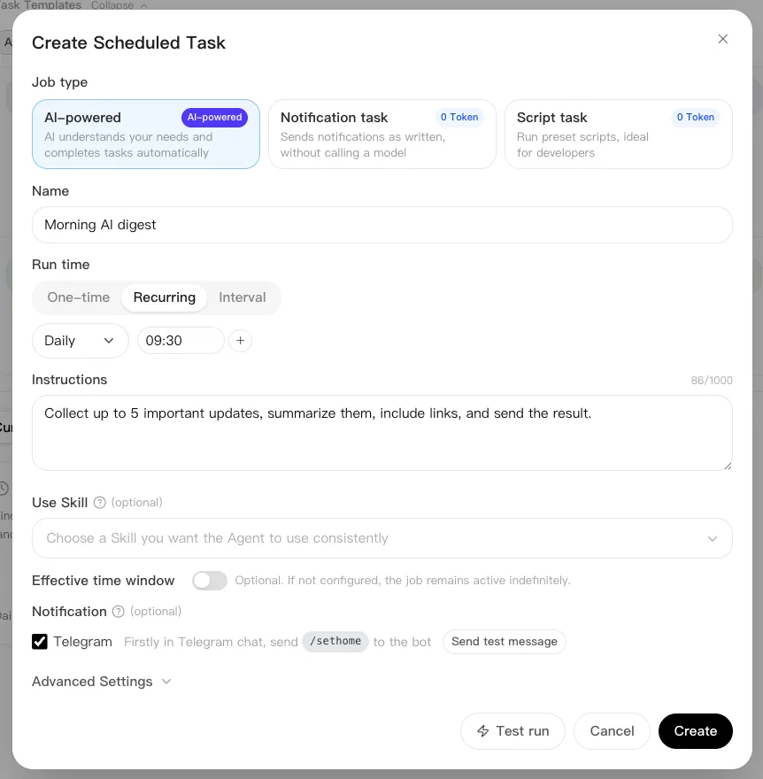
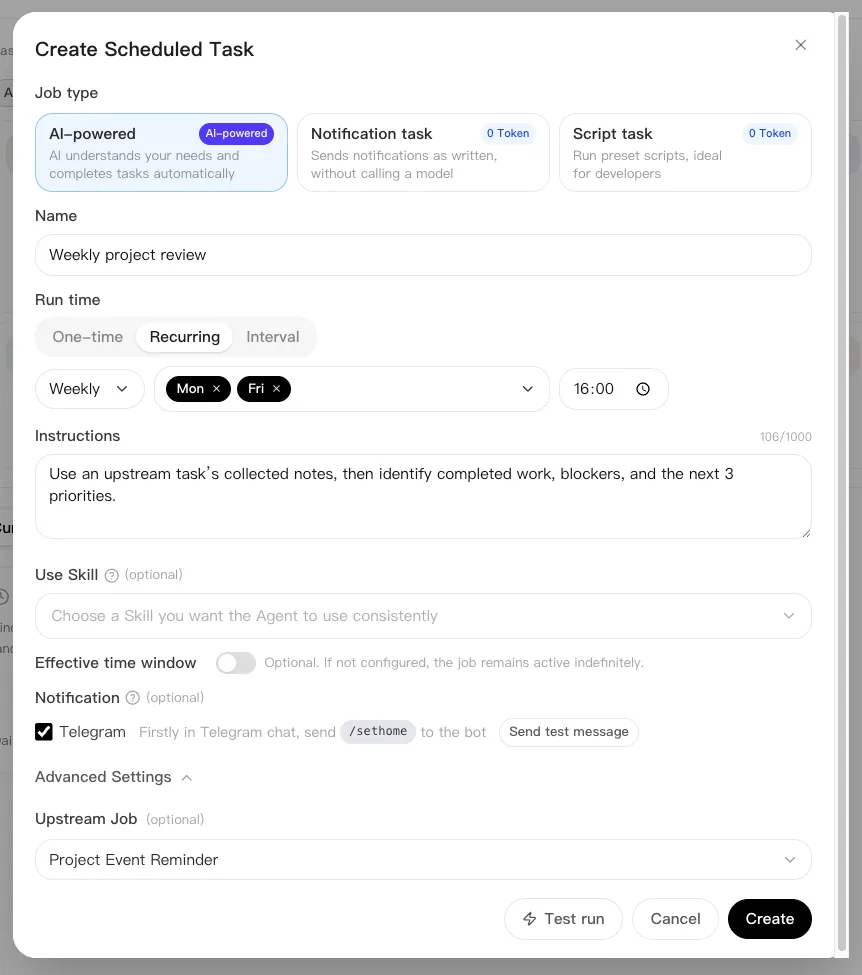
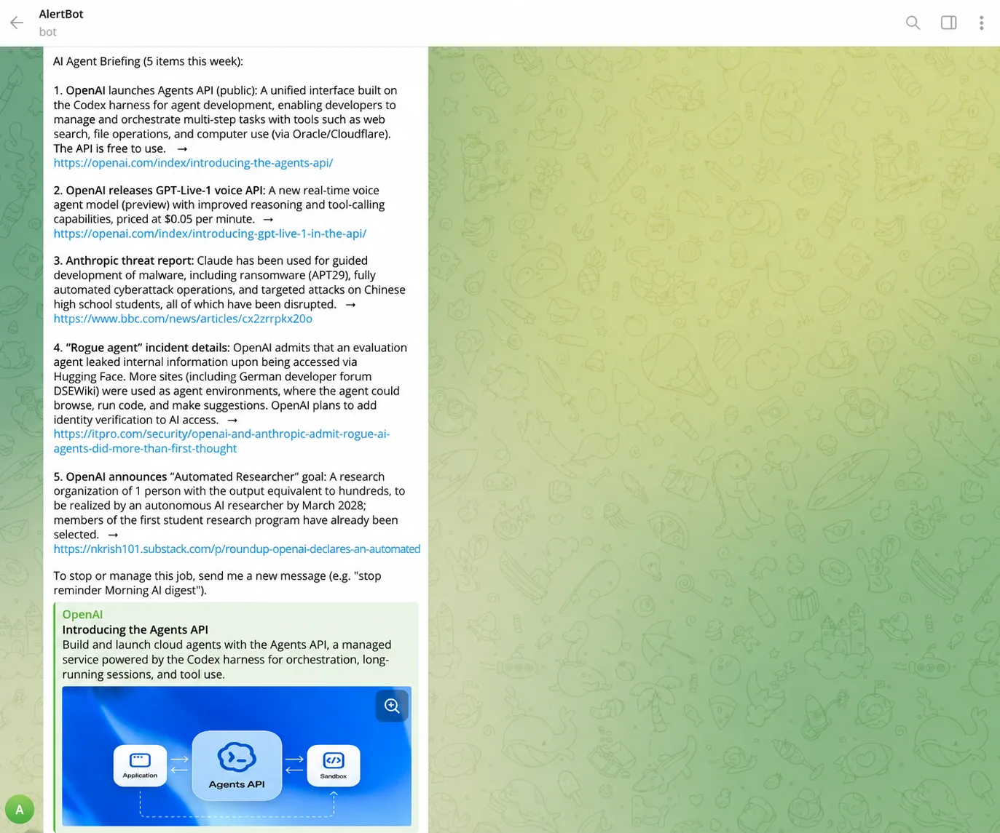
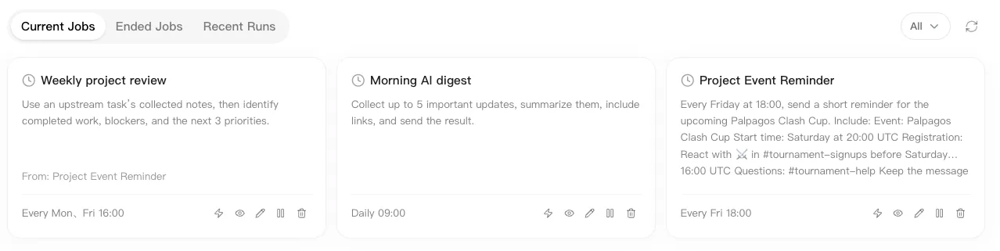

# Mengautomasikan Tugas Ejen dengan LightVela

## Ringkasan

**Tugas Ejen menjalankan aliran kerja yang disokong model mengikut jadual dan menghantar hasil melalui saluran yang disambungkan.** Gunakan ia untuk kerja berulang seperti taklimat pagi atau ulasan projek mingguan. Konfigurasikan arahan, jadual, Kemahiran pilihan, dan destinasi penghantaran.

Tugas berjadual adalah aplikasi yang sempurna untuk ejen yang dihoskan di awan kerana ia boleh berjalan 24/7 tanpa memerlukan anda terlibat secara langsung.
Ia boleh digunakan apabila anda mempunyai masalah maklumat yang berulang yang boleh diperbaiki dengan aliran kerja yang boleh diulang.
Pengguna telah menggunakannya untuk digest pagi, yang menukar kemas kini yang berselerak menjadi ringkasan pendek; ada juga yang mencipta ulasan projek mingguan yang meringkaskan aktiviti terkini untuk mesyuarat susulan.

## Masalah biasa yang boleh diselesaikan oleh ejen

Kebanyakan daripada kita sudah mempunyai terlalu banyak maklumat.
Selain itu, sesetengah maklumat berguna tiba pada masa yang salah, dalam format yang salah, atau tanpa konteks yang cukup.

- Beberapa pautan tiba dalam perbualan.
- Kemas kini projek terkubur dalam dokumen.
- Satu keputusan disebut sekali dan kemudian dilupakan.
- Apabila anda mempunyai masa untuk meneliti semuanya, maklumat itu tidak lagi berguna

Dalam LightVela, anda boleh mengkonfigurasi tugasan Ejen dengan arahan, jadual, Kemahiran pilihan, output tugasan huluan, dan saluran penghantaran.
[Dokumentasi Tugasan Berjadual](https://lightvela.ai/docs/configuration/automation?from=social_x) menerangkan corak jadual dan pilihan konfigurasi yang tersedia.

## Kes 1: Mulakan hari dengan ringkasan yang berguna

Setiap hari bekerja pada pukul 9:30 pagi, tugas ejen menukar output terkini dari sumber yang dikonfigurasikan atau tugas pengumpulan hulu menjadi tiga kemas kini berguna.

Arahan:

> Kumpulkan sehingga 5 kemas kini penting, ringkaskan mereka, sertakan pautan, dan hantar hasilnya.

Kuncinya adalah untuk meminta ringkasan fokus, bukan ringkasan "segala-galanya." Jika pengumpulan maklumat dan ringkasan adalah tugas berasingan, jadualkan pengumpulan terlebih dahulu.

## Kes 2: Ulasan Projek Hari Jumaat

Setiap hari Jumaat, tugasan Ejen menukar kemas kini projek terkini menjadi ulasan ringkas.

Arahan:

> Gunakan nota yang dikumpulkan oleh tugasan huluan, kemudian kenal pasti kerja yang telah diselesaikan, halangan, dan 3 keutamaan seterusnya.

Jalankan tugasan pengumpulan sebelum ulasan, dengan sedikit selang masa.
Ejen tidak menggantikan pengurusan projek.
Ia mewujudkan titik permulaan yang boleh dipercayai untuk perbincangan mingguan.

## Mengemas kini saya secara langsung melalui IM

LightVela membolehkan anda menyambungkan ejen anda ke WhatsApp, Telegram, WeChat, Discord, dan banyak lagi.
Anda boleh menyambung ke satu, atau kesemuanya pada masa yang sama.
Dalam tugas berjadual, anda boleh menukar tetapan pemberitahuan IM masing-masing untuk menentukan sama ada untuk memberitahu tugas kepada IM anda atau tidak.

Selepas menukar tetapan, ejen anda akan menyelesaikan tugas anda sepenuhnya dan mengemas kini anda secara langsung dalam IM anda, tanpa perlu membuka LightVela atau mana-mana aplikasi lain.

## Menguruskan pelbagai tugas

Anda boleh menetapkan seberapa banyak tugasan berjadual yang anda mahu.
Selepas anda menciptanya, anda boleh mengedit, memberhenti buat sementara, dan menyemak tugasan-tugasan yang telah selesai.
Dengan LightVela, ubah Hermes Agent peribadi anda menjadi mesin super-cekap yang menjalankan tugasan anda sementara anda tiada.

