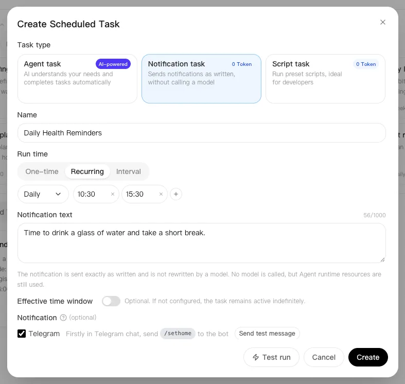
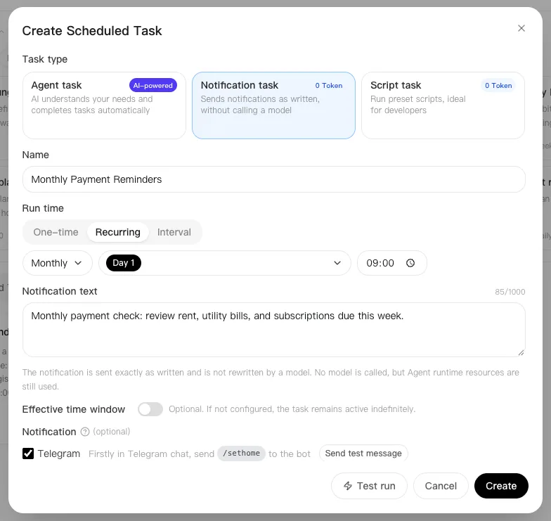
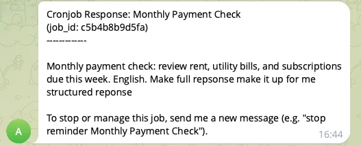
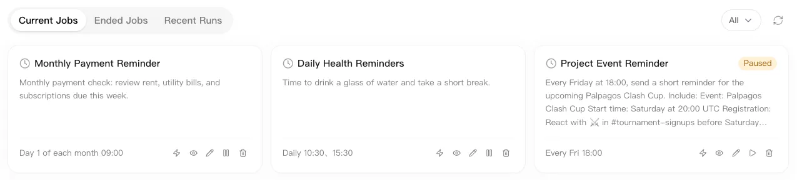

# Menetapkan Tugasan Pemberitahuan dalam LightVela

## Ringkasan

**Tugas Pemberitahuan menghantar mesej tetap anda mengikut jadual tanpa memanggil model AI atau menggunakan kredit model.** Gunakannya untuk peringatan seperti ubat-ubatan, bil, dan pembaharuan langganan; tetapkan mesej, jadual, tempoh masa berkesan, dan saluran penghantaran.

Tugas pemberitahuan adalah aplikasi mudah untuk ejen yang dihoskan di awan kerana ia boleh menghantar mesej tetap mengikut jadual tanpa memanggil model AI.
Ia boleh digunakan apabila anda memerlukan peringatan untuk tiba pada masa yang tepat, melalui saluran yang betul, menggunakan kata-kata tepat yang anda berikan.
Pengguna telah menggunakannya untuk peringatan air dan ubat; sesetengah juga telah membuat peringatan untuk bil dan pembaharuan langganan.

## Masalah biasa yang boleh diselesaikan oleh pemberitahuan

Kebanyakan daripada kita tidak lupa tugas penting kerana kita tidak peduli. Beberapa tindakan kecil tetapi perlu mudah terlepas pandang apabila kerja menjadi sibuk.

- Anda terlupa untuk minum air semasa sesi kerja panjang.
- Ubat diambil lebih lewat daripada yang dirancang.
- Pembaharuan langganan terkubur dalam peti masuk anda.
- Bil hanya diingat selepas tarikh tamatnya.

Dalam LightVela, anda boleh mengkonfigurasi tugas Pemberitahuan dengan mesej, jadual, tetingkap waktu berkesan, dan saluran penghantaran.
Mesej dihantar tepat seperti yang ditulis tanpa memanggil model, jadi ia tidak menggunakan token model.
[Dokumentasi Tugas Berjadual](https://lightvela.ai/docs/configuration/automation?from=social_x) menerangkan pilihan penjadualan dan pemberitahuan yang tersedia.

## Kes 1: Peringatan Kesihatan Harian

Setiap hari pada pukul 10:30 AM dan 3:30 PM, tugas Pemberitahuan menghantar peringatan pendek yang sama.

Mesej:

> Masa untuk minum segelas air dan berehat seketika.

Kuncinya adalah untuk memastikan mesej pendek dan boleh diambil tindakan.
Kerana ia tidak melalui model, pemberitahuan tidak akan ditulis semula atau diberikan konteks tambahan.

## Kes 2: Peringatan Pembayaran Bulanan

Pada hari pertama setiap bulan, tugas Pemberitahuan mengingatkan anda untuk menyemak pembayaran yang akan datang.

Mesej:

> Semakan pembayaran bulanan: semak sewa, bil utiliti, dan langganan yang perlu dibayar minggu ini.

Notifikasi memastikan setiap pembayaran kelihatan sebelum tarikh akhir.
Jika bil berbeza mempunyai tarikh akhir yang berbeza, buat tugasan berasingan supaya setiap peringatan tiba pada masa yang berguna.

## Mengemas kini saya secara langsung melalui IM

LightVela membolehkan anda menyambungkan ejen anda ke WhatsApp, Telegram, WeChat, Discord, dan banyak lagi.
Anda boleh menyambung ke satu atau beberapa saluran pada masa yang sama.
Dalam Tugasan Berjadual, anda boleh menukar setiap saluran yang dikonfigurasikan untuk menentukan tempat notifikasi hendak dihantar.

Selepas dihidupkan, Hermes akan menghantar notifikasi yang sama terus ke IM anda.
Anda tidak perlu membuka LightVela atau aplikasi lain untuk memeriksa peringatan.

## Menguruskan pelbagai tugas

Anda boleh menetapkan seberapa banyak tugas terjadual yang anda perlukan.
Selepas membuatnya, anda boleh mengedit kandungan dan jadualnya, menjedanya, dan menyemak larian sebelumnya.
Dengan LightVela, ejen peribadi Hermes anda boleh mengekalkan rutin penting mengikut jadual sambil anda menumpukan perhatian kepada kerja lain.

