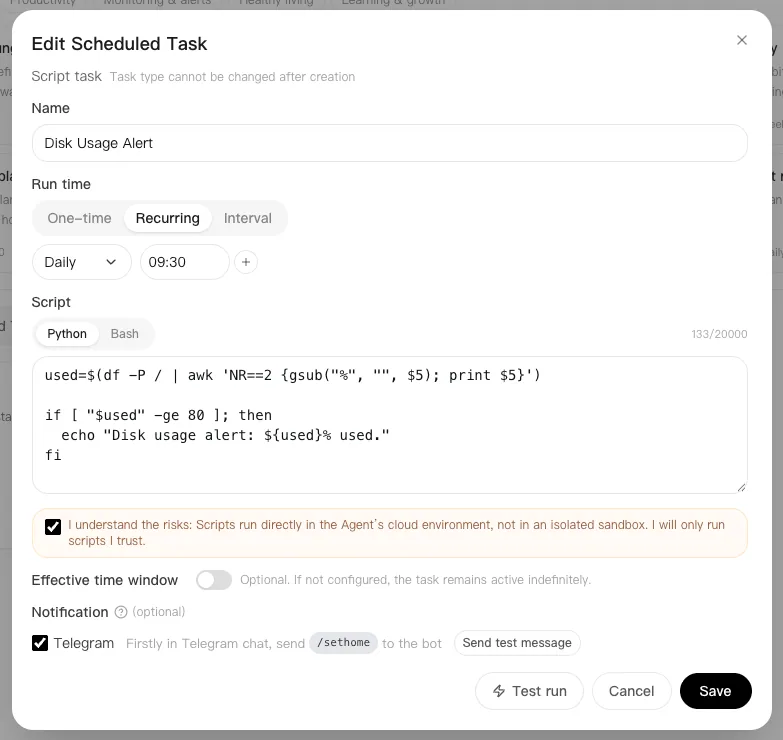
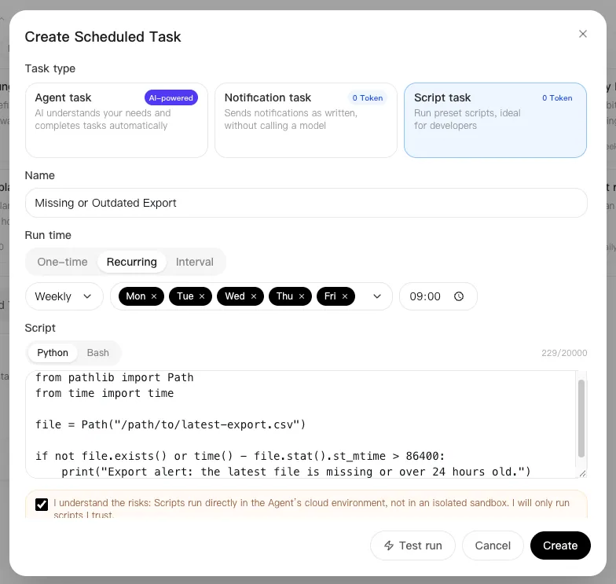
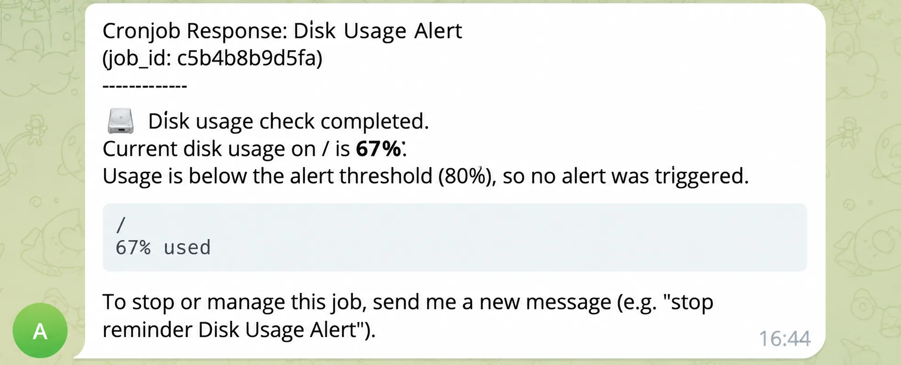
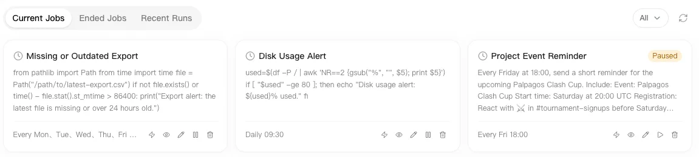

# Menjalankan Tugas Skrip dalam LightVela

## Ringkasan

**Tugas Skrip menjalankan Bash atau Python mengikut jadual tanpa memanggil model AI atau menggunakan kredit model.** Gunakannya untuk semakan yang boleh diramal seperti penggunaan cakera atau fail eksport yang hilang; tetapkan skrip, jadual, tetingkap masa berkesan, dan saluran penghantaran.

Tugas skrip adalah aplikasi praktikal untuk ejen yang dihoskan di awan kerana mereka boleh menjalankan skrip Bash atau Python mengikut jadual tanpa memanggil model AI. Mereka boleh digunakan apabila anda mempunyai semakan sistem berulang dengan peraturan yang jelas dan boleh diramalkan. Pengguna telah menggunakannya untuk amaran penggunaan cakera; ada juga yang membuat semakan untuk mengesan fail yang hilang atau ketinggalan zaman.

## Masalah biasa yang boleh diselesaikan oleh skrip

Banyak masalah sistem kecil boleh dikesan dengan semakan mudah. Namun, semakan ini sering dilupakan sehingga sesuatu berhenti berfungsi.

- Penggunaan cakera meningkat tanpa disedari.
- Eksport harian berhenti menghasilkan fail baru.
- Fail sandaran menjadi lapuk.
- Masalah hanya ditemui selepas ia menjejaskan kerja lain.

Dalam LightVela, anda boleh mengkonfigurasi tugas Skrip dengan kod Bash atau Python, jadual, tetingkap masa efektif, dan saluran penghantaran.
Tugas ini tidak memanggil model, jadi ia tidak menggunakan token model.
[Dokumentasi Tugas Berjadual](https://lightvela.ai/docs/configuration/automation?from=social_x) menerangkan pilihan penjadualan dan pemberitahuan yang tersedia.

## Kes 1: Amaran Penggunaan Cakera

Setiap pagi, satu tugas Skrip Bash memeriksa ruang cakera yang tersedia dan hanya melaporkan apabila penggunaan mencapai 80%.

Skrip:

```bash
used=$(df -P / | awk 'NR==2 {gsub("%", "", $5); print $5}')

if [ "$used" -ge 80 ]; then
  echo "Disk usage alert: ${used}% used."
fi
```



Jika penggunaan cakera di bawah ambang, skrip tidak mencetak apa-apa dan tiada pemberitahuan dihantar.
Ini mengekalkan pemeriksaan rutin dalam keadaan senyap melainkan sesuatu memerlukan perhatian.

## Kes 2: Eksport Hilang atau Ketinggalan Zaman

Setiap petang hari bekerja, satu tugas Skrip Python memeriksa sama ada fail eksport terkini wujud dan telah dikemas kini dalam 24 jam.

Skrip:

```python
from pathlib import Path
from time import time

file = Path("/path/to/latest-export.csv")

if not file.exists() or time() - file.stat().st_mtime > 86400:
    print("Export alert: the latest file is missing or over 24 hours old.")
```



Gantikan laluan contoh dengan lokasi eksport sebenar.
Jika fail wujud dan baru, skrip akan selesai dengan senyap tanpa menghantar mesej yang tidak perlu.

## Mengemas kini saya secara langsung melalui IM

LightVela membenarkan anda menghubungkan ejen anda ke WhatsApp, Telegram, WeChat, Discord, dan banyak lagi melalui [konfigurasi saluran](https://lightvela.ai/docs/configuration?from=social_x)nya.
Anda boleh menghubungkan ke satu atau beberapa saluran pada masa yang sama.
Dalam Tugasan Berjadual, anda boleh menukar setiap saluran yang dikonfigurasi untuk memutuskan ke mana amaran skrip harus dihantar.



Apabila skrip menghasilkan output standard yang tidak kosong, Hermes menghantar output itu terus ke IM anda.
Jika skrip tidak mencetak apa-apa, tugas selesai tanpa menghantar notifikasi.

## Menguruskan pelbagai tugas

Anda boleh menetapkan seberapa banyak tugas yang dijadualkan mengikut keperluan anda.
Selepas membuatnya, anda boleh mengedit skrip dan jadualnya, menjeda tugas, dan menyemak larian sebelumnya.
Uji setiap skrip sebelum menjadualkannya, terutamanya apabila ia mengakses fail penting.



Dengan LightVela, Hermes Agent peribadi anda boleh terus menangani pemeriksaan yang boleh dijangka sementara anda menumpukan perhatian pada kerja lain.
