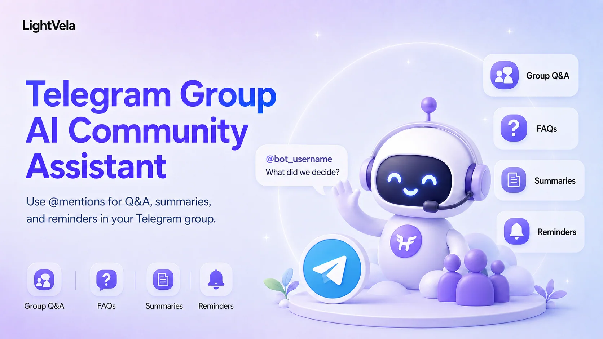

# Cara Menggunakan Telegram Pembantu Komuniti AI Kumpulan: Soal Jawab, Ringkasan dan Peringatan

## Ringkasan

**LightVela menyokong Telegram mesej kumpulan apabila anda melumpuhkan Privasi Kumpulan untuk Bot dalam BotFather, tambah Bot pada kumpulan dan mulakan perbualan dengan menyebutnya dengan `@bot_username`.**
Panduan ini merangkumi persediaan yang disahkan dan menunjukkan cara menggunakan Hermes Agent yang sama untuk Soal Jawab kumpulan, ringkasan dan peringatan tanpa menganggap acara penyertaan ahli yang tidak disahkan atau balasan kumpulan pasif sebagai ciri yang dikonfigurasikan.

## Sebelum anda bermula

Anda memerlukan Telegram Bot yang disambungkan ke Hermes Agent anda melalui [Konfigurasikan Saluran - Telegram](../configuration/channel-telegram.md).
Anda juga memerlukan kebenaran untuk menambahkan Bot itu pada kumpulan Telegram tempat anda ingin menggunakannya.

## Dayakan Telegram mesej kumpulan

### 1. Buka BotFather dan pilih Bot anda

1. Buka `@BotFather` dalam Telegram.
2. Hantar `/mybots`.
3. Pilih Bot yang disambungkan ke Hermes Agent anda.

### 2. Lumpuhkan Privasi Kumpulan

1. Buka "Tetapan Bot".
2. Pilih "Privasi Kumpulan".
3. Pilih "Matikan" atau "Lumpuhkan mod privasi".

Tetapan ini membolehkan Bot menerima mesej kumpulan yang menyebutnya.

### 3. Tambahkan Bot pada kumpulan Telegram

1. Buka kumpulan Telegram yang anda mahu gunakan.
2. Pilih "Tambah Ahli" atau tindakan pengurusan kumpulan yang setara.
3. Cari Bot dengan nama penggunanya dan tambahkannya pada kumpulan.

### 4. Sebut Bot untuk menguji mesej kumpulan

Hantar mesej yang menyebut Bot, seperti `@bot_username summarize the discussion so far`.

Hasil yang dijangkakan ialah Hermes Balasan ejen dalam kumpulan yang sama.

## Skop mesej yang disahkan

| Interaksi | Skop didokumenkan semasa | Bagaimana untuk mengesahkan |
|---|---|---|
| Perbualan kumpulan | Disokong apabila Bot ditambahkan pada kumpulan, Privasi Kumpulan dilumpuhkan dan mesej menyebut Bot | Hantar `@bot_username hello` dalam kumpulan dan sahkan balasan muncul di sana |
| Perbualan langsung | Disokong melalui Telegram Bot | Hantar mesej dalam sembang langsung Bot dan sahkan balasan |
| Alu-alukan penyertaan ahli automatik atau balasan pasif | Tidak ditubuhkan oleh panduan persediaan ini | Sahkan gelagat ini secara berasingan sebelum menjadikannya sebahagian daripada aliran kerja pengendalian |

## Gunakan Bot sebagai pembantu komuniti

Selepas ujian kumpulan berjaya, tentukan peranan yang jelas dan sempadan maklumat dengan [SOUL.md panduan personaliti](./im-agent-persona-soul-md.md).
Pastikan gesaan kumpulan jelas supaya peserta tahu apabila Ejen diminta untuk bertindak balas.

| Aliran kerja | Contoh gesaan kumpulan | Keputusan untuk menyemak |
|---|---|---|
| Soalan Lazim | `@bot_username answer only from the prepared FAQ` | Jawapannya menggunakan bahan yang disediakan atau dengan jelas meminta bantuan manusia |
| Ringkasan perbincangan | `@bot_username summarize decisions, action items, owners, and open questions` | Balasan memisahkan keputusan yang disahkan daripada item yang tidak diselesaikan |
| Draf peringatan | `@bot_username draft a reminder with time, audience, purpose, and cancellation method` | Semak draf sebelum menggunakan sebarang tugas yang dijadualkan untuk menghantarnya |

Untuk mendapatkan semula, ringkasan atau kandungan yang dijadualkan, pilih Kemahiran yang dipercayai dan semak kebenarannya dalam [Konfigurasikan Kemahiran](../configuration/skill.md).
Sahkan tugas yang dijadualkan secara berasingan dalam saluran sasaran yang disokong sebelum bergantung padanya untuk mesej yang dijadualkan.

## Keselamatan dan sempadan operasi

Melumpuhkan Privasi Kumpulan membolehkan laluan penghantaran mesej Telegram.
Ia tidak menggantikan tanggungjawab anda untuk menetapkan peraturan kumpulan, mengelakkan perkongsian maklumat sensitif, dan memerlukan pengesahan sebelum tindakan luaran berisiko tinggi.
Tentukan ahli mana yang boleh meminta tindakan sensitif, dan sahkan kebenaran sebelum Ejen melaksanakannya.

## Soalan Lazim

### Bolehkah saya menambah LightVela Telegram Bot pada kumpulan sekarang?

ya.
Lumpuhkan Privasi Kumpulan dalam BotFather, tambahkan Bot pada kumpulan dan sebutkannya dengan `@bot_username` untuk memulakan perbualan.

### Adakah tindakan melumpuhkan Privasi Kumpulan akan membuat Bot membalas dalam kumpulan?

Ia adalah bahagian yang diperlukan dalam persediaan yang didokumenkan.
Selepas melumpuhkannya, tambahkan Bot pada kumpulan dan sebutkannya dalam mesej ujian.

### Adakah panduan ini mengkonfigurasi mesej alu-aluan automatik untuk ahli baharu?

Tidak.
Panduan ini mendokumentasikan perbualan kumpulan yang dimulakan dengan menyebut Bot.
Sahkan acara sertai ahli dan sebarang aliran kerja alu-aluan automatik secara berasingan sebelum menjanjikannya kepada komuniti.

### Bolehkah WhatsApp kumpulan digunakan sebagai alternatif?

Dokumentasi saluran WhatsApp semasa masih menyatakan bahawa sembang kumpulan tidak disokong.
Jangan anggap Telegram sokongan mesej kumpulan meluas hingga WhatsApp.

## Langkah seterusnya

- [Konfigurasikan Saluran - Telegram](../configuration/channel-telegram.md) - Sambungkan Bot dan ulangi langkah persediaan mesej kumpulan.

- [Cara Menentukan Peranan, Personaliti dan Suara Ejen IM dengan SOUL.md](./im-agent-persona-soul-md.md) - Tentukan peranan dan sempadan pembantu.
