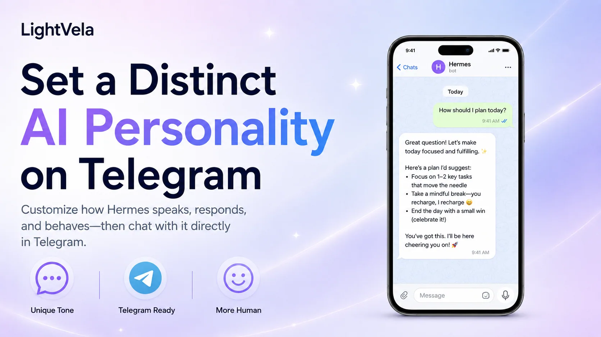

# Cara Mengkonfigurasi Hermes Agent dengan Personaliti Terbeza dalam Telegram

## Ringkasan

**Telegram hanyalah pintu masuk. Perkara yang menentukan cara Ejen bercakap, cara ia berfungsi dan perkara yang tidak akan dilakukannya ialah persona dan konteks jangka panjangnya.** Aliran ini mempunyai dua bahagian: mula-mula sambungkan Hermes Agent kepada Telegram mengikut panduan saluran (buat bot dengan BotFather untuk mendapatkan token, sambung dalam konsol, dan sahkan ia ditunjukkan sebagai disambungkan), kemudian pilih bahagian Peranan, jadual dan halaman Agent. menetapkan had dan menyuntiknya. Pastikan tiga lapisan berbeza: persona memegang prinsip tingkah laku yang tahan lama, pilihan pengguna memegang cara anda mahu dilayan dan ingatan jangka panjang memegang fakta yang disahkan dan latar belakang projek. Telegram menyokong mesej kumpulan selepas anda melumpuhkan Privasi Kumpulan dalam BotFather, tambahkan bot pada kumpulan dan mulakan perbualan dengan `@bot_username`.



## Untuk siapa ini

Panduan ini adalah untuk mereka yang inginkan Hermes Agent dengan personaliti yang konsisten dalam Telegram dari semasa ke semasa.
Ia berfungsi dengan baik untuk pembantu peribadi, rakan kongsi penyelidikan, teman belajar atau mana-mana pembantu harian yang harus berkomunikasi dengan cara yang boleh diramal.

Telegram menyokong perbualan langsung dan mesej kumpulan yang menyebut Bot yang disambungkan selepas Privasi Kumpulan dilumpuhkan.
Jika anda perlu menyambung Telegram, mulakan dengan [Konfigurasikan Saluran - Telegram](../configuration/channel-telegram.md).

## Prasyarat

- Ejen LightVela Hermes yang sedang berjalan.
  Jika anda belum menciptanya lagi, mulakan dengan [Mula Pantas](../02-quickstart.md).

- Konfigurasi model yang berfungsi atau kredit percubaan yang tersedia.
  Jika Hermes tidak dapat membalas lagi, lengkapkan [Konfigurasi Model](../configuration/model.md).

- Akaun Telegram dan Bot disambungkan dengan mengikuti [Konfigurasikan Saluran - Telegram](../configuration/channel-telegram.md).

- Idea pertama tentang peranan yang anda mahu Ejen mainkan.
  Ia boleh menjadi pembantu penyelidik ringkas, rakan belajar pesakit, atau pembantu peringatan berfokuskan pelaksanaan.

## Langkah / konsep utama

### 1. Sambungkan Hermes Agent kepada Telegram

Buka sasaran Hermes Agent dalam konsol LightVela, pergi ke "Saluran", dan pilih Telegram.
Ikuti [Konfigurasi Saluran - Telegram](../configuration/channel-telegram.md) untuk membuat Bot, tampal token HTTP API dan hantar mesej ujian.

Sahkan bahawa Telegram muncul sebagai disambungkan dalam konsol dan bahawa Bot menerima balasan Hermes Agent.
Sahkan saluran dahulu supaya masalah kemudian lebih mudah dibezakan daripada isu konfigurasi personaliti.

### 2. Terangkan bagaimana anda mahu Ejen bekerja

Keperibadian tersendiri adalah lebih daripada nama atau frasa.
Sebelum mengkonfigurasinya, tuliskan peranan, suara, gaya kerja dan sempadan yang anda mahu kekalkan stabil.

Gunakan ringkasan ringkas seperti ini sebagai titik permulaan:

```text
You are my research assistant. Help me break down questions, compare reliable sources, and write clear conclusions.
Give the conclusion first, then the key evidence. State uncertainty instead of presenting guesses as facts.
Use a professional, direct, friendly tone. Do not be performatively cute, and do not invent certainty.
Ask for confirmation before sending messages, changing files, or taking other external actions.
```

Ringkas ini membantu anda memilih Jiwa yang sesuai dan memberi anda bahasa untuk memperhalusi tingkah laku Ejen selepas Telegram disambungkan.

### 3. Pilih dan suntik Jiwa daripada Personaliti

Buka tetapan Agen sasaran dan pilih bahagian "Peribadi".
Anda boleh memilih "Lukis jiwa rawak" atau "Ujian personaliti jiwa", kemudian semak huraian pada setiap kad.

Pilih Jiwa yang paling sesuai dengan peranan dan klik "Suntikan jiwa".
LightVela menulis persona yang dipilih kepada Hermes Agent `SOUL.md` semasa dan menyimpan sandaran sebelum menggantikan konfigurasi sedia ada.

Jika Ejen sudah mempunyai Jiwa yang lain, menyuntik yang baru menggantikan persona yang sedang aktif.
Semak peranan, suara dan sempadan kad sebelum mengesahkan penggantian.

### 4. Mulakan perbualan baharu dalam Telegram

Selepas Jiwa disuntik, kembali ke sembang Telegram dan hantar:

```text
/new
```

Hermes Agent membaca `SOUL.md` baharu apabila perbualan baharu bermula.
Jika anda meneruskan perbualan lama tanpa menghantar `/new`, perbualan itu mungkin masih menggunakan syot kilat persona sebelumnya.

Setelah perbualan baharu bermula, minta semakan kendiri yang pantas:

```text
In three sentences, explain your current role, what you can help me with, and what you will not do for me.
```

### 5. Kalibrasi suara dengan tugasan sebenar

Jangan menilai personaliti hanya dengan bertanya "Siapa awak?".
Gunakan beberapa tugasan yang sebenarnya anda akan hantar dalam kehidupan seharian, seperti:

```text
Turn this research material into conclusions, evidence, and questions that still need confirmation.
```

```text
I have three deadlines today. Rank them by risk, then give me a concise plan.
```

```text
This request would send content to an external service. What would you do first?
```

Semak sama ada Ejen mengekalkan suara yang diharapkan, membenderakan ketidakpastian dan menghormati sempadan sekitar tindakan luar.
Jika sesuatu adalah keutamaan khusus pengguna, seperti bahasa, zon waktu atau format taklimat anda, minta Hermes untuk mengingatinya dan bukannya mengubah setiap pilihan menjadi peraturan persona.

## Bagaimana personaliti, pilihan pengguna dan ingatan sesuai bersama

`SOUL.md` adalah yang terbaik untuk peranan stabil, suara, keutamaan dan sempadan tingkah laku Ejen.
Profil pengguna adalah yang terbaik untuk identiti, bahasa, zon waktu dan pilihan komunikasi anda.
Memori jangka panjang adalah yang terbaik untuk fakta yang telah ditetapkan, keadaan projek dan konteks yang boleh digunakan semula daripada kerja kongsi anda.

Untuk penjelasan yang lebih mendalam, baca [Dari Mana Hermes Personaliti Ejen Berasal](../hermes-agent/10-persona-user-memory.md) dan [Pengurusan Memori](../configuration/memory.md).

## Soalan Lazim

### Adakah Bot Telegram mempunyai keperibadiannya sendiri?

Personaliti tersebut adalah milik Hermes Agent yang disambungkan ke Telegram, bukan token BotFather.
Jika Hermes Agent yang sama disambungkan ke saluran lain yang disokong, saluran tersebut menggunakan persona peringkat Ejen yang sama dan konteks tahan lama.

### Adakah `/new` memadamkan memori?

Tidak.
`/new` memulakan perbualan baharu supaya `SOUL.md` baharu dimuatkan pada permulaan sesi.
Ia tidak memadamkan memori jangka panjang atau profil pengguna Ejen.

### Bolehkah saya menambah Telegram Bot pada kumpulan?

ya.
Dalam BotFather, hantar `/mybots`, pilih Bot, kemudian buka "Tetapan Bot" → "Privasi Kumpulan" dan matikan mod privasi.
Tambahkan Bot pada kumpulan dan mulakan perbualan dengan `@bot_username`.
Lihat [Konfigurasi Saluran - Telegram](../configuration/channel-telegram.md) untuk persediaan lengkap.

### Adakah perubahan model akan menyebabkan Ejen kehilangan personalitinya?

Selalunya tidak.
Model, persona Agen dan ingatan jangka panjang adalah lapisan konfigurasi yang berasingan, walaupun menukar model boleh mengubah penaakulan, penggunaan alat dan butiran kecil gaya tindak balas.

## Langkah seterusnya

- [Cara Mengkonfigurasi Hermes Agent dengan Personaliti Terbeza dalam WhatsApp](./whatsapp-persona-agent.md) - Gunakan personaliti Ejen yang sama pada perbualan 1-ke-1 WhatsApp.

- [Cara Mentakrifkan Peranan, Personaliti dan Suara Ejen IM dengan SOUL.md](./im-agent-persona-soul-md.md) - Fahami sempadan antara Jiwa, personaliti dan ingatan jangka panjang.

- [Konfigurasikan Saluran - Telegram](../configuration/channel-telegram.md) - Ikuti aliran sambungan Telegram Bot yang lengkap.

- [Konfigurasikan Kemahiran](../configuration/skill.md) - Kembangkan personaliti yang stabil dengan keupayaan tugas praktikal.
