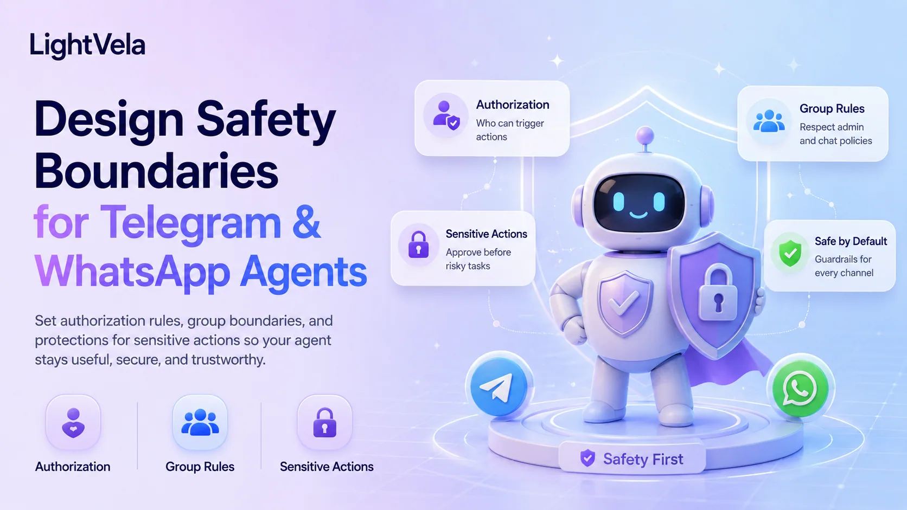

# Cara Merekabentuk Sempadan Keselamatan untuk Telegram dan WhatsApp Ejen: Keizinan, Peraturan Kumpulan dan Tindakan Sensitif

## Ringkasan

**Sempadan keselamatan Ejen tidak ditentukan oleh model sahaja. Ia dibina daripada empat lapisan: bukti kelayakan saluran, skop perbualan, dasar ingatan dan peraturan untuk tindakan luaran.** Sempadan yang jelas membolehkan anda menjawab empat soalan secara muktamad — siapa yang boleh menghubungi Ejen ini, mesej yang mana diproses, kandungan yang tidak boleh dihantar dan tindakan yang memerlukan pengesahan terlebih dahulu. Amalan utama: bukti kelayakan adalah sensitif dan tidak boleh dimasukkan ke dalam konteks jangka panjang atau ditampal ke dalam sembang; dasar ingatan mesti mengelak daripada menukar data sensitif kepada rekod kekal; dan apa-apa yang dihantar secara luaran atau tidak boleh diterbalikkan memerlukan langkah pengesahan. Telegram menyokong mesej kumpulan selepas anda melumpuhkan Privasi Kumpulan dalam BotFather, tambahkan Bot pada kumpulan dan mulakan perbualan dengan `@bot_username`. WhatsApp sokongan kumpulan tetap tertakluk kepada dokumentasi salurannya sendiri. Bekerja melalui senarai semak keselamatan sebelum disiarkan secara langsung.

## Untuk siapa ini

Panduan ini adalah untuk pengguna individu, petunjuk sokongan dan pentadbir pasukan yang menghubungkan Ejen IM ke kerja harian.

Ia berguna untuk pasukan yang ingin menentukan skop kebenaran, sempadan data dan prosedur tindakan berisiko tinggi sebelum menyambungkan akaun Bot atau WhatsApp.

## Empat lapisan sempadan keselamatan

| Lapisan | Soalan untuk dijawab | Kawalan biasa |
|---|---|---|
| Keizinan | Siapa yang boleh berhubung dan menggunakan Ejen ini? | Token bot, akaun yang dibenarkan QR, rekod sambungan, kebenaran akaun |
| Perbualan | Perbualan manakah yang diproses dan dijawab? | Skop mesej langsung, Telegram Privasi Kumpulan dan pencetus @sebutan, skop yang dibenarkan |
| Data | Kandungan manakah yang boleh dibaca atau dikekalkan? | Redaksi, Storan Awan, memori, profil pengguna, dasar pemadaman |
| Tindakan | Tindakan yang manakah boleh dijalankan secara automatik? | Keistimewaan terkecil, pengesahan manusia, jejak audit, penyerahan manusia |

Mulakan dengan skop berguna terkecil dan kembangkan kebenaran hanya apabila penggunaan sebenar memerlukannya.

## Langkah

### 1. Sahkan sasaran kebenaran untuk setiap saluran

Telegram menyambung melalui Token Bot, manakala WhatsApp menyambung melalui kebenaran QR.

Sebelum menyambung, sahkan hubungan antara Bot, akaun WhatsApp dan sasaran Hermes Agent, dan masukkan bukti kelayakan hanya dalam tetapan saluran LightVela yang sepadan.

Telegram Token Bot, WhatsApp sesi log masuk, kod pengesahan dan bukti kelayakan lain tidak boleh dihantar dalam sembang biasa atau ditulis ke dalam dokumen, tiket atau repositori.

Nombor Telegram Bot atau WhatsApp yang sama biasanya tidak terikat kepada berbilang Hermes Agent, jadi orang ramai boleh memberitahu Ejen mana yang menerima mesej.

Selepas menyambung, hantar mesej ujian berisiko rendah, sahkan bahawa balasan kembali kepada kenalan yang dijangkakan dan semak senarai saluran bersambung dalam konsol.

### 2. Hadkan skop saluran kepada keupayaan semasa

Telegram menyokong mesej kumpulan.
Lumpuhkan Privasi Kumpulan dalam BotFather, tambahkan Bot pada kumpulan dan mulakan perbualan dengan `@bot_username`.
WhatsApp kekal tertakluk kepada skop sokongan kumpulan dalam dokumentasi salurannya sendiri.

Melumpuhkan Telegram Privasi Kumpulan diperlukan untuk persediaan penghantaran mesej, tetapi ia tidak menjadikan penggunaan kumpulan selamat dengan sendirinya.
Tentukan kumpulan yang dibenarkan, pentadbir, ahli, tingkah laku @sebutan dan had kadar mesej sebelum menggunakan aliran kerja.

Sebelum menggunakan kumpulan, sahkan juga sama ada mesej ahli memasuki memori kongsi dan cara maklumat seorang ahli dihalang daripada ditunjukkan kepada yang lain.

### 3. Tetapkan sempadan kandungan mesej

Jangan hantar kata laluan, kunci API, token akses, kod pengesahan, maklumat pembayaran, butiran identiti penuh, butiran perubatan atau data privasi pelanggan yang tidak diperlukan kepada Ejen.

Jika kes perniagaan sebenar mesti dibincangkan, alih keluar nama, nombor telefon, alamat, nombor pesanan dan maklumat lain yang boleh mengenal pasti seseorang atau organisasi.

Gunakan peraturan yang lebih ketat dalam saluran kerjasama berbilang orang dan luar kerana mesej mungkin kelihatan kepada lebih ramai ahli, dimajukan atau disimpan lebih lama.

### 4. Simpan memori dan fail dalam skop minimum yang diperlukan

Letakkan peraturan peranan, suara dan sempadan yang stabil dalam [SOUL.md konfigurasi personaliti](./im-agent-persona-soul-md.md).

Kekalkan keutamaan yang disahkan dan konteks kerjasama yang tahan lama melalui [Pengurusan Memori](../configuration/memory.md).

Simpan bahan produk, Soalan Lazim sokongan dan fail rujukan yang besar dalam [Cloud Storage](../configuration/files.md) dan bukannya meletakkan setiap mesej sembang mentah ke dalam ingatan jangka panjang.

Semak memori, profil pengguna dan Storan Awan dengan kerap dan alih keluar maklumat yang tidak lagi diperlukan atau tidak sepatutnya disimpan.

### 5. Tetapkan ambang pengesahan untuk tindakan sensitif

Tindakan yang biasanya memerlukan pengesahan manusia termasuk:

- Menghantar mesej luaran atau kandungan penerbitan.

- Menukar pesanan, harga, langganan, kebenaran atau butiran akaun.

- Bayaran balik, pembayaran, semakan identiti atau komitmen undang-undang.

- Memadamkan fail, memori, data pengguna atau data tidak boleh balik yang lain.

- Menjalankan arahan yang mempengaruhi persekitaran pengeluaran atau sistem pihak ketiga.

Ejen boleh membaca bahan, mengatur risiko dan merangka cadangan terlebih dahulu, tetapi ia harus menerangkan kesan, sasaran dan kebolehbalikan sebelum pelaksanaan dan menunggu pengesahan eksplisit.

Jangan anggap soalan pengguna sebagai kebenaran untuk melaksanakan tindakan.

### 6. Tambah sempadan untuk Kemahiran dan tugasan yang dijadualkan

Sebelum memasang Skill, sahkan sumber, kebenaran, API luaran, akses fail dan keupayaan mesej proaktifnya.

Uji Kemahiran baharu dalam perbualan 1-dengan-1 dengan bahan berisiko rendah sebelum mengembangkan penggunaannya.

Setiap tugas yang dijadualkan memerlukan jadual yang jelas, tetingkap masa aktif, kaedah pemberitahuan, saluran sasaran dan kaedah jeda.

Untuk WhatsApp mesej proaktif, ambil kira tetingkap perbualan dan templat mesej dan bukannya menganggap bahawa teks biasa akan sentiasa dihantar.

### 7. Kegagalan reka bentuk dan serahan manusia

Apabila Ejen tidak pasti, tidak boleh menyebut bahannya, menerima kandungan sensitif, mendapati kebenaran tidak jelas, atau menghadapi aduan, ia harus menghentikan pelaksanaan automatik dan menyerahkan kepada manusia.

Rekod lepas tangan hendaklah termasuk pencetus, kandungan yang telah diproses, tindakan yang belum selesai dan langkah seterusnya yang disyorkan.

Jika bukti kelayakan mungkin telah didedahkan, hentikan penggunaan saluran yang terjejas dan batalkan, tetapkan semula atau beri kebenaran semula melalui prosedur platform.

## Senarai semak keselamatan prapelancaran

- Adakah setiap akaun Telegram Bot atau WhatsApp dipetakan kepada satu Ejen yang jelas?

- Adakah anda telah mengesahkan bahawa bukti kelayakan tidak muncul dalam sembang, dokumen, kod atau log?

- Adakah anda telah melumpuhkan Privasi Kumpulan, menambahkan Bot pada kumpulan dan mengesahkan mesej kumpulan Telegram dengan `@bot_username`?

- Adakah anda telah menentukan memori yang boleh disimpan, fail yang boleh diakses dan cara pemadaman berfungsi?

- Adakah tindakan sensitif, mesej luaran dan perubahan yang tidak boleh diubah memerlukan pengesahan?

- Adakah Kemahiran dan tugas berjadual mempunyai keistimewaan yang paling sedikit, saluran sasaran yang jelas dan kaedah jeda?

- Adakah anda mempunyai prosedur untuk bukti kelayakan yang terdedah, mesej yang tersilap, dan serahan manusia?

## Soalan Lazim

### Bolehkah Telegram dan WhatsApp menggunakan dasar keselamatan yang sama?

Mereka boleh berkongsi prinsip, tetapi perbezaan saluran tetap penting.

Kedua-duanya harus melindungi bukti kelayakan, mengehadkan kandungan sensitif dan memerlukan pengesahan untuk tindakan berisiko tinggi, manakala kebenaran, had mesej proaktif dan format mesej mesti disahkan secara berasingan.

### Adakah dengan melumpuhkan Telegram Mod privasi bot menjadikan penggunaan kumpulan selamat?

Tak semestinya.

Melumpuhkan mod privasi diperlukan untuk persediaan mesej kumpulan Telegram.
Ia membenarkan Bot menerima mesej kumpulan yang menyebutnya, tetapi ia tidak menggantikan peraturan kumpulan, perlindungan maklumat sensitif atau pengesahan sebelum tindakan berisiko tinggi.

### Bolehkah Ejen memadam memori atau fail secara automatik?

Pemadaman, menulis ganti dan tindakan tidak boleh balik yang lain harus memerlukan pengesahan dan penjelasan mengenai sasaran dan kesan.

Malah permintaan lupa perbualan harus mengenal pasti maklumat yang dimaksudkan dengan jelas dan bukannya ditafsirkan sebagai permintaan pemadaman pukal.

### Bolehkah Ejen perkhidmatan pelanggan mengeluarkan bayaran balik atau menukar pesanan secara terus?

Ia tidak sepatutnya secara lalai.

Melainkan kebenaran sistem, orang yang memberi kuasa, aliran pengesahan dan keperluan audit adalah eksplisit, biarkan Ejen merangka pengesyoran dan menyerahkan kes itu kepada manusia.

### Bagaimana jika saya tidak tahu sama ada maklumat itu sensitif?

Suntingkannya dahulu, atau jangan hantarnya.

Gunakan data fiksyen untuk meminta templat, aliran kerja atau nasihat keselamatan dan bukannya menyerahkan bukti kelayakan sebenar atau data privasi pelanggan.

## Langkah seterusnya

- [Konfigurasikan Saluran - Telegram](../configuration/channel-telegram.md) - Semak Telegram Persediaan bot dan skop mesej semasa.

- [Konfigurasikan Saluran - WhatsApp](../configuration/channel-whatsapp.md) - Semak WhatsApp keizinan dan had mesej proaktif.

- [Cara Menghubungkan Satu Ejen kepada Telegram dan WhatsApp Sambil Mengekalkan Satu Personaliti dan Ingatan Jangka Panjang](./multi-channel-personality-memory.md) - Fahami sempadan konfigurasi Ejen yang dikongsi.

- [Konfigurasikan Kemahiran](../configuration/skill.md) - Semak kebenaran Kemahiran dan gesaan pemasangan berisiko tinggi.
