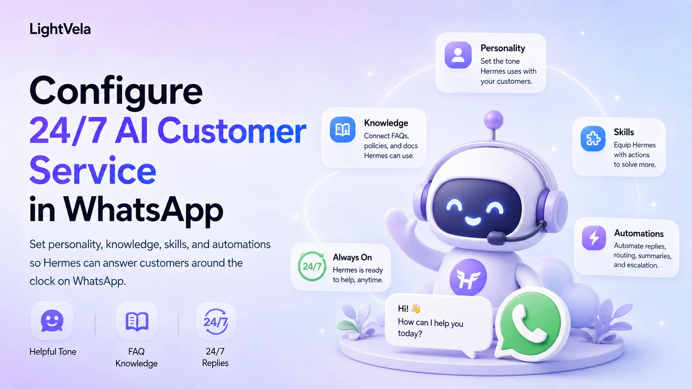

# Cara Mengkonfigurasi Perkhidmatan Pelanggan AI 24/7 dalam WhatsApp: Personaliti, Pengetahuan, Kemahiran dan Tugasan Berjadual

## Ringkasan

**WhatsApp boleh berfungsi sebagai pintu masuk satu sama lain antara pelanggan dan Hermes Agent, berguna untuk menjawab soalan berulang, menangkap keperluan pelanggan dan merangka respons. Tetapi "24/7" di sini bermakna ia boleh bertindak balas pada bila-bila masa perkhidmatan berjalan, model tersedia dan saluran disambungkan — ia bukan jaminan perkhidmatan tanpa gangguan atau SLA sokongan manusia.** Kekangan kedua sama pentingnya: pemesejan proaktif pada WhatsApp kekal tertakluk kepada tetingkap perbualan, mesej templat dan konfigurasi saluran, jadi peringatan yang dimulakan daripada pelanggan mesti direka bentuk secara automatik daripada perbualan pelanggan yang dimulakan daripada yang diasingkan. sesuka hati. Bina dalam empat lapisan, mengikut urutan: persona menetapkan keadaan suara dan peningkatan, pengetahuan menangkap Soalan Lazim, kemahiran menambah prosedur boleh guna semula dan tugas berjadual mengendalikan ringkasan berjadual.

## Untuk siapa ini

Panduan ini adalah untuk orang yang ingin menggunakan ejen sokongan peribadi, pembantu maklumat produk atau pembantu triage selepas jualan di WhatsApp.

Ia amat berguna untuk pasukan yang memerlukan bahasa sokongan yang konsisten, Soalan Lazim yang boleh diselenggara, lebih sedikit balasan berulang dan laluan serahan yang jelas untuk permintaan yang rumit.

## Prasyarat

- Ejen LightVela Hermes yang sedang berjalan.
  Jika anda belum menciptanya lagi, mulakan dengan [Mula Pantas](../02-quickstart.md).

- Konfigurasi model yang berfungsi atau kredit percubaan yang tersedia.

- Akaun WhatsApp yang boleh digunakan disambungkan dengan mengikuti [Konfigurasikan Saluran - WhatsApp](../configuration/channel-whatsapp.md).

- Bahan produk, waktu perkhidmatan, laluan peningkatan dan butiran hubungan manusia.

- Takrifan tindakan yang jelas yang memerlukan pelaksanaan atau pengesahan manusia.

## Fahami lima lapisan perkhidmatan pelanggan 24/7

| Lapisan | Tanggungjawab | Lokasi yang sesuai |
|---|---|---|
| Personaliti | Peranan, suara, keutamaan dan sempadan perkhidmatan | SOUL.md atau [Personaliti](./im-agent-persona-soul-md.md) |
| Pengetahuan | Soalan Lazim Produk, dasar, waktu perkhidmatan dan laluan peningkatan | Fail rujukan dalam [Cloud Storage](../configuration/files.md) |
| Kemahiran | Pengambilan semula, organisasi, penggubalan dan tindakan konkrit lain | [Kemahiran](../configuration/skill.md) |
| Memori | Pilihan pelanggan yang disahkan dan konteks kerjasama tahan lama | [Pengurusan Memori](../configuration/memory.md) |
| Tugas Berjadual | Semakan berjadual, peringatan dalaman dan notis proaktif | [Tugas Berjadual](../configuration/automation.md) |

Jangan letakkan asas pengetahuan produk yang besar ke dalam personaliti, dan jangan anggap kandungan pelanggan yang tidak disahkan sebagai ingatan jangka panjang.

## Langkah

### 1. Sambung dan sahkan perbualan WhatsApp 1-ke-1

Dalam tetapan saluran Hermes sasaran, pilih WhatsApp dan lengkapkan kebenaran QR dengan mengikuti [Konfigurasikan Saluran - WhatsApp](../configuration/channel-whatsapp.md).

Buka kenalan yang sepadan dalam WhatsApp dan hantar mesej ujian, kemudian sahkan bahawa konsol menunjukkan saluran sebagai disambungkan dan balasan tiba seperti biasa.

Saluran WhatsApp semasa tidak menyokong sembang kumpulan, jadi aliran perkhidmatan pelanggan ini direka untuk perbualan 1-ke-1 pelanggan.

### 2. Tulis ringkasan personaliti perkhidmatan pelanggan

Gunakan [SOUL.md panduan personaliti](./im-agent-persona-soul-md.md) untuk menentukan identiti, suara, perintah tindak balas dan sempadan peningkatan pembantu sokongan.

Mulakan dengan ringkas seperti ini:

Anda ialah pembantu sokongan produk kami.
    Beri pelanggan kesimpulan yang paling penting dahulu, diikuti dengan langkah-langkah yang diperlukan.
    Jawab hanya daripada bahan produk yang disahkan, dan cadangkan dengan jelas serahan manusia apabila tidak pasti.
    Jangan janjikan bayaran balik, perubahan harga, semakan identiti, pemadaman data atau hasil lain yang berisiko tinggi.
    Sebelum menghantar kandungan ke sistem luaran atau membuat perubahan, terangkan kesannya dan tunggu pengesahan manusia.

Kekalkan prinsip perkhidmatan yang stabil dalam personaliti, dan simpan jawapan produk yang konkrit dalam fail rujukan yang boleh diselenggara.

### 3. Atur pangkalan pengetahuan sokongan

Sediakan sekurang-kurangnya kategori ini:

- Soalan Lazim Produk dan pelan.

- Waktu perkhidmatan, jangkaan respons dan butiran hubungan manusia.

- Polisi bayaran balik, pembatalan, peningkatan dan insiden.

- Ralat biasa dan langkah penyelesaian masalah.

- Permintaan yang memerlukan penyerahan manusia dan maklumat untuk dikumpulkan sebelum penyerahan.

Pisahkan bahan kepada fail topik yang boleh diselenggara dan letakkannya dalam [Cloud Storage](../configuration/files.md).

Uji bahan dengan gesaan berisiko rendah:

Jawab soalan ini hanya daripada bahan sokongan yang disediakan.
    Jika bahan itu tidak mengandungi jawapan, nyatakan maklumat yang tiada dan cadangkan serahan manusia.

### 4. Pasang dan sahkan Kemahiran yang diperlukan

Jika anda memerlukan perolehan pengetahuan, organisasi tiket, carian web atau penjanaan kandungan, pilih Kemahiran yang dipercayai daripada [Skills.sh](https://skills.sh/) atau [ClawHub](https://clawhub.ai/).

Sebelum meminta Hermes memasangnya melalui WhatsApp, tanyakan apa yang dibaca oleh Skill, perkhidmatan luaran yang dipanggilnya dan sama ada ia boleh menghantar mesej proaktif.

Kemahiran berisiko tinggi boleh meminta pengesahan kedua sebelum pemasangan, jadi semak kebenaran dan panduan keselamatan dalam [Konfigurasikan Kemahiran](../configuration/skill.md).

Selepas pemasangan, uji draf, ringkasan dan perolehan Soalan Lazim sebelum membenarkan mana-mana Skill memproses bayaran balik, memadamkan data atau menghantar kandungan pelanggan yang belum disemak.

### 5. Tetapkan pilihan pelanggan dan ingatan tahan lama

Hanya maklumat yang disahkan dan berguna untuk perkhidmatan masa hadapan harus disimpan ke memori atau profil pengguna.

Contohnya termasuk keutamaan yang disahkan untuk bahasa Inggeris, keutamaan untuk balasan didahulukan kesimpulan atau status kes sokongan berterusan yang telah disahkan oleh pelanggan.

Kata laluan, kod pengesahan, butiran pembayaran, maklumat identiti penuh dan data sensitif yang tidak perlu tidak boleh disimpan sebagai ingatan jangka panjang.

Minta Hermes dalam perbualan untuk mengingati atau melupakan pilihan, dan semak halaman [Pengurusan Memori](../configuration/memory.md) secara berkala dalam konsol.

### 6. Konfigurasikan tugas berjadual dan mesej proaktif

Calon tugas berjadual yang baik termasuk peringatan tugas dalaman, semakan kes tidak diselesaikan dan ringkasan perkhidmatan harian.

Konfigurasikan jadual, tetingkap masa aktif dan kaedah pemberitahuan dalam [Tugas Terjadual](../configuration/automation.md).

WhatsApp mesej proaktif mungkin dihadkan oleh tetingkap perbualan atau templat mesej yang diluluskan, jadi jangan menganggap bahawa teks biasa sentiasa boleh dihantar apabila pelanggan belum memulakan perbualan.

Gunakan nombor ujian dahulu untuk mengesahkan penghantaran, kandungan dan laluan pengendalian dalaman apabila pemberitahuan gagal.

### 7. Wujudkan handoff manusia

Apabila permintaan melibatkan bayaran balik, pembayaran, semakan identiti, komitmen undang-undang, aduan yang meningkat atau bahan rujukan yang hilang, Ejen sokongan harus berhenti meneka dan menyerahkan kepada manusia.

Mesej penyerahan hendaklah termasuk fakta yang diketahui, maklumat yang hilang, langkah seterusnya yang disyorkan dan sama ada pelanggan perlu mengulangi isu tersebut.

Semak sampel perbualan setiap hari, memfokuskan pada petikan yang salah, terlalu menjanjikan, pengendalian data sensitif dan mesej proaktif yang berulang.

## Perintah tindak balas sokongan boleh diguna semula

1. Berikan kesimpulan langsung.

2. Petik bahan atau langkah yang paling relevan.

3. Terangkan kekangan, kos, masa atau maklumat yang diperlukan.

4. Nyatakan dengan jelas bila handoff manusia diperlukan.

5. Laksanakan tindakan luaran hanya apabila ia dibenarkan dan disahkan.

## Soalan Lazim

### Adakah 24/7 bermakna WhatsApp akan sentiasa membalas serta-merta?

Tidak.

Ejen mesti berjalan, model mesti tersedia, saluran WhatsApp mesti kekal disambungkan dan penghantaran proaktif mungkin dihadkan oleh tetingkap perbualan dan templat mesej.

### Bolehkah WhatsApp perkhidmatan pelanggan mengendalikan sembang kumpulan?

Dokumentasi saluran WhatsApp semasa mengatakan bahawa sembang kumpulan tidak disokong dan hanya perbualan 1-ke-1 disokong.

Jika anda memerlukan perkhidmatan pelanggan kumpulan, mula-mula sahkan bahawa saluran sasaran lain mempunyai dokumentasi sokongan kumpulan yang jelas dan bukannya membuat kesimpulan sokongan kumpulan daripada gelagat 1-ke-1.

### Patutkah bahan sokongan masuk ke dalam memori atau Storan Awan?

Soalan Lazim Produk, dasar dan koleksi rujukan yang besar tergolong dalam Storan Awan.

Memori dan profil pengguna adalah lebih baik untuk sejumlah kecil pilihan pelanggan yang stabil, fakta yang disahkan dan konteks kerjasama yang tahan lama.

### Bolehkah Skill menghantar mesej kepada pelanggan secara automatik?

Hanya apabila keupayaan saluran, kebenaran perniagaan, templat mesej dan peraturan semakan manusia adalah jelas.

Secara lalai, biarkan Skill membuat draf atau peringatan dalaman, kemudian minta manusia mengesahkan perkara yang perlu dihantar.

## Langkah seterusnya

- [Konfigurasikan Saluran - WhatsApp](../configuration/channel-whatsapp.md) - Lengkapkan sambungan WhatsApp 1-ke-1.

- [Cara Mengubah Ejen IM menjadi Khidmat Pelanggan, Komuniti atau Pembantu Rakan dengan Kemahiran](./im-agent-skill-scenarios.md) - Pilih dan sahkan Kemahiran perkhidmatan pelanggan.

- [Cara Menentukan Peranan, Personaliti dan Suara Ejen IM dengan SOUL.md](./im-agent-persona-soul-md.md) - Tentukan personaliti sokongan dan sempadan tingkah laku.

- [Tugas Berjadual](../configuration/automation.md) - Konfigurasikan peringatan dalaman dan ringkasan berjadual.
