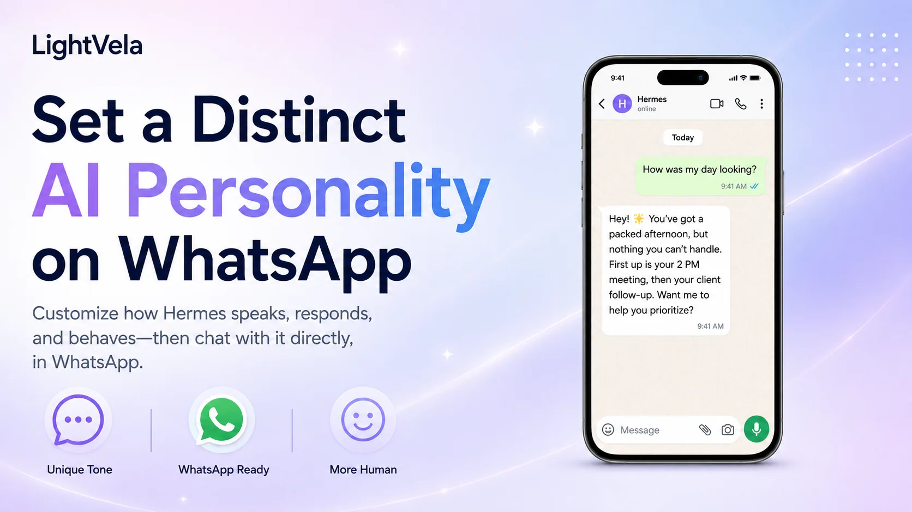

# Cara Mengkonfigurasi Hermes Agent dengan Personaliti Terbeza dalam WhatsApp

## Ringkasan

**WhatsApp membawa mesej; peranan Ejen, nada, had dan konteks jangka panjang berasal daripada konfigurasinya dalam LightVela — menukar titik masuk tidak mengubah siapa itu.** Sambungkan saluran WhatsApp dahulu (beri kebenaran mengikut panduan saluran dan sahkan konsol menunjukkannya sebagai disambungkan), kemudian gunakan bahagian Persona pada halaman tetapan Ejen untuk memilih dan menyuntik saya, perbualan peribadi atau pelanggan yang sesuai. Jika Ejen ini berhadapan dengan pelanggan atau pasukan, namakan khalayak secara eksplisit dalam persona dan tambahkan nada jenama, skop yang mungkin dikendalikannya dan syarat untuk meningkat kepada manusia. Selepas menyambung, hantar mesej ujian dan sahkan balasan tiba dalam perbualan yang dijangkakan. Jika tiada apa-apa yang tiba, semak sama ada model dikonfigurasikan, sama ada kredit percubaan telah habis dan sama ada saluran dipaparkan sebagai disambungkan.



## Untuk siapa ini

Panduan ini adalah untuk orang yang mahukan Hermes Agent dengan suara yang konsisten dan konteks kerja yang berguna dalam WhatsApp.
Ia berfungsi terutamanya untuk bantuan peribadi, peringatan setiap hari, organisasi maklumat dan senario 1-ke-1 lain di mana gaya perbualan harus kekal boleh diramal.

WhatsApp pada masa ini bertujuan terutamanya untuk perbualan 1-ke-1.
Jika anda belum menyambung WhatsApp lagi, mulakan dengan [Konfigurasikan Saluran - WhatsApp](../configuration/channel-whatsapp.md).

## Prasyarat

- Ejen LightVela Hermes yang sedang berjalan.
  Jika anda belum menciptanya lagi, mulakan dengan [Mula Pantas](../02-quickstart.md).

- Konfigurasi model yang berfungsi atau kredit percubaan yang tersedia.
  Jika Hermes tidak dapat membalas lagi, lengkapkan [Konfigurasi Model](../configuration/model.md).

- Akaun WhatsApp yang boleh menerima mesej pengesahan, dengan kebenaran diselesaikan melalui [Konfigurasikan Saluran - WhatsApp](../configuration/channel-whatsapp.md).

- Ringkas personaliti ringkas.
  Tentukan siapa Ejen berkhidmat, masalah apa yang membantunya, bagaimana ia sepatutnya berbunyi, dan tindakan mana yang sentiasa memerlukan pengesahan anda.

## Langkah / konsep utama

### 1. Sambungkan saluran WhatsApp dahulu

Buka sasaran Hermes Agent dalam konsol LightVela, pergi ke "Saluran", dan pilih WhatsApp.
Ikuti [Konfigurasi Saluran - WhatsApp](../configuration/channel-whatsapp.md) melalui kebenaran telefon, kod pengesahan atau aliran QR, kemudian hantar mesej ujian.

Sahkan bahawa WhatsApp muncul sebagai disambungkan dalam konsol dan Hermes Agent membalas dalam WhatsApp.
Jika saluran belum disambungkan lagi, selesaikan isu kebenaran, model atau kredit sebelum menala personaliti.

### 2. Tulis ringkasan peranan untuk konteks WhatsApp

WhatsApp perbualan selalunya lebih pendek dan lebih segera, dan mereka boleh mencampurkan permintaan peribadi dan kerja dalam urutan yang sama.
Bersama-sama dengan menerangkan siapa Ejen itu, tentukan panjang balasannya, gelagat penjelasan dan sempadan di sekitar tindakan berisiko tinggi.

Mulakan dengan ringkas peranan seperti ini:

```text
You are my everyday WhatsApp assistant.
Help me organize to-dos, follow-ups, and short messages, but do not take external actions without my confirmation.
Use a concise, natural, friendly tone by default. Use short sections when an explanation is needed instead of sending one long block.
If my request is missing a time, person, or goal, ask the single most important clarifying question first.
```

Jika WhatsApp Ejen melayani pelanggan atau pasukan, gantikan "saya" dengan khalayak yang dimaksudkan dan tambahkan suara jenama, skop yang disokong dan syarat untuk menyerahkan permintaan kepada manusia.

### 3. Pilih dan suntik Jiwa daripada Personaliti

Buka tetapan Ejen sasaran dan pilih bahagian "Peribadi".
Anda boleh melukis Jiwa rawak atau menggunakan ujian personaliti untuk mencari padanan yang lebih dekat.

Semak perihalan peranan, suara dan tingkah laku pada kad, pilihnya dan klik "Suntikan jiwa".
LightVela menulis Jiwa yang dipilih kepada Hermes Agent `SOUL.md` semasa dan menyimpan sandaran sebelum menggantikan persona sebelumnya.

Hanya satu Jiwa yang aktif untuk Ejen pada satu masa.
Jika anda menyuntik yang baharu, WhatsApp balasan menggunakan personaliti baharu dalam perbualan baharu, jadi bandingkan peranan lama dan baharu sebelum mengesahkan.

### 4. Mulakan perbualan baharu dalam WhatsApp

Selepas Jiwa disuntik, hantar mesej ini dalam perbualan WhatsApp:

```text
/new
```

Ini membolehkan Hermes Agent membaca `SOUL.md` baharu apabila perbualan baharu bermula.
Jika perbualan lama masih berbunyi sama, sahkan bahawa `/new` telah berjaya dihantar sebelum menguji lebih lanjut.

Gunakan semakan kendiri pendek untuk mengesahkan keputusan:

```text
Explain who you serve, your default reply style, and what you do when a request would send a message outside this chat.
```

### 5. Tentukur irama WhatsApp dengan mesej sebenar

Dalam WhatsApp, personaliti yang berguna bukan sahaja tentang bunyi seperti watak tertentu.
Ia juga termasuk panjang mesej, pengumpulan dan masa untuk bertanya soalan susulan.

Ujinya dengan tiga jenis mesej:

```text
Turn this content into three messages I could send to a colleague.
```

```text
Remind me to follow up on this tomorrow at 3 PM, and first tell me what information you plan to record.
```

```text
This request might trigger an external action. List the risks and what you need me to confirm first.
```

Jika balasan terlalu panjang, simpan pilihan seperti "kekalkan balasan lalai di bawah tiga bahagian pendek".
Jika Ejen memerlukan konteks projek yang stabil, gunakan keupayaan [Pengurusan Memori](../configuration/memory.md) untuk mengekalkan fakta yang sepatutnya kekal berguna.

## Jauhkan personaliti berasingan daripada aliran kerja perkhidmatan pelanggan

Personaliti mentakrifkan peranan dan suara yang digunakan oleh Ejen.
Kemahiran menentukan sama ada ia boleh melaksanakan tugas tertentu.
Tugasan Berjadual menentukan masa ia mula berfungsi secara proaktif.
Memori dan profil pengguna menentukan konteks jangka panjang yang harus dikekalkan.

Contohnya, personaliti perkhidmatan pelanggan yang mesra tidak menyediakan carian pesanan, carian asas pengetahuan atau keupayaan bayaran balik secara automatik.
Keupayaan tersebut memerlukan konfigurasi model, kemahiran, fail rujukan dan sempadan tindakan yang jelas.

Untuk penjelasan lebih mendalam tentang sempadan antara personaliti, pilihan pengguna dan ingatan jangka panjang, baca [Dari Mana Hermes Personaliti Ejen Berasal](../hermes-agent/10-persona-user-memory.md).

## Soalan Lazim

### Patutkah satu WhatsApp nombor memetakan kepada satu Hermes Agent?

Secara amnya, satu nombor WhatsApp hendaklah terikat kepada satu Hermes Agent.
Jika anda memerlukan beberapa peranan yang berbeza, gunakan WhatsApp nombor dan Hermes kejadian ejen yang berasingan dan bukannya menggantikan satu personaliti dalam urutan yang sama berulang kali.

### Adakah menyuntik Jiwa baharu memadamkan sejarah atau ingatan WhatsApp?

Tidak.
Menyuntik Jiwa baharu terutamanya menggantikan `SOUL.md` semasa Ejen, manakala `/new` memulakan perbualan baharu.
Memori jangka panjang dan profil pengguna kekal sebagai lapisan konteks yang berasingan, walaupun personaliti baharu boleh mengubah cara Hermes mentafsir dan menggunakan konteks tersebut.

### Bolehkah saya menggunakan persediaan ini dalam kumpulan WhatsApp?

Dokumentasi WhatsApp semasa mentakrifkan perbualan 1-ke-1 sebagai skop yang disokong, jadi kumpulan bukan sebahagian daripada panduan ini.
Semak [Konfigurasi Saluran - WhatsApp](../configuration/channel-whatsapp.md) untuk had saluran semasa.

### Bolehkah ejen WhatsApp menghantar mesej secara proaktif?

Mesej proaktif juga tertakluk pada WhatsApp peraturan templat mesej dan tetingkap perbualan.
Jika anda mahukan peringatan berjadual, baca [Tugas Berjadual](../configuration/automation.md) dan sahkan bahawa kaedah penghantaran menepati had saluran WhatsApp sebenar.

## Langkah seterusnya

- [Cara Mengkonfigurasi Hermes Agent dengan Personaliti Terbeza dalam Telegram](./telegram-persona-agent.md) - Bandingkan persediaan dengan saluran pemesejan antarabangsa yang lain.

- [Cara Mentakrifkan Peranan, Personaliti dan Suara Ejen IM dengan SOUL.md](./im-agent-persona-soul-md.md) - Asingkan personaliti, profil pengguna, ingatan dan kemahiran.

- [Konfigurasikan Saluran - WhatsApp](../configuration/channel-whatsapp.md) - Ikuti aliran kebenaran dan penyelesaian masalah penuh WhatsApp.

- [Tugas Berjadual](../configuration/automation.md) - Jadualkan peringatan atau ulasan yang telah diuji dalam perbualan.
