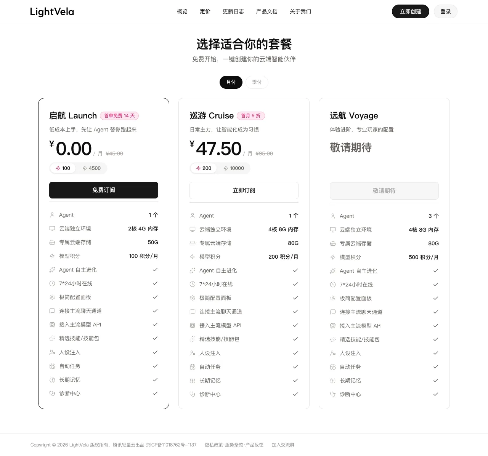

# 套餐说明

LightVela 提供**启航 Launch、巡游 Cruise、远航 Voyage**三档套餐，覆盖从低成本上手到专业进阶的不同需求。每档套餐都为你开通一个独立的云端 Hermes Agent 运行环境，并附带每月发放的模型积分。本页说明各档套餐的定位、规格与权益，帮你按需选择。

## 本页覆盖

- 三档套餐的定位与适合人群

- 各档的独立环境规格、存储与模型积分

- 所有套餐共享的 Agent 核心能力

- 计费周期、促销与选购说明

---

## 套餐是什么

套餐（Plan）是你在 LightVela 上开通 Hermes Agent 的资源包。开通任意套餐后，平台会为你分配一个**专属云端运行环境**（独立的 CPU / 内存 / 存储），你的 Hermes Agent 在其中 7×24 小时在线运行，无需自己购买服务器或做任何本地部署。

不同档位的区别主要在**独立环境规格、专属存储容量、每月模型积分**，而 Agent 的核心能力（自主进化、多通道接入、技能、自动任务、长期记忆等）所有套餐一致。

各档实时价格与积分档位以[订阅页](./03-account.md)显示为准；下方数值为当前订阅页展示口径，供你了解结构。

---

## 三档套餐

### 启航 Launch — 低成本上手，先让 Agent 替你跑起来

面向**首次体验云端 Agent**的用户，用最低门槛把 Agent 跑起来。

| 项目 | 规格 |
|---|---|
| Agent 数量 | 1 个 |
| 云端独立环境 | 2 核 4G 内存 |
| 专属云端存储 | 50G |
| 模型积分 | 100 积分 / 月 |
| 计费周期 | 月付 |
| 促销 | 首单免费 14 天 |

新用户开通启航标准版可享**首单免费 14 天、0 元下单**，适合先体验完整功能再决定是否长期使用。关于模型积分如何计费与消耗，见[体验积分说明](./credits.md)。

### 巡游 Cruise — 日常主力，让智能化成为习惯

面向把 Agent 当作**日常主力工具**的用户，环境规格与存储更高，积分额度更充裕。

| 项目 | 规格 |
|---|---|
| Agent 数量 | 1 个 |
| 云端独立环境 | 4 核 8G 内存 |
| 专属云端存储 | 80G |
| 模型积分 | 200 积分 / 月 |
| 计费周期 | 月付 |
| 促销 | 首月 5 折 |

### 远航 Voyage — 体验进阶，专业玩家的配置

面向**重度使用与专业玩家**，提供更高的 Agent 配额与积分额度。该档目前**敬请期待**，尚未开放开通。

| 项目 | 规格 |
|---|---|
| Agent 数量 | 3 个 |
| 云端独立环境 | 4 核 8G 内存 |
| 专属云端存储 | 80G |
| 模型积分 | 500 积分 / 月 |
| 状态 | 敬请期待 |

---

## 所有套餐共享的 Agent 能力

无论选择哪一档，你的 Hermes Agent 都具备以下能力，差异只在环境规格与积分额度：

- **Agent 自主进化** — Agent 在使用中持续学习、越用越懂你

- **7×24 小时在线** — 云端托管，无需本地开机

- **极简配置面板** — 网页点选即可完成[模型](./configuration/model.md)、通道、技能配置

- **连接主流聊天通道** — 在微信 / QQ / 飞书等入口直接和 Agent 对话

- **接入主流模型 API** — 自由选择底层大模型

- **精选技能 / 技能包** — 为 Agent 安装可复用的能力

- **人设注入** — 自定义 Agent 的角色与说话风格

- **自动任务** — 让 Agent 按固定时间自动执行任务，详见[自动任务配置](./configuration/automation.md)

- **长期记忆** — Agent 记住历史对话与你的偏好

- **诊断中心** — 排查运行状态与异常

---

## 计费与选购

- **计费周期**：当前套餐按**月付**开通，季付等更长周期正在陆续开放。

- **促销**：启航标准版首单免费 14 天；巡游标准版首月 5 折；AI 增强版首月 6 折。促销以订阅页实时展示为准。

- **积分档位**：部分套餐提供不同积分档位（如标准积分与 AI 增强积分），选购时可在卡片上切换。积分机制见[体验积分说明](./credits.md)。

- **开通前置**：首次开通任意套餐前需完成实名认证，见[账号与实名认证](./03-account.md)。

---

## 常见问题

### 各档套餐的价格是多少

价格随促销与后端配置动态调整，且不同积分档位价格不同，因此本页不写死具体金额。请以[订阅页](./03-account.md)实时显示的价格为准。

### 套餐之间可以升级或更换吗

当前平台暂不支持在已开通套餐上直接升级或更换套餐，请以管理台的实际选项为准。

### 一个套餐可以开几个 Agent

启航 / 巡游各含 1 个 Agent 配额，远航含 3 个（敬请期待）。Agent 配额指可同时运行的 Hermes 实例数量。

### 积分用完了会怎样

积分用于模型调用计费，用完后需等待下月发放或按平台规则补充。详见[体验积分说明](./credits.md)。

---

## 下一步

- [体验积分说明](./credits.md) — 了解积分如何计费与消耗

- [如何开通第一个 Hermes 实例？](./create-first-hermes.md) — 从选套餐到跑起 Agent 的完整流程

- [账号与实名认证](./03-account.md) — 开通套餐前的实名认证说明

- [快速开始](./02-quickstart.md) — 完整的接入流程
