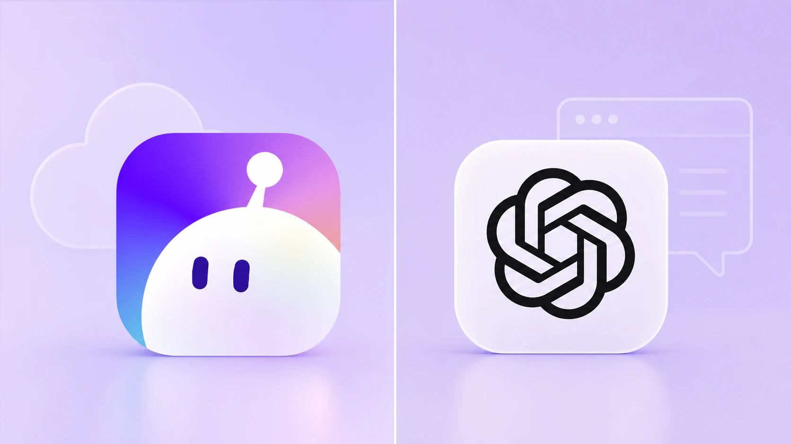

# LightVela vs ChatGPT: อะไรดีที่สุดในการสร้างผู้ช่วย AI ส่วนตัวของคุณ?

## สรุป

**หากเป้าหมายของคุณคือการโฮสต์เอเจนต์ AI ส่วนตัวที่พร้อมใช้งานและเป็นส่วนหนึ่งของเวิร์กโฟลว์ของคุณเอง LightVela เป็นตัวเลือกที่ตรงกว่า** ChatGPT จะเหมาะกว่า หากคุณต้องการพื้นที่ทำงาน AI ที่กว้างและครบเครื่องสำหรับการสนทนา ไฟล์ การวิจัย การเขียน และงานหลากหลายประเภท พวกมันทับซ้อนกันในสิ่งที่สามารถช่วยคุณทำได้ แต่จริง ๆ แล้วไม่ใช่ผลิตภัณฑ์เดียวกัน

## ภาพรวมโดยย่อ

| สิ่งที่สำคัญ | LightVela | ChatGPT |
| - | - | - |
| **งานหลัก** | โฮสต์เอเจนต์เฉพาะ Hermes | พื้นที่ทำงาน AI สำหรับวัตถุประสงค์ทั่วไป |
| **ระยะเวลาทำงาน** | เอเจนต์คลาวด์เฉพาะที่สามารถใช้งานได้ตลอด 24/7 | บัญชี ChatGPT, แชท, โครงการ, และ GPTs |
| **การปรับแต่งส่วนบุคคล** | โมเดล, เครื่องมือ, บุคลิก, ทักษะ, ช่องทาง | ความจำ, คำแนะนำ, โครงการ, GPTs แบบกำหนดเอง |
| **การโต้ตอบ** | ช่องทางส่งข้อความ เช่น Telegram, WhatsApp, Discord, Slack, และ WeChat | ChatGPT เว็บ, มือถือ, เดสก์ท็อป, เสียง, ไฟล์, และ Canvas |
| **เหมาะสมที่สุดสำหรับ** | เอเจนต์ที่คงอยู่ซึ่งคุณกำหนดค่าและกลับมาใช้งาน | ผู้ช่วยที่ยืดหยุ่นสำหรับงานหลายประเภท |

## ความแตกต่างที่สำคัญ: พื้นที่ทำงานหรือเอเจนต์?

LightVela เริ่มจากคำถามที่แตกต่าง:

> **ถ้าฉันต้องการเอเจนต์จริง ๆ ตัวหนึ่งที่ฉันตั้งค่าเพียงครั้งเดียว คงใช้งานออนไลน์ เชื่อมต่อกับแอปส่งข้อความที่ฉันใช้ปกติ และสร้างนิสัยรอบ ๆ มัน จะทำอย่างไร?**

LightVela มีเอเจนต์ Hermes อุทิศตนในคลาวด์ โดยคุณสามารถควบคุมโมเดล เครื่องมือ บุคลิกภาพ ทักษะ และช่องทางที่เชื่อมต่อของมัน เอเจนต์ถูกออกแบบให้สามารถออนไลน์ได้โดยไม่ขึ้นกับอุปกรณ์ท้องถิ่นของคุณ

นั่นทำให้ LightVela มีความกว้างน้อยลง แต่มีความเน้นมากขึ้น

ChatGPT เก่งมากในการเป็นสถานที่ที่คุณสามารถถามเกือบทุกอย่างได้

OpenAI’s [ภาพรวมความสามารถของ ChatGPT](https://help.openai.com/en/articles/9260256) ระบุความสามารถของ ChatGPT ที่มีให้ใช้งาน ได้แก่ การค้นหาเว็บ การวิเคราะห์ข้อมูล เสียง Canvas ความทรงจำ โครงการ งานที่กำหนดเวลา และ GPTs แบบกำหนดเอง ขึ้นอยู่กับแผนและการตั้งค่าของคุณ ChatGPT ถูกออกแบบมาให้เป็นผู้ช่วยสนทนาที่ครอบคลุมพร้อมเครื่องมือหลายอย่างรอบตัว

โครงการทำให้ ChatGPT มีประโยชน์เป็นพิเศษสำหรับงานที่กำลังดำเนินอยู่ คุณสามารถจัดกลุ่มการแชท อัปโหลดไฟล์ เพิ่มคำสั่งปรับแต่ง และรักษาโฟกัสของโครงการได้ตามเวลา OpenAI อธิบาย [โครงการ](https://help.openai.com/en/articles/10169521-projects-in-chatgpt) ว่าเป็นพื้นที่ทำงานอัจฉริยะสำหรับความพยายามที่ดำเนินต่อเนื่องยาวนาน

นั่นทรงพลัง—แต่มันก็ยังเป็นพื้นที่ทำงานภายใน ChatGPT

## ที่ LightVela มีความตรงไปตรงมามากกว่า

LightVela จะดีกว่าเมื่อเอเจนต์เองเป็นสินค้าที่คุณต้องการเก็บไว้

คุณไม่ได้เพียงแค่เปิดพื้นที่ทำงาน AI สำหรับงานหนึ่ง คุณกำลังตั้งค่า Hermes Agent ด้วยตัวตนเฉพาะ การกำหนดค่ารูปแบบ ทักษะ และช่องทางการสื่อสาร

ความแตกต่างจะชัดเจนขึ้นเมื่อคุณคิดในรูปแบบกิจวัตรแทนที่จะคิดในรูปแบบคำสั่ง

ด้วย ChatGPT คุณอาจเปิดโครงการและขอให้มันช่วยคุณวางแผนเดือน

ด้วย LightVela คุณอาจเชื่อมต่อ Hermes ไปยัง Telegram ให้มันมีเวิร์กโฟลว์ที่ทำซ้ำได้ และคาดหวังว่ามันจะพร้อมใช้งานในวันพรุ่งนี้ สัปดาห์หน้า และเดือนหน้า—โดยไม่จำเป็นต้องเปิดแล็ปท็อปของคุณ

LightVela ยังเปิดเผยการตั้งค่าของ Agent อย่างตรงไปตรงมามากขึ้น คุณสามารถเลือก [โมเดล](https://lightvela.ai/docs/configuration/model) เชื่อมต่อ [ช่องทาง](https://lightvela.ai/docs/configuration) และขยาย Hermes ผ่าน [ทักษะ](https://lightvela.ai/docs/configuration/skill) ในคอนโซลการตั้งค่า

ถ้าเอเจนต์ต้องทำงานประเภทเดียวกันซ้ำ ๆ [งานที่กำหนดไว้](https://lightvela.ai/docs/configuration/automation) ของ LightVela จะทำให้รูปแบบนั้นเป็นส่วนหนึ่งของกิจวัตรการทำงานของเอเจนต์แทนที่จะต้องเริ่มใหม่ด้วยตนเองทุกครั้ง

## เมื่อ ChatGPT เป็นตัวเลือกที่ดีกว่า

ChatGPT เหมาะมากกว่าเมื่อคุณต้องการพื้นที่งาน AI ที่กว้างโดยไม่ต้องคิดเกี่ยวกับการตั้งค่าเอเจนต์ มันสามารถเคลื่อนย้ายระหว่างเอกสาร การค้นคว้า รูปภาพ โค้ด และงานอื่น ๆ แบบครั้งเดียวตามการเปลี่ยนแปลงของงานของคุณ

สำหรับงานเฉพาะทางที่ดำเนินอยู่ [GPTs](https://help.openai.com/en/articles/8554397-create-a-gpt) ช่วยให้คุณสร้างเวอร์ชัน ChatGPT ที่ปรับแต่งได้พร้อมคำแนะนำและความรู้ของตนเอง เลือกใช้เมื่อต้องการความกว้างขวางมากกว่าการรักษาเอกลักษณ์ของ Agent ที่คงที่

## ความแตกต่างในการใช้ประจำวัน

> **LightVela รู้สึกเหมือนเอเจนต์ส่วนตัวที่คุณเก็บไว้ ในขณะที่ ChatGPT รู้สึกเหมือนเป็นสถานที่ที่คุณไปซึ่งมีความสามารถมาก**

นั่นไม่ได้หมายความว่า ChatGPT จะจำสิ่งต่าง ๆ ไม่ได้ ChatGPT มีความจำ, ความจำของโปรเจกต์, คำสั่งที่ปรับแต่งได้, และ GPT ที่ปรับแต่งได้ ความแตกต่างก็คือ LightVela มุ่งเน้นที่เอเจนต์ Hermes หนึ่งที่โฮสต์อยู่ แทนที่จะเป็นการรวบรวมบทสนทนา, เวิร์กสเปซ, และผู้ช่วยอย่างกว้างขวาง

สำหรับบางคน ความยืดหยุ่นของ ChatGPT คือสิ่งที่พวกเขาต้องการ พวกเขาไม่ต้องการผู้ช่วยประจำตัวแบบถาวร พวกเขาต้องการเครื่องมือที่ดีที่สุดสำหรับสิ่งที่อยู่ตรงหน้า

สำหรับคนอื่น ๆ ความยืดหยุ่นนั้นอาจรู้สึกเหมือนกับการสร้างความสัมพันธ์ใหม่อยู่ตลอดเวลา: แชทใหม่ โครงการใหม่ บล็อกคำสั่งใหม่ หรือหน้าต่างบริบทใหม่
