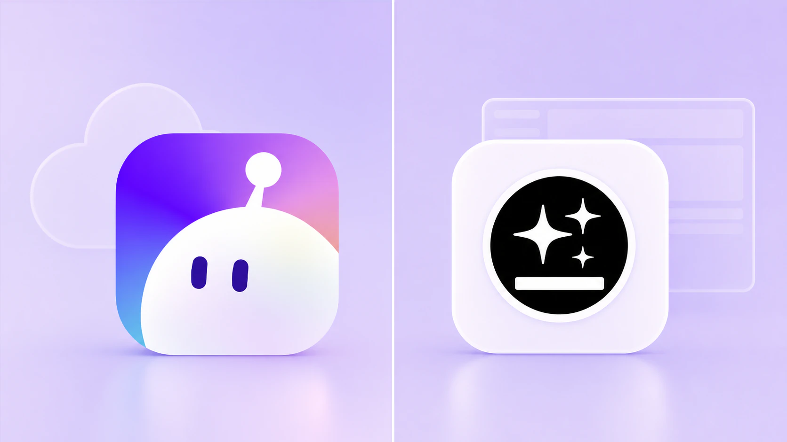

# LightVela vs Genspark: อันไหนดีที่สุดในการโฮสต์เอเจนต์ AI ของคุณ?

## สรุป

**หากคุณต้องการโฮสต์เอเจนต์ AI ส่วนตัวที่พร้อมใช้งานตลอดเวลาและปฏิบัติตามการตั้งค่าที่สม่ำเสมอ LightVela เป็นตัวเลือกที่ตรงกว่า** หากคุณต้องการพื้นที่ทำงาน AI แบบครบวงจรที่สามารถค้นคว้า เขียน ออกแบบ สร้างสไลด์ วิเคราะห์ข้อมูล และผลิตผลงานสำเร็จ, Genspark น่าจะเป็นตัวเลือกที่แข็งแกร่งกว่า ทั้งสองกำลังก้าวออกจากรูปแบบแชทบอท แต่พวกเขากำลังแก้ไขปัญหาที่แตกต่างกัน

## ภาพรวมโดยย่อ

| สิ่งที่สำคัญ | LightVela | Genspark |
| - | - | - |
| **งานหลัก** | โฮสต์เอเจนต์ Hermes เฉพาะตัว | ทำงานผ่านพื้นที่ทำงาน AI ครบวงจร |
| **โมเดลเอเจนต์** | เอเจนต์คงที่ตัวหนึ่งที่คุณตั้งค่า | ซูเปอร์เอเจนต์ที่ประสานโมเดล เครื่องมือ และเอเจนต์เฉพาะด้าน |
| **ความจำ** | ความจำการสนทนาของเอเจนต์และพื้นที่จัดเก็บบนคลาวด์เฉพาะตัว | SecondBrain บริบทข้ามอีเมล การประชุม แชท เอกสาร แอป และโปรเจกต์ |
| **พื้นผิวการทำงาน** | ช่องทางการส่งข้อความและการตั้งค่าเอเจนต์ | เอกสาร สไลด์ ชีต การออกแบบ โค้ด อีเมล วิจัย สื่อ และอื่น ๆ |
| **เหมาะสมที่สุดกับ** | เอเจนต์ส่วนตัวที่คุณเก็บและสร้างนิสัยรอบตัว | งานที่เสร็จสมบูรณ์ที่ผลิตจากพื้นที่ทำงานกว้างหนึ่งเดียว |

## ความแตกต่างที่แท้จริง: โฮสต์เอเจนต์ vs. แพลตฟอร์มการทำงาน

LightVela เริ่มต้นด้วยเอเจนต์

ภาพรวม [LightVela](https://lightvela.ai/docs/overview) อธิบายวิธีที่มันทำให้ Hermes เอเจนต์ออนไลน์ตลอด 24/7 ในขณะที่ให้คุณควบคุมโมเดล บุคลิก เครื่องมือ ทักษะ และช่องทางของมัน เอเจนต์คือศูนย์กลางของผลิตภัณฑ์ ทุกอย่างอื่นสนับสนุนความสัมพันธ์นั้น

Genspark เริ่มต้นด้วยงาน

การอัปเดต [AI Workspace 6.0](https://www.genspark.ai/blog/genspark-ai-workspace-6) ของมันอธิบายถึงสี่ชั้น: SecondBrain เป็นชั้นความจำ, Super Agent เป็นเอนจินปัญญา, ชุดเครื่องมือสร้างสรรค์และประสิทธิภาพการทำงาน, และ GenTeam เป็นชั้นการทำงานร่วมกัน

นั่นคือความแตกต่างที่มีความหมายในปรัชญาผลิตภัณฑ์:

> **LightVela ถามว่า “เอเจนต์ของฉันควรทำงานอย่างไร?” Genspark ถามว่า “คุณต้องการให้งานใดเสร็จสิ้น?”**

## ที่ซึ่ง LightVela เหมาะสมมากกว่า

LightVela มีสมาธิมากกว่า และความสมาธินั้นมีความสำคัญหากสิ่งที่คุณต้องการคือเอเจนต์มากกว่าการทำงานในพื้นที่ AI

ด้วย LightVela คุณสร้างเอเจนต์ Hermes และตัดสินใจว่ามันควรจะทำงานอย่างไร คุณเลือก [โมเดล](https://lightvela.ai/docs/configuration/model) เชื่อมต่อ [ช่องทาง](https://lightvela.ai/docs/configuration) การส่งข้อความที่คุณใช้งานจริง และขยายความสามารถของมันด้วย [ทักษะ](https://lightvela.ai/docs/configuration/skill)

การตั้งค่านั้นเกี่ยวข้องน้อยกับการสร้างสิ่งที่น่าประทับใจเพียงอย่างเดียว แต่เกี่ยวข้องมากกว่าในการสร้างชั้นการทำงานต่อเนื่องสำหรับกิจวัตรส่วนตัวของคุณ

คุณอาจใช้ Hermes เพื่อ:

- เก็บความทรงจำต่อเนื่องเกี่ยวกับความชอบและงานที่กำลังทำอยู่  
- ส่งการแจ้งเตือนและอัปเดตที่เกิดซ้ำ  
- ติดตามข้อมูลเมื่อเวลาผ่านไป  
- ตอบคำถามจาก Telegram, WhatsApp, Discord, Slack หรือ WeChat  
- ใช้ทักษะเพื่อขยายสิ่งที่สามารถทำได้  
- รัน [งานที่กำหนดเวลา](https://lightvela.ai/docs/configuration/automation) ตามตารางเวลา

หน้าการจัดกำหนดงานเป็นเรื่องที่เกี่ยวข้องโดยเฉพาะที่นี่ จุดประสงค์ไม่ใช่เพียงแค่ขอ Hermes สำหรับรายงานวันนี้เท่านั้น แต่เพื่อให้เอเจนต์ยังคงจัดการงานประเภทเดียวกันในวันพรุ่งนี้

นั่นเป็นประโยชน์ในรูปแบบที่แตกต่างจากโมเดล “คำสั่งเดียว งานเสร็จ” ของ Genspark

## ที่ที่ Genspark เหมาะสมมากกว่า

Genspark เป็นตัวเลือกที่เหมาะสมกว่าเมื่อความกว้างมีความสำคัญที่สุด [ซูเปอร์เอเจนต์](https://www.genspark.ai/helpcenter?doc=general_What_is_Super_Agent) ของมัน ประสานงานโมเดล เครื่องมือ และเอเจนต์เฉพาะทางรอบผลลัพธ์

- **การวิจัยและวิเคราะห์:** แปลงข้อมูลต้นฉบับเป็นรายงานและผลการค้นพบที่มีโครงสร้าง
- **การสร้างสรรค์:** ผลิตงานนำเสนอ เอกสาร สื่อภาพ หรือโค้ดในพื้นที่ทำงานเดียว
- **การประสานงาน:** รวมอีเมล การประชุม และบริบทการทำงานอื่น ๆ เมื่อสร้างผลงาน

เลือกสิ่งนี้เมื่อคุณต้องการอธิบายผลลัพธ์ที่เสร็จสมบูรณ์มากกว่าการจัดการเอเจนต์ที่คงอยู่

## หน่วยความจำไม่ใช่สิ่งเดียวกันในทั้งสองผลิตภัณฑ์

ความทรงจำของ LightVela เป็นความทรงจำของเอเจนต์ มันเป็นของเอเจนต์ Hermes ที่คุณคุยด้วย ปรับแต่ง และพัฒนามาตลอดเวลา

SecondBrain ของ Genspark คือหน่วยความจำของพื้นที่ทำงาน มันพยายามรวมข้อมูลที่เกี่ยวข้องกับงานของคุณเพื่อให้ Super Agent สามารถใช้งานได้ในหลายงาน

ไม่มีวิธีใดที่ดีกว่าโดยอัตโนมัติ

LightVela จะสมเหตุสมผลมากขึ้นหากคุณต้องการเอเจนต์ส่วนบุคคลที่สอดคล้องกันซึ่งจดจำวิธีการทำงานของคุณและสามารถติดต่อได้ผ่านช่องทางที่คุณต้องการ

Genspark มีความสมเหตุสมผลมากขึ้นหากความรู้ของคุณกระจายอยู่ในเครื่องมือการทำงานหลายอย่างและคุณต้องการระบบ AI ที่จะรวบรวมทุกอย่างเข้าด้วยกัน

> **หนึ่งใกล้เคียงกับระบบปฏิบัติการสำหรับการทำงานอัจฉริยะ อีกอันหนึ่งใกล้เคียงกับเพื่อนส่วนตัวที่โฮสต์ไว้**

## ความแตกต่างในการใช้ประจำวัน

LightVela รู้สึกเหมือนกำลังส่งข้อความหาใครบางคนที่รู้อยู่แล้วว่ากิจวัตรของคุณเป็นอย่างไร

คุณไม่จำเป็นต้องเปิดชุดโปรแกรมเฉพาะ คุณส่งข้อความผ่านช่องทางที่คุณใช้แล้ว และ Hermes ตอบกลับจากสภาพแวดล้อมของเอเจนต์เดียวกัน

Genspark รู้สึกเหมือนกำลังเปิดสตูดิโอ

คุณมาถึงพร้อมกับเป้าหมาย และระบบจะมอบชุดเครื่องมือและเอเจนต์พิเศษให้คุณเพื่อเปลี่ยนเป้าหมายนั้นให้กลายเป็นสิ่งที่ใช้งานได้: สำรับเอกสาร แผ่นงาน เว็บไซต์ รายงาน อีเมล หรือสื่อภาพ

นั่นทำให้ Genspark น่าประทับใจมากขึ้นสำหรับผลลัพธ์ที่ใช้โครงการเป็นหลัก มันทำให้ LightVela เป็นธรรมชาติมากขึ้นสำหรับเวิร์กโฟลว์ส่วนบุคคลที่เกิดขึ้นซ้ำ

## คุณควรเลือกอันไหนดี?

เลือก LightVela หากคุณ:

- **ต้องการโฮสต์เฉพาะ:** คุณต้องการโฮสต์เอเจนต์ส่วนตัว Hermes  
- **ต้องการความต่อเนื่อง:** คุณต้องการให้เอเจนต์สามารถใช้งานได้ตลอด 24/7  
- **ชอบการส่งข้อความ:** คุณต้องการติดต่อเอเจนต์ของคุณผ่านช่องทางประจำวันที่ใช้กัน  
- **ต้องการการควบคุมโดยตรง:** คุณต้องการจัดการโมเดล บุคลิก ทักษะ และงานที่ตั้งเวลาไว้ของเอเจนต์  
- **ต้องการความสัมพันธ์ระยะยาว:** คุณใส่ใจเกี่ยวกับการสร้างนิสัยรอบเอเจนต์ที่มีความสอดคล้องหนึ่งตัว

เลือก Genspark หากคุณ:

- **ต้องการพื้นที่ทำงานแบบกว้าง:** คุณต้องการเครื่องมือสำหรับการวิจัย การสร้างสรรค์ และการผลิตในที่เดียวกัน
- **ให้ความสำคัญกับผลลัพธ์ที่ส่งมอบ:** งานที่เสร็จแล้วสำคัญกว่าการรักษาเอกลักษณ์ของ Agent หนึ่ง
- **ชอบคำขอที่เน้นผลลัพธ์ก่อน:** คุณต้องการให้พื้นที่ทำงานสามารถประสานเครื่องมือต่าง ๆ ได้

ความคิดเห็นของฉัน: **LightVela เป็นโฮสต์เอเจนต์เฉพาะที่ดีกว่า Genspark เป็นพื้นที่ทำงาน AI ที่ดีกว่า**

ถ้าคำถามของคุณคือ “เครื่องมือใดสามารถทำงานนำเสนอ รายงานวิจัย และสเปรดชีตได้เร็วที่สุด?” Genspark น่าจะเป็นคำตอบที่ชัดเจนมากกว่า

หากคุณกำลังเปรียบเทียบโฮสต์เอเจนต์ส่วนบุคคลกับงาน AI ที่มอบหมาย, [LightVela กับ Grok Bot](./lightvela-vs-grok-bot.md) อธิบายความแตกต่างระหว่างเอเจนต์ที่สามารถปรับแต่งได้หนึ่งตัวกับบอทคลาวด์ที่คงอยู่

ถ้าคำถามของคุณคือ “ฉันควรโฮสต์เอเจนต์ AI ที่ฉันใช้งานทุกวันที่ไหนดี?” LightVela คือทางเลือกที่เหมาะสมกว่า
