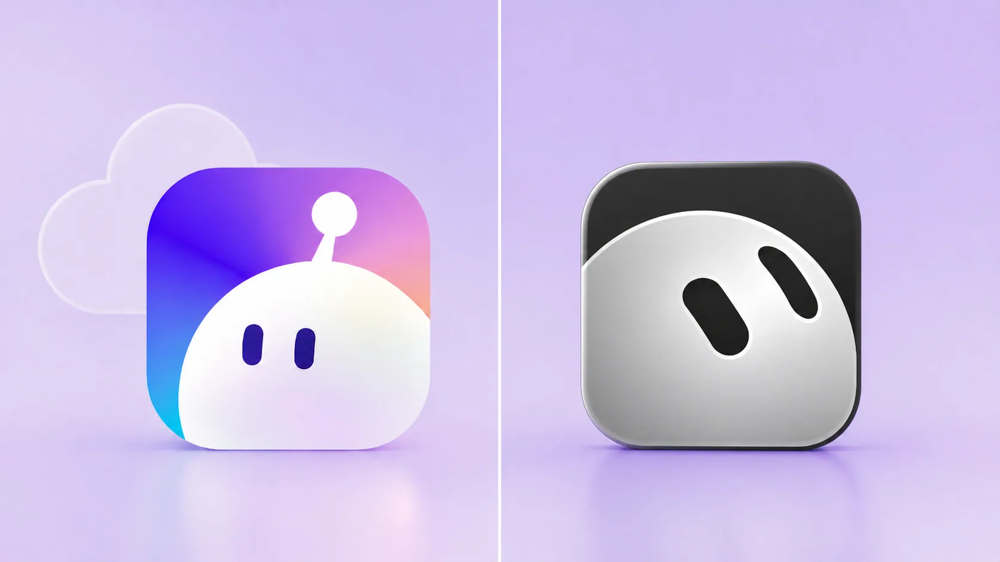

# LightVela vs Grok Bot: ตัวไหนดีที่สุดในการรันเอเยนต์ AI ส่วนตัวของคุณ?

## สรุป

**เลือก LightVela หากคุณต้องการเอเจนต์ส่วนตัว Hermes หนึ่งตัวที่คุณสามารถปรับแต่งตามกิจวัตรของคุณ ติดตั้งทักษะที่ใช้ซ้ำได้ และทำงานต่อเนื่องผ่านงานตามกำหนดเวลาและช่องทางที่คุณเลือก** เลือก Grok Bot หากคุณต้องการเพื่อนร่วมทีม AI บนคลาวด์ที่ทำงานอย่างต่อเนื่อง สามารถทำงานข้ามแอป ใช้คอมพิวเตอร์บนคลาวด์ และรันงานที่มอบหมายแบบขนาน ทั้งสองผลิตภัณฑ์มีความสามารถมากกว่าแชทบอททั่วไป แต่พวกเขาจัดระเบียบความสามารถนั้นรอบ ๆ งานที่แตกต่างกัน

## ภาพรวมโดยย่อ

| สิ่งที่สำคัญ | LightVela | Grok Bot |
| - | - | - |
| **เหมาะที่สุดสำหรับ** | เอเจนต์ AI ส่วนตัวที่ทำงานยาวนาน | งานที่มอบหมายในแอปและเว็บไซต์ต่าง ๆ |
| **ความรู้สึกหลัก** | เอเจนต์ที่คุณตั้งค่าไว้ พร้อมใช้งานเมื่อคุณต้องการ | บอทที่คงอยู่ซึ่งคุณสามารถปฏิบัติเหมือนเพื่อนร่วมทีม |
| **จุดเน้นในการตั้งค่า** | ทักษะ งานที่ตั้งเวลาไว้ ความจำ บุคลิกแบบเอเจนต์ แบบจำลอง และช่องทาง | บอท คอมพิวเตอร์คลาวด์ ตัวเชื่อมต่อ รูทีน และการอนุมัติ |
| **การเข้าถึงทุกวัน** | ช่องทางการส่งข้อความและพื้นที่ทำงานของเอเจนต์ที่คงอยู่ | ประสบการณ์ Grok Bot บนเดสก์ท็อปและ iOS |
| **กรณีการใช้งานที่แข็งแกร่งที่สุด** | กระบวนการทำงานส่วนตัวที่ควรปรับปรุงขึ้นเรื่อย ๆ สำหรับคุณ | งานหลายขั้นตอนที่ต้องมีการโต้ตอบกับเบราว์เซอร์และแอป |

## การเปลี่ยนแปลงในการใช้งานประจำวัน

ความแตกต่างนั้นไม่ได้อยู่ที่ระบบใดฟังดูฉลาดกว่าจากคำถามครั้งเดียว แต่เป็นเรื่องที่ว่าเอเจนต์นั้นอยู่ในวันของคุณตอนไหน และคุณต้องการสร้างผู้ช่วยถาวรคนหนึ่งหรือมอบหมายงานให้บอทที่ตั้งชื่อแล้ว

ด้วย LightVela คุณสามารถกำหนดค่าเอเจนต์ Hermes ที่โฮสต์รอบวิธีการทำงานของคุณ จากนั้นคุณสามารถพูดคุยกับเอเจนต์ตัวเดียวกันต่อไปเมื่อความต้องการของคุณเปลี่ยนไป คุณสามารถติดตั้ง [ทักษะ](../configuration/skill.md) ที่ใช้ซ้ำได้ สร้าง [งานตามกำหนดเวลา](../configuration/automation.md) เลือก [โมเดล](../configuration/model.md) และเชื่อมต่อช่องทางที่คุณใช้งานจริง ซึ่งจะเปลี่ยนการโต้ตอบแบบครั้งเดียวที่มีประโยชน์ให้กลายเป็นเวิร์กโฟลว์ที่สามารถทำงานให้คุณต่อไปได้

คุณอาจขอรายงานสรุปรายวัน รายการเฝ้าดูซ้ำ ร่างเนื้อหา หรือการเตือนโดยไม่ต้องสร้างเวิร์กโฟลว์ใหม่ทุกครั้ง LightVela ถูกออกแบบโดยคำนึงถึงความต่อเนื่องนั้น: เอเจนต์หนึ่งตัว การตั้งค่าที่พัฒนาไปเรื่อย ๆ หนึ่งชุด และสถานที่หนึ่งที่จะปรับปรุงวิธีที่ควรช่วยเหลือ

Grok Bot มุ่งไปที่บางสิ่งที่มีความเป็นปฏิบัติการมากขึ้น [ภาพรวมของ Grok Bot ของ xAI](https://docs.x.ai/grok-bot/overview) อธิบายว่า Bot คือเพื่อนร่วมงาน AI ที่มีชื่อและคงอยู่ได้ ซึ่งสามารถใช้เบราว์เซอร์ ระบบไฟล์ และเทอร์มินัลบนคอมพิวเตอร์คลาวด์ที่คงอยู่ มันสามารถทำงานข้ามแอปและเว็บไซต์ รักษาบริบทตลอดเวลา และกลับมาหาคุณเมื่อมันต้องการการอนุมัติของคุณ Bot หลายตัวสามารถใช้คอมพิวเตอร์ที่มีขอบเขตผู้ใช้ร่วมกัน ส่งต่อบริบทระหว่างกัน และทำงานพร้อมกันได้

นั่นมีพลังเมื่อการทำงานเป็นงานที่กว้าง ซับซ้อน และเกี่ยวข้องกับแอปเว็บหลายตัว มันน่าสนใจน้อยลงหากสิ่งที่คุณต้องการจริงๆ คือเอเจนต์ส่วนตัวเพียงตัวเดียวที่ค่อยๆ มีประโยชน์มากขึ้นตามนิสัยของคุณ ความแตกต่างนั้นคล้ายกับความแตกต่างใน [LightVela vs Genspark](./lightvela-vs-genspark.md) แต่ Grok Bot ผลักดันโมเดลการมอบหมายงานให้ไปไกลขึ้นด้วยคอมพิวเตอร์ที่คงอยู่และการส่งงานระหว่างบอท

## ที่ซึ่ง LightVela เหมาะสมมากกว่า

LightVela เหมาะสมมากกว่า ถ้าคุณต้องการให้เอไอเอเจนต์ของคุณรู้สึกเหมือนเป็นส่วนหนึ่งที่สอดคล้องของระบบปฏิบัติการของคุณเอง คุณไม่ได้พยายามควบคุมเพื่อนร่วมงานดิจิทัลหลายคน และคุณไม่ได้มองหาคอมพิวเตอร์คลาวด์แยกสำหรับแต่ละงาน

คุณอาจต้องการเอเจนต์ที่ตรวจสอบข้อมูลทุกเช้า เฝ้าดูคู่แข่ง แปลงอัปเดตสินค้าเป็นโพสต์โซเชียล หรือสรุปหัวข้อการวิจัยทุกสัปดาห์ ส่วนที่เป็นประโยชน์ไม่ใช่คำตอบที่สมบูรณ์แบบเพียงหนึ่งคำตอบ แต่คือการที่สามารถเปลี่ยนปฏิสัมพันธ์ที่มีประโยชน์ให้กลายเป็นสิ่งที่ยังคงทำงานต่อไปได้

นั่นคือจุดที่ทักษะและงานตามกำหนดเวลาสร้างความแตกต่าง ทักษะให้ความสามารถที่สามารถนำกลับมาใช้ใหม่กับเอเจนต์ของคุณ ในขณะที่งานตามกำหนดเวลาอนุญาตให้การทำงานประจำเกิดขึ้นตามกำหนดเวลาแทนที่จะต้องพึ่งคุณจำคำสั่งในเวลาที่ถูกต้อง คุณสามารถเริ่มต้นด้วยการรายงานสรุปตอนเช้า เพิ่มทักษะการค้นคว้า และส่งผลลัพธ์ผ่านช่องทางที่คุณมีแนวโน้มจะเห็นมากที่สุด

LightVela ยังเป็นตัวเลือกที่ตรงไปตรงมามากกว่าหากคุณสนใจในการกำหนดบทบาทของเอเจนต์มากกว่าการยอมรับประสบการณ์ผลิตภัณฑ์ที่กำหนดไว้ คุณเลือกโมเดล พฤติกรรมที่คุณต้องการส่งเสริม ความสามารถที่คุณต้องการเพิ่ม และช่องทางที่เอเจนต์ควรปรากฏ [LightVela ภาพรวม](../01-overview.md) อธิบายว่าส่วนเหล่านั้นเข้ากันอย่างไร

การแลกเปลี่ยนคือความมุ่งเน้น LightVela ถูกสร้างขึ้นรอบตัวเอเจนต์ Hermes ที่โฮสต์อยู่หนึ่งตัวและความสัมพันธ์ที่ต่อเนื่องกับคุณ หากคุณต้องการเวิร์กเบนช์เดสก์ท็อปที่กว้างซึ่งสามารถเข้าสู่เว็บไซต์ที่ไม่คุ้นเคยและวางงานที่เสร็จแล้วลงในเครื่องมือเหล่านั้น Grok Bot อาจเป็นตัวเลือกที่เหมาะสมกว่า

## ที่ที่ Grok Bot เหมาะสมมากกว่า

Grok Bot เป็นตัวเลือกที่แข็งแรงกว่าเมื่อคุณต้องการให้ Agent ทำงานข้ามสแต็กของแอปพลิเคชัน โดยเฉพาะเมื่อการทำงานนั้นต้องมีการโต้ตอบแบบเบราว์เซอร์หรือมี Bot มากกว่าหนึ่งตัวทำงานพร้อมกัน [ประกาศอย่างเป็นทางการของ xAI](https://x.ai/news/introducing-grok-bot) ระบุว่า Bots สามารถเข้าสู่ระบบแอปและเว็บไซต์ ใช้คอมพิวเตอร์คลาวด์ถาวรของตนเอง และทำงานให้เสร็จสิ้นตั้งแต่ต้นจนจบก่อนกลับมาขออนุมัติเมื่อจำเป็น

ผลิตภัณฑ์นี้ยังรองรับการเรียนรู้รูปแบบการทำงาน คุณสามารถสาธิตกระบวนการหลายขั้นตอน ให้บอทบันทึกเป็นกิจวัตร และเรียกใช้กิจวัตถุนั้นอีกครั้งตามต้องการหรือกำหนดเวลา ผลิตภัณฑ์ [Automations](https://x.ai/news/grok-automations) แยกต่างหากของ Grok รองรับงานตามกำหนดเวลาและทริกเกอร์อีเมล พร้อมตัวเชื่อมต่อและทักษะที่แนบไปกับแต่ละครั้งที่รัน

นั่นทำให้ Grok Bot น่าสนใจหากคุณมีงานปฏิบัติการที่ต้องมอบหมาย: ศึกษาบัญชี, อัปเดต CRM, เตรียมกล่องจดหมาย, ตรวจสอบเว็บไซต์, หรือประสานงานผู้เชี่ยวชาญหลายคน คอมพิวเตอร์บนคลาวด์เป็นตัวแยกความแตกต่างที่มีความหมายเพราะงานสามารถเกิดขึ้นในเบราว์เซอร์หรือแอปพลิเคชันจริง แทนที่จะหยุดอยู่ที่ร่างแชท

ขอบเขตมีความสำคัญเท่า ๆ กัน Bots ของผู้ใช้แต่ละคนจะแชร์คอมพิวเตอร์คลาวด์ถาวรเครื่องเดียว ซึ่งรวมถึงไฟล์ เซสชันเบราว์เซอร์ และการเข้าสู่ระบบแอป โมเดลคอมพิวเตอร์ที่แชร์นี้ช่วยให้สามารถส่งต่อได้ แต่ก็หมายความว่า Bots แยกต่างหากไม่ได้เป็นขอบเขตความปลอดภัยที่แยกกัน หากเป้าหมายของคุณคือ Agent ส่วนบุคคลเพียงหนึ่งเดียวที่มีบทบาท ทักษะ ความจำ และการเข้าถึงการส่งข้อความที่กำหนดอย่างรอบคอบ LightVela ยังคงเป็นการตั้งค่าที่เน้นมากกว่า

## คุณควรเลือกอันไหนดี?

เลือก LightVela หากคุณ:

- **ต้องการเอเจนต์ส่วนตัวหนึ่งตัว:** คุณต้องการเอเจนต์ Hermes ที่โฮสต์ไว้ซึ่งจะเป็นประโยชน์มากขึ้นเมื่อคุณปรับปรุงมัน  
- **ต้องการความต่อเนื่อง:** คุณต้องการให้เอเจนต์เดียวกันสามารถใช้งานและเก็บการตั้งค่าของคุณไว้ได้ตลอดเวลา  
- **ชอบรูทีนที่ตั้งค่าได้:** คุณต้องการทักษะที่นำกลับมาใช้ซ้ำได้และงานที่ตั้งเวลาไว้ซ้ำ ๆ รอบ ๆ นิสัยของคุณเอง  
- **ชอบการเข้าถึงผ่านข้อความ:** คุณต้องการเข้าถึงเอเจนต์ของคุณผ่านช่องทางที่คุณใช้แล้ว  
- **ต้องการควบคุมโดยตรง:** คุณต้องการจัดการโมเดล บุคลิก ความสามารถ และรูปแบบเวิร์กโฟลว์

เลือก Grok Bot ถ้าคุณ:

- **ต้องการการดำเนินงานที่มอบหมาย:** คุณต้องการบอทเพื่อดำเนินงานหลายขั้นตอนผ่านแอปและเว็บไซต์จริง  
- **ต้องการคอมพิวเตอร์คลาวด์:** การเข้าถึงเบราว์เซอร์ ระบบไฟล์ และเทอร์มินัลเป็นส่วนหนึ่งของงาน  
- **ต้องการเพื่อนร่วมงานแบบขนาน:** บอทหลายตัวที่ทำงานอย่างต่อเนื่องสามารถทำงานร่วมกันและส่งต่อชิ้นงาน  
- **ชอบขั้นตอนการทำงานตามตัวอย่าง:** คุณต้องการแสดงเวิร์กโฟลว์เพียงครั้งเดียวและให้มันรันอีกครั้งในภายหลัง  
- **ต้องการจุดตรวจสอบการอนุมัติ:** คุณต้องการให้บอททำงานอย่างอิสระและกลับมาหาเมื่อจำเป็นต้องตัดสินใจ

ความคิดเห็นของฉัน: **LightVela เหมาะสมมากกว่าในการเป็นเอเจนต์ AI ส่วนตัวที่เติบโตไปรอบ ๆ กิจวัตรของคุณ Grok Bot เหมาะสมมากกว่าสำหรับงานที่มอบหมายข้ามแอปพลิเคชันซึ่งดำเนินการโดยเพื่อนร่วมงานบนคลาวด์ที่มีอยู่ต่อเนื่อง**

ถ้าคำถามของคุณคือ “ระบบใดสามารถทำงานภายในเบราว์เซอร์ แอป และกล่องจดหมายของฉันในขณะที่ฉันเดินจากไปได้?” Grok Bot น่าจะเป็นคำตอบที่ชัดเจนกว่า

ถ้าคำถามของคุณคือ “ฉันควรเรียกใช้งานเอเจนต์ AI ที่ฉันใช้ทุกวันได้ที่ไหน?” LightVela เป็นตัวเลือกที่เหมาะสมกว่า

หากคุณกำลังเปรียบเทียบเอเจนต์ส่วนบุคคลที่สามารถปรับแต่งได้กับผู้ช่วยแบบ Telegram-ขั้นแรก ให้ดูที่ [LightVela vs Mira](./lightvela-vs-mira.md)
