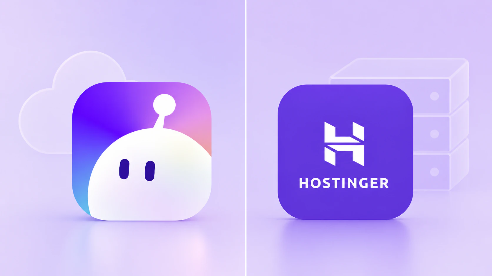

# LightVela กับ Hostinger: VPS ใดที่ดีที่สุดสำหรับการโฮสต์เอเจนต์?

## สรุป

**ถ้าคุณต้องการใช้งาน Hermes Agent โดยไม่ทำให้การดูแล VPS กลายเป็นงานอดิเรก, LightVela จะเหมาะสมมากกว่า.** หากคุณต้องการสิทธิ์ root, สภาพแวดล้อมเซิร์ฟเวอร์ของคุณเอง, และอิสระในการปรับแต่งทุกชั้นรอบ ๆ Hermes, VPS ของ Hostinger เป็นทางเลือกที่ยืดหยุ่นมากกว่า นี่ไม่ใช่เพียงการเปรียบเทียบผลิตภัณฑ์กับผลิตภัณฑ์เท่านั้น: LightVela จะมอบ Hermes Agent ที่โฮสต์ให้คุณ ในขณะที่ Hostinger จะมอบ VPS ที่คุณสามารถรัน Agent ได้

## ภาพรวมโดยย่อ

| สิ่งที่สำคัญ | LightVela | Hostinger VPS |
| - | - | - |
| **สิ่งที่คุณเริ่มต้นด้วย** | เอเจนต์ Hermes ที่โฮสต์บนคลาวด์ | เซิร์ฟเวอร์เสมือน KVM ที่คุณกำหนดค่าเอง |
| **การตั้งค่า Hermes** | ตัวกลางของ Agent ถูกโฮสต์ให้คุณ | คุณปรับใช้ กำหนดค่า และใช้งาน Hermes |
| **ความเป็นเจ้าของในชีวิตประจำวัน** | โมเดล ช่องทาง และทักษะในคอนโซลผลิตภัณฑ์ | Linux การเข้าถึง การอัปเดต ความลับ การสำรองข้อมูล และตัวกลาง Hermes |
| **การควบคุม** | มุ่งเน้นไปที่การใช้และการกำหนดค่า Agent | เข้าถึง root แบบเต็มและการควบคุมระดับเซิร์ฟเวอร์ |
| **เหมาะสำหรับ** | คนที่ต้องการให้ Agent ทำงานตลอดเวลาโดยไม่ต้องทำงานเซิร์ฟเวอร์ | นักสร้างที่ต้องการเป็นเจ้าของสแต็กเซิร์ฟเวอร์โดยเฉพาะ |

## ความแตกต่างที่แท้จริง: ผลิตภัณฑ์ของเอเจนต์เทียบกับเซิร์ฟเวอร์

Hostinger เป็นทางเลือกที่ถูกต้องสำหรับ Hermes บริการ VPS ของมันรวมถึงการเข้าถึง root แบบเต็ม การจัดการไฟร์วอลล์ การสำรองข้อมูลรายสัปดาห์ เทอร์มินัลเว็บ และแคตตาล็อกแอปพลิเคชันที่ระบุ Hermes Agent ซึ่งทำให้มันเป็นจุดเริ่มต้นที่เป็นมิตรกว่าการเช่าเซิร์ฟเวอร์ว่างในที่อื่นและค่อย ๆ หาวิธีจัดการเอง หน้า [Hostinger VPS](https://www.hostinger.com/vps-hosting) ชี้แจงเกี่ยวกับข้อเสนอพื้นฐานอย่างชัดเจน: คุณจะได้สภาพแวดล้อมเสมือนที่แยกออกมาและมีอิสระในการกำหนดค่าระบบปฏิบัติการและซอฟต์แวร์ของมัน

Hermes ถูกสร้างขึ้นมาเพื่อความยืดหยุ่นแบบนั้นโดยเฉพาะ โครงการอย่างเป็นทางการรองรับ backend แบบท้องถิ่น, Docker, SSH และแบบคลาวด์; มันสามารถรันบน VPS และเชื่อมต่อกับช่องทางการส่งข้อความผ่านเกตเวย์ของมันได้ โครงการ [Hermes Agent](https://github.com/NousResearch/hermes-agent) ยังแสดงให้เห็นว่า VPS เป็นหนึ่งในสถานที่ที่ Agent สามารถอยู่ได้

> **แต่ VPS ก็ยังคงเป็น VPS**

เมื่อ Hermes ทำงานที่นั่น ใครบางคนจำเป็นต้องตัดสินใจว่าจะเริ่มต้นมันอย่างไร จะให้มันทำงานต่ออย่างไร จะอัปเดตมันอย่างไร จะเก็บข้อมูลประจำตัวอย่างไร และจะปกป้องการเข้าถึงจากระยะไกลอย่างไร เอกสาร [remote-backend ของ Hermes](https://hermes-agent.nousresearch.com/docs/user-guide/desktop) แยกความแตกต่างระหว่างการเข้าถึงเครือข่ายที่เชื่อถือได้กับการตั้งค่าที่เข้าถึงได้ต่อสาธารณะซึ่งต้องการการตรวจสอบสิทธิ์ที่เข้มงวดยิ่งขึ้น

“ใครบางคน” นั้นสามารถเป็นคุณได้อย่างแน่นอน **มันควรเป็นเพียงการเลือกเท่านั้น**

## ที่ซึ่ง LightVela เหมาะสมมากกว่า

LightVela สำหรับบุคคลที่ต้องการผลลัพธ์จากการรัน Hermes โดยไม่ต้องเป็นผู้ดูแลเซิร์ฟเวอร์ Hermes ก่อน

LightVela รันอินสแตนซ์เอเจนต์ Hermes โดยเฉพาะในคลาวด์ โดยมีรันไทม์แยกออกมาออกแบบให้ทำงานออนไลน์ได้อย่างอิสระจากอุปกรณ์ท้องถิ่นของคุณ คุณจัดการตัวเลือกที่มีประโยชน์—[โมเดล](https://lightvela.ai/docs/configuration/model), [ช่องทาง](https://lightvela.ai/docs/configuration), และ [ทักษะ](https://lightvela.ai/docs/configuration/skill)—ผ่านผลิตภัณฑ์ แทนที่จะประกอบสภาพแวดล้อมพื้นฐานด้วยตัวเอง [ภาพรวม LightVela](https://lightvela.ai/docs/overview) อธิบายโมเดลที่โฮสต์และการตั้งค่าแบบหลายช่องทางของมัน

นั่นเปลี่ยนภาระทางจิตใจ

แทนที่จะต้องตัดสินใจว่าจะเปิดเผยหรือป้องกันบริการระยะไกลอย่างไร คุณสามารถใช้เวลาของคุณในการตัดสินใจว่า Agent ของคุณควรทำอะไร แทนที่จะเตรียมเซิร์ฟเวอร์ก่อนเชื่อมต่อช่องทาง คุณสามารถกำหนดค่า Agent จากคอนโซลและมุ่งเน้นไปที่เวิร์กโฟลว์จริงๆ [LightVela ภาพรวมการกำหนดค่า](https://lightvela.ai/docs/configuration) ครอบคลุมตัวเลือกหลักเหล่านั้น

> **LightVela ไม่ใช่ “ดีกว่า” สำหรับผู้ใช้ด้านเทคนิคทุกคน มันจะดีกว่าเมื่อโครงสร้างพื้นฐานไม่ใช่ประเด็น**

## ที่ที่ Hostinger เหมาะสมมากกว่า

เลือก Hostinger เมื่อการเป็นเจ้าของเซิร์ฟเวอร์เป็นส่วนหนึ่งของเป้าหมาย: คุณต้องการสิทธิ์ root และต้องการ Hermes เคียงข้าง Linux ของคุณเอง, Docker, หรือบริการที่กำหนดเอง [การให้บริการ VPS ของพวกเขา](https://www.hostinger.com/vps-hosting) มอบการควบคุมโครงสร้างพื้นฐานสำหรับการตั้งค่านั้น

ข้อแลกเปลี่ยนคือความเป็นเจ้าของ: การอัปเดต ข้อมูลประจำตัว เครือข่าย และความพร้อมใช้งานจะกลายเป็นส่วนหนึ่งของสแต็กของคุณที่ต้องดำเนินการ

## คุณควรเลือกอันไหนดี?

เลือก LightVela หาก:

- **คุณต้องการเอเจนต์ ไม่ใช่ VPS:** คุณต้องการ Hermes ใช้งานได้โดยไม่ต้องจัดการเซิร์ฟเวอร์  
- **คุณใส่ใจการใช้งานประจำวัน:** โมเดล ช่องทาง ทักษะ และเวิร์กโฟลว์สำคัญกว่าการดูแลเซิร์ฟเวอร์  
- **คุณต้องการลดการตัดสินใจเกี่ยวกับโครงสร้างพื้นฐาน:** คุณต้องการผ่านจาก “ฉันต้องการเอเจนต์” ไปสู่ “เอเจนต์ของฉันทำงานแล้ว” อย่างตรงไปตรงมามากขึ้น  
- **คุณต้องการความแยกออกจากกัน:** คุณต้องการให้การทำงานบนคลาวด์จัดการแยกต่างหากจากคอมพิวเตอร์และสแตกส่วนตัวของคุณ

เลือก Hostinger VPS หาก:

- **คุณต้องการการควบคุม:** คุณต้องการสิทธิ์ root เต็มรูปแบบและการควบคุมระดับเซิร์ฟเวอร์
- **คุณสามารถจัดการสแต็กได้:** คุณมีความชำนาญในการใช้งาน Linux, บริการ, การอัปเดต, ข้อมูลรับรอง และเครือข่าย
- **มีสิ่งที่ต้องรันเพิ่มเติม:** คุณต้องการ Hermes นอกเหนือจากคอนเทนเนอร์หรือโครงสร้างพื้นฐานของคุณเอง

คำตอบตรงที่สุดคือ: **LightVela เป็นสถานที่ที่ดีในการข้ามการสร้างโฮสติ้ง Hermes และเริ่มใช้ Hermes. Hostinger เป็นสถานที่ที่ดีในการสร้างโฮสติ้งนั้นด้วยตัวคุณเอง.**

## แหล่งที่มา

- [โฮสติ้ง VPS ของ Hostinger](https://www.hostinger.com/vps-hosting)
- [Hermes เอเจนต์บน GitHub](https://github.com/NousResearch/hermes-agent)
- [เอกสารเกี่ยวกับ remote-backend Hermes](https://hermes-agent.nousresearch.com/docs/user-guide/desktop)
