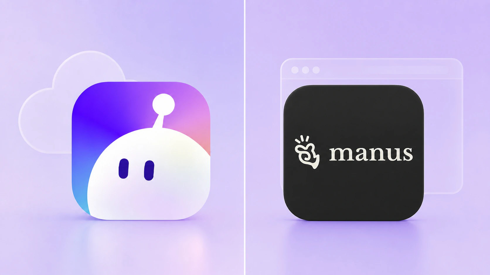

# LightVela กับ Manus: ตัวไหนดีที่สุดในการโฮสต์เอเจนต์ AI ของคุณ?

## สรุป

**เลือก LightVela หากคุณต้องการเอเจนต์ Hermes ส่วนตัวที่ออนไลน์อยู่เสมอ จำการตั้งค่าของคุณ และอยู่ในช่องทางการส่งข้อความที่คุณใช้อยู่แล้ว** เลือก Manus หากคุณต้องการมอบหมายงานที่กำหนดไว้—การค้นคว้า งานเบราว์เซอร์ รายงาน หรือกระบวนการทำงาน—และให้เอเจนต์ทำงานไปสู่ผลลัพธ์ที่ต้องการ ทั้งสองคำทับซ้อนกันที่คำว่า “เอเจนต์” แต่ในการใช้งานประจำวัน พวกมันเริ่มจากจุดที่แตกต่างกันมาก

## ภาพรวมโดยย่อ

| สิ่งที่สำคัญ | LightVela | Manus |
| - | - | - |
| **จุดเริ่มต้น** | เอเจนต์ Hermes ของคุณที่โฮสต์บนคลาวด์อยู่ตลอด | เป้าหมายหรืองานที่คุณต้องการให้เอเจนต์ทำให้สำเร็จ |
| **พื้นผิวทุกวัน** | ช่องทางการส่งข้อความและคอนโซลการตั้งค่า | คอมพิวเตอร์เสมือนและพื้นที่ทำงานบนเบราว์เซอร์ |
| **เวลาทำงาน** | เอเจนต์ Hermes เฉพาะที่ออนไลน์ตลอดเวลา | กล่องทรายงานโดยค่าเริ่มต้น; คอมพิวเตอร์คลาวด์ถาวรเป็นตัวเลือก |
| **การควบคุมหลัก** | เลือกโมเดล, ช่องทาง, บุคลิกภาพ, และทักษะ | อธิบายผลลัพธ์; เข้าควบคุมเมื่อจำเป็น |
| **ความเหมาะสมที่สุด** | เอเจนต์ส่วนตัวที่คุณกลับมาใช้ทุกวัน | การวิจัยอัตโนมัติและการดำเนินการหลายขั้นตอน |

## จุดเริ่มต้นที่แตกต่างกันสองจุด

LightVela ใช้เส้นทางที่เป็นส่วนตัวมากขึ้น มันมีเอเจนต์ Hermes เฉพาะในคลาวด์ เก็บไว้ให้ใช้งานได้ตลอด 24/7 และให้คุณสื่อสารกับมันผ่านช่องทางที่ตั้งค่าไว้ เช่น Telegram, WhatsApp, Discord, Slack, และ WeChat [LightVela ภาพรวม](https://lightvela.ai/docs/overview) อธิบายโมเดลที่โฮสต์นี้และวิธีที่เอเจนต์เชื่อมต่อกับเครื่องมือในชีวิตประจำวันของคุณ

Manus อธิบายตัวเองว่าเป็นเอเจนต์ AI ทั่วไปอัตโนมัติที่มีคอมพิวเตอร์เสมือนของตัวเอง: คุณให้ผลลัพธ์แก่มัน และมันจะวางแผน ดำเนินการ และส่งงานกลับ เครื่องมือ [Cloud Browser](https://manus.im/docs/features/cloud-browser) ของมันสามารถท่องเว็บไซต์ กรอกแบบฟอร์ม ดึงข้อมูล และทำงานเบราว์เซอร์หลายขั้นตอนได้

> **LightVela เริ่มต้นด้วย Agent ที่คุณเก็บไว้ Manus เริ่มต้นด้วยงาน**

## การเปลี่ยนแปลงในการใช้งานประจำวัน

ความแตกต่างสามารถรู้สึกได้ง่ายที่สุดในวันอังคารปกติ

กับ LightVela การโต้ตอบจะเหมือนกับว่า: “คอยดูเรื่องนี้ให้หน่อย,” “เตือนฉันพรุ่งนี้,” “ช่วยฉันให้โครงการนี้เดินหน้า,” หรือเพียงแค่ “ครั้งที่แล้วเราตัดสินใจอะไรไปบ้าง?” จุดสำคัญไม่ใช่ผลงานที่เรียบร้อยเพียงชิ้นเดียว แต่คือการมี Hermes Agent เดียวกันอยู่รอบตัวคุณในช่วงเวลาหนึ่ง พร้อมกับบริบทและการตั้งค่าที่คุณเลือก.

กับ Manus คุณอาจพูดว่า: “วิจัยคู่แข่ง 30 ราย ดึงราคาของพวกเขา และเปลี่ยนเป็นบทสรุปตลาดสั้น ๆ” เอเจนต์สามารถทำงานผ่านเบราว์เซอร์ รวบรวมข้อมูล และจัดทำผลลัพธ์ นั่นเป็นรูปแบบที่ดีสำหรับงานที่มีขอบเขตจำกัด: มันมีเส้นชัยที่ชัดเจน

นั่นหมายความว่าคำถามการตั้งค่าก็จะแตกต่างกันด้วย ใน LightVela คุณจะตัดสินใจว่าใช้ [โมเดล](https://lightvela.ai/docs/configuration/model) ใด เชื่อมต่อ [ช่องทาง](https://lightvela.ai/docs/configuration) ที่คุณต้องการ และเพิ่ม [ทักษะ](https://lightvela.ai/docs/configuration/skill) ที่เหมาะกับกิจวัตรของคุณผ่านคอนโซล ใน Manus คุณภาพของผลลัพธ์มักจะเริ่มจากการที่คุณอธิบายงาน ข้อจำกัดของมัน และรูปแบบของคำว่า “เสร็จสิ้น” อย่างชัดเจน

## ที่ซึ่ง LightVela เหมาะสมมากกว่า

LightVela มีความหมายมากขึ้นเมื่อเอเจนต์เอง—ไม่ใช่แค่ภารกิจ—เป็นสิ่งที่คุณต้องการเก็บไว้

เอเจนต์ Hermes ที่โฮสต์จะมีประโยชน์เมื่อคุณต้องการที่คุ้นเคยที่จะกลับไปใช้: โมเดลที่กำหนดค่าไว้เหมือนเดิม ช่องทางที่เชื่อมต่อเหมือนเดิม ทักษะเหมือนเดิม และบริบทการสนทนาที่ต่อเนื่องเหมือนเดิม คุณไม่จำเป็นต้องคงให้แล็ปท็อปเปิดอยู่หรือจัดการเซิร์ฟเวอร์เพียงเพื่อให้เอเจนต์พร้อมใช้งาน

นั่นเป็นความสะดวกในแบบที่ต่างออกไปจากการ 'ทำงานนี้ให้ฉัน' มันใกล้เคียงกับการมีผู้ช่วยที่คอยอยู่ตลอดเวลาที่คุณสามารถส่งข้อความไปหาได้ทุกครั้งที่มีความคิดเกิดขึ้น

LightVela ยังเหมาะสมกว่าในกรณีที่คุณสนใจในการปรับรูปแบบของเอเจนต์ให้เข้ากับนิสัยของคุณเอง: การกำหนดค่าโมเดล การเลือกสถานที่ที่การสนทนาเกิดขึ้น และการขยาย Hermes ด้วยทักษะ หากงานที่ต้องทำซ้ำเป็นส่วนหนึ่งของภาพรวม คุณยังสามารถตั้งค่า [งานตามกำหนดเวลา](https://lightvela.ai/docs/configuration/automation) แทนที่จะจัดการทุกคำขอเป็นโครงการใหม่.

## ที่ที่ Manus เหมาะสมกว่า

Manus เหมาะสมมากกว่าสำหรับงานบนเบราว์เซอร์ที่มีขอบเขตชัดเจนและมีผลลัพธ์ที่ชัดเจน [Cloud Browser](https://manus.im/docs/features/cloud-browser) ของมันสามารถทำงานได้ข้ามเว็บไซต์และเซสชันที่ได้รับอนุญาต; ขั้นตอนการยืนยันเช่น CAPTCHA หรือ SMS ยังคงต้องการความช่วยเหลือจากคุณ

- **การวิจัยหรือการรายงาน:** เปลี่ยนบรีฟที่กำหนดให้เป็นการเปรียบเทียบหรือรายงาน
- **การทำงานเบราว์เซอร์:** ทำงานต่อเนื่องตามขั้นตอนที่ชัดเจนผ่านแอปเว็บ
- **การดำเนินการอย่างต่อเนื่อง:** ใช้คอมพิวเตอร์คลาวด์สำหรับกระบวนการที่ต้องดำเนินต่อเนื่อง; ดู [บทความช่วยเหลือ](https://help.manus.im/en/articles/15392111-what-is-the-cloud-computer)

## คุณควรเลือกอันไหนดี?

เลือก LightVela หากคุณ:

- **ต้องการความต่อเนื่อง:** คุณต้องการ Hermes Agent ที่คงพร้อมใช้งานเกินกว่าหนึ่งงานเดียว
- **ชอบการส่งข้อความ:** คุณต้องการติดต่อ Agent ของคุณผ่านช่องทางประจำวัน
- **ต้องการกำหนดความสัมพันธ์:** คุณต้องการควบคุมโมเดล ช่องทาง ทักษะ และบุคลิกภาพของมันตามกาลเวลา
- **ต้องการโครงสร้างพื้นฐานน้อยลง:** คุณต้องการ Agent ที่พร้อมใช้งานตลอดเวลาโดยไม่ต้องตั้งค่าเซิร์ฟเวอร์หรือบำรุงรักษาอุปกรณ์ในเครื่อง

เลือก Manus ถ้าคุณ:

- **ต้องการผลลัพธ์สำเร็จ:** คุณต้องการให้เอเจนต์ทำงานที่กำหนดหลายขั้นตอนและส่งผลลัพธ์กลับมา
- **ทำงานในเบราว์เซอร์:** คุณใช้เวลาอยู่ในเครื่องมือและกระบวนการค้นคว้าที่อยู่บนเบราว์เซอร์มาก
- **ชอบคำอธิบายงาน:** คุณอยากจะอธิบายงานมากกว่าการดูแลเอเจนต์ส่วนตัวอย่างต่อเนื่อง

และอย่างตรงไปตรงมา พวกมันสามารถเสริมกันได้ **LightVela อาจเป็นเอเจนต์ Hermes ที่คุณเก็บใกล้ตัว—คนที่คุณส่งข้อความ ปรับแต่ง และสร้างนิสัยรอบตัวเขา Manus อาจเป็นคนทำงานที่มีสมาธิที่คุณส่งไปทำงานเบราว์เซอร์ขนาดใหญ่**
