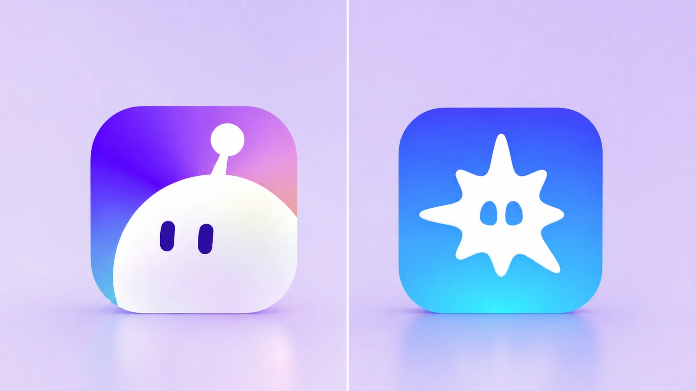

# LightVela กับ Mira: อะไรดีที่สุดสำหรับการใช้งานเอเจนต์ AI ส่วนตัวของคุณ?

## สรุป

**เลือก LightVela หากคุณต้องการให้เอเจนต์ส่วนตัว Hermes ถูกสร้างขึ้นตามตารางกิจวัตรของคุณ, ทักษะที่ใช้ซ้ำได้, งานที่กำหนดเวลาไว้, และช่องทางการส่งข้อความที่คุณเลือก.** เลือก Mira หาก Telegram คือที่ที่งานและชุมชนของคุณอยู่แล้ว และคุณต้องการเปลี่ยนบทสนทนาเป็นการติดตาม, สรุป, การเตือนความจำ, และการกระทำ.

ผลิตภัณฑ์ทั้งสองไปไกลกว่าหน้าต่างแชท แต่เริ่มต้นจากจุดศูนย์ถ่วงที่ต่างกัน: Mira เป็นผู้ช่วยแบบ Telegram-first ในขณะที่ LightVela เป็นเอเจนต์ส่วนบุคคลที่ปรับแต่งได้ซึ่งสามารถเติบโตเป็นระบบเวิร์กโฟลว์ที่กว้างขึ้น

## ภาพรวมโดยย่อ

| สิ่งที่สำคัญ | LightVela | Mira |
| - | - | - |
| **เหมาะสำหรับ** | เอเจนต์ AI ส่วนตัวที่ใช้งานยาวนาน | ผู้ช่วยส่วนตัวหรือทีมภายใน Telegram |
| **ประสบการณ์หลัก** | ตั้งค่าเอเจนต์หนึ่งตัวโดยรอบกิจวัตรและความชอบของคุณ | ขอให้เอเจนต์เข้าใจแชทและดำเนินการจากการสนทนา |
| **จุดเน้นการตั้งค่า** | ทักษะ, งานตามกำหนด, ความจำ, บุคลิก, แบบจำลอง, และช่องทาง | แชท Telegram, บริบทกลุ่ม, เครื่องมือที่เชื่อมต่อ, และการทำกิจกรรมซ้ำๆ |
| **คุณค่าในชีวิตประจำวัน** | เอเจนต์ที่สม่ำเสมอซึ่งยังคงทำงานต่อเนื่องนอกเหนือจากการสนทนาหนึ่งครั้ง | ลดการเปลี่ยนบริบทระหว่างแชท, งาน, และเครื่องมือที่เชื่อมต่อ |
| **กรณีการใช้งานที่แข็งแกร่งที่สุด** | กระบวนการทำงานส่วนตัวที่ควรปรับปรุงอย่างต่อเนื่อง | การติดตามแชท, การบรีฟสั้น, เนื้อหา, และการประสานงานของทีม |

## การเปลี่ยนแปลงในการใช้งานประจำวัน

ความแตกต่างในทางปฏิบัติไม่ได้อยู่ที่ผลิตภัณฑ์ใดให้คำตอบที่ดีกว่าต่อคำสั่งเดียว แต่มันอยู่ที่ว่าเอเจนต์นั้นอยู่ในวันของคุณอย่างไร และคุณต้องการกำหนดรูปแบบการทำงานของมันมากแค่ไหน

ด้วย LightVela คุณสามารถกำหนดค่าเอเจนต์ Hermes ที่โฮสต์รอบวิธีการทำงานของคุณ จากนั้นคุณสามารถพูดคุยกับเอเจนต์ตัวเดียวกันต่อไปเมื่อความต้องการของคุณเปลี่ยนไป  
คุณสามารถติดตั้ง [ทักษะ](../configuration/skill.md) ที่ใช้ซ้ำได้ สร้าง [งานที่ตั้งเวลาไว้](../configuration/automation.md) เลือก [โมเดล](../configuration/model.md) และเชื่อมต่อช่องทางที่คุณใช้งานจริง  
วิธีนี้จะเปลี่ยนการโต้ตอบที่มีประโยชน์เพียงครั้งเดียวให้กลายเป็นเวิร์กโฟลว์ที่สามารถทำงานต่อเนื่องได้สำหรับคุณ

คุณอาจขอรายงานสรุปรายวัน รายการเฝ้าดูซ้ำ ร่างเนื้อหา หรือการเตือนโดยไม่ต้องสร้างกระบวนการใหม่ทุกครั้ง LightVela ถูกออกแบบโดยคำนึงถึงความต่อเนื่องนั้น: เอเจนต์หนึ่งตัว การตั้งค่าที่พัฒนาต่อเนื่อง และที่เดียวในการปรับปรุงวิธีที่มันควรช่วยเหลือ

[Mira](https://mira.tg/) เริ่มต้นจากสมมติฐานที่แตกต่าง  
มันถูกสร้างขึ้นโดยตรงภายใน Telegram ซึ่งคุณสามารถใช้มันในการแชทส่วนตัว แชทกลุ่ม และช่องต่าง ๆ โดยไม่ต้องเปิดแอปพลิเคชันแยกต่างหาก  
Mira นำเสนอเองเป็นเอเจนต์ที่สามารถจดจำบริบท สรุปการสนทนา ติดตามการตัดสินใจ เชื่อมต่อเครื่องมือนอก และเปลี่ยนข้อความให้เป็นการกระทำจริง ๆ

นั่นทำให้ Mira ดูเป็นธรรมชาติมากโดยเฉพาะเมื่อแหล่งที่มาของงานเป็นบทสนทนาอยู่แล้ว  
ทีมสามารถเพิ่ม Mira เข้าไปในกลุ่ม ถามว่ามีการตัดสินใจอะไรบ้าง แปลงข้อตกลงให้เป็นงานติดตามผล หรือขอข้อมูลสรุปโดยไม่ต้องออกจาก Telegram  
ประสบการณ์นี้ใกล้เคียงกับการมอบหมายงานภายในแชทที่แชร์ร่วมกันมากกว่าการตั้งค่าพื้นที่ทำงานส่วนตัวแยกออกไป

## ที่ซึ่ง LightVela เหมาะสมมากกว่า

LightVela เป็นตัวเลือกที่เหมาะสมกว่าถ้าคุณต้องการให้เอไอเอเจนต์ของคุณกลายเป็นส่วนหนึ่งที่สอดคล้องของระบบปฏิบัติการส่วนตัวของคุณ คุณไม่ได้เพียงแค่ขอให้ผู้ช่วยตอบสนองต่อข้อความล่าสุด คุณกำลังกำหนดว่าตัวเอเจนต์ควรทำตัวอย่างไร ควรรู้เรื่องอะไร ใช้ความสามารถใดได้บ้าง และควรลงมือเมื่อใด

คุณอาจต้องการเอเจนต์ที่ตรวจสอบข้อมูลทุกเช้า เฝ้าดูคู่แข่ง แปลงอัปเดตสินค้าเป็นร่างโซเชียล หรือสรุปหัวข้อการวิจัยทุกสัปดาห์ ส่วนที่เป็นประโยชน์ไม่ใช่คำตอบที่สมบูรณ์แบบ แต่คือการสามารถเปลี่ยนการโต้ตอบที่มีประโยชน์ให้กลายเป็นสิ่งที่ทำงานต่อเนื่องได้

นั่นคือจุดที่ความสามารถ (Skills) และงานตามกำหนดเวลา (Scheduled Tasks) มีความสำคัญ ความสามารถจะมอบความสามารถที่สามารถใช้งานซ้ำได้ให้กับเอเจนต์ของคุณ ในขณะที่งานตามกำหนดเวลาช่วยให้การทำงานประจำเกิดขึ้นตามตารางเวลา แทนที่จะต้องพึ่งพาคุณในการจำคำสั่งในเวลาที่เหมาะสม คุณสามารถเริ่มจากการประชุมสรุปเช้า เพิ่มความสามารถในการค้นคว้า และส่งผลลัพธ์ผ่านช่องทางที่คุณมีแนวโน้มจะเห็นมากที่สุด

LightVela ยังเป็นตัวเลือกที่ตรงไปตรงมามากกว่าหากคุณสนใจในการกำหนดบทบาทของเอเจนต์มากกว่าการยอมรับประสบการณ์ผลิตภัณฑ์ที่กำหนดไว้ล่วงหน้า คุณเลือกโมเดล, พฤติกรรมที่คุณต้องการสนับสนุน, ความสามารถที่คุณต้องการเพิ่ม และช่องทางที่เอเจนต์ควรปรากฏ [LightVela ภาพรวม](../01-overview.md) อธิบายว่าชิ้นส่วนเหล่านั้นเข้ากันอย่างไร

ข้อแลกเปลี่ยนคือ LightVela ถูกตั้งใจให้มีจุดศูนย์กลางอยู่ที่เอเจนต์ส่วนบุคคลที่กำลังพัฒนา หากความต้องการหลักของคุณคือการเข้าใจและปฏิบัติตามการสนทนา Telegram ที่ยุ่ง การใช้ Mira อาจรู้สึกตรงไปตรงมามากกว่า

## ที่ที่ Mira เหมาะสมมากกว่า

Mira เป็นตัวเลือกที่แข็งแกร่งกว่าเมื่อ Telegram เป็นสถานที่ที่งาน ชุมชน และการตัดสินใจของคุณเกิดขึ้นแล้ว  
เว็บไซต์ทางการของมันอธิบายถึงผู้ช่วยที่เป็น Telegram-เนทีฟ ซึ่งสามารถช่วยด้านเนื้อหา กล่องจดหมาย การติดตามคริปโต การช็อปปิ้ง การวางแผนการเดินทาง การเตือนความจำ และเครื่องมือที่เชื่อมต่อ  
ข้อได้เปรียบสำคัญคือบริบทนั้นมีอยู่แล้วในการแชทที่คำขอเริ่มต้น

Mira ยังเหมาะอย่างยิ่งสำหรับทีมและชุมชน สามารถติดตามว่าใครพูดอะไร สรุปการสนทนากลุ่มยาว ๆ แสดงการตัดสินใจที่ยังเปิดอยู่ และช่วยเปลี่ยนการสนทนาให้กลายเป็นงานที่มอบหมาย นั่นมีประโยชน์สำหรับทีมผลิตภัณฑ์ ผู้ก่อตั้ง ผู้สร้างสรรค์ และผู้ดูแลชุมชนที่ใช้เวลามากขึ้นใน Telegram มากกว่าระบบงานเฉพาะ

โมเดล Telegram-แรกเดียวกันสามารถสนับสนุนการประชุมสรุปรายวันและเวิร์กโฟลว์ที่เกิดซ้ำได้ คุณสามารถขอสรุปในเวลาที่เหมาะสม มอบหมายงานวิจัย หรือเชื่อมต่อบริการต่างๆ เช่น GitHub, Notion และ Google Drive จากประสบการณ์แชท เอกสารอย่างเป็นทางการของ Mira ยังเน้นชั้นเครื่องมือและการรวมระบบที่กว้าง ดังนั้นผู้ช่วยสามารถเปลี่ยนจากคำตอบเป็นการกระทำโดยไม่ต้องขอให้คุณสลับบริบท

ขอบเขตเป็นจุดสนใจ  
Mira ถูกปรับให้เหมาะสมรอบ ๆ อินเทอร์เฟซ Telegram และบริบททางสังคมภายในนั้น  
หากคุณต้องการออกแบบบุคลิกของ Agent หนึ่ง โมเดล ทักษะ งานที่กำหนดเวลา และช่องทางต่าง ๆ เป็นระบบส่วนบุคคลระยะยาว LightVela จะให้พื้นที่ควบคุมที่ชัดเจนมากขึ้นแก่คุณ

## คุณควรเลือกอันไหนดี?

เลือก LightVela หากคุณ:

- **ต้องการเอเจนต์ส่วนตัวหนึ่งตัว:** คุณต้องการเอเจนต์ Hermes แบบโฮสต์ที่มีประโยชน์มากขึ้นเมื่อคุณปรับปรุงมัน  
- **ต้องการความต่อเนื่อง:** คุณต้องการให้อเจนต์เดียวกันคงอยู่และเก็บการตั้งค่าของคุณไว้ตามเวลา  
- **ชอบรูปแบบที่ปรับแต่งได้:** คุณต้องการทักษะที่นำกลับมาใช้ได้และงานตามกำหนดเวลาที่เกิดซ้ำตามนิสัยของคุณ  
- **ต้องการการเข้าถึงที่ยืดหยุ่น:** คุณต้องการติดต่อเอเจนต์ของคุณผ่านช่องทางที่เหมาะกับวิธีการทำงานของคุณ  
- **ต้องการการควบคุมโดยตรง:** คุณต้องการจัดการโมเดล บุคลิก ความสามารถ และรูปแบบการทำงาน

เลือก Mira ถ้าคุณ:

- **ใช้ชีวิตใน Telegram:** งานส่วนตัว การตัดสินใจของทีม หรือกิจกรรมชุมชนของคุณเกิดขึ้นแล้วในแชท
- **ต้องการความจำของการสนทนา:** คุณต้องการให้เอเจนต์เข้าใจสิ่งที่ผู้คนพูดและสิ่งที่ยังต้องทำ
- **ต้องการการมอบหมายงานอย่างรวดเร็ว:** คุณต้องการเปลี่ยนข้อความให้เป็นการเตือน งาน สรุป ร่าง หรือการกระทำของเครื่องมือที่เชื่อมต่อกัน
- **ต้องการการทำงานร่วมกันเป็นกลุ่ม:** คุณต้องการผู้ช่วยร่วมหนึ่งคนที่สามารถเข้าร่วมการสนทนาส่วนตัวและกลุ่มได้
- **ชอบการตั้งค่าที่น้อยที่สุด:** คุณต้องการเริ่มคุยกับเอเจนต์โดยไม่ต้องตั้งค่าสถานที่ทำงานแยกต่างหากก่อน

ความคิดเห็นของฉัน: **LightVela เหมาะสมกว่ากับเอเจนต์ AI ส่วนตัวหนึ่งตัวที่เติบโตไปพร้อมกับกิจวัตรของคุณ Mira เหมาะสมกว่าตอนที่ Telegram เป็นพื้นผิวในการทำงานสำหรับการสนทนา งาน และการติดตามของคุณ**

ถ้าคุณต้องการเปรียบเทียบ Mira กับผู้ช่วยคนอื่นที่ถูกสร้างขึ้นรอบแบบการทำงานที่ต่างออกไป ดูที่ [LightVela vs Grok Bot](./lightvela-vs-grok-bot.md)

หากคำถามของคุณคือ “ควรให้เอเจนต์ใดอยู่ในบทสนทนา Telegram ของฉัน?” Mira น่าจะเป็นคำตอบที่ชัดเจนกว่า

ถ้าคำถามของคุณคือ “ฉันควรจะรันเอเจนต์ AI ที่ฉันปรับแต่งและใช้งานทุกวันได้ที่ไหน?”, LightVela คือทางเลือกที่เหมาะสมกว่า
