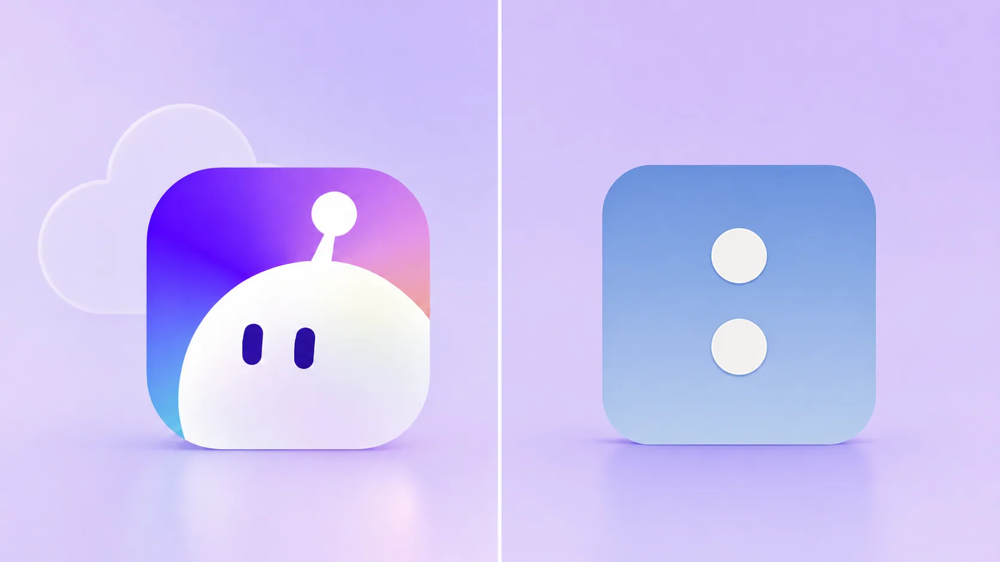

# LightVela กับ Today.AI: อันไหนดีที่สุดสำหรับผู้ช่วย AI ส่วนตัวที่เปิดใช้งานตลอดเวลา?

## สรุป

**เลือก LightVela หากคุณต้องการเอเจนต์ AI ส่วนตัวที่ใช้งานได้จริงและออนไลน์ตลอดเวลาซึ่งคุณสามารถเข้าถึงผ่านแอปส่งข้อความ ปรับแต่งด้วยโมเดลต่าง ๆ ขยายด้วยทักษะ และตั้งเวลากับงานที่กำหนดเวลาได้** เลือก Today.AI หากคุณต้องการระบบปฏิบัติการส่วนตัวที่เน้นแอปมากขึ้นซึ่งสร้างขึ้นรอบข้อมูลประจำวันของคุณและข้อเสนอแนะเชิงรุก

โมเดลผลิตภัณฑ์ที่มีเอกสารของ LightVela มุ่งเน้นไปที่เอเจนต์ Hermes ที่โฮสต์บนคลาวด์ ในขณะที่การวางตำแหน่งสาธารณะของ Today.AI เน้นไปที่บริบทส่วนบุคคล การช่วยเหลือเชิงรุก และความช่วยเหลือข้ามอุปกรณ์  
LightVela เป็นตัวเลือกที่เข้าใจได้ทันทีมากกว่าสำหรับการโฮสต์เอเจนต์อย่างต่อเนื่องและการควบคุมอย่างชัดเจน  
Today.AI แสดงถึงวิสัยทัศน์ที่เป็นการทดลองมากกว่า: ผู้ช่วยที่สร้างภาพชีวิตของคุณและทำงานก่อนที่คุณจะขอ

## ภาพรวมโดยย่อ

นี่คือการเปรียบเทียบรูปร่างของผลิตภัณฑ์และการเป็นเจ้าของในชีวิตประจำวัน ไม่ใช่มาตรฐานหรือคำตัดสินด้านราคา
ข้อมูลสาธารณะที่มีสำหรับ Today.AI ยังคงมีจำกัดมากกว่าการเอกสารผลิตภัณฑ์ที่ LightVela เผยแพร่

| สิ่งที่สำคัญ | LightVela | Today.AI |
| - | - | - |
| **รูปร่างผลิตภัณฑ์** | เอเจนต์ที่โฮสต์บนคลาวด์ Hermes | ผู้ช่วย AI ส่วนตัวและวิสัยทัศน์ระบบปฏิบัติการ AI ที่เป็นเนทีฟ |
| **รูปแบบการเข้าถึงหลัก** | ช่องทางการส่งข้อความรวมทั้งคอนโซลเว็บ | แอปเนทีฟและประสบการณ์ข้ามอุปกรณ์ |
| **หน่วยความจำ** | ความจำของเอเจนต์คงอยู่ตลอดการสนทนา | ความจำที่เติบโตจากบริบทส่วนบุคคล |
| **งานเชิงรุก** | งานที่กำหนดเวลาไว้โดยชัดเจนและงานตามกำหนด | ถูกออกแบบให้ดำเนินการก่อนที่ผู้ใช้จะร้องขอ |
| **ความสามารถในการขยาย** | โมเดล, ช่องทาง, ทักษะ, และงานตามกำหนด | รายละเอียดของโมเดลและระบบนิเวศยังอยู่ระหว่างการพัฒนา |
| **การเหมาะสมที่สุด** | ผู้ใช้ที่ต้องการเอเจนต์ที่สามารถใช้งานได้ตลอดเวลาเดี๋ยวนี้ | ผู้ที่เริ่มใช้งานแรก ๆ ที่มองหาระบบปฏิบัติการส่วนตัวเชิงรุก |

## การเปลี่ยนแปลงในการใช้งานประจำวัน

ความแตกต่างที่ง่ายที่สุดคือที่อยู่ของผู้ช่วย  
LightVela จะวาง Hermes Agent ในคลาวด์ จากนั้นให้คุณเข้าถึง Agent เดียวกันนั้นผ่านช่องทางเช่น Telegram, WhatsApp, Discord, Slack หรือ WeChat  
Today.AI ถูกนำเสนอเหมือนชั้นการทำงานส่วนตัว: มันรวบรวมบริบทจากอุปกรณ์และบริการของคุณ จัดระเบียบสิ่งที่สำคัญ และเปลี่ยนบริบทนั้นให้กลายเป็นข้อเสนอแนะที่เหมาะสมตามเวลา

ลองจินตนาการถึงเช้าวันจันทร์
หน้า [Landing Page](https://today.ai/landing) สาธารณะของ Today.AI แสดงถึงประสบการณ์ที่ตั้งใจออกแบบรอบๆ สรุปย่อช่วงเช้าที่เชื่อมโยงตารางเวลาของคุณ สัญญาณสุขภาพ โครงการ ความสัมพันธ์ และเป้าหมายที่ยังไม่เสร็จ
มันยังนำเสนอความทรงจำที่มีชีวิต ข้อเสนอแนะเชิงรุก ตัวเชื่อมแอพ คอมพิวเตอร์บนคลาวด์ และการควบคุมข้ามอุปกรณ์เป็นส่วนหนึ่งของประสบการณ์ผู้ช่วยเดียวกัน

ด้วย LightVela คุณกำหนดสภาพแวดล้อมการทำงานของผู้ช่วยได้อย่างชัดเจนยิ่งขึ้น  
คุณสามารถเชื่อมต่อโมเดล เลือกช่องทาง ติดตั้ง [ทักษะ](../configuration/skill.md) ที่เป็นประโยชน์ และสร้างงานที่ตั้งเวลา เช่น การเตือนความจำ, สรุปข่าวสาร, หรือการวิจัยซ้ำ ๆ ผ่าน [งานที่ตั้งเวลา](../configuration/automation.md)  
ผลลัพธ์จะให้ความรู้สึกเหมือนเป็นเอเจนต์ที่เชื่อถือได้ซึ่งคุณตั้งใจจัดรูปแบบ มากกว่าที่จะเป็นระบบปฏิบัติการที่คอยสังเกตวันทั้งวันของคุณ

ความแตกต่างนั้นมีผลต่อความเชื่อใจและความสามารถในการคาดเดา  
LightVela ขอให้คุณตัดสินใจว่า ความสามารถและตารางเวลาใดควรมีอยู่  
คำสัญญาของ Today.AI คือ บริบทที่กว้างขึ้นทำให้มันสังเกตได้ว่าสิ่งใดอาจมีความสำคัญต่อไปและเข้าไปแทรกแซงในเวลาที่เหมาะสม  
วิธีการหนึ่งให้คุณมีพื้นควบคุมที่ชัดเจน  
อีกวิธีตั้งเป้าที่จะเป็นผู้ช่วยแบบรอบตัวที่มีประโยชน์โดยการเข้าใจชีวิตของคุณมากขึ้น

## ที่ซึ่ง LightVela เหมาะสมมากกว่า

ข้อได้เปรียบที่แข็งแกร่งที่สุดของ LightVela คือความชัดเจนในการปฏิบัติการ มันถูกออกแบบมาเพื่อลบงานโครงสร้างพื้นฐานที่อยู่เบื้องหลังเอเจนต์ที่คงอยู่: ไม่ต้องตั้งค่าเซิร์ฟเวอร์ บำรุงรักษาคอนเทนเนอร์ หรือคอมพิวเตอร์ท้องถิ่นที่ต้องตื่นอยู่ [ภาพรวม LightVela](../01-overview.md) บันทึกเอเจนต์ Hermes ที่โฮสต์บนคลาวด์ซึ่งยังคงพร้อมใช้งานโดยไม่ขึ้นอยู่กับอุปกรณ์ส่วนตัวของคุณ

เรื่องนี้สำคัญเพราะความจำและการทำงานเชิงรุกจะมีประโยชน์ก็ต่อเมื่อเอเจนต์ยังคงพร้อมใช้งาน  
ผู้ช่วยที่ทำงานบนแล็ปท็อปอาจทรงพลังในระหว่างเซสชันที่ใช้งานอยู่ แต่จะไม่สามารถใช้งานได้เมื่อเครื่องเข้าสู่โหมดสลีป เปลี่ยนเครือข่าย หรือถูกแทนที่  
LightVela ทำให้เอเจนต์ทำงานได้อย่างอิสระ ดังนั้นงานที่กำหนดเวลาและบทสนทนาในอนาคตจึงไม่ขึ้นอยู่กับว่าอุปกรณ์ส่วนตัวของคุณออนไลน์หรือไม่

LightVela ยังชัดเจนขึ้นเกี่ยวกับขอบเขตการกำหนดค่า โมเดลของมันแยกบล็อกหลักออกเป็น Hermes เอเจนต์ โมเดล ช่องทาง ทักษะ และงานที่กำหนดเวลา ช่องทางหลายช่องสามารถเชื่อมต่อกับเอเจนต์เดียวกันและแชร์ความจำและพฤติกรรมของมันได้ ขณะที่ทักษะเพิ่มความสามารถที่นำกลับมาใช้ใหม่ได้สำหรับเวิร์กโฟลว์เฉพาะ

นี่ให้คุณมีการควบคุมที่เป็นประโยชน์ คุณสามารถเปลี่ยนโมเดลได้โดยไม่ต้องสร้าง Agent ใหม่ เพิ่ม Channel ได้โดยไม่ต้องสร้างบุคลิกที่สอง และติดตั้ง Skill เมื่อคุณต้องการกระบวนการทำงานซ้ำ งานตามกำหนดเวลาจึงให้ชั้นการจัดกำหนดเวลาสำหรับการเตือน สรุป การแจ้งเตือน และงานที่เกิดขึ้นซ้ำอื่น ๆ

LightVela น่าสนใจเป็นพิเศษหาก AI ของคุณอยู่ในเครื่องมือสื่อสารของคุณอยู่แล้ว แทนที่จะเปิดแดชบอร์ดแยกต่างหาก คุณสามารถถามคำถามเดียวกันกับ Agent ใน Telegram ต่อเนื่องไปยัง Channel ที่เชื่อมต่ออีกช่องทางหนึ่ง และเก็บการสนทนาไว้กับตัวตนและความทรงจำเดียวกัน

## ที่ที่ Today.AI เหมาะสมมากกว่า

กรณีที่แข็งแกร่งที่สุดของ Today.AI คือความทะเยอทะยานในผลิตภัณฑ์ของมัน ตำแหน่งสาธารณะของมันอธิบายผู้ช่วยที่มุ่งเน้นไปที่บุคคล มีความทรงจำที่มีชีวิต การช่วยเหลือเชิงรุก ระบบนิเวศของตัวเชื่อมที่เติบโต คลาวด์คอมพิวเตอร์ การควบคุมข้ามอุปกรณ์ และทักษะของชุมชน

นั่นเป็นจุดเริ่มต้นที่แตกต่างจาก LightVela
Today.AI กำลังพยายามให้ผู้ช่วยเข้าใจรูปแบบวันของคุณก่อนที่คุณจะสร้างคำขอ
ประสบการณ์นี้อาจน่าดึงดูดหากคุณต้องการบริบทส่วนบุคคลเพื่อนำตารางเวลา โปรเจกต์ สัญญาณด้านสุขภาพ ความสัมพันธ์ และเป้าหมายที่ยังไม่เสร็จมารวมเข้าด้วยกันเป็นลำดับข้อมูลรายวันเดียว

Today.AI น่าสนใจสำหรับผู้ที่ชอบแอปพลิเคชันพื้นเมืองและความช่วยเหลือข้ามอุปกรณ์ วัสดุสาธารณะของมันอธิบายประสบการณ์ที่สามารถทำงานข้ามอุปกรณ์ที่คุณใช้อยู่แล้ว ในขณะที่คอมพิวเตอร์คลาวด์จัดการเบราว์เซอร์ ไฟล์ และโค้ดเมื่อภารกิจต้องการมากกว่าคำแนะนำ ทักษะของชุมชนถูกเสนอเป็นอีกวิธีหนึ่งในการนำเวิร์กโฟลว์ที่นำกลับมาใช้ซ้ำได้เข้าสู่ผู้ช่วย

คุณสมบัติที่สำคัญคือความมีวุฒิภาวะและการมองเห็น หน้าแรกสาธารณะของ Today.AI ในปัจจุบันนำผู้เยี่ยมชมไปยังรายการรอ และข้อกำหนดของบริการระบุว่านี่เป็นเวอร์ชันเบต้าเข้าถึงล่วงหน้าที่คุณสมบัติอาจเปลี่ยนแปลง รายละเอียดเฉพาะของโมเดลและระบบนิเวศของมันจึงยังอยู่ในระหว่างการพัฒนา นี่คือผลิตภัณฑ์ที่พัฒนาต่อเนื่องมากกว่าการเป็นแพลตฟอร์มที่โปร่งใสและพร้อมใช้ในวงกว้าง

นั่นทำให้ Today.AI เป็นตัวเลือกตามธรรมชาติสำหรับผู้ที่เริ่มใช้เทคโนโลยีใหม่ที่ต้องการสำรวจแนวคิดของเลเยอร์ปฏิบัติการส่วนบุคคล  
มันเป็นตัวเลือกที่ชัดเจนน้อยกว่า หากคุณต้องการเส้นทางการตั้งค่าที่มีเอกสารรองรับ ขอบเขตการกำหนดค่าที่คาดเดาได้ และเอเจนต์ที่โฮสต์บนคลาวด์ซึ่งใช้งานได้ทันที

## คุณควรเลือกอันไหนดี?

เลือก LightVela หากคุณ:

- **ต้องการเอเจนต์ที่พร้อมใช้งานตลอดเวลา:** คุณต้องการเอไอเอเจนต์ที่ไม่ขึ้นอยู่กับการเปิดเครื่องคอมพิวเตอร์หรือโทรศัพท์ของคุณ  
- **ชอบการเข้าถึงที่คุ้นเคย:** คุณต้องการใช้ช่องทางการส่งข้อความแทนการพึ่งพาแอปพลิเคชันใหม่แบบเดี่ยว  
- **ต้องการการควบคุมอย่างชัดเจน:** คุณต้องการตั้งค่ารูปแบบ ทักษะ ช่องทาง ความจำ และงานตามกำหนดการ  
- **ให้ความสำคัญกับการตั้งค่าที่มีเอกสาร:** คุณต้องการเส้นทางการตั้งค่าที่คุณสามารถเข้าใจ ทำซ้ำ และปรับเปลี่ยนได้  
- **ต้องการเริ่มทันที:** คุณต้องการใช้งานบนคลาวด์ที่พร้อมทำงาน Hermes เอเจนต์ในขณะที่ผลิตภัณฑ์เติบโตไปกับคุณ

เลือก Today.AI ถ้าคุณ:

- **ต้องการบริบทส่วนบุคคลที่กว้างขึ้น:** คุณต้องการให้ผู้ช่วยสร้างภาพรวมที่มีชีวิตจากข้อมูล อุปกรณ์ และบริการของคุณ  
- **ชอบแอปเนทีฟ:** คุณต้องการประสบการณ์ที่มุ่งเน้น Mac, iOS หรือ Android ข้ามอุปกรณ์  
- **ต้องการคำแนะนำเชิงรุก:** คุณตื่นเต้นกับการรับข้อมูลรายวันและความช่วยเหลือที่มาถึงก่อนที่คุณจะถาม  
- **ยอมรับการเข้าถึงข้อมูลที่กว้างขึ้น:** คุณสบายใจที่จะอนุญาตให้มีบริบทส่วนบุคคลเป็นส่วนหนึ่งของประสบการณ์ผู้ช่วย  
- **เพลิดเพลินกับการเข้าถึงก่อนใคร:** คุณเต็มใจเข้าร่วมผลิตภัณฑ์ที่กำลังพัฒนา ขณะที่โมเดลและระบบนิเวศของมันชัดเจนขึ้น

ความคิดเห็นของฉัน: **LightVela เหมาะกับคนที่ต้องการเอเจนต์ส่วนตัวที่ยั่งยืนซึ่งพวกเขาสามารถปรับแต่งและใช้งานได้วันนี้ Today.AI เหมาะกับผู้ที่นำเทคโนโลยีมาใช้ก่อนใครที่ต้องการสำรวจว่ามันจะเกิดอะไรขึ้นเมื่อผู้ช่วย AI กลายเป็นชั้นปฏิบัติการส่วนบุคคล**

ไม่จำเป็นต้องปฏิเสธผลิตภัณฑ์ใด ๆ ทั้งสอง  
พวกเขากำลังแก้ปัญหาที่อยู่ใกล้กัน: LightVela ทำให้ Agent ที่มีความสามารถน่าเชื่อถือ เข้าถึงได้ และขยายได้ ขณะที่ Today.AI กำลังสำรวจว่าผู้ช่วยสามารถเข้าใจและคาดการณ์จังหวะชีวิตของคน ๆ หนึ่งได้ลึกเพียงใด
