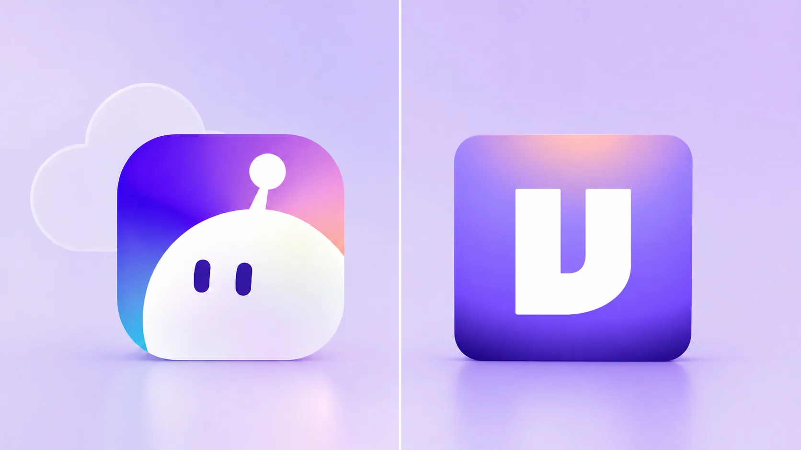

# LightVela vs Viktor.com: อะไรดีที่สุดในการใช้งานเอเจนต์ AI ส่วนตัวของคุณ?

## สรุป

**เลือก LightVela หากคุณต้องการเพื่อน AI ส่วนตัวที่สามารถใช้งานได้ตลอดเวลา มีหน่วยความจำระยะยาว การกำหนดค่ารูปแบบที่ยืดหยุ่น ช่องทางการส่งข้อความ ทักษะ และงานที่ตั้งเวลาได้** เลือก Viktor.com หากคุณต้องการเพื่อนร่วมงาน AI แบบแชร์ที่ทำงานภายในพื้นที่ทำงานของทีมและทำงานร่วมกับเครื่องมือธุรกิจต่าง ๆ เช่น Slack, GitHub, Notion, Stripe, Salesforce และ Google Ads

ความแตกต่างไม่ได้อยู่ที่เพียงว่า AI ตัวไหนฉลาดกว่า แต่มันอยู่ที่ว่าเอเจนต์อยู่ที่ไหน เป็นของใคร และถูกออกแบบมาให้ทำงานประเภทใด

## ภาพรวมโดยย่อ

| สิ่งที่สำคัญ | LightVela | Viktor.com |
| - | - | - |
| **บทบาทหลัก** | เอเจนต์ AI ส่วนบุคคลในคลาวด์ | เพื่อนร่วมงาน AI สำหรับทีม |
| **อินเทอร์เฟซหลัก** | คอนโซลเว็บและช่องทางการส่งข้อความ | Slack, Microsoft Teams, เว็บแอป และ Discord |
| **โมเดลความจำ** | ความจำของเอเจนต์ส่วนบุคคลในบทสนทนาและช่องทางต่าง ๆ | บริบทและความจำของพื้นที่ทำงานร่วมกัน |
| **การเชื่อมต่อระบบต่าง ๆ** | ช่องทางการส่งข้อความ, ทักษะ, งานที่กำหนดเวลา, และผู้ให้บริการโมเดล | การเชื่อมต่อเครื่องมือธุรกิจกว่า 3,200 รายการ |
| **โมเดลการตั้งค่า** | เอเจนต์คลาวด์ที่จัดการแล้วโดยไม่ต้องบำรุงรักษาเซิร์ฟเวอร์ | เชื่อมต่อ Viktor, อนุญาตเครื่องมือ และมอบหมายงาน |
| **ความเหมาะสมที่สุด** | การช่วยส่วนบุคคลและความร่วมมือระยะยาว | การดำเนินธุรกิจข้ามเครื่องมือ |

## ความแตกต่างที่แท้จริงคือความเป็นเจ้าของ

LightVela ถูกสร้างขึ้นบนแนวคิดของการมีผู้ช่วยส่วนตัวที่มีอายุการใช้งานยาวนาน  
ผู้ช่วย Hermes ของคุณทำงานบนคลาวด์ สามารถใช้งานได้แม้อุปกรณ์ของคุณออฟไลน์ และสามารถติดต่อผ่านช่องทางการส่งข้อความที่รองรับ  
ความทรงจำ, บุคลิกภาพ, แบบจำลอง, ทักษะ และงานที่ตั้งเวลาไว้ ถูกกำหนดรอบความสัมพันธ์ที่ต่อเนื่อง  
[LightVela ภาพรวม](../01-overview.md) อธิบายว่าชิ้นส่วนเหล่านั้นทำงานร่วมกันอย่างไร

Viktor.com ใช้แนวทางที่แตกต่างกัน
Viktor อธิบายตัวเองว่าเป็นเพื่อนร่วมงาน AI ที่อยู่ใน Slack และ Microsoft Teams ซึ่งทีมทั้งหมดสามารถส่งข้อความหา มัน เชิญมันเข้าช่อง และแชร์บริบทของพื้นที่ทำงานของมัน
เอกสารผลิตภัณฑ์ปัจจุบันของมันยังรวมถึงการแชทบนเว็บและการเข้าถึง Discord แต่แนวคิดหลักยังคงเป็นสภาพแวดล้อมการทำงานร่วมกัน มากกว่าการเป็นเพื่อนส่วนตัวส่วนตัว

ความแตกต่างนั้นมีความสำคัญ  
หากคำถามคือ “เอเจนต์นี้สามารถจำวิธีการทำงานของฉันและอยู่กับฉันไปตลอดได้หรือไม่?” LightVela คือคำตอบที่ชัดเจนกว่า  
หากคำถามคือ “ปัญญาประดิษฐ์นี้สามารถทำงานข้ามเครื่องมือของบริษัทของเราสำหรับทุกคนได้หรือไม่?” Viktor ถูกออกแบบมาสำหรับงานนั้น

ขอบเขตเดียวกันปรากฏใน [LightVela vs Mira](./lightvela-vs-mira.md) แต่การเปรียบเทียบแตกต่างกัน Mira เริ่มต้นจากการสนทนา Telegram ขณะที่ Viktor เริ่มต้นจากพื้นที่ทำงานธุรกิจที่ใช้ร่วมกันและการปฏิบัติงานที่เชื่อมต่อกัน

## ที่ซึ่ง LightVela เหมาะสมมากกว่า

LightVela เหมาะอย่างยิ่งเมื่อเอเจนต์ของคุณจำเป็นต้องใช้งานได้ในสถานที่ที่คุณสื่อสารอยู่แล้ว  
คุณสามารถเชื่อมต่อช่องทาง ปรับแต่งโมเดล ติดตั้ง [ทักษะ](../configuration/skill.md) และสร้าง [งานตามกำหนดซ้ำ](../configuration/automation.md) จากสภาพแวดล้อม LightVela  
เอเจนต์เดียวกันนี้สามารถรองรับการเตือน การค้นคว้า การจัดระเบียบข้อมูล งานเนื้อหา และการสนทนาประจำวันโดยไม่ต้องให้คุณดูแลเซิร์ฟเวอร์

โมเดลยังมีความยืดหยุ่นโดยตั้งใจ คุณสามารถกำหนดค่าผู้ให้บริการโมเดลที่รองรับผ่าน LightVela และเปลี่ยนชั้นโมเดลโดยไม่ต้องสร้างความสัมพันธ์ของเอเจนต์ใหม่ ทักษะจะขยายสิ่งที่ Hermes สามารถทำได้ ในขณะที่งานที่กำหนดเวลาไว้จะกำหนดว่าเมื่อใดควรทำงานอย่างเชิงรุก

LightVela ยังให้คุณมีพื้นที่ในการสำรวจ Agent runtime มากกว่าหนึ่งตัวจากสภาพแวดล้อมที่โฮสต์บนคลาวด์เดียวกัน [DeepSeek Harness](../configuration/deepseek-harness.md) ทำงานควบคู่กับ Hermes Agent เป็นบริการที่จัดการแยกต่างหาก พร้อมกับ WebUI ของตัวเอง การกำหนดค่าผู้ให้บริการ และโปรไฟล์ที่เปิดใช้งานปลั๊กอิน ซึ่งเป็นประโยชน์หากคุณต้องการทดลองสภาพแวดล้อมแบบให้ปลั๊กอินเป็นหลักโดยไม่ต้องแทนที่ Agent ส่วนตัวหลักของคุณ

สิ่งนี้ทำให้ LightVela เหมาะสำหรับคนที่ต้องการเอเจนต์ส่วนตัวหนึ่งตัวที่มีหลายวิธีในการทำงาน:

- ตั้งคำถามจากช่องทางส่งข้อความ  
- มอบหมายงานประจำให้กับเอเจนต์  
- ติดตั้งทักษะสำหรับเวิร์กโฟลว์เฉพาะทาง  
- เปลี่ยนโมเดลโดยไม่สูญเสียบริบทกว้างของเอเจนต์  
- ทดลองใช้งานเวลารันเอเจนต์อื่นโดยไม่ต้องแทนที่ Hermes

ข้อแลกเปลี่ยนคือ LightVela มุ่งเน้นไปที่ความสัมพันธ์ส่วนตัวหนึ่งความสัมพันธ์ หากความต้องการหลักของคุณคือผู้ปฏิบัติงานที่ทำงานในทีมได้กว้างและสามารถเขียนลงในระบบธุรกิจหลายระบบ Viktor อาจเป็นตัวเลือกที่ตรงไปตรงมากว่า

## ที่ที่ Viktor.com เหมาะสมมากกว่า

ข้อได้เปรียบที่แข็งแกร่งที่สุดของวิกเตอร์คือความกว้างในซอฟต์แวร์ธุรกิจ วัสดุทางการของมันอธิบายการรวมมากกว่า 3,200 รายการ ครอบคลุม CRM, การวิเคราะห์, การโฆษณา, วิศวกรรม, การเงิน และเครื่องมือเพิ่มผลผลิต [ไดเรกทอรีการรวมของวิกเตอร์](https://viktor.com/integrations) แสดงให้เห็นว่าการเชื่อมต่อเหล่านั้นสามารถสนับสนุนงานในสแต็กที่มีอยู่ของบริษัทได้อย่างไร

นี่จะเปลี่ยนประเภทของคำขอที่คุณสามารถทำได้ แทนที่จะขอให้เอเจนต์ช่วยคุณคิดกระบวนการทำงาน คุณสามารถขอให้ Viktor กระทบยอด Stripe และ HubSpot อัปเดตแดชบอร์ด Notion จัดลำดับความสำคัญปัญหาใน Linear หรือจัดทำรายงานข้ามหลายระบบที่เชื่อมต่อกันได้

Viktor ยังรองรับงานที่ทำซ้ำได้โดยตรงจากการสนทนา คุณสามารถอธิบายงานใน Slack หรือ Teams กำหนดตารางเวลา ยืนยัน แล้วให้ Viktor ดำเนินการซ้ำได้ เอกสาร [งานตามกำหนดเวลา](https://viktor.com/docs/scheduled-tasks) ของมันอธิบายขั้นตอนการทำงานนี้สำหรับการดำเนินธุรกิจซ้ำ ๆ

สำหรับทีมเทคนิค Viktor มี API สาธารณะ, เซิร์ฟเวอร์ MCP และการเข้าถึงที่เข้ากันได้กับ OpenAI และ Anthropic  
พื้นผิวของนักพัฒนาถูกออกแบบมาสำหรับเธรดแบบอะซิงโครนัส, การรัน, ผลิตภัณฑ์, การค้นหาการรวม, ข้อมูลการใช้งาน และสถานะการอนุมัติ  
สิ่งนี้ทำให้ Viktor เหมาะสมมากขึ้นเมื่อตัวเอเจนต์เองจำเป็นต้องกลายเป็นส่วนหนึ่งของเวิร์กโฟลว์ทางธุรกิจแบบโปรแกรมมิง

โมเดลความปลอดภัยของ Viktor ยังถูกออกแบบรอบการดำเนินการทางธุรกิจที่มอบหมายได้ เอกสารความปลอดภัยของมัน [security documentation](https://viktor.com/security) อธิบายถึงการเชื่อมต่อ OAuth หรือ API แบบปลอดภัย การเข้าถึงแบบกำหนดช่วง การอนุมัติก่อนการดำเนินการที่ละเอียดอ่อน ความสามารถในการตรวจสอบ และการฉีดข้อมูลรับรองในเวลาการดำเนินการแทนที่จะเปิดเผยต่อโมเดล

ข้อแลกเปลี่ยนคือการเป็นเจ้าของร่วม  
Viktor ถูกออกแบบมาสำหรับพื้นที่ทำงานที่มีคนหลายคนและเครื่องมือทางธุรกิจเข้าร่วมในบริบทการทำงานเดียวกัน  
สิ่งนั้นมีคุณค่าสำหรับการทำงานเป็นทีม แต่เป็นความสัมพันธ์ที่แตกต่างจากเอเจนต์ส่วนตัวที่ความทรงจำ บุคลิกภาพ และกิจวัตรประจำวันเป็นของคุณเป็นหลัก

## คุณควรเลือกอันไหนดี?

เลือก LightVela หากคุณ:

- **ต้องการผู้ช่วยส่วนตัว:** คุณต้องการผู้ช่วย AI ที่พร้อมใช้งานอยู่เสมอและมีประโยชน์มากขึ้นในกิจวัตรของคุณ  
- **ให้ความสำคัญกับความต่อเนื่อง:** ความทรงจำระยะยาวและความสัมพันธ์กับผู้ช่วยคนเดียวสำคัญกว่าบริบทของทีมทั้งหมด  
- **ชอบการเข้าถึงผ่านข้อความ:** คุณต้องการติดต่อผู้ช่วยผ่านช่องทางที่คุณใช้อยู่แล้ว  
- **ต้องการควบคุมการตั้งค่า:** คุณต้องการจัดการแบบจำลอง ทักษะ งานที่กำหนดเวลา และพฤติกรรมของผู้ช่วยรอบการทำงานของคุณเอง  
- **ต้องการความยืดหยุ่นในการทำงาน:** คุณต้องการสำรวจ Hermes และตัวรันไทม์ผู้ช่วยเพิ่มเติมจากสภาพแวดล้อมที่โฮสต์บนคลาวด์เดียว

เลือก Viktor.com หากคุณ:

- **ทำงานในพื้นที่ทำงานร่วมกัน:** งานของคุณเกิดขึ้นแล้วใน Slack, Microsoft Teams, หรือ Discord  
- **ต้องการเพื่อนร่วมงาน AI หนึ่งคนสำหรับหลายคน:** คุณต้องการ Agent ร่วมที่ทั้งทีมสามารถส่งข้อความและเชิญเข้าร่วม Channels  
- **พึ่งพาความหลากหลายของเครื่องมือธุรกิจ:** คุณค่าเกิดจากการเชื่อมต่อเครื่องมือ CRM, การวิเคราะห์, การเงิน, การจัดการโครงการ, และวิศวกรรม  
- **ต้องการการดำเนินงานข้ามเครื่องมือ:** คุณต้องการให้ Agent ดำเนินการด้านธุรกิจแทนที่จะเพียงเตรียมคำตอบ  
- **ต้องการสิทธิ์เข้าถึงสำหรับนักพัฒนา:** การเข้าถึง API, MCP สาธารณะ หรือที่เข้ากันได้กับ SDK เป็นส่วนหนึ่งของเวิร์กโฟลว์ของคุณ

ความคิดเห็นของฉัน: **LightVela เหมาะสมกว่าสำหรับความสัมพันธ์แบบ Agent ส่วนบุคคลและยั่งยืน Viktor.com เหมาะสมกว่าสำหรับทีมที่ต้องการผู้ปฏิบัติการ AI ที่เชื่อมต่อกับสแต็กธุรกิจของพวกเขา**

ถ้าคำถามของคุณคือ “เอเจนต์คนไหนควรจำวิธีการทำงานของฉันและอยู่กับฉันทุกวัน?” LightVela เป็นตัวเลือกที่เหมาะสมมากกว่า

ถ้าคำถามของคุณคือ “เพื่อนร่วมงาน AI ตัวไหนที่ทีมของเราสามารถเชื่อมต่อกับเครื่องมือทางธุรกิจและมอบหมายงานได้?” Viktor.com น่าจะเป็นคำตอบที่ชัดเจนกว่า
