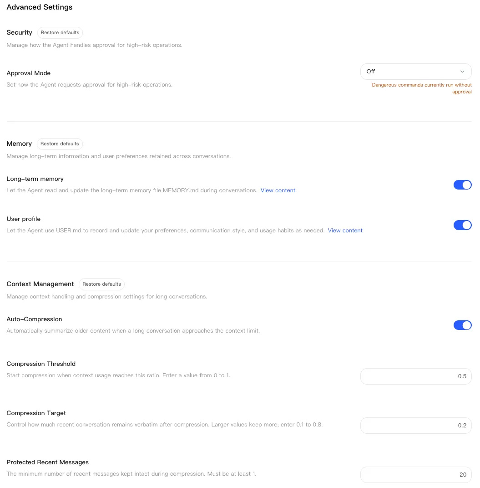

# การตั้งค่าขั้นสูง

## สรุป

**การตั้งค่าขั้นสูงช่วยให้คุณควบคุมวิธีที่ Hermes Agent จัดการเรื่องความปลอดภัย ความทรงจำ และบริบทของการสนทนา**  
คุณสามารถเลือกวิธีที่ Agent ขออนุมัติสำหรับการดำเนินการที่มีความเสี่ยงสูง จัดการความทรงจำถาวร โปรไฟล์ผู้ใช้ และการบีบอัดอัตโนมัติสำหรับการสนทนาที่ยาว จากนั้นเลือกว่าจะเริ่มการบีบอัดเมื่อใด จะเก็บเนื้อหาในช่วงเวลาล่าสุดมากแค่ไหน และมีข้อความล่าสุดกี่ข้อความที่ยังคงอยู่ครบถ้วน  
หลังจากที่โหมดการอนุมัติถูกบันทึก LightVela จะอ่านการกำหนดค่ากลับเพื่อยืนยันค่าที่ใหม่  
หลังจากที่การตั้งค่าการจัดการความทรงจำหรือบริบทถูกบันทึก LightVela จะเริ่มบริการที่เกี่ยวข้องใหม่และอ่านการกำหนดค่ากลับเพื่อยืนยันค่าที่ใหม่

## หน้านี้ครอบคลุม

- การจัดการวิธีที่เอเจนต์ร้องขอการอนุมัติสำหรับปฏิบัติการที่มีความเสี่ยงสูง
- การจัดการหน่วยความจำถาวรและโปรไฟล์ผู้ใช้
- การจัดการการบีบอัดอัตโนมัติสำหรับการสนทนายาว
- การตั้งค่าธรณีสำหรับการบีบอัด อัตราส่วนเนื้อหาที่เก็บรักษา และจำนวนข้อความล่าสุดที่ได้รับการปกป้อง
- การคืนค่าเริ่มต้นสำหรับกลุ่มความปลอดภัย หน่วยความจำ หรือการจัดการบริบท

## ก่อนที่คุณจะเริ่ม

1. ยืนยันว่าเอเจนต์เป้าหมายกำลังทำงานอยู่  
2. เปิด **Agents** และเลือกเอเจนต์ที่คุณต้องการกำหนดค่า  
3. เปิด **Advanced Settings**

เมื่อเอเจนต์ไม่ได้ทำงาน คุณสามารถดูค่าปัจจุบันของมันได้ แต่ไม่สามารถเปลี่ยนค่าเหล่านั้นได้

## การตั้งค่าที่มีอยู่

| กลุ่ม | การตั้งค่า | สิ่งที่ทำ |
| --- | --- | --- |
| ความปลอดภัย | โหมดอนุมัติ | เลือก Smart, Always Ask หรือ Off เพื่อควบคุมว่าเอเจนต์ขออนุมัติสำหรับการดำเนินการที่มีความเสี่ยงสูงอย่างไร |
| ความทรงจำ | ความทรงจำถาวร | ช่วยให้เอเจนต์สามารถอ่านและอัปเดตความทรงจำระยะยาวของตัวเองในการสนทนาครั้งต่อไป |
| ความทรงจำ | โปรไฟล์ผู้ใช้ | ช่วยให้เอเจนต์บันทึกและใช้ความชอบ สไตล์การสื่อสาร และพฤติกรรมของคุณ |
| การจัดการบริบท | การบีบอัดอัตโนมัติ | สรุปเนื้อหาเก่าเมื่อการสนทนายาวใกล้ถึงขีดจำกัดของบริบท |
| การจัดการบริบท | เกณฑ์การบีบอัด | กำหนดอัตราส่วนการใช้บริบทที่เริ่มการบีบอัด ตั้งแต่ 0 ถึง 1 |
| การจัดการบริบท | อัตราส่วนการเก็บรักษาหลังบีบอัด | กำหนดจำนวนข้อความสนทนาล่าสุดที่จะถูกเก็บรักษาหลังการบีบอัด ตั้งแต่ 0.1 ถึง 0.8 |
| การจัดการบริบท | ข้อความล่าสุดที่ได้รับการปกป้อง | กำหนดจำนวนข้อความล่าสุดที่ยังคงอยู่ครบถ้วนในระหว่างการบีบอัด โดยมีอย่างน้อย 1 ข้อความ |

## เปลี่ยนการตั้งค่า

### โหมดอนุมัติ

1. ในรายการ **โหมดการอนุมัติ** ให้เลือก สมาร์ท, ถามเสมอ, หรือ ปิด  
2. หากคุณเลือก ปิด ให้อ่านข้อความเตือนความเสี่ยงและยืนยันว่าคุณต้องการปิดการอนุมัติ  
3. รอให้หน้าเว็บอ่านการตั้งค่ากลับมาและยืนยันว่ามันแสดงโหมดที่คุณเลือก

เมื่อการอนุมัติถูกปิด เอเจนต์จะไม่ขอการอนุมัติจากคุณสำหรับการดำเนินการที่มีความเสี่ยงสูง และหน้าจะยังคงแสดงคำเตือนความเสี่ยง ใช้ปิดเฉพาะในสภาพแวดล้อมที่เชื่อถือได้เท่านั้น

### การตั้งค่าสวิตช์

1. เลือกสวิตช์ถัดจาก Persistent Memory, User Profile, หรือ Automatic Compression
2. อ่านข้อความยืนยันและยืนยันการเปลี่ยนแปลง
3. รอให้การบันทึกเสร็จสิ้น

การปิดหน่วยความจำถาวรหรือโปรไฟล์ผู้ใช้จะไม่ลบเนื้อหาที่มีอยู่ การปิดการบีบอัดอัตโนมัติจะยังคงค่าการบีบอัดที่มีอยู่ แต่จะหยุดการสรุปอัตโนมัติของเนื้อหาการสนทนาที่เก่ากว่า

### การตั้งค่าหมายเลข

1. เลือกปุ่มแก้ไขข้างค่าที่คุณต้องการเปลี่ยนแปลง
2. ใส่ค่าภายในช่วงที่อนุญาต
3. เลือกบันทึกหรือกด Enter เพื่อบันทึกค่า
4. เลือกยกเลิกหรือกด Escape เพื่อละเว้นการแก้ไข

คุณสามารถเปลี่ยนเกณฑ์การบีบอัด อัตราการเก็บรักษา และจำนวนข้อความที่ป้องกันได้เฉพาะเมื่อเปิดใช้งานการบีบอัดอัตโนมัติเท่านั้น

## กู้คืนค่าเริ่มต้น

การตั้งค่าขั้นสูงมี **กู้คืนค่าเริ่มต้น** แยกตามกลุ่ม **ความปลอดภัย**, **หน่วยความจำ**, และ **การจัดการบริบท**

1. ในกลุ่มที่คุณต้องการรีเซ็ต ให้เลือก **กู้คืนค่าเริ่มต้น**
2. อ่านข้อความยืนยัน
3. ยืนยันการกู้คืน

การคืนค่าเริ่มต้นจะลบค่าที่กำหนดเองออกจากกลุ่มที่เลือกเท่านั้น และจะคืนค่ากลุ่มนั้นไปยังค่าเริ่มต้นของเอเจนต์ Hermes  
การคืนค่ากลุ่มความปลอดภัยจะคืนค่าโหมดอนุมัติเป็น **อัจฉริยะ**  
จะไม่ส่งผลกระทบต่อกลุ่มอื่นหรือ ลบความจำที่มีอยู่ของเอเจนต์

## ยืนยันการเปลี่ยนแปลง

หลังจากการบันทึกหรือกู้คืนสำเร็จ หน้าจะโชว์ค่าที่อ่านกลับมาจาก Agent  
การบันทึกโหมดอนุมัติจะไม่รีสตาร์ทบริการที่เกี่ยวข้อง และหน้าจะอ่านค่ากลับมาโดยตรง  
การบันทึกหรือกู้คืนการตั้งค่าการจัดการหน่วยความจำและบริบทจะรีสตาร์ทบริการที่เกี่ยวข้องและอ่านค่าการกำหนดค่ากลับ  
หลังจากเปลี่ยนการบีบอัดอัตโนมัติ ให้ดำเนินการสนทนายาวขึ้นเพื่อยืนยันว่า Agent ปฏิบัติตามกฎการจัดการบริบทใหม่  
หลังจากเปลี่ยนการตั้งค่าหน่วยความจำ ให้สังเกตการสนทนาต่อไปเพื่อยืนยันว่า Agent ใช้งานหน่วยความจำและค่ากำหนดตามที่คาดหวัง

## คำถามที่พบบ่อย

### ทำไมฉันถึงไม่สามารถเปลี่ยนการตั้งค่าได้?

ตรวจสอบก่อนว่าเอเจนต์กำลังทำงานหรือไม่  
การควบคุมยังไม่สามารถใช้งานได้ชั่วคราวในขณะที่ LightVela กำลังอ่านการกำหนดค่า บันทึกการเปลี่ยนแปลง หรือกู้คืนค่าตั้งต้น

### ทำไมในการตั้งค่าจึงระบุว่ารุ่นเอเจนต์ของฉันไม่รองรับ?

เวอร์ชันที่กำลังใช้งานบนเอเจนต์นั้นไม่รองรับการตั้งค่านี้ ใช้การตั้งค่าที่มีอยู่ หรือกลับมาตรวจหน้าหน้านี้อีกครั้งหลังจากที่เอเจนต์ได้รับการอัปเดตแล้ว

### ทำไมฉันจึงไม่สามารถบันทึกหมายเลขที่ฉันกรอกได้?

เกณฑ์การบีบอัดต้องอยู่ระหว่าง 0 ถึง 1 อัตราการเก็บรักษาการบีบอัดต้องอยู่ระหว่าง 0.1 ถึง 0.8 จำนวนข้อความล่าสุดที่ได้รับการป้องกันต้องเป็นจำนวนเต็มอย่างน้อย 1

### ทำไมฉันถึงไม่สามารถแก้ไขการตั้งค่าการบีบอัดอื่น ๆ หลังจากปิดการบีบอัดอัตโนมัติ?

ค่าดังกล่าวใช้ได้เฉพาะเมื่อเปิดการบีบอัดอัตโนมัติเท่านั้น เปิดกลับมาก่อนที่จะเปลี่ยนค่าเหล่านั้น

### ควรปิดการอนุมัติเมื่อใด?

เมื่อการอนุมัติถูกปิด การดำเนินการที่มีความเสี่ยงสูงจะไม่ขอการอนุมัติจากคุณอีกต่อไป เว้นแต่คุณกำลังทำงานตามตารางที่ตั้งใจไว้ในสภาพแวดล้อมที่เชื่อถือได้ ให้เลือก Smart ไว้หรือเลือก Always Ask

### ฉันควรทำอย่างไรถ้าการบันทึกรายงานการรีสตาร์ทหรือความล้มเหลวในการตรวจสอบ?

หากคุณเปลี่ยนการตั้งค่าการจัดการหน่วยความจำหรือบริบท การกำหนดค่าอาจถูกบันทึกแล้ว แต่การรีสตาร์ทบริการที่เกี่ยวข้องหรือการอ่านค่าการกำหนดค่ากลับมาอาจยังไม่เสร็จสิ้น  
หากคุณเปลี่ยนโหมดการอนุมัติ การกำหนดค่าอาจถูกบันทึกแล้ว แต่หน้าอาจยังไม่ได้ตรวจสอบค่าที่อ่านกลับมา  
รีเฟรชหน้าต่างเพื่อดูค่าที่แสดง จากนั้นตัดสินใจว่าจะลองอีกครั้งหรือไม่
