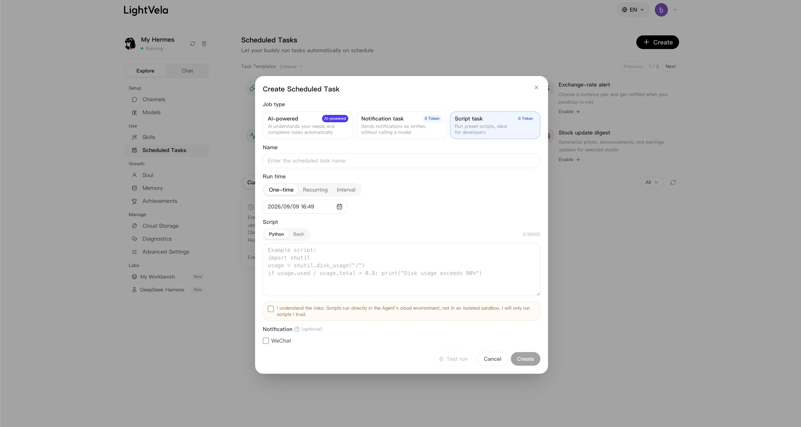
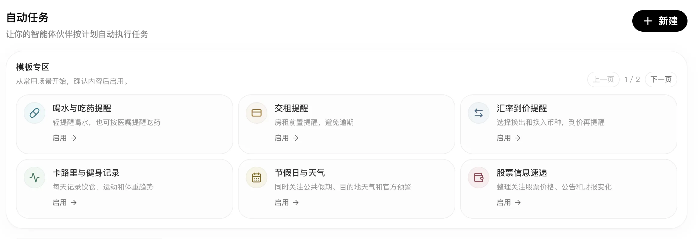

# งานที่กำหนดเวลา

## สรุป

**งานที่กำหนดเวลาให้ Hermes Agent เริ่มทำงานโดยไม่ต้องมีคำสั่งด้วยมือ เลือกงาน Agent Task เมื่อการทำงานต้องการการใช้เหตุผลของ AI, งาน Notification Task เมื่อข้อความเดียวกันควรถูกส่งตามที่เขียนไว้ หรือ งาน Script Task เมื่อสคริปต์ Bash หรือ Python ควรทำการตรวจสอบแบบตายตัว ทั้งสามประเภทใช้ตารางเวลาหนึ่งครั้ง, ซ้ำ, และช่วงเวลาเดียวกัน หน้าต่างผลบังคับใช้ และการตั้งค่าการแจ้งเตือนเหมือนกัน**

## เลือกประเภทงาน

เลือกประเภทงานตามสิ่งที่ต้องเกิดขึ้นเมื่อถึงกำหนดเวลา

| ประเภทงาน | เหมาะสำหรับ | สิ่งที่คุณให้ | สิ่งที่ทำงาน |
| --- | --- | --- | --- |
| **งานเอเจนต์** | สรุป, การวิจัย, การวิเคราะห์, การร่าง, หรือ งานอื่น ๆ ที่ต้องการการตีความ | คำสั่งงาน และถ้าต้องการ ทักษะหรือ งานต้นน้ำ | Hermes เอเจนต์เริ่มงานที่สนับสนุนด้วยโมเดล |
| **งานแจ้งเตือน** | การเตือนที่แน่นอน, ประกาศ, และข้อความประจำ | ข้อความแจ้งเตือน | งานที่ LightVela จัดการจะส่งข้อความของคุณตามที่เขียน โดยไม่เรียกโมเดล |
| **งานสคริปต์** | เวิร์กโฟลว์ของนักพัฒนา, การตรวจสอบ, และการทำงานอัตโนมัติที่กำหนดได้ | สคริปต์ Bash หรือ Python | สคริปต์ทำงานโดยไม่ต้องมีเซสชันเอเจนต์หรือเรียกโมเดล ผลลัพธ์ออกมาตรฐานที่ไม่ว่างสามารถส่งเป็นการแจ้งเตือน |

ประเภทงานจะแยกจากรูปแบบตารางเวลา แต่ละประเภทสามารถทำงานได้ครั้งเดียว แบบซ้ำทุกวัน ทุกสัปดาห์ หรือทุกเดือน หรือในช่วงเวลาที่กำหนด

## ก่อนที่คุณจะสร้างงาน

ตรวจสอบให้แน่ใจว่าเอเจนต์ Hermes เปิดใช้งานอยู่ เลือกช่องทางการแจ้งเตือนหากจำเป็น และทบทวนรหัสงานสคริปต์ใด ๆ ก่อนบันทึก

## สร้างงานเอเจนต์

เลือก **งานของเอเจนต์** เมื่อ Hermes เอเจนต์จำเป็นต้องเข้าใจคำขอของคุณและสร้างผลลัพธ์ ตัวอย่างเช่น งานของเอเจนต์สามารถรวบรวมข่าว AI ประจำวัน เลือกสิ่งที่เกี่ยวข้องมากที่สุด และเขียนสรุปสั้น ๆ

ตั้งค่าฟิลด์ต่อไปนี้:

- **ชื่อ**: ตั้งชื่อที่สามารถจดจำได้สำหรับงานนี้
- **กำหนดการ**: เลือกว่าจะรันครั้งเดียว, รันซ้ำเป็นระยะ, หรือรันตามช่วงเวลาที่กำหนด
- **คำสั่งงาน**: อธิบายเป้าหมาย, ขอบเขต, ข้อจำกัดของแหล่งข้อมูล, และรูปแบบผลลัพธ์ที่คาดหวัง
- **ทักษะ**: สามารถแนบทักษะที่มีอยู่เมื่อการทำงานนั้นต้องการความสามารถนั้น
- **งานต้นน้ำ**: หากต้องการ สามารถใช้ผลลัพธ์ล่าสุดที่เสร็จสมบูรณ์จาก Agent Task อื่นเป็นบริบทเพิ่มเติม
- **ช่วงเวลาที่มีผล**: สามารถจำกัดเวลาที่อนุญาตให้งานนี้ทำงานได้
- **การแจ้งเตือน**: สามารถเลือกได้ว่าผลลัพธ์ที่เสร็จสมบูรณ์จะถูกส่งไปที่ใด

ในเวลาที่กำหนด Hermes เอเจนต์สร้างงานเอเจนต์และเรียกใช้โมเดลที่เลือก ผลลัพธ์สามารถส่งไปยังช่องทางการแจ้งเตือนที่เลือกและถูกบันทึกในการรันล่าสุด

## สร้างงานการแจ้งเตือน

เลือก **งานการแจ้งเตือน** สำหรับข้อความที่ควรปรากฏตามที่คุณเขียนไว้ ตัวอย่างเช่น สร้างการเตือนให้ดื่มน้ำประจำวัน การเตือนค่าเช่ารายเดือน หรือข้อความสั้นๆ สำหรับทีม

ตั้งชื่อภารกิจ กำหนดตารางเวลา เนื้อหาการแจ้งเตือน หน่วงเวลาที่มีผล และช่องทางการแจ้งเตือน เนื้อหาการแจ้งเตือนสามารถประกอบด้วยเครื่องหมายวรรคตอนปกติ การขึ้นบรรทัด อีโมจิ และข้อความหลายภาษา

ในเวลาที่กำหนด LightVela จะส่งเนื้อหาการแจ้งเตือนตามที่เขียนไว้  
มันไม่ได้ขอให้โมเดลร่าง เขียนใหม่ สรุป แปล หรืออธิบายข้อความ  
นั่นหมายความว่าการใช้โทเค็นของโมเดลคือ 0 โทเค็นสำหรับงานนี้

หากคุณไม่เลือกช่องทางการแจ้งเตือน งานจะทำงานเบื้องหลังและบันทึกข้อมูลแทนการส่งข้อความ การจัดรูปแบบช่องทางการแจ้งเตือนยังอาจส่งผลต่อการแสดงผลการขึ้นบรรทัดใหม่และตัวอักษรต่อผู้รับ

## สร้างงานสคริปต์

เลือก **งานสคริปต์** เมื่อคุณต้องการเวิร์กโฟลว์ Bash หรือ Python ที่มีผลลัพธ์แน่นอน ตัวอย่างเช่น สคริปต์สามารถตรวจสอบการใช้ดิสก์ ตรวจสอบการตอบสนองของบริการ หรือพิมพ์การแจ้งเตือนเฉพาะเมื่อถึงเกณฑ์ที่กำหนด

ตั้งชื่อภารกิจ กำหนดตารางเวลา ภาษาในการเขียนสคริปต์ เนื้อหาสคริปต์ ช่วงเวลาที่มีผล และช่องทางการแจ้งเตือน ก่อนที่คุณจะสร้างภารกิจ ให้ยืนยันการรับทราบประกาศความปลอดภัยของสคริปต์และยืนยันว่าคุณไว้วางใจในรหัสนั้น

งานสคริปต์จะไม่สร้างเซสชันเอเจนต์, เรียกใช้โมเดล, ใช้พรอมต์, หรือเรียกใช้ทักษะ  
งานเหล่านี้มีการใช้โมเดล Token 0 แต่จะใช้ทรัพยากรเวลารันของเอเจนต์บนคลาวด์

| ผลลัพธ์สคริปต์ | ผลลัพธ์งาน | พฤติกรรมการส่งมอบ |
| --- | --- | --- |
| รหัสออก `0` พร้อมกับเอาต์พุตมาตรฐานที่ไม่ว่าง | สำเร็จ | เอาต์พุตมาตรฐานจะถูกส่งตามที่เขียนไปยังช่องทางการแจ้งเตือนที่เลือก |
| รหัสออก `0` พร้อมกับเอาต์พุตมาตรฐานว่าง | สำเร็จแบบเงียบ | จะไม่มีการส่งการแจ้งผลลัพธ์ |
| รหัสออกที่ไม่ใช่ศูนย์ | ล้มเหลว | การล้มเหลวจะถูกบันทึกไว้และเป็นไปตามการจัดการความล้มเหลวของงาน |
| หมดเวลาหรือเริ่มต้นล้มเหลว | ล้มเหลว | ประเภทความล้มเหลวจะถูกบันทึกไว้และเป็นไปตามการจัดการความล้มเหลวของงาน |

อย่าพึ่งพางานสคริปต์ในการซ่อมแซม อธิบาย หรือสรุปความล้มเหลวกับ AI มันยังคงเป็นแบบกำหนดแน่นอน: การส่งออกว่างจะยังคงเงียบ และสคริปต์ที่ล้มเหลวจะไม่ทำให้เกิดการสลับกลับไปใช้โมเดล

## ลิงก์งานเอเจนต์ต้นน้ำ

ใช้ภารกิจต้นน้ำเมื่อภารกิจผู้แทนงานหนึ่งควรเตรียมบริบทสำหรับอีกภารกิจหนึ่ง ภารกิจปลายน้ำจะรับผลลัพธ์ล่าสุดที่ทำเสร็จแล้วของภารกิจต้นน้ำในขณะที่ยังคงตารางเวลา คำแนะนำ หน่วงเวลาประสิทธิผล และการตั้งค่าการแจ้งเตือนของตนเองอยู่

กำหนดตารางงานที่ขึ้นอยู่กับงานอื่นโดยมีเวลาพอระหว่างกัน และอธิบายในคำแนะนำของงาน downstream ว่าจะใช้ผลลัพธ์จาก upstream อย่างไร  
บริบทของ upstream การดำเนินการของโมเดล และทักษะต่าง ๆ ใช้ได้เฉพาะกับงานของ Agent เท่านั้น

## ตั้งค่ากำหนดการและกฎการจัดส่งที่ใช้ร่วมกัน

งานทั้งสามประเภทมีการควบคุมการกำหนดเวลาและการแจ้งเตือนเหมือนกัน

- **ครั้งเดียว**: รันเพียงครั้งเดียวในวันที่และเวลาที่เลือก  
- **ซ้ำแบบกำหนดรอบ**: รันทุกวัน ทุกสัปดาห์ หรือตามเดือนในเวลาที่เลือก  
- **ช่วงเวลา**: รันทุกจำนวนของนาที ชั่วโมง หรือวันที่เลือก  
- **ช่องเวลาที่มีผล**: จำกัดเวลาที่งานซ้ำหรือแบบช่วงเวลาสามารถรันได้ หรือปล่อยว่างเพื่อให้ทำงานได้ตลอดเวลา  
- **การแจ้งเตือน**: เลือกช่องทางที่จะได้รับผลลัพธ์หรือการแจ้งเตือนเมื่อทำงานสำเร็จ

การเปลี่ยนประเภทงานระหว่างการสร้างงานจะเก็บการตั้งค่าที่ใช้ร่วมกันเหล่านี้ไว้ หลังจากสร้างแล้ว ไม่สามารถเปลี่ยนประเภทงานได้ ดังนั้นให้สร้างงานใหม่หากต้องการเปลี่ยนรูปแบบการดำเนินการ

## ใช้เทมเพลตงาน

หากคุณไม่แน่ใจว่าจะเริ่มงานเอเจนต์อย่างไร ให้ใช้พื้นที่แม่แบบในหน้าผลงานที่กำหนดเวลา เลือกการ์ดเช่น การเตือนการดื่มน้ำและยารักษาโรค การเตือนการจ่ายค่าเช่า การแจ้งเตือนอัตราแลกเปลี่ยน หรือสรุปการปรับปรุงหุ้น จากนั้นตรวจสอบตารางเวลาที่สร้างขึ้นและคำแนะนำก่อนสร้างงาน

การเปิดแม่แบบจะเติมข้อมูลล่วงหน้าในหน้าต่างสร้างงาน ตัวอย่างเช่น แม่แบบสรุปการอัปเดตสต็อก จะเติมชื่อภารกิจ ตารางเวลาประจำวัน และคำแนะนำเกี่ยวกับข้อมูลตลาดที่คุณสามารถปรับแต่งก่อนทดสอบหรือสร้างงานนั้น

สร้างงานแจ้งเตือนแบบกำหนดเองหรือสคริปต์งานจากกล่องโต้ตอบสร้าง แทนที่จะเปลี่ยนประเภทงานแม่แบบ

## จัดการงานที่กำหนดเวลา

หลังจากที่สร้างงานแล้ว ให้ใช้หน้างานที่กำหนดเวลาเพื่อตรวจสอบงานปัจจุบัน งานที่สิ้นสุดแล้ว และการทำงานล่าสุด
มุมมองงานปัจจุบันสามารถกรองงานเอเจนต์ งานแจ้งเตือน และงานสคริปต์ได้

ใน **Recent Runs** เปิดการรันหนึ่งแล้วเลือก **View result** เพื่ออ่านผลลัพธ์ Markdown หรือ **Download result** เพื่อบันทึกผลลัพธ์ ก่อนอื่นให้สลับไปที่บ็อตที่เป็นเจ้าของงาน: ผลลัพธ์ของมันจะถูกเก็บไว้ในบันทึกการรันของบ็อตนั้นและจะไม่ปรากฏในการแชทหรือบันทึกของบ็อตอื่น

งานที่เสร็จสิ้นรวบรวมงานที่เสร็จสมบูรณ์ งานที่ล้มเหลว และงานที่หมดอายุ งานที่กำลังดำเนินการยังคงอยู่ภายใต้งานปัจจุบัน

จากรายการงาน ให้ตรวจสอบรายละเอียด แก้ไขการตั้งค่าที่อนุญาต หยุดชั่วคราวงาน หรือ ลบงาน สำหรับงานของเอเจนต์ที่มีการพึ่งพาแบบอัพสตรีม ให้ตรวจสอบว่างานอื่นยังต้องใช้ผลลัพธ์ล่าสุดที่เสร็จสมบูรณ์ของมันอยู่หรือไม่ก่อนลบ

## ตรวจสอบงานใหม่

หลังจากสร้างหรือแก้ไขงานแล้ว อย่าหยุดเพียงแค่ 'บันทึกเรียบร้อยแล้ว'

1. ยืนยันว่าหน้าที่ปรากฏในตัวกรองประเภทงานที่ถูกต้องและสถานะตรงตามที่คาดไว้
2. ตรวจสอบกำหนดเวลา หน้าต่างที่มีผล และการตั้งค่าการแจ้งเตือน
3. รันการทดสอบหรือรอหนึ่งการดำเนินการจริง แล้วตรวจสอบการทำงานล่าสุด
4. สำหรับงานเอเจนต์ ให้ตรวจสอบว่าผลลัพธ์สอดคล้องกับคำแนะนำและใช้ผลลัพธ์จากงานขั้นต้นที่เลือกเมื่อมีการกำหนดค่า
5. สำหรับงานแจ้งเตือน ให้ตรวจสอบว่าข้อความที่ส่งตรงกับเนื้อหาของคุณ
6. สำหรับงานสคริปต์ ให้ตรวจสอบผลลัพธ์การออกและว่ามีการส่งค่าผลลัพธ์มาตรฐานหรือไม่หรือคงเงียบอย่างถูกต้อง

## การจัดการความล้มเหลวทั่วไป

| อาการ | สาเหตุที่เป็นไปได้ | การจัดการที่แนะนำ |
| --- | --- | --- |
| งานไม่ทำงานตามเวลาที่คาดไว้ | ตารางเวลา, ช่วงเวลาที่มีผล, หรือสถานะงานไม่ได้เปิดใช้งาน | ตรวจสอบตารางเวลาและช่วงเวลาที่มีผล ยืนยันว่างานถูกเปิดใช้งาน จากนั้นตรวจสอบการทำงานล่าสุด |
| ผลลัพธ์ของงาน Agent Task ไม่ตรงประเด็น | คำสั่งไม่ชัดเจน, ไม่มีทักษะที่จำเป็น, หรือไม่มีบริบทของงานก่อนหน้า | ระบุเป้าหมาย ขอบเขต รูปแบบผลลัพธ์ และข้อจำกัดของแหล่งข้อมูลอย่างชัดเจน ตรวจสอบทักษะและงานก่อนหน้าก่อนรันครั้งต่อไป |
| งาน Notification Task ทำงานแต่ไม่มีข้อความถึงปลายทาง | ไม่มีการเลือกช่องทางแจ้งเตือน หรือช่องทางปลายทางไม่สามารถใช้งานได้ | เลือกและตรวจสอบช่องทางแจ้งเตือน จากนั้นทดสอบงานอีกครั้ง |
| งานสคริปต์ทำงานโดยไม่มีข้อความ | สคริปต์ออกสำเร็จโดยไม่มีผลลัพธ์มาตรฐาน | นี่คือความสำเร็จแบบเงียบๆ ให้สคริปต์พิมพ์ข้อความที่ถูกต้องตามที่ควรถูกส่งออกเมื่อเงื่อนไขเป็นจริง |
| งานสคริปต์ล้มเหลว | สคริปต์ออกพร้อมข้อผิดพลาด, หมดเวลาหรือไม่สามารถเริ่มได้ | ตรวจสอบบันทึกการทำงาน, แก้ไขสคริปต์ที่เชื่อถือได้ และทดสอบอีกครั้ง อย่าคาดหวังว่า AI จะแก้ไขหรืออธิบายสคริปต์โดยอัตโนมัติ |
