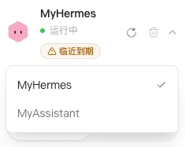

# สลับบอท

## สรุป

**การสลับบอทช่วยให้ Agent คลาวด์ LightVela หนึ่งสามารถมีบอทเฉพาะทางหลายตัวได้ คุณสามารถสร้างบอทเพื่อการวิจัย การวางแผน การเขียนโค้ด เนื้อหา การสนับสนุน หรือเวิร์กโฟลว์ที่เกิดซ้ำ แล้วสลับไปมาระหว่างบอทเหล่านี้จากแถบอวาตาร์บอท**

**แต่ละบอทมีบริบทพื้นที่ทำงานของตัวเอง ขึ้นอยู่กับว่าคุณสร้างบอทเปล่าหรือโคลนบอทที่มีอยู่ LightVela จะใช้กฎการสืบทอดที่แตกต่างกันกับการตั้งค่าโมเดล หน่วยความจำ ทักษะ บุคลิกภาพ งานที่กำหนดเวลา และการเชื่อมต่อช่องทาง**

## ก่อนที่คุณจะเริ่ม

- เข้าสู่ระบบที่ LightVela และเปิดเอเจนต์คลาวด์ที่ใช้งานอยู่
- หากต้องการสร้างบอทเพิ่มเติม ตรวจสอบให้แน่ใจว่าแผนปัจจุบันของคุณอนุญาตให้มีบอทอีกตัว และไม่มีบอทตัวอื่นอยู่ระหว่างการสร้างหรือการลบ
- หากคุณวางแผนที่จะเชื่อมต่อช่องทาง ให้เตรียมข้อมูลประจำตัวหรือวิธีการอนุญาตที่ช่องทางนั้นต้องการ

## การสร้างบอทของคุณ

หลังจากลงชื่อเข้าใช้ด้วย Google หรือ GitHub และเปิดใช้งานแพ็กเกจที่มีให้ใช้ ให้เปิด [คอนโซล Agent](/agents/overview/) ตั้งค่าบอทแรกโดยกรอกชื่อซึ่งจำเป็นต้องมี เพิ่มคำอธิบายได้ตามต้องการ และปรับรูปลักษณ์ เลือก **สร้าง** แล้วรอให้การสร้างและการตั้งค่าเริ่มต้นเสร็จสิ้น เมื่อตั้งค่าเสร็จ ให้เลือก **เริ่มต้นการเดินทาง** แล้วเปิดเว็บแชทของบอทนั้น ช่องทางรับส่งข้อความเป็นตัวเลือกเพิ่มเติม ส่วนการตอบกลับต้องมีเครดิตโมเดลที่ใช้ได้หรือโมเดลที่ตั้งค่าไว้

เมื่อต้องการสร้างบอทถัดไป ให้เลือก **บอทใหม่** หากมีปุ่มนี้และโควตาแพ็กเกจยังเพียงพอ กรอก **ชื่อ** (จำเป็น) และ **คำอธิบาย** (ไม่บังคับ) แล้วปรับรูปลักษณ์ตามต้องการ ค่าเริ่มต้นคือ **การตั้งค่าพื้นฐาน** หากมีบอทต้นทางที่คัดลอกได้ ให้เปิด **ขั้นสูง** แล้วเลือกบอทต้นทางที่ต้องการ หากต้องการคัดลอกบอทที่ใช้อยู่ ให้เปิด **จัดการบอท → คัดลอก Bot** แบบฟอร์มจะเลือกต้นทางนั้นไว้ให้ ตรวจสอบต้นทาง เลือก **สร้าง** แล้วรอจนเสร็จ

ปุ่มปิดและตัวเลือกการคัดลอกขั้นสูงจะแสดงเมื่อมีบอทต้นทางที่ใช้ได้เท่านั้น การตั้งค่าครั้งแรกที่ไม่มีต้นทางต้องทำให้เสร็จ ตัวควบคุมรูปลักษณ์ใช้ปรับสี รูปร่าง และเครื่องประดับ ไม่ได้ใช้เลือกต้นทางสำหรับคัดลอก

ภาพหน้าจอต่อไปนี้แสดงแบบฟอร์มสร้าง Bot เพิ่มเติมและเทมเพลตที่แนะนำใน UI ปัจจุบัน ปุ่มปิดและส่วนขั้นสูงปรากฏเพราะ Agent นี้มี Bot อยู่แล้ว นี่ไม่ใช่หน้าจอตั้งค่า Bot แรก

## พื้นที่ทำงานและการตั้งค่าบอท

เลือกอวาตาร์ของบอทที่ต้องการจากแถบบอท หากหน้าจอแคบ ให้เปิดแผงนำทางก่อน ตรวจสอบชื่อก่อนเปลี่ยนโมเดล หน่วยความจำ สกิล ช่องทาง หรืองานตามกำหนดเวลา เว็บแชทและรายการบทสนทนาจะเป็นของบอทที่เลือก บอทเพิ่มเติมก็ใช้เว็บแชทได้ และเว็บแชทไม่ต้องเชื่อมต่อช่องทางรับส่งข้อความ

โหมดการสร้างกำหนดสิ่งที่บอทใหม่จะสืบทอด:

| โหมดการสร้าง | สืบทอด | เริ่มแยกกัน |
| --- | --- | --- |
| การตั้งค่าพื้นฐาน | โมเดลหลักและข้อมูลประจำตัวของผู้ให้บริการ รวมถึงทักษะที่ระบบจัดหาให้ | โมเดลสำรอง โมเดลอื่นที่ตั้งค่าไว้ บุคลิกภาพ ความจำ ทักษะที่ติดตั้งเพิ่มเติมใน Bot หลัก ช่องทาง และงานที่กำหนดเวลา |
| คัดลอก Bot | โมเดล บุคลิกภาพ ทักษะ ความชอบของผู้ใช้ และความจำระยะยาว | การสนทนาปัจจุบัน ประวัติแชทก่อนหน้า งานที่กำหนดเวลา สถานะการทำงาน และการเชื่อมต่อช่องทาง |

ตรวจสอบกล่องโต้ตอบการสร้างก่อนยืนยันว่าคุณต้องการเก็บการตั้งค่าแยกกันหรือไม่ จากนั้นคุณสามารถจัดการ [ความทรงจำ](./memory.md), [ทักษะ](./skill.md) และ [งานที่กำหนดเวลา](./automation.md) ของแต่ละบอทได้อย่างอิสระ

## ทำไมต้องสร้างบอทแยกกัน?

บอทหนึ่งตัวสามารถจัดการหลายงานได้ แต่บริบทของมันจะยากขึ้นในการจัดการเมื่อความรับผิดชอบเพิ่มขึ้น นักวิจัยเฉพาะทาง นักวางแผนการเดินทาง นักวิเคราะห์การเงิน หรือผู้ตรวจสอบคุณภาพ สามารถรักษาชุดความทรงจำ ทักษะ การตั้งค่าบุคลิกภาพ และงานที่กำหนดเวลาได้อย่างมีโฟกัสมากกว่า

บอทอิสระยังช่วยให้ง่ายต่อการทดสอบรูปแบบการทำงานที่แตกต่างโดยไม่ต้องเปลี่ยนบอทที่คุณใช้งานอยู่สำหรับงานอื่น

เลือกอวาตาร์ของบอทที่ต้องการจากแถบบอท หากหน้าจอแคบ ให้เปิดแผงนำทางก่อน ตรวจสอบชื่อก่อนเปลี่ยนโมเดล หน่วยความจำ สกิล ช่องทาง หรืองานตามกำหนดเวลา เว็บแชทและรายการบทสนทนาจะเป็นของบอทที่เลือก บอทเพิ่มเติมก็ใช้เว็บแชทได้ และเว็บแชทไม่ต้องเชื่อมต่อช่องทางรับส่งข้อความ

## วิธีใช้บอทหลายตัวพร้อมกัน

คุณสามารถเชื่อมต่อบอทหลายตัวกับช่องทางการส่งข้อความที่รองรับ การรวมช่องทางที่มีอยู่ขึ้นอยู่กับภูมิภาค LightVela:

| LightVela เวอร์ชัน | ช่องทางที่รองรับการรวมหลายบอท |
| --- | --- |
| เวอร์ชันสากล | Telegram, Discord, Slack, QQ, WeCom, Lark |

สำหรับช่องทางเช่น WeChat และ WhatsApp การกำหนดค่าปัจจุบันอาจอนุญาตให้มี Bot เพียงหนึ่งตัวต่ออินสแตนซ์เท่านั้น หากช่องทางถูกครอบครองโดย Bot ตัวอื่นแล้ว LightVela จะแสดงข้อความแจ้งและให้วิธีการจัดการ Bot ที่เป็นเจ้าของช่องทางนั้น

## ตรวจสอบการเชื่อมต่อสวิตช์หรือช่องของบอท

หลังจากสลับหรือเชื่อมต่อบอท ให้ตรวจสอบดังต่อไปนี้:

1. ชื่อ Bot ที่กำลังใช้งานและภาพประจำตัวจะเปลี่ยนเป็น Bot ที่คุณเลือก
2. หน้าการตั้งค่าจะแสดงพื้นที่ทำงานและการกำหนดค่าของ Bot ที่เลือก
3. ช่องทางที่เชื่อมต่อจะแสดงอยู่ภายใต้ Bot ที่เป็นเจ้าของการเชื่อมต่อนั้น
4. ข้อความทดสอบสั้น ๆ ถูกส่งไปยัง Bot ที่ตั้งใจไว้และได้รับการตอบกลับ

สำหรับช่องกลุ่ม ให้ส่งข้อความทดสอบด้วยระดับสิทธิ์ที่คุณตั้งค่า ยืนยันว่าบอทสามารถอ่านบริบทของกลุ่มได้อย่างเดียวหรือสามารถตอบกลับได้ด้วย

## ปัญหาที่พบบ่อย

| ปัญหา | สาเหตุที่เป็นไปได้ | สิ่งที่ควรทำ |
| --- | --- | --- |
| **Bot ใหม่** ไม่สามารถใช้งานได้ | แผนของคุณถึงขีดจำกัด Bot หรือมี Bot อื่นที่กำลังถูกสร้างหรือถูกลบอยู่ | รอให้กระบวนการปัจจุบันเสร็จสิ้น ลบ Bot ที่ไม่ได้ใช้ หรืออัปเกรดเป็นแผนที่มีขีดจำกัดสูงขึ้น |
| ตัวเลือกโคลนไม่สามารถใช้งานได้ | ไม่มี Bot ปัจจุบันหรือหลักที่ถูกต้องให้คัดลอก | เลือก **สร้างเปล่า** หรือกลับไปยัง Bot ที่ตั้งใจไว้ก่อนเปิดหน้าต่างสร้าง |
| รายการ Bot ไม่สามารถใช้งานได้ชั่วคราว | ตัว Agent ถูกหยุด หรือคำขอรายการ Bot ล้มเหลว | เริ่มหรือรีเฟรช Agent แล้วโหลดหน้าการตั้งค่า Bot ใหม่ |
| ช่องทางเชื่อมต่อกับ Bot อื่นอยู่แล้ว | ช่องทางมีข้อจำกัดการเป็นเจ้าของ Bot เพียงหนึ่งตัว | ใช้ประกาศเพื่อเปิด Bot ที่เป็นเจ้าของ หรือยกเลิกการเชื่อมต่อและเชื่อมต่อช่องทางใหม่ตามหน้าการตั้งค่าช่องทาง |
| ข้อความกลุ่มไม่ได้รับการตอบกลับ | สิทธิ์ของบอทในกลุ่มหรือการตั้งค่าช่องไม่สมบูรณ์ | ตรวจสอบ [Telegram](./channel-telegram.md), [Discord](./channel-discord.md) หรือหน้าการตั้งค่าช่องอื่นที่เกี่ยวข้อง จากนั้นส่งข้อความทดสอบอีกครั้ง |

## การแชทกับบอทของคุณในกลุ่ม

คุณสามารถเชิญบอทหลายตัวเข้าร่วมแชทกลุ่มที่รองรับได้ ขึ้นอยู่กับระดับสิทธิ์ที่คุณตั้ง บอทอาจอ่านบริบทของกลุ่ม ตอบข้อซักถามของผู้ใช้ หรือทำทั้งสองอย่างได้

พฤติกรรมของกลุ่มและขั้นตอนการตั้งค่าจะแตกต่างกันไปตามแพลตฟอร์ม โปรดติดตามหน้าการกำหนดค่าช่องที่เกี่ยวข้องก่อนเชิญบอท และทดสอบบอทด้วยการกล่าวถึงโดยตรงหรือทริกเกอร์ที่รองรับโดยแพลตฟอร์มอื่นตามความจำเป็น
