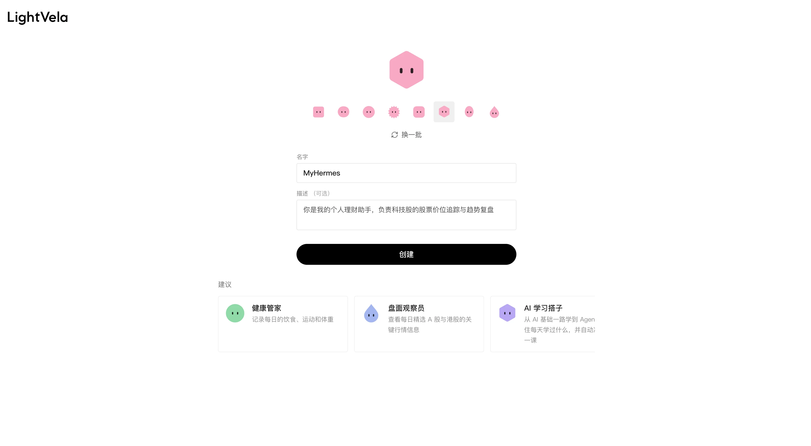

# สลับบอท

## สรุป

**การสลับบอทช่วยให้ Agent คลาวด์ LightVela หนึ่งสามารถมีบอทเฉพาะทางหลายตัวได้ คุณสามารถสร้างบอทเพื่อการวิจัย การวางแผน การเขียนโค้ด เนื้อหา การสนับสนุน หรือเวิร์กโฟลว์ที่เกิดซ้ำ แล้วสลับไปมาระหว่างบอทเหล่านี้จากเมนูโปรไฟล์ของ Agent**

**แต่ละบอทมีบริบทพื้นที่ทำงานของตัวเอง ขึ้นอยู่กับว่าคุณสร้างบอทเปล่าหรือโคลนบอทที่มีอยู่ LightVela จะใช้กฎการสืบทอดที่แตกต่างกันกับการตั้งค่าโมเดล หน่วยความจำ ทักษะ บุคลิกภาพ งานที่กำหนดเวลา และการเชื่อมต่อช่องทาง**

## ก่อนที่คุณจะเริ่ม

- เข้าสู่ระบบที่ LightVela และเปิดเอเจนต์คลาวด์ที่ใช้งานอยู่
- หากต้องการสร้างบอทเพิ่มเติม ตรวจสอบให้แน่ใจว่าแผนปัจจุบันของคุณอนุญาตให้มีบอทอีกตัว และไม่มีบอทตัวอื่นอยู่ระหว่างการสร้างหรือการลบ
- หากคุณวางแผนที่จะเชื่อมต่อช่องทาง ให้เตรียมข้อมูลประจำตัวหรือวิธีการอนุญาตที่ช่องทางนั้นต้องการ

## การสร้างบอทของคุณ

หลังจากเลือก **บอทใหม่** ให้เลือกอวาตาร์ กรอกชื่อและคำอธิบาย และเลือกว่าจะสร้างบอทเปล่าหรือคัดลอกบอทที่มีอยู่

เมื่อมีบอทอื่นอยู่แล้ว กล่องโต้ตอบการสร้างสามารถเสนอ **คัดลอกปัจจุบัน**, **คัดลอกบอทหลัก**, หรือ **สร้างเปล่า**.

ตัวอย่างเช่น เพื่อสร้างบอทนักวิเคราะห์การเงิน คุณสามารถกรอกได้ว่า:

> <strong>ชื่อ:</strong> นักวิเคราะห์อัลฟา
>
> <strong>คำอธิบาย:</strong> นักวิเคราะห์อัลฟาเชี่ยวชาญในการวิเคราะห์รายงานของบริษัท ข่าวตลาด ผลการดำเนินงานของพอร์ตโฟลิโอ การประเมินค่า และความเสี่ยงทางการเงิน ผลิตข้อมูลเชิงลึกที่กระชับและมีหลักฐานชัดเจน แยกข้อเท็จจริงออกจากสมมติฐานอย่างชัดเจน และหลีกเลี่ยงการนำเสนอการวิเคราะห์เป็นคำแนะนำทางการเงินที่รับประกัน

หน้าสร้างอาจจะแสดงแม่แบบสำหรับบทบาทเฉพาะ เช่น ผู้จัดการด้านสุขภาพ ผู้ติดตามตลาด หรือเพื่อนศึกษาปัญญาประดิษฐ์

หลังจากป้อนรายละเอียดแล้ว ยืนยันการสร้างและรอให้บอทใหม่เสร็จสิ้นการจัดเตรียม

## พื้นที่ทำงานและการตั้งค่าบอท

หลังจากการสร้าง บอทจะเปิดพื้นที่การตั้งค่าของตัวเอง จากแท็บบอทในหน้าหลักของเอเจนต์ คุณสามารถเลือกบอทนั้นและจัดการการตั้งค่าที่มีให้สำหรับมัน รวมถึงหน่วยความจำ ทักษะ บุคลิกภาพ งานที่ตั้งเวลาไว้ และช่องทางที่เชื่อมต่ออยู่

โหมดการสร้างกำหนดสิ่งที่บอทใหม่จะสืบทอด:

| โหมดการสร้าง | สืบทอด | เริ่มแยกกัน |
| --- | --- | --- |
| สร้างจากว่าง | โมเดลหลักและข้อมูลประจำตัวของผู้ให้บริการ รวมถึงทักษะที่ระบบจัดหาให้ | โมเดลสำรอง โมเดลอื่นที่ตั้งค่าไว้ บุคลิกภาพ ความจำ ทักษะที่ติดตั้งเพิ่มเติมใน Bot หลัก ช่องทาง และงานที่กำหนดเวลา |
| คัดลอกปัจจุบัน หรือ คัดลอก Bot หลัก | โมเดล บุคลิกภาพ ทักษะ ความชอบของผู้ใช้ และความจำระยะยาว | การสนทนาปัจจุบัน ประวัติแชทก่อนหน้า งานที่กำหนดเวลา สถานะการทำงาน และการเชื่อมต่อช่องทาง |

ตรวจสอบกล่องโต้ตอบการสร้างก่อนยืนยันว่าคุณต้องการเก็บการตั้งค่าแยกกันหรือไม่ จากนั้นคุณสามารถจัดการ [ความทรงจำ](./memory.md), [ทักษะ](./skill.md) และ [งานที่กำหนดเวลา](./automation.md) ของแต่ละบอทได้อย่างอิสระ

## ทำไมต้องสร้างบอทแยกกัน?

บอทหนึ่งตัวสามารถจัดการหลายงานได้ แต่บริบทของมันจะยากขึ้นในการจัดการเมื่อความรับผิดชอบเพิ่มขึ้น นักวิจัยเฉพาะทาง นักวางแผนการเดินทาง นักวิเคราะห์การเงิน หรือผู้ตรวจสอบคุณภาพ สามารถรักษาชุดความทรงจำ ทักษะ การตั้งค่าบุคลิกภาพ และงานที่กำหนดเวลาได้อย่างมีโฟกัสมากกว่า

บอทอิสระยังช่วยให้ง่ายต่อการทดสอบรูปแบบการทำงานที่แตกต่างโดยไม่ต้องเปลี่ยนบอทที่คุณใช้งานอยู่สำหรับงานอื่น

ผลลัพธ์คือพื้นที่ทำงาน LightVela ที่มีการจัดระเบียบมากขึ้น ในการสลับระหว่างบอท ให้คลิกที่โปรไฟล์บอทที่ใช้งานอยู่ในพื้นที่มุมซ้ายบนของพื้นที่ทำงานของเอเจนต์ แล้วเลือกบอทอื่นจากเมนู

## วิธีใช้บอทหลายตัวพร้อมกัน

คุณสามารถเชื่อมต่อบอทหลายตัวกับช่องทางการส่งข้อความที่รองรับ การรวมช่องทางที่มีอยู่ขึ้นอยู่กับภูมิภาค LightVela:

| LightVela เวอร์ชัน | ช่องทางที่รองรับการรวมหลายบอท |
| --- | --- |
| เวอร์ชันจีน | QQ, WeCom, Lark, DingTalk |
| เวอร์ชันสากล | Telegram, Discord, Slack, QQ, WeCom, Lark |

สำหรับช่องทางเช่น WeChat และ WhatsApp การกำหนดค่าปัจจุบันอาจอนุญาตให้มี Bot เพียงหนึ่งตัวต่ออินสแตนซ์เท่านั้น หากช่องทางถูกครอบครองโดย Bot ตัวอื่นแล้ว LightVela จะแสดงข้อความแจ้งและให้วิธีการจัดการ Bot ที่เป็นเจ้าของช่องทางนั้น

## ตรวจสอบการเชื่อมต่อสวิตช์หรือช่องของบอท

หลังจากสลับหรือเชื่อมต่อบอท ให้ตรวจสอบดังต่อไปนี้:

1. ชื่อ Bot ที่กำลังใช้งานและภาพประจำตัวจะเปลี่ยนเป็น Bot ที่คุณเลือก
2. หน้าการตั้งค่าจะแสดงพื้นที่ทำงานและการกำหนดค่าของ Bot ที่เลือก
3. ช่องทางที่เชื่อมต่อจะแสดงอยู่ภายใต้ Bot ที่เป็นเจ้าของการเชื่อมต่อนั้น
4. ข้อความทดสอบสั้น ๆ ถูกส่งไปยัง Bot ที่ตั้งใจไว้และได้รับการตอบกลับ

สำหรับช่องกลุ่ม ให้ส่งข้อความทดสอบด้วยระดับสิทธิ์ที่คุณตั้งค่า ยืนยันว่าบอทสามารถอ่านบริบทของกลุ่มได้อย่างเดียวหรือสามารถตอบกลับได้ด้วย

## ปัญหาที่พบบ่อย

| ปัญหา | สาเหตุที่เป็นไปได้ | สิ่งที่ควรทำ |
| --- | --- | --- |
| **Bot ใหม่** ไม่สามารถใช้งานได้ | แผนของคุณถึงขีดจำกัด Bot หรือมี Bot อื่นที่กำลังถูกสร้างหรือถูกลบอยู่ | รอให้กระบวนการปัจจุบันเสร็จสิ้น ลบ Bot ที่ไม่ได้ใช้ หรืออัปเกรดเป็นแผนที่มีขีดจำกัดสูงขึ้น |
| ตัวเลือกโคลนไม่สามารถใช้งานได้ | ไม่มี Bot ปัจจุบันหรือหลักที่ถูกต้องให้คัดลอก | เลือก **สร้างเปล่า** หรือกลับไปยัง Bot ที่ตั้งใจไว้ก่อนเปิดหน้าต่างสร้าง |
| รายการ Bot ไม่สามารถใช้งานได้ชั่วคราว | ตัว Agent ถูกหยุด หรือคำขอรายการ Bot ล้มเหลว | เริ่มหรือรีเฟรช Agent แล้วโหลดหน้าการตั้งค่า Bot ใหม่ |
| ช่องทางเชื่อมต่อกับ Bot อื่นอยู่แล้ว | ช่องทางมีข้อจำกัดการเป็นเจ้าของ Bot เพียงหนึ่งตัว | ใช้ประกาศเพื่อเปิด Bot ที่เป็นเจ้าของ หรือยกเลิกการเชื่อมต่อและเชื่อมต่อช่องทางใหม่ตามหน้าการตั้งค่าช่องทาง |
| ข้อความกลุ่มไม่ได้รับการตอบกลับ | สิทธิ์ของบอทในกลุ่มหรือการตั้งค่าช่องไม่สมบูรณ์ | ตรวจสอบ [Telegram](./channel-telegram.md), [Discord](./channel-discord.md) หรือหน้าการตั้งค่าช่องอื่นที่เกี่ยวข้อง จากนั้นส่งข้อความทดสอบอีกครั้ง |

## การแชทกับบอทของคุณในกลุ่ม

คุณสามารถเชิญบอทหลายตัวเข้าร่วมแชทกลุ่มที่รองรับได้ ขึ้นอยู่กับระดับสิทธิ์ที่คุณตั้ง บอทอาจอ่านบริบทของกลุ่ม ตอบข้อซักถามของผู้ใช้ หรือทำทั้งสองอย่างได้

พฤติกรรมของกลุ่มและขั้นตอนการตั้งค่าจะแตกต่างกันไปตามแพลตฟอร์ม โปรดติดตามหน้าการกำหนดค่าช่องที่เกี่ยวข้องก่อนเชิญบอท และทดสอบบอทด้วยการกล่าวถึงโดยตรงหรือทริกเกอร์ที่รองรับโดยแพลตฟอร์มอื่นตามความจำเป็น
