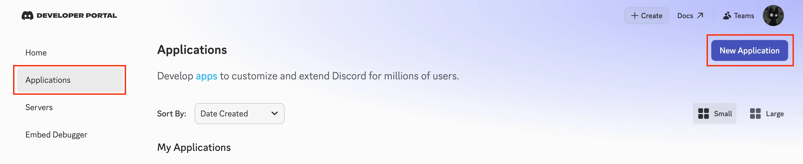
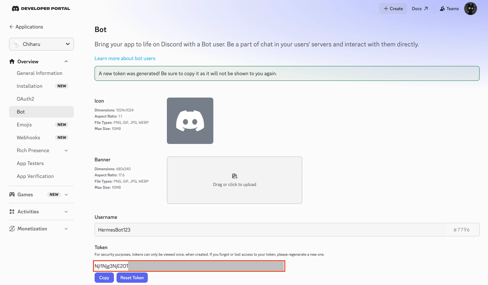
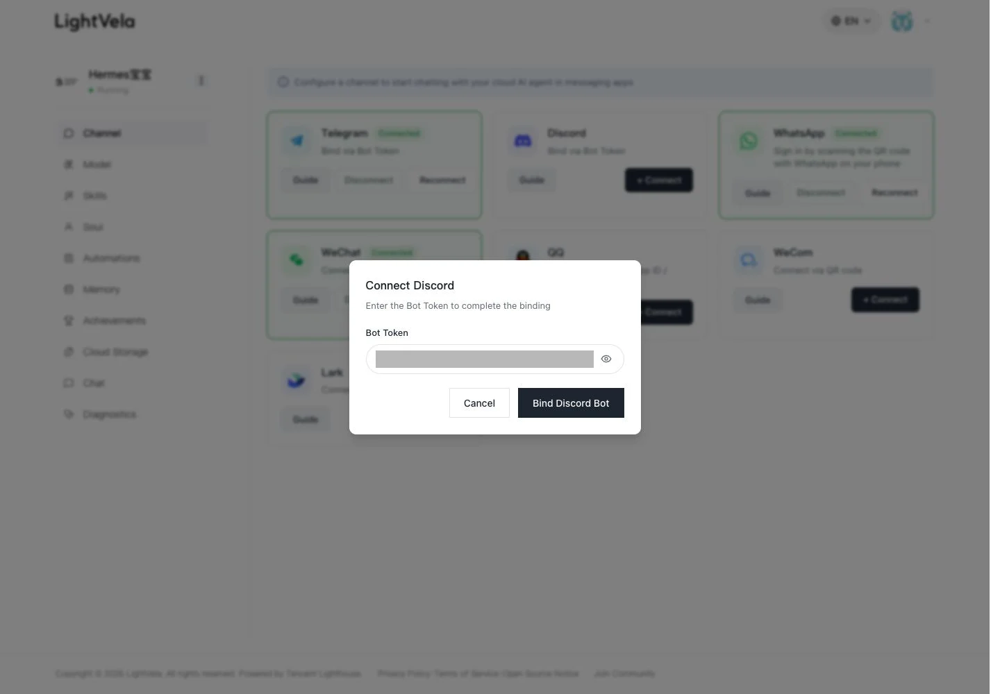
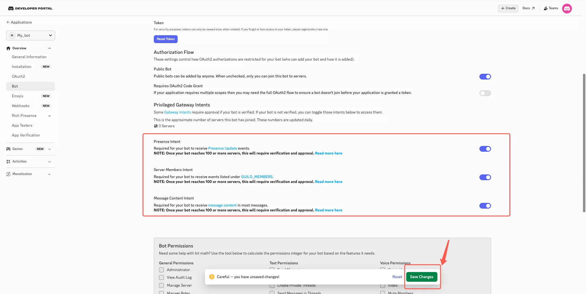
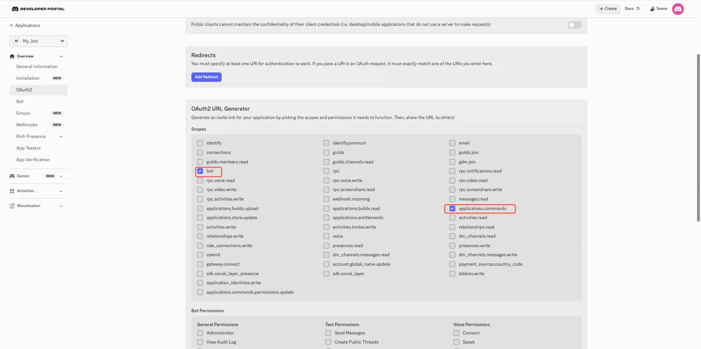
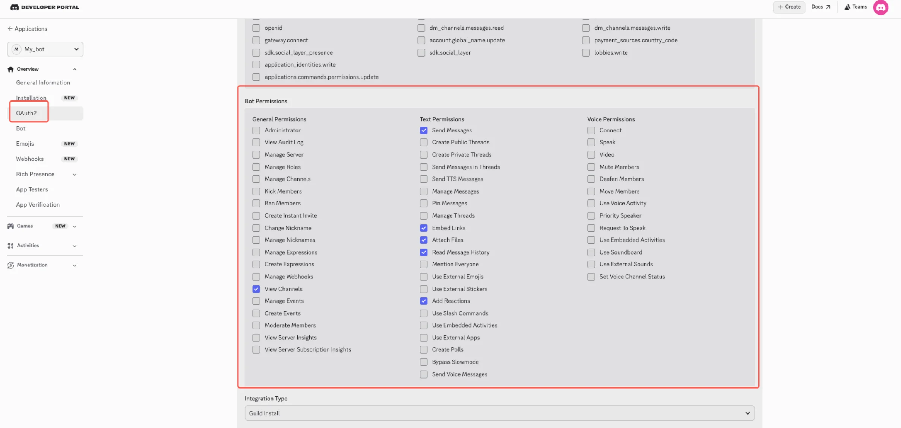
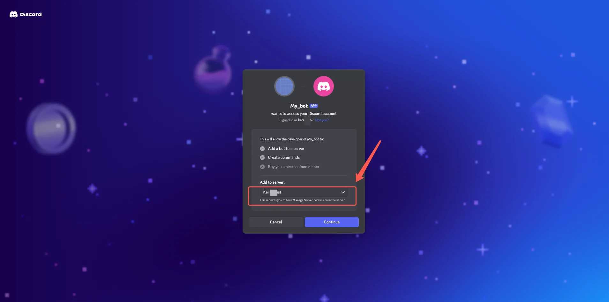
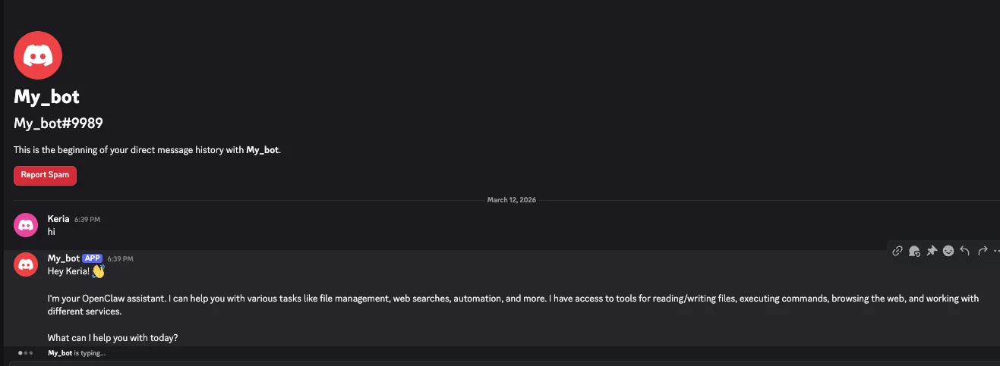

# กำหนดค่าช่อง - Discord

## สรุป

**ช่อง Discord เชื่อมต่อผ่านการอนุญาตของบอท ซึ่งเหมาะสำหรับการนำเอเจนต์ Hermes ของคุณเข้าสู่เซิร์ฟเวอร์ Discord เพื่อตอบคำถาม ช่วยเหลือ หรือกระตุ้นการมีส่วนร่วมของชุมชน: สร้างแอปพลิเคชันและบอทในพอร์ทัลนักพัฒนา Discord รับข้อมูลประจำตัว นำไปวางในส่วน Channels ของคอนโซล LightVela จากนั้นเชิญบอทไปยังเซิร์ฟเวอร์เป้าหมายของคุณ คุณต้องมีเซิร์ฟเวอร์ Discord ที่คุณมีสิทธิ์ผู้ดูแลระบบและโมเดลที่ตั้งค่าแล้ว (หรือเพียงเครดิตโมเดลรายเดือนที่รวมอยู่ในแผนของคุณ) เมื่อเชื่อมต่อแล้ว เอเจนต์ใน Discord จะแชร์บุคลิกและความทรงจำระยะยาวเดียวกันกับช่องอื่น ๆ ของคุณ**

---

ช่อง Discord ใช้การเข้าถึงการอนุมัติของบอทและเหมาะสำหรับการเชื่อมต่อเอเจนต์ Hermes กับเซิร์ฟเวอร์ Discord โดยให้ความสามารถในการถามตอบ ผู้ช่วย หรือการโต้ตอบในชุมชนในช่องต่าง ๆ

## หน้านี้ครอบคลุม

- เปิดลิงก์เชิญใน Discord และทำการอนุญาตให้เสร็จสมบูรณ์

- แชทกับเอเจนต์ Hermes ในเซิร์ฟเวอร์หรือช่องทาง Discord


> 💡 **ข้อกำหนดเบื้องต้น**
>
> -   บัญชี Discord ที่สามารถลงชื่อเข้าใช้ได้
>
> -   เซิร์ฟเวอร์ Discord ที่คุณสามารถเพิ่มบอทได้
>
> -   การตั้งค่า [โมเดล](./model.md) ให้สมบูรณ์ (หรือใช้เครดิตทดลอง 100 หน่วยที่รวมอยู่ในแผน Launch)

---

## ขั้นตอน

### 1. เข้าสู่คอนโซล

ลงชื่อเข้าใช้ LightVela คลิก "My Hermes" ที่มุมขวาบนเพื่อเข้าสู่คอนโซล และหาปุ่ม "Channel"

### 2. เลือกช่อง Discord

ค้นหาการ์ด Discord และคลิก "+ เชื่อมต่อ"

### 3. เปิด Discord และไปที่พอร์ทัลนักพัฒนา

เลือกเซิร์ฟเวอร์ที่คุณต้องการเพิ่มบอทเข้าไป จากนั้นไปที่ [Developer Portal](https://discord.com/developers/home):

1. คลิกที่แอปพลิเคชัน



2. คลิก แอปพลิเคชันใหม่ ที่มุมขวาบน

3. ตั้งชื่อแอปพลิเคชันของคุณ

4. เพิ่มบอทลงในแอปพลิเคชันของคุณและสร้างโทเค็นบอท โทเค็นนี้ใช้เพื่อรับรองความถูกต้องของการเชื่อมต่อระหว่าง Hermes Agent และ Discord เซิร์ฟเวอร์ของคุณ



5. วางโทเค็นลงในการ์ด Discord



### 4. ไปที่หน้าบอทในพอร์ทัลนักพัฒนา

บนหน้าบอท เลื่อนลงไปที่ Privileged Gateway Intents และเปิดใช้งาน:

- **เจตนาของเนื้อหาข้อความ**: จำเป็น, ใช้เพื่ออ่านเนื้อหาข้อความ

- **เจตนาของสมาชิกเซิร์ฟเวอร์**: แนะนำ ใช้สำหรับรายการบทบาทและการจับคู่ชื่อกับรหัส

- **ความตั้งใจในการแสดงสถานะ**: ไม่จำเป็น, ใช้เฉพาะสำหรับอัปเดตสถานะเท่านั้น



หลังจากเปิดใช้งานพวกเขาแล้ว ให้คลิกบันทึกการเปลี่ยนแปลงที่ด้านล่าง

### 5. ไปที่หน้า OAuth2 ในพอร์ทัลนักพัฒนา

กำหนดค่าการอนุญาตของบอท: คลิกที่ OAuth2 ในแถบด้านซ้าย จากนั้นเลือก ตัวสร้าง URL OAuth2 กำหนดค่า Scopes ก่อน; ตามหลักการสิทธิ์ที่น้อยที่สุด ให้ใช้ `bot` และ `applications.commands`



เลื่อนลงต่อเพื่อกำหนดค่าการอนุญาตของบอท และเลือก:

- ดูช่อง

- ส่งข้อความ

- อ่านประวัติข้อความ

- ฝังลิงก์

- แนบไฟล์

- เพิ่มปฏิกิริยา (ไม่บังคับ)



### 6. คัดลอกและเปิดลิงก์เชิญ

คัดลอกลิงก์เชิญที่สร้างขึ้น เปิดในเบราว์เซอร์ของคุณ และเชิญบอทไปยังเซิร์ฟเวอร์ Discord ของคุณ (จำเป็นต้องมีสิทธิ์ผู้ดูแลเซิร์ฟเวอร์) หลังจากคลิกดำเนินการต่อและให้สิทธิ์ บอทจะถูกเชิญไปยังเซิร์ฟเวอร์



### 7. แชทกับบอทใหม่ใน Discord

คุณสามารถเริ่มโต้ตอบกับบอทได้แล้ว เปิดแชทกับบอทและส่งข้อความทดสอบ:

```
Hi
```



คุณควรได้รับการตอบกลับจากเอเจนต์ Hermes ภายในไม่กี่วินาที

---

## สถานะสำเร็จ

- รายการ "ช่องทางที่เชื่อมต่อ" ในคอนโซลมี "Discord"

- บอทที่เกี่ยวข้องสามารถพบได้ใน Discord รายชื่อผู้ติดต่อ

- Hermes เอเจนต์ตอบกลับหลังจากที่คุณส่งข้อความ


---

## ประเภทข้อความที่รองรับ

หลังจากการเข้าถึงสำเร็จ บอท Discord สามารถรับและตอบข้อความข้อความพื้นฐานได้ และรองรับประเภทข้อความเพิ่มเติมดังนี้:

| ประเภทข้อความที่บอท Discord รองรับ | รองรับ |
|---|---|
| รับข้อความตัวอักษร | ✅ รองรับ |
| รับรูปภาพและวิดีโอ | ✅ รองรับ |
| รับแฟ้ม | ✅ รองรับ |
| ตอบกลับด้วยข้อความตัวอักษร | ✅ รองรับ |
| ตอบกลับด้วยรูปภาพและวิดีโอ | ✅ รองรับ |
| ตอบกลับด้วยแฟ้ม | ✅ รองรับ |
| ส่งข้อความล่วงหน้า (เช่น การแจ้งเตือนที่ตั้งเวลาไว้) | ✅ รองรับ |

> ℹ️ **ความสามารถในการประมวลผลที่แท้จริงขึ้นอยู่กับโมเดล**
>
> ตารางด้านบนแสดงเฉพาะประเภทข้อความที่บอท Discord รองรับในระดับช่องทางเท่านั้น ว่าภาพ ไฟล์ และงานอื่น ๆ สามารถประมวลผลได้จริงหรือไม่ก็ขึ้นอยู่กับว่าโมเดลภาษาขนาดใหญ่ที่เชื่อมต่อกับ Hermes Agent มีความสามารถที่เกี่ยวข้องหรือไม่ด้วย

---

## คำถามที่พบบ่อย

| ปัญหา | สาเหตุที่เป็นไปได้ | วิธีแก้ไข |
|---|---|---|
| ไม่สามารถสร้าง Discord Bot ได้ | ไม่ได้เข้าสู่ Discord Developer Portal หรือยังไม่ทำขั้นตอนการสร้างแอปพลิเคชันให้เสร็จ | เข้าสู่ Discord Developer Portal สร้างแอปพลิเคชัน จากนั้นเพิ่ม Bot |
| ไม่พบ Bot Token | Token ยังไม่ได้สร้างหรือไม่ได้คัดลอกครบถ้วน | ในหน้า Bot คลิก Reset Token / Copy Token จากนั้นวางโทเค็นทั้งหมดในช่องโทเค็น |
| Token แสดงว่าไม่ถูกต้องหลังจากวางแล้ว | โทเค็นไม่ครบถ้วนหรือมีช่องว่าง/การขึ้นบรรทัดเกิน | คัดลอก Bot Token ทั้งหมดอีกครั้งและตรวจสอบว่าไม่มีช่องว่างเกิน |
| ไม่สามารถเชิญบอทไปยังเซิร์ฟเวอร์ได้ | URL OAuth2 ถูกกำหนดค่าไม่ถูกต้อง หรือบัญชีของคุณไม่มีสิทธิ์ผู้ดูแลเซิร์ฟเวอร์ | ในเครื่องมือสร้าง URL OAuth2 ให้เลือกขอบเขต `bot` และยืนยันว่าคุณมีสิทธิ์ผู้ดูแลเซิร์ฟเวอร์
| บอทไม่ปรากฏในเซิร์ฟเวอร์หลังจากการเชิญ | การเชิญไม่เสร็จสมบูรณ์ หรือบอทไม่ได้ออนไลน์ | เปิดลิงก์เชิญอีกครั้งเพื่อตรวจสอบว่าการอนุญาตสำเร็จหรือไม่; รีเฟรชรายชื่อสมาชิกเซิร์ฟเวอร์ Discord |
| ไม่มีการตอบกลับหลังส่งข้อความ | โมเดลไม่ได้ถูกตั้งค่า เครดิตทดลองใช้หมดแล้ว หรือช่อง Discord ยังไม่ได้เชื่อมต่อสำเร็จ | ตรวจสอบสถานะ "โมเดลปัจจุบัน" ในการ์ด "1. โมเดล" และยืนยันว่าช่อง Discord แสดงว่าเชื่อมต่อแล้ว |
| บอทไม่สามารถอ่านข้อความได้ | การตั้งค่า Message Content Intent ไม่ถูกเปิดใช้งาน | เปิดใช้งาน Message Content Intent ในการตั้งค่าบอทของ Discord Developer Portal |
| บอทไม่มีสิทธิ์ตอบกลับในช่อง | สิทธิ์ในช่องไม่เพียงพอ | ยืนยันว่าบอทมีสิทธิ์ View Channels, Send Messages, Read Message History และสิทธิ์อื่นๆ ที่จำเป็น |
| บอทไม่สามารถรับข้อความโดยตรงได้ | การอนุญาต DM หรือข้อจำกัดด้านความเป็นส่วนตัวของผู้ใช้ | ยืนยันว่าบอทอนุญาตให้ส่ง DM และตรวจสอบการตั้งค่าความเป็นส่วนตัวของผู้ใช้ Discord |
| วิธีการยกเลิกการเชื่อมต่อ | — | ลบระเบียน Discord ที่เกี่ยวข้องในรายการ "ช่องที่เชื่อมต่อ" |
| บอท Discord เดียวกันสามารถเชื่อมต่อกับอินสแตนซ์ Hermes Agent หลายตัวได้หรือไม่ | ไม่แนะนำ; โทเค็นบอทแต่ละตัวควรผูกกับ Hermes Agent ตัวเดียว | หากคุณต้องการอินสแตนซ์ Hermes Agent หลายตัว ให้สร้างบอท Discord แยกออกมา |

---

## หมายเหตุช่อง

- **ประเภทข้อความ**: รองรับข้อความ รูปภาพ วิดีโอ ไฟล์ ข้อความเสียง และอื่นๆ ดู "ประเภทข้อความที่รองรับ" ข้างต้น

- **การสนับสนุนแชทกลุ่ม**: ปัจจุบันยังไม่รองรับการสนทนากลุ่ม; รองรับเฉพาะการสนทนาแบบตัวต่อตัวเท่านั้น

- **การขาดการเชื่อมต่อ**: ระยะเวลานานที่ไม่มีการตอบสนองอาจบ่งชี้ว่าการอนุญาตถูกยกเลิก กลับไปที่คอนโซลและอนุญาตการเข้าถึงอีกครั้ง

---

## ขั้นตอนถัดไป

- [กำหนดค่าช่องทาง - Slack](./channel-slack.md) — การทำงานร่วมกันของทีม การแจ้งเตือนในพื้นที่ทำงาน และเวิร์กโฟลว์ของช่องทาง

- [กำหนดค่าช่อง - QQ](./channel-qq.md) — บอทสร้างขึ้นด้วยตนเอง, รวมผ่าน AppID/AppSecret

- [กำหนดค่าช่องทาง - WeCom](./channel-wecom.md) — การทำงานร่วมกันภายในองค์กรและสถานการณ์สำนักงาน

- [ตั้งค่าช่องทาง - Lark](./channel-feishu.md) — สถานการณ์ในสำนักงานที่มีข้อความรูปแบบและการสนทนากลุ่ม

- [กำหนดค่าทักษะ](./skill.md) — ขยายความสามารถของเอเจนต์Hermes
