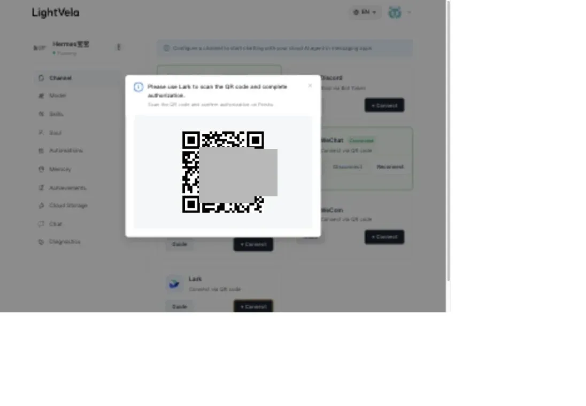
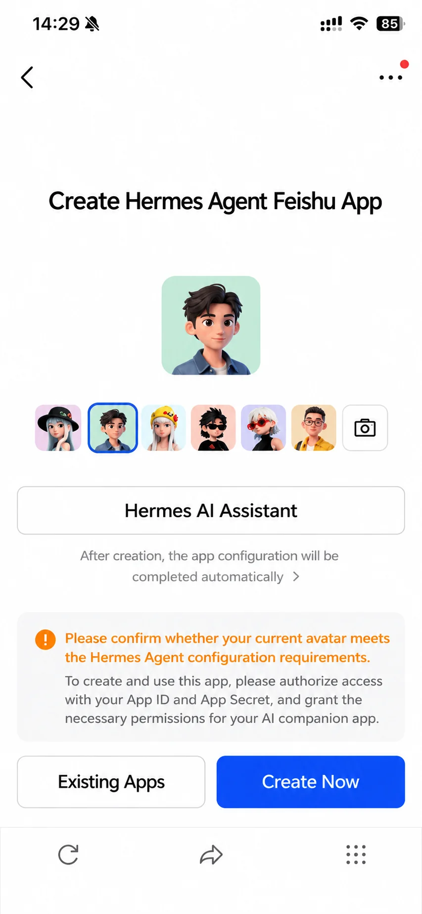
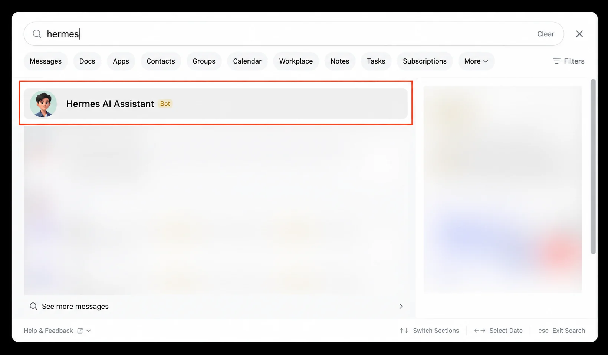
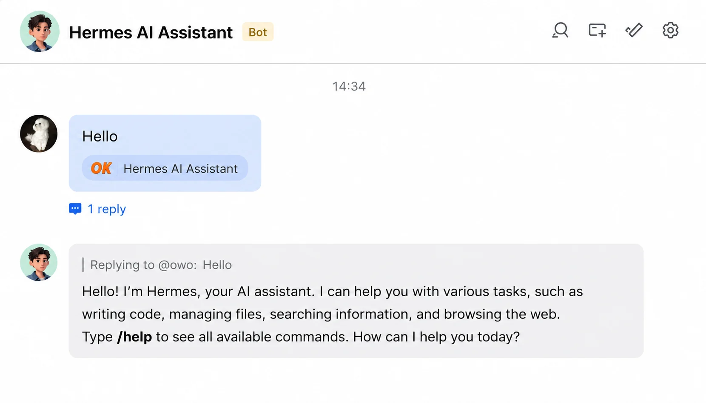

# กำหนดค่าช่อง - Lark

## สรุป

**ช่อง Lark เหมาะกับการใช้งานในที่ทำงาน รองรับข้อความรูปแบบ rich-text และสามารถ @mention บอทในแชทกลุ่มได้ และเชื่อมต่อในลักษณะเดียวกับ WeChat: เลือก Lark ในส่วน Channels ของคอนโซล คลิกเพื่ออนุมัติและสร้างรหัส QR จากนั้นสแกนด้วย Lark เพื่อเริ่มพูดคุย คุณต้องมี Lark บนโทรศัพท์ (หรือเข้าระบบบนเดสก์ท็อป) และโมเดลที่ตั้งค่าไว้แล้ว (หรือเพียงใช้เครดิตโมเดลรายเดือนที่รวมอยู่ในแผนของคุณ) เอเจนต์หนึ่งคนสามารถเชื่อมต่อกับหลายช่องพร้อมกันได้ โดยใช้บุคลิกและความจำระยะยาวเดียวกัน.**

---

ช่อง Lark เหมาะสำหรับสถานการณ์ในสำนักงาน มันรองรับข้อความรูปแบบข้อความที่มีความหลากหลายและการ @mention บอทในแชทกลุ่ม การรวมระบบนี้ใช้การอนุญาตผ่านรหัส QR คล้ายกับ WeChat

## หน้านี้ครอบคลุม

- กำลังสร้างรหัส QR แบบเข้าถึง Lark ใน LightVela

- สแกนรหัส QR ด้วย Lark เพื่ออนุญาต

- กำลังแชทกับเอเจนต์ Hermes ใน Lark


> 💡 **ข้อกำหนดเบื้องต้น**
>
> - โทรศัพท์ที่ติดตั้ง Lark แล้ว (หรือคอมพิวเตอร์เดสก์ท็อป Lark ที่เข้าสู่ระบบแล้ว)
>
> - ทำการ [กำหนดค่าโมเดล](./model.md) ให้ครบถ้วน (หรือใช้เครดิตทดลอง 100 เครดิตที่รวมอยู่ในแผนเปิดตัว)

---

## ขั้นตอน

### 1. เข้าสู่คอนโซล

ลงชื่อเข้าใช้ LightVela คลิก "My Hermes" ที่มุมขวาบนเพื่อเข้าสู่คอนโซล และหาปุ่ม "Channel"

### 2. เลือกช่อง Lark

คลิกที่เมนูแบบเลื่อนลงและเลือก "Lark" การแนะนำช่อง Lark จะแสดงด้านล่าง

### 3. คลิก "อนุญาตการเข้าถึง"

รหัส QR ปรากฏบนหน้า



### 4. สแกนด้วย Lark

**บนมือถือ:**

1. เปิด Lark

2. แตะ "+" ที่มุมขวาบน → "สแกน"

3. สแกนรหัส QR บนหน้าจอคอมพิวเตอร์ของคุณ

4. ทำตามข้อความแจ้งเพื่อเสร็จสิ้นการอนุมัติ




### 5. ค้นหา Hermes เอเจนต์ใน Lark

หลังจากการสแกนสำเร็จ:

- มีรายการ "Lark" ปรากฏในรายการ "ช่องที่เชื่อมต่อ" ของคอนโซล

- Lark จะเพิ่มบอทไปยังรายชื่อผู้ติดต่อของคุณโดยอัตโนมัติ


ค้นหา Lark สำหรับชื่อแอปพลิเคชันที่คุณสร้างขึ้น



เปิดหน้าต่างแชทของบอทแล้วส่งข้อความทดสอบ:

```
Hello
```



## สถานะสำเร็จ

- มีรายการ "Lark" ปรากฏในรายการ "ช่องที่เชื่อมต่อ" ของคอนโซล

- สามารถค้นหาบอทได้ผ่านการค้นหา Lark

- การส่งข้อความจะได้รับการตอบกลับจากเอเจนต์ Hermes


---

## ประเภทข้อความที่รองรับ

หลังจากการรวม ระบบบอท Lark รองรับมากกว่าข้อความพื้นฐาน รายการทั้งหมด:

| Lark บอท — ประเภทข้อความและคุณสมบัติที่รองรับ | รองรับ |
| --- | --- |
| รับข้อความตัวอักษร | ✅ ใช่ |
| รับรูปภาพ | ✅ ใช่ |
| รับไฟล์ | ✅ ใช่ |
| รับเสียง / วิดีโอ | ✅ ใช่ |
| ตอบกลับด้วยข้อความตัวอักษร | ✅ ใช่ |
| ตอบกลับด้วยรูปภาพ | ✅ ใช่ |
| ตอบกลับด้วยไฟล์ | ✅ ใช่ |
| ตอบกลับด้วยเสียง | ✅ ใช่ |
| เนื้อหาการตอบกลับรองรับ Markdown | ✅ ใช่ |
| ส่งข้อความโดยเชิงรุก (เช่น การแจ้งเตือนตามกำหนด) | ✅ ใช่ |
| ใช้งาน Lark Docs, Wiki, Drive | ✅ ใช่ |

> ℹ️ **ความสามารถที่แท้จริงขึ้นอยู่กับโมเดล**
>
> ตารางด้านบนสะท้อนเฉพาะสิ่งที่บอท Lark สามารถรับและตอบกลับในระดับช่องสัญญาณเท่านั้น ว่างานต่าง ๆ เช่น การประมวลผลภาพ / ไฟล์สามารถทำงานได้จริงหรือไม่ขึ้นอยู่กับว่า LLM พื้นฐานที่เชื่อมต่อกับ Hermes Agent รองรับความสามารถเหล่านั้นหรือไม่

---

## คำถามที่พบบ่อย

| อาการ | สาเหตุที่เป็นไปได้ | วิธีแก้ไข |
| --- | --- | --- |
| สแกนแล้วขึ้น "แอปพลิเคชันไม่ได้รับอนุญาต" | ผู้ดูแลระบบผู้เช่า จำกัดแอปของบุคคลที่สาม | ขอให้ผู้ดูแลระบบผู้เช่าอนุญาตแอป หรือสลับไปใช้ผู้เช่าส่วนบุคคล |
| ไม่พบผู้ติดต่อบอท | Lark จะย่อบอทโดยค่าเริ่มต้น | ค้นหาชื่อแอปพลิเคชัน Hermes Agent จากด้านบนของ Lark |
| วิธีเพิ่มบอทในกลุ่ม | — | ในการตั้งค่ากลุ่ม เลือก "เพิ่มสมาชิก" ค้นหาบอทและเพิ่ม |
| รหัส QR หมดอายุ | ไม่ได้สแกนภายในเวลาที่กำหนด | ปิดกล่องโต้ตอบแล้วคลิก "อนุญาตการเข้าถึง" อีกครั้ง |
| ไม่มีการตอบกลับหลังส่งข้อความ | โมเดลไม่ได้ตั้งค่าไว้หรือเครดิตทดลองหมด | ตรวจสอบสถานะ "โมเดลปัจจุบัน" |
| ปัญหาการแสดงผลข้อความรูปแบบสมบูรณ์ | Lark ไม่รองรับ Markdown บางส่วน | การสนทนาแบบข้อความธรรมดาไม่ได้รับผลกระทบ |

---

## หมายเหตุช่อง

- **ประเภทของข้อความ**: ข้อความ ข้อความรูปแบบรวย รูปภาพ ไฟล์ เสียง วิดีโอ และอื่น ๆ — ดู "ประเภทข้อความที่รองรับ" ข้างต้น

- **การสนับสนุนแชทกลุ่ม**: บอทสามารถถูกเพิ่มเข้าไปในแชทกลุ่มและจะตอบกลับเมื่อมีการ @กล่าวถึง

- **ข้อจำกัดของผู้เช่า**: ว่าผู้เช่าองค์กร Lark จะอนุญาตบ็อตของบุคคลที่สามหรือไม่ ขึ้นอยู่กับนโยบายของผู้ดูแลระบบผู้เช่า


---

## ขั้นตอนถัดไป

- [กำหนดค่าทักษะ](./skill.md) — ขยายความสามารถของเอเจนต์Hermes
