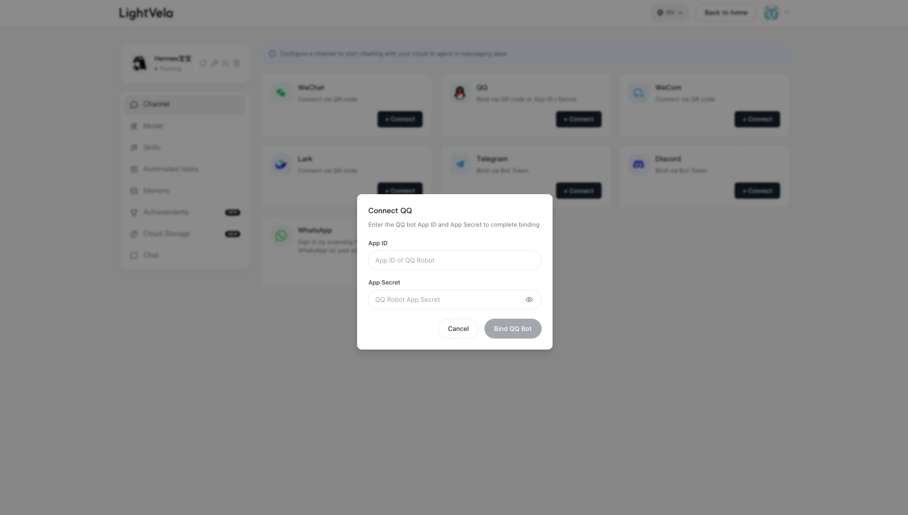
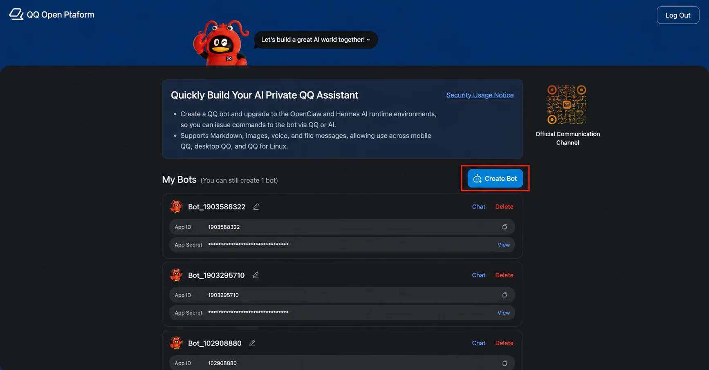
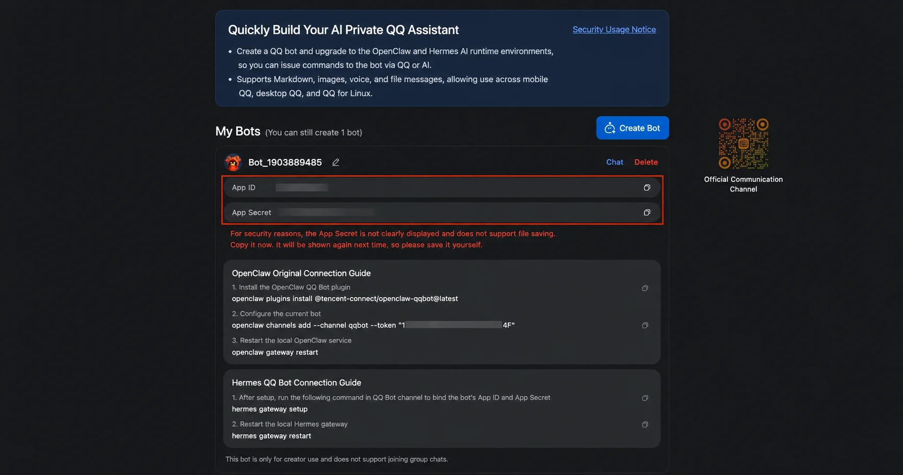
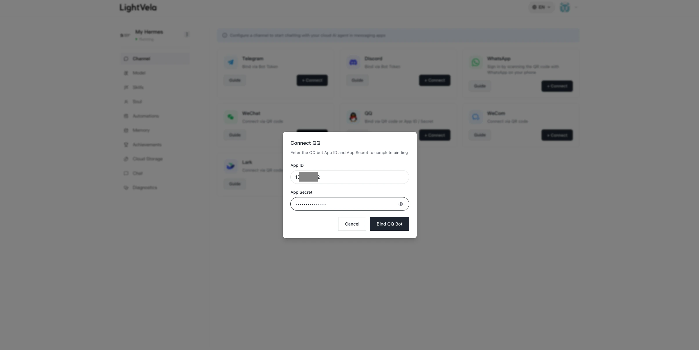
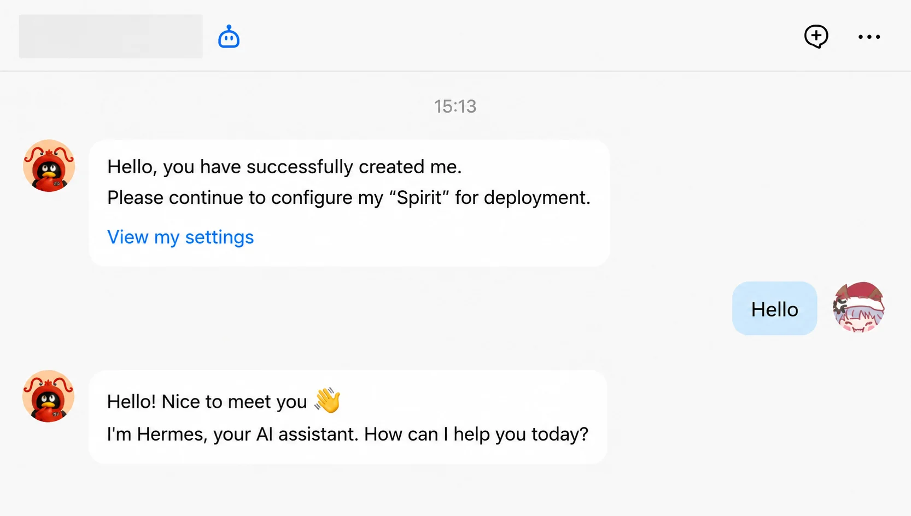

# ตั้งค่าช่อง - QQ

## สรุป

**ช่อง QQ เป็นช่องที่ต้องกรอกพารามิเตอร์ด้วยมือ: สร้างบอทบนแพลตฟอร์ม QQ Open Platform, รับ AppID และ AppSecret ของมัน แล้ววางลงในส่วน Channels ของคอนโซล LightVela ทั้งหมดนี้ใช้เวลาประมาณ 5–10 นาที คุณต้องมีบัญชี QQ เพื่อทำหน้าที่เป็นผู้ดูแลบอท และมีโมเดลที่ตั้งค่าไว้แล้ว (หรือใช้เครดิตโมเดลรายเดือนที่รวมอยู่ในแผนของคุณ) เมื่อเทียบกับ WeChat, WeCom และ Lark ที่ทั้งหมดเชื่อมต่อโดยสแกน QR โค้ด เมื่อเชื่อมต่อแล้ว เอเจนต์ใน QQ จะมีบุคลิกและความทรงจำระยะยาวเหมือนกับช่องทางอื่น ๆ ของคุณ**

---

ช่องทาง QQ ต้องสร้างบอทบนแพลตฟอร์ม QQ Open ก่อน จากนั้นกรอก **AppID** และ **AppSecret** ที่ได้ลงใน LightVela ทั้งกระบวนการใช้เวลาประมาณ 5–10 นาที

## หน้านี้ครอบคลุม

- การลงทะเบียนและสร้างบอทบนแพลตฟอร์ม QQ Open

- การขอรับ AppID และ AppSecret

- กรอกข้อมูลประจำตัวลงใน LightVela เพื่อทำการเชื่อมต่อให้สมบูรณ์

- แชทกับเอเจนต์ Hermes ใน QQ


> 💡 **ข้อกำหนดเบื้องต้น**
>
> - บัญชี QQ (เพื่อทำหน้าที่เป็นผู้ดูแลบอท)
>
> - การ [ตั้งค่าโมเดล](./model.md) ให้ครบถ้วน (หรือใช้เครดิตทดลอง 100 เครดิตที่รวมอยู่ในแผน Launch)

---

## ขั้นตอน

### 1. เข้าสู่คอนโซล

ลงชื่อเข้าใช้ LightVela คลิก "My Hermes" ที่มุมขวาบนเพื่อเข้าสู่คอนโซล และหาปุ่ม "Channel"

### 2. เลือกช่องทาง QQ

คลิกที่เมนูแบบเลื่อนลงและเลือก “QQ” การแนะนำช่อง QQ จะแสดงด้านล่าง



### 3. ลงทะเบียนบนแพลตฟอร์ม QQ Open

เยี่ยมชม [QQ Open Platform](https://q.qq.com/qqbot/openclaw/) และสแกนรหัส QR บนหน้าเพจด้วยแอป QQ บนมือถือเพื่อลงทะเบียน / เข้าสู่ระบบ ในการเข้าชมครั้งแรก การสแกนจะลงทะเบียนโดยอัตโนมัติและเชื่อมบัญชี QQ ปัจจุบันกับบัญชี Open Platform

หลังจากสแกนบนแอป QQ บนมือถือและเลือก **ตกลง** การลงทะเบียนจะเสร็จสมบูรณ์และคุณจะเข้าสู่หน้าการตั้งค่า bot ของ QQ

### 4. สร้างบอท QQ

บนหน้าบอทของแพลตฟอร์ม QQ เปิด ให้คลิก "สร้างบอท" เพื่อสร้างบอท QQ ใหม่



### 5. รับ AppID และ AppSecret

หลังจากที่สร้างบอทแล้ว ให้หาค่า **AppID** และ **AppSecret** บนหน้าเว็บ คลิกปุ่ม "คัดลอก" ข้างๆ แต่ละค่าและบันทึกลงในไฟล์โน้ตในเครื่อง



> ⚠️ **AppSecret เป็นข้อมูลสำคัญที่ละเอียดอ่อน**
>
> - เพื่อเหตุผลด้านความปลอดภัย, **AppSecret จะไม่สามารถดูได้อีกเป็นข้อความปกติ — การดูอีกครั้งจะบังคับให้รีเซ็ต** ดังนั้นให้บันทึกทันทีเมื่อสร้างครั้งแรก
>
> - อย่านำไปวางในกลุ่มแชท, เว็บสาธารณะ, หรือ commit ลงใน Git repository
>
> - หากรั่วไหล ให้รีเซ็ตทันทีในแพลตฟอร์ม QQ Open ภายใต้ “Reset Secret” จากนั้นกรอกข้อมูลรับรองใหม่ลงใน LightVela

หลังจากสร้างแล้ว QQ จะเพิ่มบอทไปยังรายการข้อความของคุณโดยอัตโนมัติและส่งข้อความต้อนรับ ในจุดนี้ บอทยังไม่ได้เชื่อมโยงกับ LightVela การส่งข้อความจะส่งกลับ "บอทนี้ไปที่ดาวอังคาร ลองใหม่อีกครั้งภายหลัง" — นี่เป็นเรื่องปกติ ให้ดำเนินการไปยังขั้นตอนถัดไป

### 6. กรอกข้อมูลรับรองใน LightVela

กลับไปที่การ์ด "Channel" ในคอนโซล เลือก "QQ" จากเมนูแบบเลื่อนลง แล้ววางข้อมูลประจำตัวที่คุณเพิ่งคัดลอกมา:

1. **AppID**: วาง AppID ที่คัดลอกมา

2. **AppSecret**: วาง AppSecret ที่คัดลอกมา




### 7. คลิก "เพิ่มและใช้"

LightVela ใช้ข้อมูลประจำตัวด้านบนเพื่อเชื่อมต่อบอตบนแพลตฟอร์ม QQ Open หลังจากไม่กี่สิบวินาที หน้าจะขึ้นข้อความว่า "บันทึกสำเร็จ" และมีรายการ "QQ" ปรากฏในรายการ "ช่องทางที่เชื่อมต่อ"

### 8. ค้นหา Hermes เอเจนต์ใน QQ

เปิด QQ ค้นหาโบตที่คุณสร้างขึ้น แล้วส่งข้อความทดสอบ:

```
Hello
```

คุณจะได้รับการตอบกลับจาก Hermes เอเจนต์ภายในไม่กี่วินาที



> ✅ **รองรับการกล่าวถึงในกลุ่ม QQ**
>
> หลังจากการผูกบัญชี QQ สำเร็จ LightVela จะเปิดใช้นโยบายแชทกลุ่ม QQ ของ Hermes โดยค่าเริ่มต้น เพิ่มบอทไปยังกลุ่ม QQ แล้วกล่าวถึงมันเพื่อเริ่มการสนทนา นโยบายเริ่มต้นคือ `open` ซึ่งหมายความว่าสมาชิกของกลุ่ม QQ ที่มีบอทอยู่สามารถกล่าวถึงมันเพื่อแชท ข้อความปกติในกลุ่มโดยไม่กล่าวถึงจะไม่ทำให้เกิดการสนทนา

## สถานะสำเร็จ

- บ็อตถูกสร้างขึ้นบนแพลตฟอร์ม QQ Open

- รายการ "QQ" ปรากฏในรายการ "ช่องที่เชื่อมต่อ" ของคอนโซล

- บอทใน QQ ตอบกลับอย่างถูกต้องโดยใช้ AI

- บอทตอบในกลุ่ม QQ เมื่อถูกพูดถึง


---

## ประเภทข้อความที่รองรับ

หลังจากการรวมเข้าด้วยกัน บอท QQ รองรับมากกว่าข้อความพื้นฐาน รายการเต็มมีดังนี้:

| บอท QQ — ประเภทข้อความและคุณสมบัติที่รองรับ | รองรับ |
| --- | --- |
| รับข้อความตัวอักษร | ✅ ใช่ |
| รับรูปภาพ | ✅ ใช่ |
| รับไฟล์ | ✅ ใช่ |
| รับข้อความเสียง | ✅ ใช่ |
| ตอบข้อความตัวอักษร | ✅ ใช่ |
| ตอบด้วยรูปภาพ | ✅ ใช่ |
| ตอบด้วยไฟล์ | ✅ ใช่ |
| เนื้อหาการตอบสนองรองรับ Markdown | ✅ ใช่ |
| ส่งข้อความโดยเชิงรุก (เช่น การแจ้งเตือนตามกำหนดเวลา) | ✅ ใช่ |
| อ้างอิงข้อความย้อนหลัง | ❌ ยังไม่ใช่

> ℹ️ **ความสามารถที่แท้จริงขึ้นอยู่กับโมเดล**
>
> ตารางด้านบนสะท้อนเพียงสิ่งที่บอท QQ สามารถรับและตอบกลับได้ในชั้นของช่องทาง การที่งานเช่น การประมวลผลภาพ/ไฟล์จะใช้งานได้หรือไม่นั้นขึ้นอยู่กับว่า LLM พื้นฐานที่เชื่อมต่อกับ Hermes Agent รองรับความสามารถเหล่านั้นหรือไม่

---

## คำถามที่พบบ่อย

| อาการ | สาเหตุที่เป็นไปได้ | วิธีแก้ไข |
| --- | --- | --- |
| บอทตอบว่า "วิญญาณของฉันออฟไลน์ กรุณาตรวจสอบการติดตั้งบริการโฮสต์ของคุณ" | ยังไม่ได้กำหนดค่า AppID / AppSecret ใน LightVela หรือข้อมูลรับรองไม่ถูกต้อง | คัดลอกพารามิเตอร์จาก QQ Open Platform อีกครั้ง ตรวจสอบให้แน่ใจว่าไม่มีช่องว่างด้านหน้า/ด้านหลัง แล้วกรอกใน LightVela |
| บอทตอบว่า "บอทนี้ไปดาวอังคารแล้ว ลองใหม่อีกครั้งในภายหลัง" | บอท QQ ถูกสร้างแล้วแต่ยังไม่ได้ผูกกับ LightVela | ทำตามหน้านี้เพื่อกรอก AppID / AppSecret |
| บอทยังคงไม่ตอบหลังจากกำหนดค่าทุกอย่าง | แบบจำลองไม่ได้ถูกกำหนดค่าหรือเครดิตทดลองใช้หมด | ตรวจสอบสถานะ "Current Model" บนการ์ด "1. Model" |
| ไม่พบ AppSecret | AppSecret จะเห็นได้เฉพาะเวลาที่สร้างเท่านั้น | คลิก "Reset Secret" บน QQ Open Platform เพื่อสร้างค่าใหม่ แล้วกรอกใน LightVela |
| รหัสลับแอปหลุด | — | ไปที่แพลตฟอร์ม QQ Open คลิก “รีเซ็ตรหัสลับ” และกรอก AppSecret ใหม่ใน LightVela | 
| รหัส QR หมดอายุ | ไม่ได้สแกนภายในช่วงเวลาที่ใช้งานได้ | ปิดหน้าต่างแล้วคลิก “อนุญาตการเข้าถึง” อีกครั้ง |

---

## หมายเหตุช่อง

- **ประเภทข้อความ**: ข้อความ รูปภาพ ไฟล์ เสียง และอื่น ๆ — ดู "ประเภทข้อความที่รองรับ" ข้างต้น

- **การสนับสนุนแชทกลุ่ม**: การกล่าวถึงกลุ่มจะถูกเปิดใช้งานโดยค่าเริ่มต้นหลังจากการผูกบัญชี คอนโซลจะใช้ นโยบาย `open` ทำให้สมาชิกของกลุ่ม QQ ที่มีบอทสามารถกล่าวถึงมันในการแชทได้ หากต้องการจำกัดการเข้าถึงเฉพาะกลุ่มที่เลือก ให้เปลี่ยนการกำหนดค่าอินสแตนซ์ Hermes เป็น `allowlist` และคงรายการอนุญาตไว้ที่นั่น; การ์ดช่องยังไม่แสดงสวิตช์นี้

- **การจัดการข้อมูลรับรอง**: AppSecret จะมองเห็นเป็นข้อความธรรมดาได้เฉพาะตอนสร้างเท่านั้น; หากสูญหายหรือรั่วไหล ต้องรีเซ็ตใหม่


---

## ขั้นตอนถัดไป

- [กำหนดค่าช่องทาง - WeCom](./channel-wecom.md) — การทำงานร่วมกันภายในองค์กรและสถานการณ์สำนักงาน

- [ตั้งค่าช่องทาง - Lark](./channel-feishu.md) — สถานการณ์ในสำนักงานที่มีข้อความรูปแบบและการสนทนากลุ่ม

- [กำหนดค่าทักษะ](./skill.md) — ขยายความสามารถของเอเจนต์Hermes
