# กำหนดค่าช่อง - Slack

## สรุป

**ช่อง Slack เชื่อมต่อกับโทเค็นบอทและโทเค็นแอป ซึ่งเหมาะสำหรับนำเอเจนต์ Hermes ของคุณไปยังช่องทีม ข้อความตรง และการแจ้งเตือนงานที่กำหนดเวลา: สร้างแอปในคอนโซลจัดการแอป Slack กำหนดสิทธิ์การเข้าถึง รับโทเค็นทั้งสอง แล้ววางลงในส่วน Channels ของคอนโซล LightVela คุณต้องมีพื้นที่ทำงาน Slack ที่สามารถติดตั้งแอปและมีโมเดลที่กำหนดค่าแล้ว (หรือเพียงเครดิตโมเดลรายเดือนที่รวมอยู่ในแผนของคุณ) โทเค็นทั้งสองเป็นข้อมูลรับรองที่ละเอียดอ่อน — อย่าแชร์กับสาธารณะ เมื่อต่อแล้ว เอเจนต์ใน Slack จะมีบุคลิกและความจำระยะยาวเหมือนกับช่องอื่น ๆ ของคุณ

---

Slack ใช้โทเค็นบอทและโทเค็นแอปเพื่อเชื่อมต่อ Hermes เอเจนต์ไปยังช่องทีม ข้อความโดยตรง และการแจ้งเตือนงานตามกำหนด

## หน้านี้ครอบคลุม

- การสร้างแอป Slack และการกำหนดค่าโหมดซ็อกเก็ต สิทธิ์ และเหตุการณ์

- การผูกโทเค็นบอท Slack และโทเค็นแอป LightVela

- แชทกับเอเจนต์ Hermes ผ่านช่องทาง Slack และข้อความโดยตรง

> 💡 **ก่อนที่คุณจะเริ่ม**
>
> - คุณมี Hermes เอเจนต์ที่มีโมเดลทำงานได้ตั้งค่าอยู่ใน [Configure Models](./model.md)
>
> - คุณมี Slack เวิร์กสเปซและสิทธิ์ในการสร้างและติดตั้งแอป
>
> - หากการติดตั้งแอปต้องได้รับการอนุมัติจากผู้ดูแล ให้ติดต่อผู้ดูแลเวิร์กสเปซของคุณ
>
> - เตรียมสถานที่ที่ปลอดภัยเพื่อจัดเก็บโทเค็นทั้งสองชั่วคราว
>
> Bot Tokens และ App Tokens เป็นข้อมูลรับรองที่ละเอียดอ่อน หากโทเค็นถูกเปิดเผย ให้เพิกถอนใน Slack และสร้างเอเจนต์ใหม่

---

## ขั้นตอน

### 1. เปิดการตั้งค่าช่อง Slack ใน LightVela

เข้าสู่ระบบที่เว็บไซต์ระหว่างประเทศ LightVela เปิด **My Hermes → Channel** ค้นหาการ์ด **Slack** และคลิก **+ Connect** คุณจะได้รับข้อมูลประจำตัวสองรายการ:

- **Slack โทเค็นบ็อต**: เริ่มต้นด้วย `xoxb-`.
- **Slack โทเค็นแอป**: เริ่มต้นด้วย `xapp-`.

### 2. สร้างแอป Slack

1. เปิด [Slack API แอป](https://api.slack.com/apps) และลงชื่อเข้าใช้
2. คลิก **สร้างแอปใหม่**

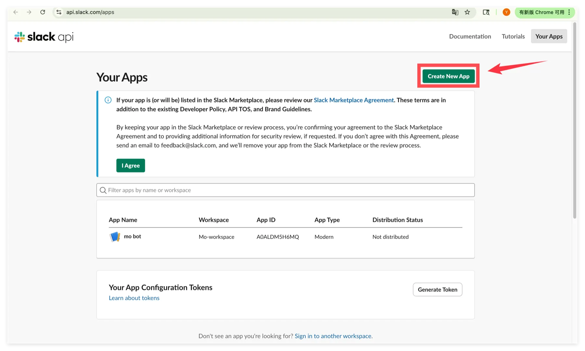

3. เลือก **จากเริ่มต้น**

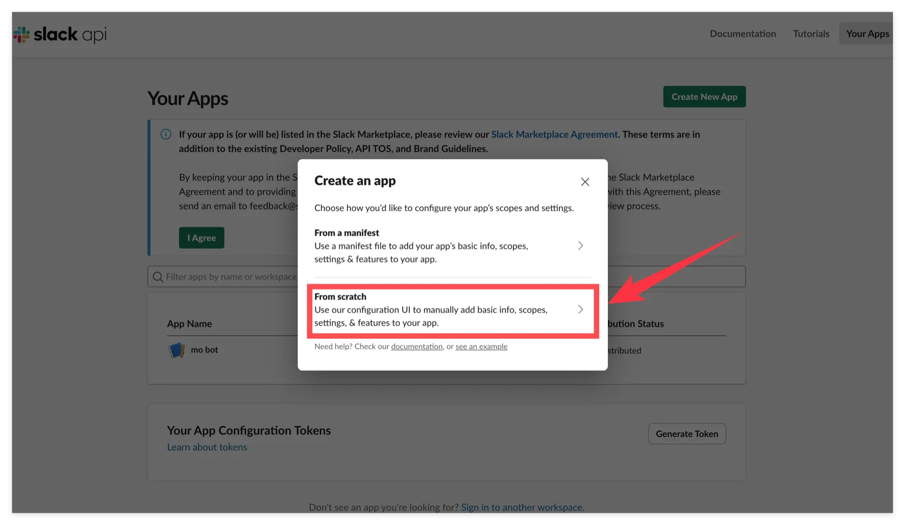

4. ป้อนชื่อแอป เช่น `Hermes Agent`
5. เลือกพื้นที่ทำงานที่เอเจนต์ Hermes ควรทำงาน จากนั้นคลิก **สร้างแอป**

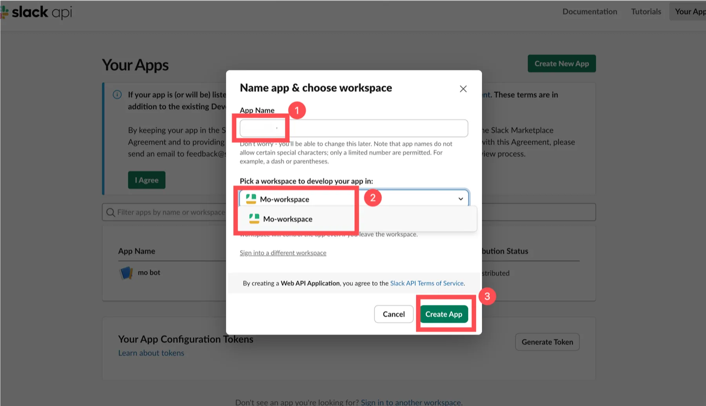

หากไม่พบพื้นที่ทำงาน ให้ตรวจสอบว่าบัญชี Slack ปัจจุบันเป็นของพื้นที่ทำงานนั้นและสามารถสร้างแอปได้

### 3. สร้างโทเค็นของแอป

โทเค็นแอปสร้างการเชื่อมต่อ WebSocket ในโหมดซ็อกเก็ต ต้องรวมสโคป `connections:write` ด้วย

1. ในแถบด้านข้างของแอป Slack เปิด **การตั้งค่า → ข้อมูลพื้นฐาน**

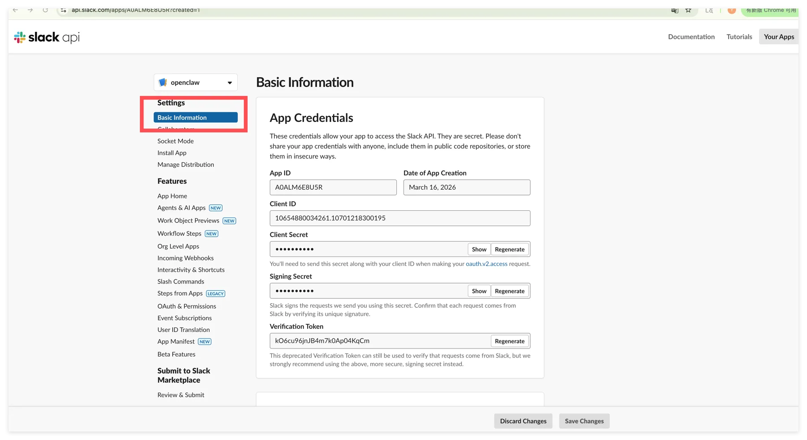

2. เลื่อนลงไปที่ **โทเค็นระดับแอป** และคลิก **สร้างโทเค็นและขอบเขต**

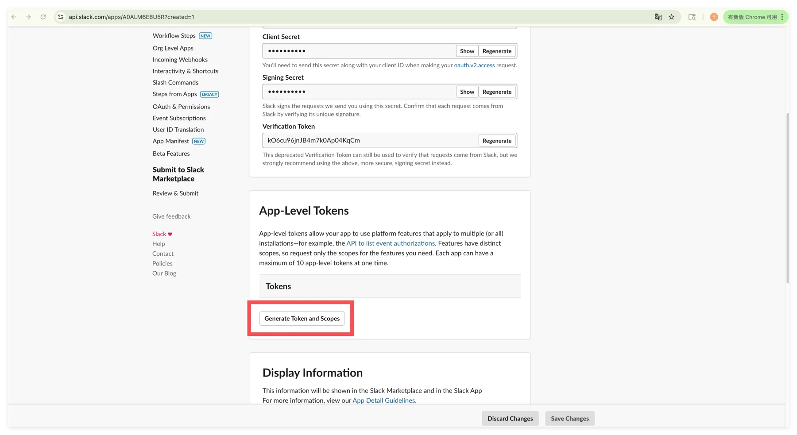

3. ป้อนชื่อโทเค็นที่จดจำได้ เช่น `HermesSocket`  
4. คลิก **เพิ่มขอบเขต**

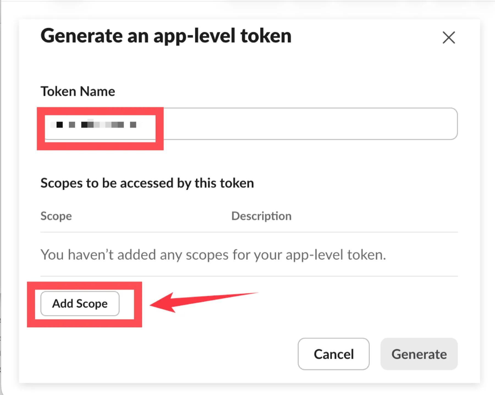

5. ค้นหาและเลือก `connections:write`

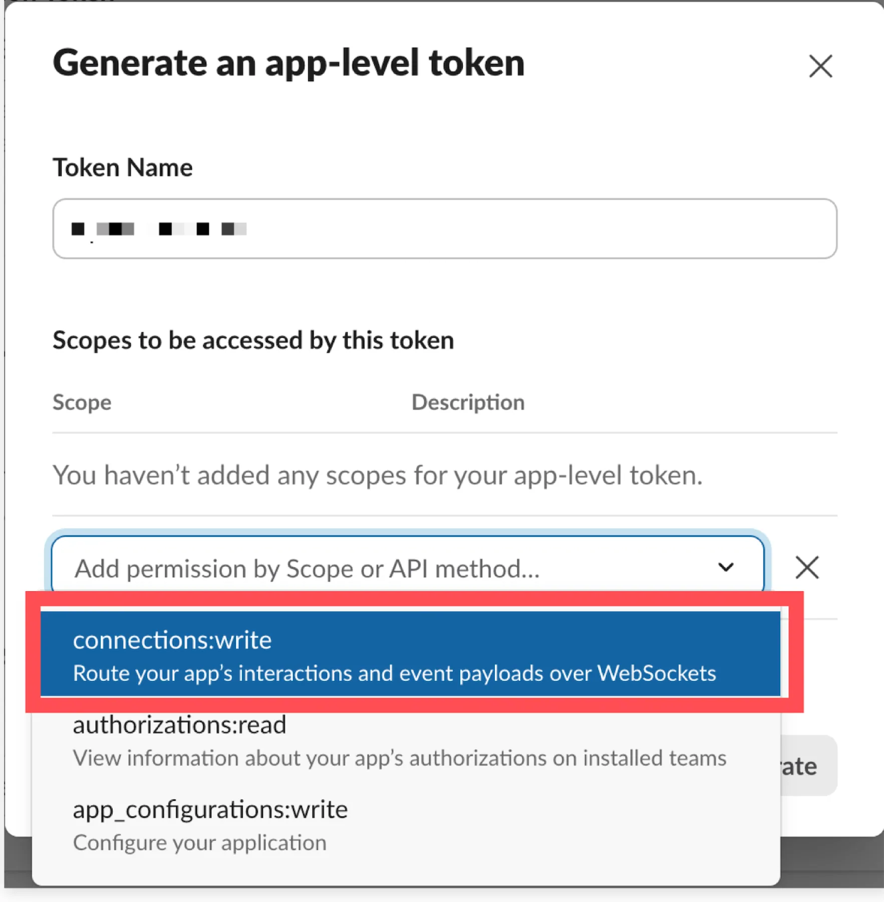

6. ยืนยันว่ามีการระบุขอบเขตแล้ว จากนั้นคลิก **สร้าง**

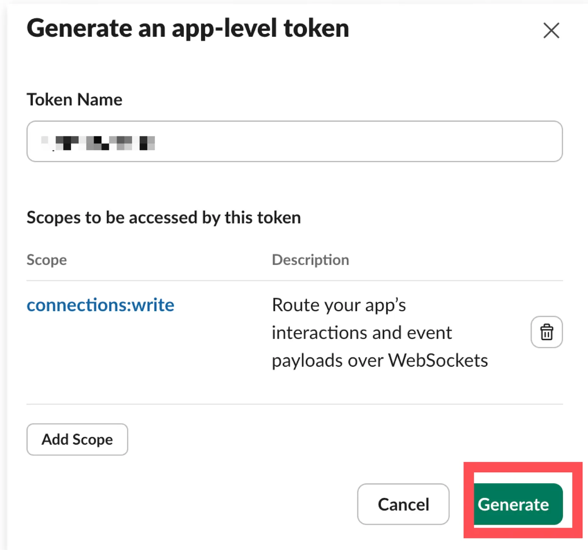

7. คัดลอกโทเค็น `xapp-...` ที่สร้างขึ้นและเก็บไว้ในที่ปลอดภัย คลิก **เสร็จสิ้น** หลังจากคัดลอกแล้ว

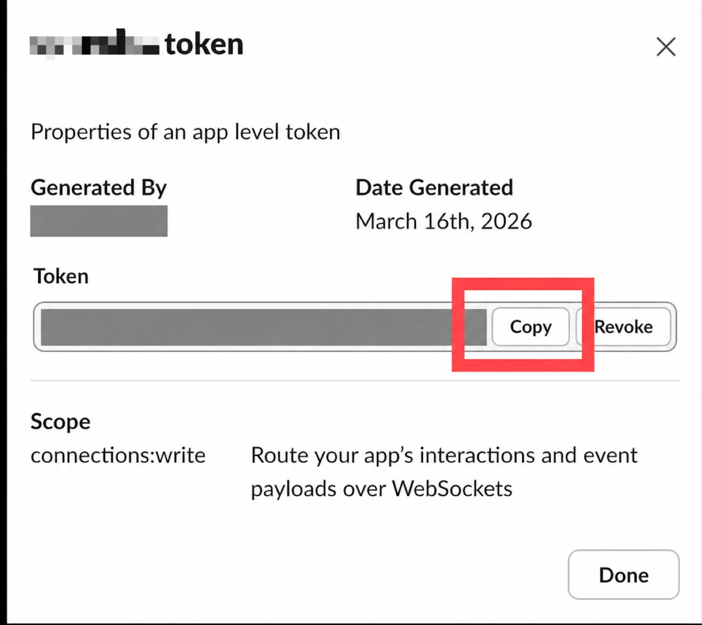

อย่านำ App Token วางในช่อง Bot Token โปรดทราบว่า Client Secret หรือ Signing Secret ไม่สามารถใช้แทนโทเค็นนี้ได้

### 4. กำหนดค่าโหมดซ็อกเก็ต, สิทธิ์, และเหตุการณ์

#### 4.1 เปิดใช้งานโหมดซ็อกเก็ต

1. เปิด **การตั้งค่า → โหมดซ็อกเก็ต**
2. เปิดใช้งาน **เปิดโหมดซ็อกเก็ต**

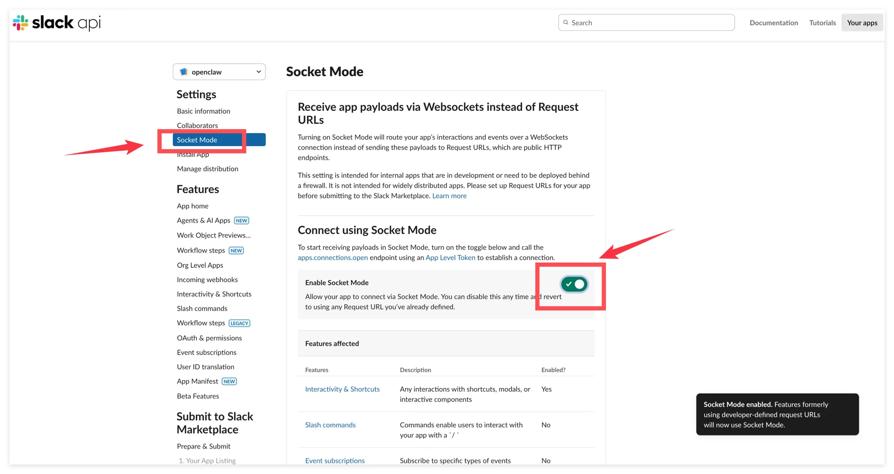

โหมดซ็อกเก็ตส่ง Slack เหตุการณ์ไปยัง Hermes เอเจนต์ผ่าน WebSocket การตั้งค่านี้ไม่จำเป็นต้องใช้ URL คำขอสมัครรับเหตุการณ์หรือ URL การเปลี่ยนเส้นทาง OAuth

#### 4.2 เพิ่มช่วงสิทธิ์ของโทเค็นบอท

1. เปิด **Features → OAuth & Permissions**
2. เลื่อนไปที่ **Scopes → Bot Token Scopes**
3. คลิก **Add an OAuth Scope**

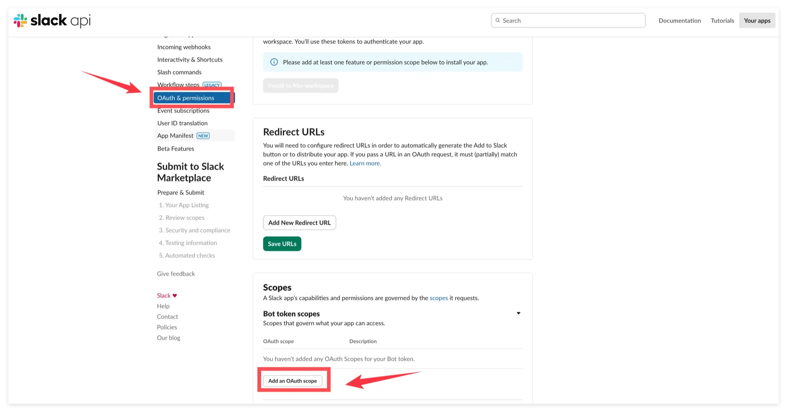

เพิ่มขอบเขตสำหรับโหมดการโต้ตอบที่คุณต้องการ:

| ขอบเขต | จำเป็นสำหรับ | วัตถุประสงค์ |
|---|---|---|
| `app_mentions:read` | การใช้ช่องทาง | รับข้อความที่กล่าวถึงบ็อต |
| `channels:read` | ช่องทางสาธารณะ | อ่านข้อมูลพื้นฐานของช่องทางสาธารณะ |
| `channels:history` | ช่องทางสาธารณะ | อ่านข้อความในช่องทางสาธารณะที่บ็อตเข้าร่วม |
| `chat:write` | การตอบกลับทั้งหมด | ส่งข้อความในฐานะบ็อต |
| `im:read` | ข้อความตรง | อ่านข้อมูลการสนทนาข้อความตรง |
| `im:history` | ข้อความตรง | อ่านข้อความตรงที่ส่งถึงบ็อต |
| `im:write` | ข้อความตรง | เปิดหรือจัดการการสนทนาข้อความตรง |
| `groups:read` | ช่องทางส่วนตัวที่เป็นทางเลือก | อ่านข้อมูลช่องทางส่วนตัว |
| `groups:history` | ช่องทางส่วนตัวที่เป็นทางเลือก | อ่านข้อความในช่องทางส่วนตัวที่บ็อตเข้าร่วม |

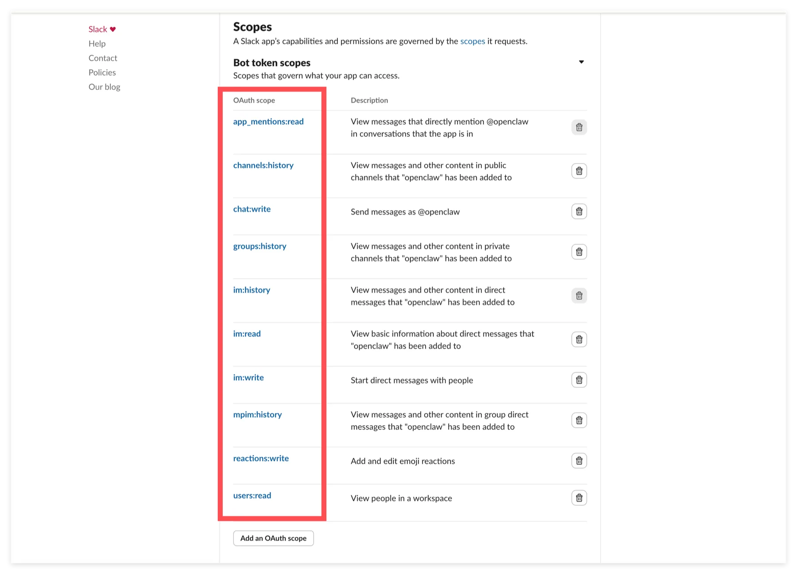

เพิ่มเพียงสองขอบเขต `groups:*` เมื่อจำเป็นต้องเข้าถึงช่องทางส่วนตัว แอปยังต้องได้รับเชิญไปยังแต่ละช่องทางเป้าหมาย

#### 4.3 เปิดใช้งานข้อความตรงใน App Home

หากผู้ใช้ควรสามารถส่งข้อความถึงเอเจนต์ Hermes โดยตรง:

1. เปิด **คุณสมบัติ → หน้าแอป**
2. เลื่อนลงไปที่ **แสดงแท็บ**
3. เปิดใช้งาน **แท็บข้อความ**
4. เปิดใช้งานตัวเลือกที่อนุญาตให้ผู้ใช้ส่งข้อความจากแท็บข้อความ

ถ้าคุณใช้การกล่าวถึงช่องทางเท่านั้น คุณสามารถข้ามส่วนนี้และละเว้นช่วง `im:*` และเหตุการณ์ `message.im` ได้

#### 4.4 สมัครรับเหตุการณ์ของบอท

1. เปิด **คุณสมบัติ → การสมัครสมาชิกเหตุการณ์**
2. เปิดใช้งาน **เปิดใช้งานเหตุการณ์**
3. ภายใต้ **สมัครสมาชิกเหตุการณ์บอท** คลิก **เพิ่มเหตุการณ์ผู้ใช้บอท**
4. เพิ่ม `app_mention` สำหรับการกล่าวถึงช่อง
5. เพิ่ม `message.im` หากเปิดใช้งานข้อความโดยตรง
6. คลิก **บันทึกการเปลี่ยนแปลง**

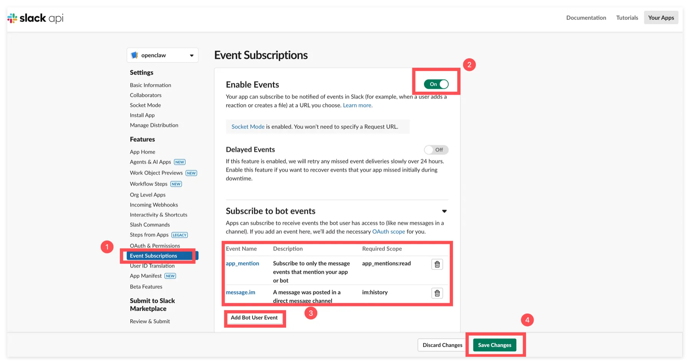

> หากคุณเปลี่ยนสโคปหรือเหตุการณ์หลังการติดตั้ง ให้กลับไปที่ **OAuth & Permissions** และคลิก **Reinstall to Workspace** สิทธิ์ใหม่จะไม่เริ่มมีผลจนกว่าจะติดตั้งแอปอีกครั้ง

### 5. ติดตั้งแอปและคัดลอกโทเค็นบอท

1. กลับไปที่ **Features → OAuth & Permissions**
2. คลิก **Install to Workspace** หากแอปติดตั้งแล้ว ให้คลิก **Reinstall to Workspace**

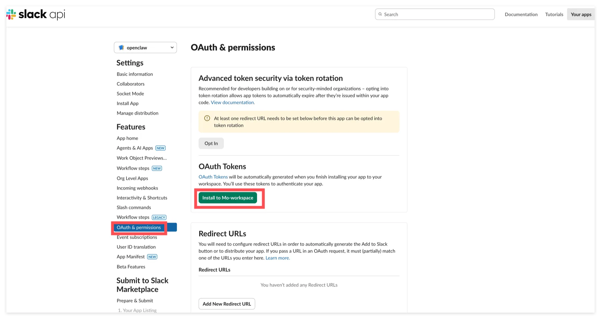

3. ตรวจสอบสิทธิ์ที่ร้องขอแล้วคลิก **อนุญาต**

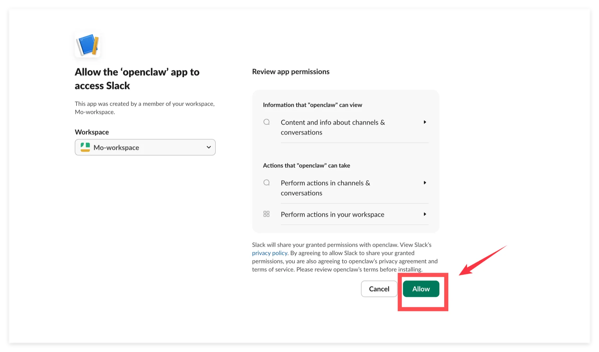

4. หลังจาก Slack กลับไปที่ **OAuth & Permissions** ให้ค้นหา **OAuth Tokens สำหรับ Workspace ของคุณ**
5. คัดลอก **Bot User OAuth Token** ที่เริ่มต้นด้วย `xoxb-`

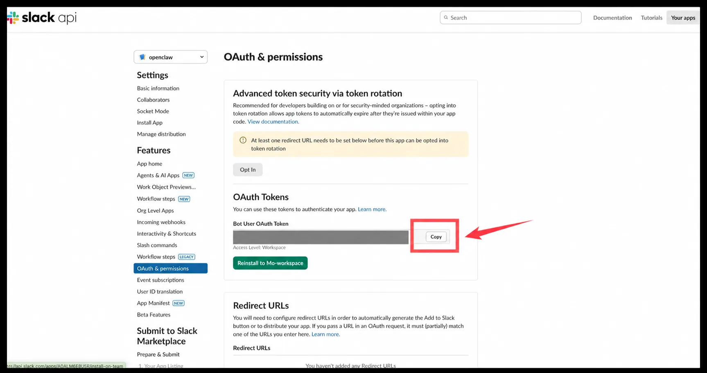

อย่าใช้ Signing Secret, Client Secret, Verification Token, หรือ `xoxp-...` User OAuth Token. LightVela ต้องการ `xapp-...` App Token หนึ่งและ `xoxb-...` Bot Token หนึ่ง

### 6. ผูก Slack ใน LightVela

1. กลับไปที่ **My Hermes → Channel → Slack**
2. วางโทเค็น `xoxb-...` ลงใน **Slack Bot Token**
3. วางโทเค็น `xapp-...` ลงใน **Slack App Token**
4. ยืนยันว่าโทเค็นอยู่ในช่องที่ถูกต้อง จากนั้นส่งการเชื่อมต่อ
5. รอให้การ์ด Slack แสดงว่าเชื่อมต่อเรียบร้อย

### 7. ทดสอบเอเจนต์ Hermes ใน Slack

#### 7.1 ทดสอบการกล่าวถึงช่องทาง

1. เปิดช่อง Slack ที่คุณต้องการใช้เอเจนต์ Hermes  
2. เชิญแอป:

```text
/invite @Hermes Agent
```

3. ส่งข้อความที่กล่าวถึงบอท:

```text
@Hermes Agent Summarize the key points discussed in this channel today.
```

บอทจะได้รับข้อความจากช่องนั้นเฉพาะหลังจากที่มันเข้าร่วมช่องนั้นแล้วเท่านั้น

#### 7.2 ทดสอบข้อความโดยตรง

1. เปิดแอปใหม่จากส่วน **แอป** ใน Slack
2. เลือกแท็บ **ข้อความ**
3. ส่งข้อความสั้น ๆ เช่น `Hello`

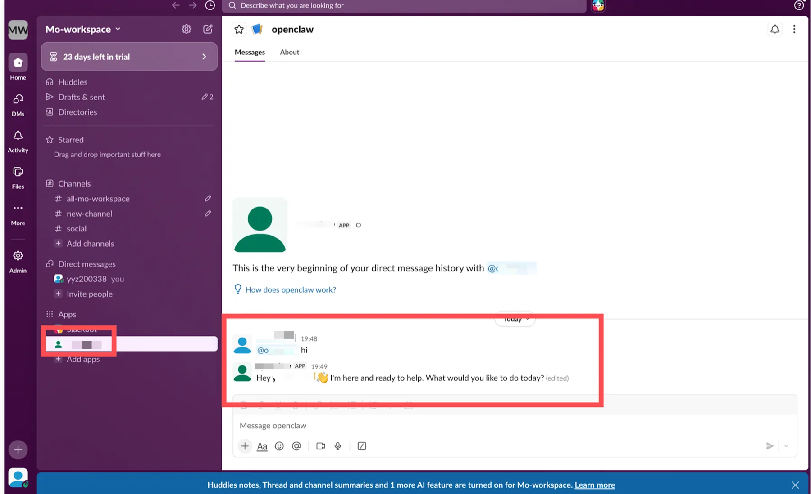

---

## สถานะสำเร็จ

การติดตั้งเสร็จสมบูรณ์เมื่อการตรวจสอบที่เกี่ยวข้องทั้งหมดผ่าน

- การ์ด Slack ใน LightVela แสดงว่าเชื่อมต่อแล้ว  
- แอป Slack ถูกติดตั้งในพื้นที่ทำงานเป้าหมาย  
- เอเจนต์ Hermes ตอบกลับการกล่าวถึงในช่องที่แอปได้เข้าร่วม  
- เมื่อเปิดใช้งานสิทธิ์ App Home และ IM เอเจนต์ Hermes ตอบกลับข้อความโดยตรง

---

## ประเภทข้อความที่รองรับ

หลังจากเชื่อมต่อ Slack ช่องทางรองรับสถานการณ์การส่งข้อความเหล่านี้:

| Slack ประเภทข้อความ | รองรับ |
|---|---|
| รับข้อความที่ถูกกล่าวถึงในช่อง | ✅ รองรับ |
| รับข้อความตรงใน App Home | ✅ รองรับ |
| ตอบกลับด้วยข้อความในช่องและข้อความตรง | ✅ รองรับ |
| ส่งข้อความเชิงรุก เช่น การแจ้งเตือนงานที่กำหนดเวลา | ✅ รองรับ |

> ℹ️ **การจัดการงานจริงขึ้นอยู่กับโมเดล**
>
> ตารางนี้อธิบายถึงการสนับสนุนการส่งข้อความระดับช่อง Slack การสรุป แปลภาษา และงานอื่น ๆ ยังคงขึ้นอยู่กับโมเดลที่ตั้งค่าไว้และทักษะที่ติดตั้ง

---

## คำถามที่พบบ่อย

| ปัญหา | สาเหตุที่เป็นไปได้ | วิธีแก้ไข |
|---|---|---|
| App Token ถูกปฏิเสธ | ประเภทโทเค็นผิดหรือขาด `connections:write` | สร้างโทเค็น `xapp-...` ใหม่ภายใต้ **ข้อมูลพื้นฐาน → App-Level Tokens** |
| Bot Token ถูกปฏิเสธ | คัดลอก User OAuth Token หรือข้อมูลประจำตัวอื่น | คัดลอก `xoxb-...` Bot User OAuth Token จาก **OAuth & Permissions** |
| Event Subscriptions ต้องการ Request URL | Socket Mode ถูกปิด | เปิด **การตั้งค่า → Socket Mode** แล้วกลับไปที่ Event Subscriptions |
| การกล่าวถึงช่องไม่ถูกส่ง | แอปไม่ได้อยู่ในช่อง, ขาดสิทธิ์ที่จำเป็น, หรือ `app_mention` ขาดอยู่ | เชิญแอป, เพิ่มสิทธิ์ของช่องและ `app_mention` จากนั้นติดตั้งแอปใหม่ |
| ข้อความตรงไม่ถูกส่ง | เปิดแท็บข้อความถูกปิด, ขาดสิทธิ์ IM, หรือ `message.im` ขาดอยู่ | เปิดแท็บข้อความ, เพิ่ม `im:*` และ `message.im` จากนั้นติดตั้งแอปใหม่ |
| สิทธิ์ใหม่ไม่ทำงาน | แอปไม่ได้ถูกติดตั้งใหม่หลังจากมีการเปลี่ยนแปลง | คลิก **ติดตั้งใหม่ในพื้นที่ทำงาน** ภายใต้ **OAuth & Permissions** |
| ช่องทางเชื่อมต่อแล้วแต่ไม่มีการตอบกลับ | โมเดลไม่พร้อมใช้งาน เครดิตไม่เพียงพอ หรือปัญหาสถานะของเอเจนต์ | ตรวจสอบ [ตั้งค่าโมเดล](./model.md), สถานะอินสแตนซ์ และเครดิตที่มีอยู่ |

---

## ขั้นตอนถัดไป

- [ปรับแต่งช่องทาง - Telegram](./channel-telegram.md) — การสนทนาส่วนตัวและการแจ้งเตือนกลุ่ม

- [กำหนดค่าช่องทาง - WhatsApp](./channel-whatsapp.md) — การสื่อสารกับผู้ใช้ระหว่างประเทศและการบริการลูกค้า

- [กำหนดค่าช่อง - Discord](./channel-discord.md) — การดำเนินงานของชุมชนและชุมชนนักพัฒนา

- [กำหนดงานที่ตั้งเวลาไว้](./automation.md) — ส่งการเตือนและผลงานที่ตั้งเวลาไว้ไปยัง Slack

- [กำหนดค่าทักษะ](./skill.md) — ขยายความสามารถของเอเจนต์Hermes
