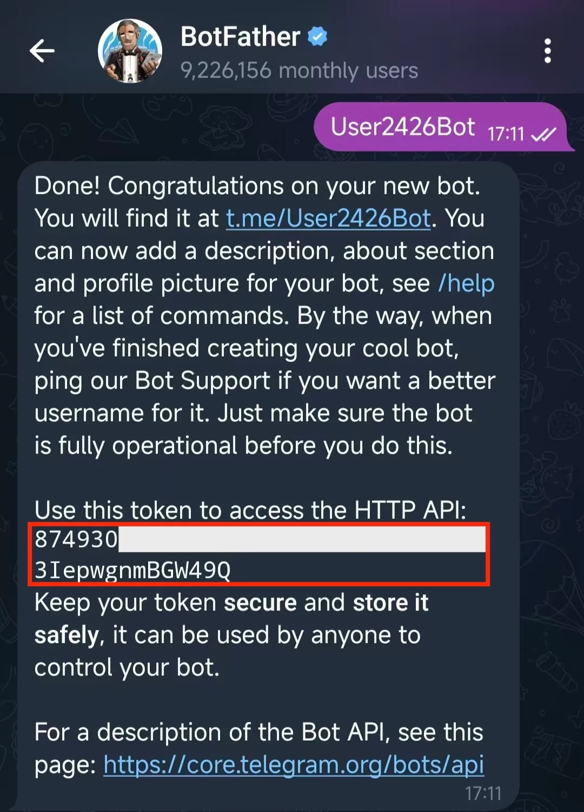
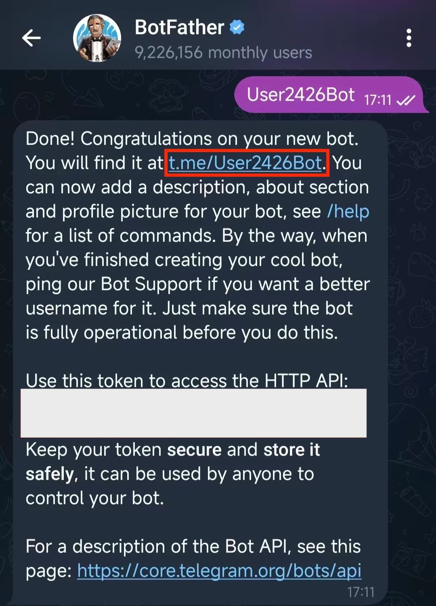

# กำหนดค่าช่อง - Telegram

## สรุป

**ช่อง Telegram เชื่อมต่อกับโทเค็นบอท ทำให้เป็นวิธีที่รวดเร็วในการนำเอเจนต์ Hermes ของคุณเข้ามาในข้อความตรง Telegram หรือกลุ่ม: สร้างบอทผ่าน BotFather ใน Telegram คัดลอกโทเค็นบอทของมัน และวางในส่วน Channels ของคอนโซล LightVela คุณจำเป็นต้องมีบัญชี Telegram และโมเดลที่ตั้งค่าแล้ว (หรือเพียงแค่เครดิตโมเดลรายเดือนที่รวมอยู่ในแผนของคุณ) โทเค็นบอทเป็นข้อมูลที่มีความอ่อนไหว — ห้ามแชร์ต่อสาธารณะ เมื่อเชื่อมต่อแล้ว เอเจนต์ใน Telegram จะมีบุคลิกและความจำระยะยาวเหมือนกับช่องทางอื่น ๆ ของคุณ**

---

ช่อง Telegram ใช้การเข้าถึง Bot Token และเหมาะสำหรับการเชื่อมต่อ Hermes Agent ไปยังแชทส่วนตัวหรือกลุ่ม Telegram ได้อย่างรวดเร็ว

## หน้านี้ครอบคลุม

- อนุญาตการเข้าถึงโดยการสแกนรหัสหรือเปิดลิงก์ใน Telegram บนโทรศัพท์ของคุณ

- กำลังแชทกับเอเจนต์ Hermes ใน Telegram


> 💡 **ข้อกำหนดเบื้องต้น**
>
> - โทรศัพท์ที่ติดตั้ง Telegram แล้ว
>
> - การ [กำหนดค่าโมเดล](./model.md) เสร็จสมบูรณ์ (หรือใช้เครดิตทดลอง 100 เครดิตที่มีมาในแผนเปิดตัว)

---

## ขั้นตอน

### 1. เข้าสู่คอนโซล

ลงชื่อเข้าใช้ LightVela คลิก "My Hermes" ที่มุมขวาบนเพื่อเข้าสู่คอนโซล และหาปุ่ม "Channel"

### 2. เลือกช่อง Telegram

ค้นหาการ์ด Telegram และคลิก "+ เชื่อมต่อ"

### 3. เปิด Telegram

1. เปิดแอป Telegram บนโทรศัพท์ของคุณ

2. ค้นหา @BotFather และเปิดแชท


3. ส่ง `/start`

4. ส่ง `/newbot`

5. ป้อนชื่อสำหรับเอเจนต์ของคุณ: ชื่อผู้ใช้ต้องไม่ซ้ำและต้องลงท้ายด้วย "bot"

6. คัดลอกโทเค็น HTTP API:




### 4. วางโทเค็น HTTP API ลงใน Telegram

วางโทเค็น HTTP API ลงในช่องโทเค็น


> ⚠️ **เก็บโทเค็นของคุณให้ปลอดภัย**
>
> เก็บโทเค็นอย่างปลอดภัย ใครก็ตามที่ได้โทเค็นสามารถควบคุมบอทของคุณได้!

### 5. แชทกับบอทใหม่ใน Telegram

คลิกที่ลิงก์ที่ BotFather ให้มาแล้วเริ่มโต้ตอบกับบอท



เปิดแชทกับบอทแล้วส่งข้อความทดสอบ:

```
Hi
```

คุณควรได้รับการตอบกลับจากเอเจนต์ Hermes ภายในไม่กี่วินาที


### 6. ตัวเลือก: เปิดใช้งานข้อความกลุ่มใน BotFather

ทำขั้นตอนที่ 6 และ 7 เท่านั้นหากคุณต้องการใช้บอทในกลุ่ม ข้อความตรงไปยังผู้ใช้สามารถใช้งานได้แล้วหลังจากขั้นตอนที่ 5

1. เปิด `@BotFather` ใน Telegram
2. ส่ง `/mybots`
3. เลือกบอทที่เชื่อมต่อกับ Hermes Agent ของคุณ
4. เปิด "การตั้งค่าบอท"
5. เลือก "ความเป็นส่วนตัวของกลุ่ม"
6. เลือก "ปิด" หรือ "ปิดโหมดความเป็นส่วนตัว"

### 7. ตัวเลือก: เพิ่มและทดสอบบอทในกลุ่ม

1. เปิดกลุ่ม Telegram ที่คุณต้องการใช้
2. เลือก "เพิ่มสมาชิก" หรือการกระทำจัดการกลุ่มที่คล้ายกัน
3. ค้นหา Bot ด้วยชื่อผู้ใช้ของมันแล้วเพิ่มเข้ากลุ่ม
4. กล่าวถึงมันด้วย `@bot_username` และส่งข้อความทดสอบ

หลังจากปิดการใช้งานความเป็นส่วนตัวของกลุ่ม บอทจะสามารถรับและตอบข้อความในกลุ่มที่มีการกล่าวถึงมันได้

---

## สถานะสำเร็จ

- รายการ "ช่องทางที่เชื่อมต่อ" ในคอนโซลมี "Telegram"

- บอทที่เกี่ยวข้องสามารถพบได้ใน Telegram รายชื่อผู้ติดต่อ

- Hermes เอเจนต์ตอบกลับหลังจากที่คุณส่งข้อความ

- Hermes เอเจนต์ตอบกลับหลังจากที่คุณกล่าวถึงบอทและส่งข้อความในกลุ่มที่บอทถูกเพิ่มเข้าไป


---

## ประเภทข้อความที่รองรับ

หลังจากการเข้าถึงสำเร็จ บอท Telegram สามารถรับและตอบข้อความข้อความพื้นฐานได้ และรองรับประเภทข้อความเพิ่มเติมดังนี้:

| ประเภทข้อความที่บอท Telegram รองรับ | รองรับ |
|---|---|
| รับข้อความตัวอักษร | ✅ รองรับ |
| รับรูปภาพและวิดีโอ | ✅ รองรับ |
| รับแฟ้ม | ✅ รองรับ |
| ตอบกลับด้วยข้อความตัวอักษร | ✅ รองรับ |
| ตอบกลับด้วยรูปภาพและวิดีโอ | ✅ รองรับ |
| ตอบกลับด้วยแฟ้ม | ✅ รองรับ |
| ส่งข้อความล่วงหน้า (เช่น การแจ้งเตือนที่ตั้งเวลาไว้) | ✅ รองรับ |

> ℹ️ **ความสามารถในการประมวลผลที่แท้จริงขึ้นอยู่กับโมเดล**
>
> ตารางด้านบนแสดงเฉพาะประเภทข้อความที่บอท Telegram รองรับในระดับช่องทางเท่านั้น ว่าภาพ ไฟล์ และงานอื่น ๆ สามารถประมวลผลได้จริงหรือไม่ก็ขึ้นอยู่กับว่าโมเดลภาษาขนาดใหญ่ที่เชื่อมต่อกับ Hermes Agent มีความสามารถที่เกี่ยวข้องหรือไม่ด้วย

---

## คำถามที่พบบ่อย

| ปัญหา | สาเหตุที่เป็นไปได้ | วิธีแก้ไข |
|---|---|---|
| BotFather ไม่สามารถสร้างบอทได้ | ชื่อบอทหรือชื่อผู้ใช้ไม่เป็นไปตามข้อกำหนดของ Telegram | ชื่อที่แสดงสามารถตั้งได้อะไรก็ได้ แต่ชื่อผู้ใช้ต้องลงท้ายด้วย `bot` เช่น `my_hermes_bot` |
| BotFather ไม่ส่งคืนโทเค็น HTTP API | กระบวนการสร้างยังไม่เสร็จสมบูรณ์ | กลับไปที่แชท BotFather รัน `/newbot` อีกครั้ง และทำตามคำแนะนำเพื่อตั้งชื่อและชื่อผู้ใช้ |
| โทเค็นแสดงว่าไม่ถูกต้องหลังจากวาง | โทเค็นไม่สมบูรณ์หรือมีช่องว่าง / การขึ้นบรรทัดเพิ่มเติม | คัดลอกโทเค็น HTTP API ทั้งหมดจาก BotFather อีกครั้งแล้ววางในช่องโทเค็น |
| ไม่มีการตอบสนองหลังจากคลิกเข้าถึง | การหน่วงของเครือข่ายหรือไม่ได้รับอนุญาต | รีเฟรชคอนโซลเพื่อตรวจสอบสถานะ; หากการเข้าถึงไม่สำเร็จ ให้ลองอีกครั้ง |
| ไม่พบบอทใน Telegram | คุณไม่ได้คลิกลิงก์ที่ BotFather ให้มา หรือไม่ได้เริ่มแชท | คลิกลิงก์ที่ BotFather ให้มา จากนั้นคลิกเริ่ม (Start) ในหน้าบอท |
| ไม่มีการตอบกลับหลังจากส่งข้อความ | โมเดลยังไม่ได้ตั้งค่า เครดิตทดลองใช้หมดแล้ว หรือบอทยังไม่ได้เชื่อมต่อสำเร็จ | ตรวจสอบสถานะ "โมเดลปัจจุบัน (Current model)" ในการ์ด "1. โมเดล (Model)" และยืนยันว่าช่อง Telegram แสดงว่าเชื่อมต่อแล้ว |
| บอทไม่สามารถรับข้อความกลุ่มได้ | ความเป็นส่วนตัวของกลุ่มยังเปิดอยู่ บอทยังไม่ได้ถูกเพิ่มเข้ากลุ่ม หรือข้อความไม่ได้เอ่ยถึงบอท | ใน BotFather ส่ง `/mybots` เลือกบอท จากนั้นเปิด "การตั้งค่าบอท (Bot Settings)" → "ความเป็นส่วนตัวของกลุ่ม (Group Privacy)" แล้วปิดโหมดความเป็นส่วนตัว เพิ่มบอทเข้ากลุ่มแล้วส่งข้อความทดสอบโดยใช้ `@bot_username` |
| วิธีการยกเลิกการเชื่อมโยง | — | ลบระเบียน Telegram ที่สอดคล้องกันในรายการ "ช่องทางที่เชื่อมต่อ (Connected channels)" |
| บอท Telegram เดียวกันสามารถเชื่อมต่อกับหลายอินสแตนซ์ Hermes Agent ได้หรือไม่ | ไม่แนะนำ; โทเค็นบอทหนึ่งตัวควรถูกผูกกับหนึ่ง Hermes Agent | หากคุณต้องการหลายอินสแตนซ์ Hermes Agent ให้สร้างบอท Telegram แยกต่างหาก |

---

## หมายเหตุช่อง

- **ประเภทข้อความ**: รองรับข้อความ รูปภาพ วิดีโอ ไฟล์ ข้อความเสียง และอื่นๆ ดู "ประเภทข้อความที่รองรับ" ข้างต้น

- **การสนับสนุนแชทกลุ่ม**: ข้อความในกลุ่มสามารถใช้งานได้หลังจากคุณปิดการตั้งค่าความเป็นส่วนตัวของกลุ่มใน BotFather เพิ่มบอทในกลุ่ม และเริ่มการสนทนาด้วย `@bot_username`

- **การขาดการเชื่อมต่อ**: ระยะเวลานานที่ไม่มีการตอบสนองอาจบ่งชี้ว่าการอนุญาตถูกยกเลิก กลับไปที่คอนโซลและอนุญาตการเข้าถึงอีกครั้ง

---

## ขั้นตอนถัดไป

- [กำหนดค่าช่องทาง - WhatsApp](./channel-whatsapp.md) — การสื่อสารกับผู้ใช้ระหว่างประเทศและการบริการลูกค้า

- [กำหนดค่าช่อง - Discord](./channel-discord.md) — การดำเนินงานของชุมชนและชุมชนนักพัฒนา

- [กำหนดค่าช่องทาง - Slack](./channel-slack.md) — การทำงานร่วมกันของทีม การแจ้งเตือนในพื้นที่ทำงาน และเวิร์กโฟลว์ของช่องทาง

- [กำหนดค่าช่อง - QQ](./channel-qq.md) — บอทสร้างขึ้นด้วยตนเอง, รวมผ่าน AppID/AppSecret

- [กำหนดค่าทักษะ](./skill.md) — ขยายความสามารถของเอเจนต์Hermes
