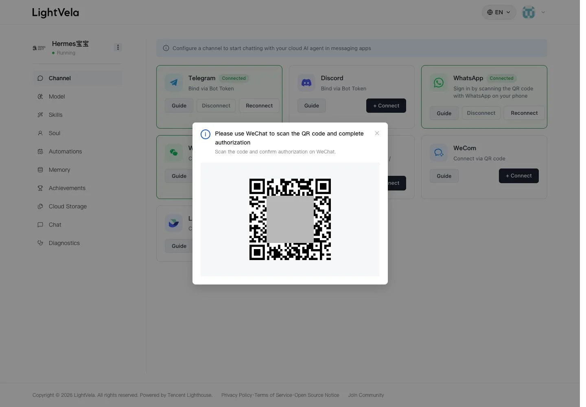

# กำหนดค่าช่อง - WeChat

## สรุป

**ช่อง WeChat เชื่อมต่อโดยใช้รหัส QR และเป็นช่องที่ตั้งค่าที่ง่ายที่สุดในบรรดาทั้งหมด: เลือก WeChat ในส่วน Channels ของคอนโซล คลิกเพื่ออนุญาตและสร้างรหัส QR จากนั้นสแกนมันด้วย WeChat บนโทรศัพท์ของคุณเพื่อเริ่มสนทนา คุณต้องมีเพียงสองสิ่ง — โทรศัพท์ที่ติดตั้ง WeChat และโมเดลที่ตั้งค่าเรียบร้อยแล้ว (หรือเพียงแค่เครดิตโมเดลรายเดือนที่รวมอยู่ในแผนของคุณ) เอเจนต์เพียงหนึ่งคนสามารถเชื่อมต่อกับหลายช่องพร้อมกันได้ และพวกเขาทั้งหมดใช้บุคลิกและความจำระยะยาวเดียวกัน**

---

ช่อง WeChat ใช้การเข้าถึงแบบรหัส QR และเป็นช่องที่ง่ายที่สุดในการตั้งค่า

## หน้านี้ครอบคลุม

- กำลังสร้างรหัส QR แบบเข้าถึง WeChat ใน LightVela
    
- สแกนรหัส QR ด้วย WeChat บนโทรศัพท์ของคุณ
    
- กำลังแชทกับเอเจนต์ Hermes ใน WeChat
    

> 💡 **ข้อกำหนดเบื้องต้น**
> 
> - โทรศัพท์ที่ติดตั้ง WeChat แล้ว
> 
> - ทำการ [ตั้งค่าโมเดล](./model.md) ให้ครบถ้วน (หรือใช้เครดิตทดลอง 100 เครดิตที่รวมอยู่ในแผนเปิดตัว)

---

## ขั้นตอน

### 1. เข้าสู่คอนโซล

ลงชื่อเข้าใช้ LightVela คลิก "My Hermes" ที่มุมขวาบนเพื่อเข้าสู่คอนโซล และหาปุ่ม "Channel"

### 2. เลือกช่อง WeChat

คลิกที่เมนูแบบเลื่อนลงและเลือก "WeChat" การแนะนำช่อง WeChat และลิงก์ "ดูรายละเอียด" จะปรากฏด้านล่าง

### 3. คลิก "อนุญาตการเข้าถึง"

รหัส QR ปรากฏบนหน้า



> ⚠️ **รหัส QR หมดอายุ**
>
> รหัส QR จะหมดอายุหลังจากไม่กี่นาที หากหมดอายุ ให้ปิดหน้าต่างและคลิก "อนุญาตการเข้าถึง" อีกครั้งเพื่อสร้างรหัส QR ใหม่

### 4. สแกนด้วย WeChat บนโทรศัพท์ของคุณ

1. เปิด WeChat บนโทรศัพท์ของคุณ
    
2. แตะ "+" ที่มุมขวาบน → "สแกน"
    
3. สแกนรหัส QR บนหน้าจอคอมพิวเตอร์ของคุณ
    
4. ทำตามคำแนะนำบนโทรศัพท์ของคุณเพื่อทำการอนุมัติให้เสร็จสมบูรณ์
    

### 5. ค้นหา Hermes เอเจนต์ใน WeChat

หลังจากการสแกนสำเร็จ:

- กล่องโต้ตอบจะปิดโดยอัตโนมัติ และบันทึก "WeChat" จะถูกเพิ่มไปยังรายการ "ช่องที่เชื่อมต่อ" ในคอนโซล
    
- WeChat เพิ่มบัญชีบอทโดยอัตโนมัติ
    

เปิดแชทกับบอทนั้นและส่งข้อความทดสอบ:

```
Hi
```

คุณควรได้รับการตอบกลับจากเอเจนต์ Hermes ภายในไม่กี่วินาที


---

## สถานะสำเร็จ

- รายการ "ช่องทางที่เชื่อมต่อ" ในคอนโซลมี "WeChat"
    
- บอทที่เกี่ยวข้องสามารถพบได้ใน WeChat รายชื่อผู้ติดต่อ
    
- Hermes เอเจนต์ตอบกลับหลังจากที่คุณส่งข้อความ
    

---

## ประเภทข้อความที่รองรับ

หลังจากการเข้าถึงสำเร็จ บอท WeChat สามารถรับและตอบข้อความข้อความพื้นฐานได้ และรองรับประเภทข้อความเพิ่มเติมดังนี้:

| ประเภทข้อความที่บอท WeChat รองรับ | รองรับ |
|---|---|
| รับข้อความตัวอักษร | ✅ รองรับ |
| รับรูปภาพและวิดีโอ | ✅ รองรับ |
| รับไฟล์ | ✅ รองรับ |
| รับข้อความเสียง | ✅ รองรับ |
| ตอบกลับด้วยข้อความตัวอักษร | ✅ รองรับ |
| ตอบกลับด้วยรูปภาพและวิดีโอ | ✅ รองรับ |
| ตอบกลับด้วยไฟล์ | ✅ รองรับ |
| ส่งข้อความเชิงรุก (เช่น การแจ้งเตือนตามกำหนดเวลา) | ✅ รองรับ |

> ℹ️ **ความสามารถในการประมวลผลจริงขึ้นอยู่กับโมเดล**
> 
> ตารางด้านบนแสดงเพียงประเภทข้อความที่บอท WeChat รองรับในระดับช่องทางเท่านั้น ว่าภาพ ไฟล์ และงานอื่น ๆ สามารถประมวลผลได้จริงหรือไม่นั้น ขึ้นอยู่กับว่าโมเดลภาษาขนาดใหญ่ที่เชื่อมต่อกับ Hermes Agent มีความสามารถที่เกี่ยวข้องหรือไม่ด้วย

---

## คำถามที่พบบ่อย

| ปัญหา | สาเหตุที่เป็นไปได้ | วิธีแก้ไข |
|---|---|---|
| WeChat แสดง "รหัส QR ไม่ถูกต้อง" หลังจากสแกน | รหัส QR หมดอายุแล้ว | ปิดกล่องโต้ตอบแล้วคลิก "อนุญาตการเข้าถึง" อีกครั้ง |
| ไม่มีการตอบสนองบนคอมพิวเตอร์หลังจากสแกน | เครือข่ายช้าหรือการอนุญาตยังไม่เสร็จสมบูรณ์ | รีเฟรชคอนโซลเพื่อยืนยันสถานะ; หากการเข้าถึงไม่สำเร็จ ให้ลองอีกครั้ง |
| ไม่สามารถหาบัญชีบอทใน WeChat ได้ | ข้อความถูกพับไปใน "การแจ้งเตือนบริการ" | ค้นหา "LightVela" หรือชื่อ Hermes Agent ที่ด้านบนของ WeChat |
| ไม่มีการตอบกลับหลังจากส่งข้อความ | โมเดลยังไม่ได้ตั้งค่าหรือเครดิตทดลองใช้หมดแล้ว | ตรวจสอบสถานะ "โมเดลปัจจุบัน" ในบัตร "1. โมเดล" |
| วิธีการยกเลิกการเชื่อมต่อ | — | ลบระเบียนที่เกี่ยวข้องในรายการ "ช่องทางที่เชื่อมต่อ" |
| สามารถใช้บัญชี WeChat เดียวเชื่อมต่อกับหลาย Hermes Agent ได้หรือไม่ | แผนเปิดตัวจำกัด 1 Hermes Agent | ไม่สามารถใช้ได้ |

---

## หมายเหตุช่อง

- **ประเภทข้อความ**: รองรับข้อความ รูปภาพ วิดีโอ ไฟล์ ข้อความเสียง และอื่นๆ ดู "ประเภทข้อความที่รองรับ" ข้างต้น
    
- **การสนับสนุนแชทกลุ่ม**: ปัจจุบันยังไม่รองรับการสนทนากลุ่ม; รองรับเฉพาะการสนทนาแบบตัวต่อตัวเท่านั้น
    
- **การขาดการเชื่อมต่อ**: ระยะเวลานานที่ไม่มีการตอบสนองอาจบ่งชี้ว่าการอนุญาตถูกยกเลิก กลับไปที่คอนโซลและอนุญาตการเข้าถึงอีกครั้ง
    

---

## ขั้นตอนถัดไป

- [กำหนดค่าช่องทาง - Telegram](./channel-telegram.md) — การแจ้งเตือนแบบเบาและการสื่อสารข้ามแพลตฟอร์ม

- [กำหนดค่าช่องทาง - WhatsApp](./channel-whatsapp.md) — การสื่อสารกับผู้ใช้ระหว่างประเทศและการบริการลูกค้า

- [กำหนดค่าช่อง - Discord](./channel-discord.md) — การดำเนินงานของชุมชนและชุมชนนักพัฒนา

- [กำหนดค่าช่องทาง - Slack](./channel-slack.md) — การทำงานร่วมกันของทีม การแจ้งเตือนในพื้นที่ทำงาน และเวิร์กโฟลว์ของช่องทาง

- [กำหนดค่าทักษะ](./skill.md) — ขยายความสามารถของเอเจนต์Hermes
