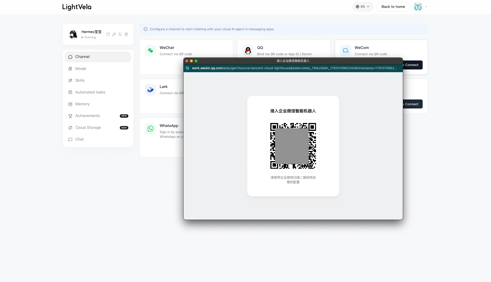
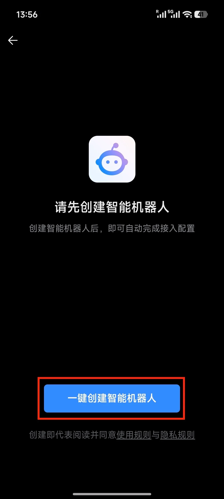
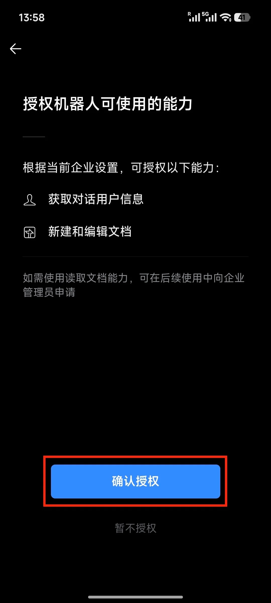
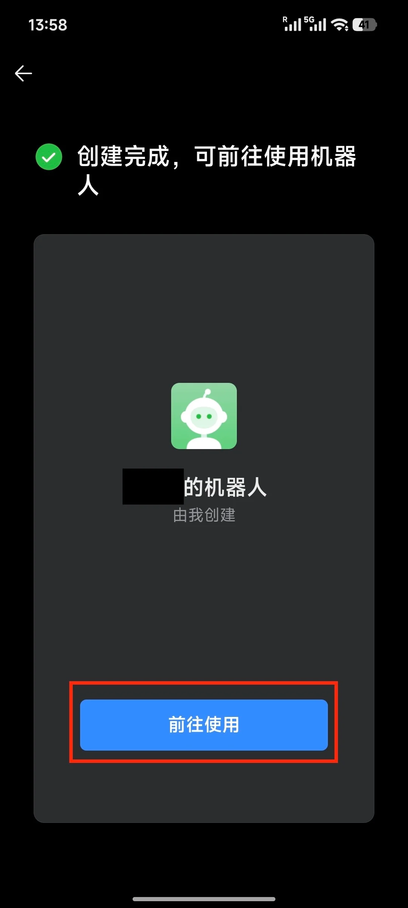
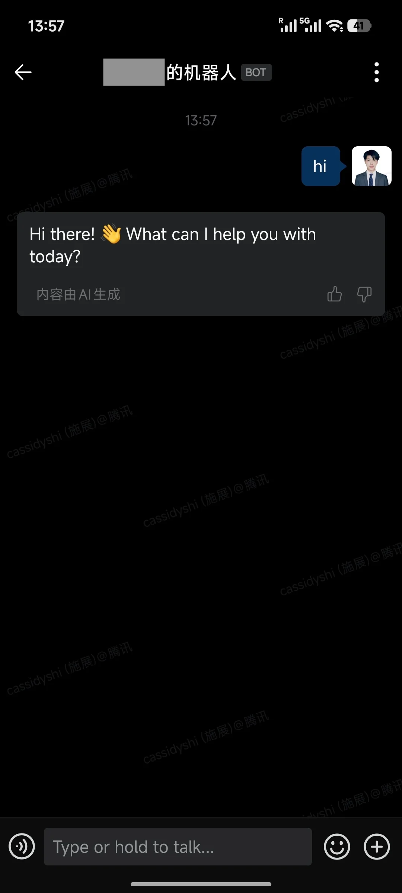

# กำหนดค่าช่อง - WeCom

## สรุป

**ช่อง WeCom เชื่อมต่อผ่านรหัส QR และเป็นช่องที่ง่ายต่อการตั้งค่าเช่นเดียวกับ WeChat — เหมาะอย่างยิ่งสำหรับการใช้ Hermes Agent ในที่ทำงานขององค์กร: เลือก WeCom ในส่วน Channels ของคอนโซล คลิกเพื่ออนุมัติและสร้างรหัส QR จากนั้นสแกนด้วย WeCom บนโทรศัพท์ของคุณเพื่อเริ่มการสนทนา คุณจะต้องมีโทรศัพท์ที่ติดตั้ง WeCom และมีโมเดลที่ตั้งค่าไว้แล้ว (หรือใช้เครดิตโมเดลรายเดือนที่รวมอยู่ในแผนของคุณ) หนึ่งเอเจนต์สามารถเชื่อมต่อกับหลายช่องพร้อมกันได้ โดยใช้บุคลิกและความทรงจำระยะยาวเดียวกัน**

---

ช่อง WeCom ใช้การเข้าถึงแบบรหัส QR และเป็นช่องที่ง่ายที่สุดในการตั้งค่า

## หน้านี้ครอบคลุม

- กำลังสร้างรหัส QR แบบเข้าถึง WeCom ใน LightVela

- สแกนรหัส QR ด้วย WeCom บนโทรศัพท์ของคุณ

- กำลังแชทกับเอเจนต์ Hermes ใน WeCom


> 💡 **ข้อกำหนดเบื้องต้น**
>
> - โทรศัพท์ที่ติดตั้ง WeCom แล้ว
>
> - การ [กำหนดค่าโมเดล](./model.md) เสร็จสมบูรณ์ (หรือต้องการใช้เครดิตทดลอง 100 เครดิตที่รวมในแผน Launch)

---

## ขั้นตอน

### 1. เข้าสู่คอนโซล

ลงชื่อเข้าใช้ LightVela คลิก "My Hermes" ที่มุมขวาบนเพื่อเข้าสู่คอนโซล และหาปุ่ม "Channel"

### 2. เลือกช่อง WeCom

ค้นหาโมดูล WeCom และคลิก "+ เชื่อมต่อ"

### 3. คลิก "อนุญาตการเข้าถึง"

รหัส QR ปรากฏบนหน้า



> ⚠️ **รหัส QR หมดอายุ**
>
> รหัส QR จะหมดอายุหลังจากไม่กี่นาที หากหมดอายุแล้ว ให้ปิดหน้าต่างและคลิก "อนุญาตการเข้าถึง" อีกครั้งเพื่อสร้างรหัส QR ใหม่

### 4. สแกนด้วย WeCom บนโทรศัพท์ของคุณ

1. เปิด WeCom บนโทรศัพท์ของคุณ

2. แตะ "+" ที่มุมขวาบน → "สแกน"

3. สแกนรหัส QR บนหน้าจอคอมพิวเตอร์ของคุณ




4. ทำตามคำแนะนำบนโทรศัพท์ของคุณเพื่อทำการอนุมัติให้เสร็จสมบูรณ์





### 5. แชทกับบอทที่สร้างขึ้น

หลังจากการสแกนสำเร็จ:

- กล่องโต้ตอบจะปิดโดยอัตโนมัติและคุณจะถูกนำไปที่หน้าบอทที่สร้างขึ้น

- WeCom จะเพิ่มบอทไปยังรายชื่อผู้ติดต่อของคุณโดยอัตโนมัติ


เปิดหน้าต่างแชทของบอทแล้วส่งข้อความทดสอบ:

```
Hello
```

คุณจะได้รับการตอบกลับจาก Hermes เอเจนต์ภายในไม่กี่วินาที



---

## สถานะสำเร็จ

- มีรายการ "WeCom" ปรากฏในรายการ "ช่องที่เชื่อมต่อ" ของคอนโซล

- คุณสามารถหาบอทได้ในรายชื่อผู้ติดต่อ WeCom ของคุณ

- การส่งข้อความจะได้รับการตอบกลับจากเอเจนต์ Hermes


---

## ประเภทข้อความที่รองรับ

หลังจากการรวม ระบบบอท WeCom รองรับมากกว่าข้อความพื้นฐาน รายการทั้งหมด:

| WeCom บอท — ประเภทข้อความที่รองรับ | รองรับ |
| --- | --- |
| รับข้อความตัวอักษร | ✅ ใช่ |
| รับภาพ/วิดีโอ | ✅ ใช่ |
| รับไฟล์ | ✅ ใช่ |
| รับข้อความเสียง | ✅ ใช่ |
| ตอบกลับด้วยข้อความตัวอักษร | ✅ ใช่ |
| ตอบกลับด้วยภาพ/วิดีโอ | ✅ ใช่ |
| ตอบกลับด้วยไฟล์ | ✅ ใช่ |
| ส่งข้อความโดย主动 (เช่น การแจ้งเตือนตามกำหนด) | ✅ ใช่ |

> ℹ️ **ความสามารถที่แท้จริงขึ้นอยู่กับโมเดล**
>
> ตารางด้านบนสะท้อนเฉพาะสิ่งที่บอท WeCom สามารถรับและตอบกลับในระดับช่องสัญญาณเท่านั้น ว่างานต่าง ๆ เช่น การประมวลผลภาพ / ไฟล์สามารถทำงานได้จริงหรือไม่ขึ้นอยู่กับว่า LLM พื้นฐานที่เชื่อมต่อกับ Hermes Agent รองรับความสามารถเหล่านั้นหรือไม่

---

## คำถามที่พบบ่อย

| อาการ | สาเหตุที่เป็นไปได้ | การแก้ไข |
| --- | --- | --- |
| WeCom แสดง "รหัส QR ไม่ถูกต้อง" หลังจากสแกน | รหัส QR หมดอายุแล้ว | ปิดหน้าต่างและคลิก "อนุญาตการเข้าถึง" อีกครั้ง |
| ไม่มีการตอบสนองบนเดสก์ท็อปหลังจากสแกน | เครือข่ายล่าช้าหรือการอนุญาตยังไม่เสร็จสิ้น | รีเฟรชหน้าแผงควบคุมเพื่อตรวจสอบสถานะ; หากยังไม่เชื่อมต่อ ให้ลองอีกครั้ง |
| ไม่พบผู้ติดต่อบอทใน WeCom | ข้อความถูกซ่อนภายใต้ "การแจ้งเตือนบริการ" | ค้นหา "LightVela" หรือชื่อ Hermes Agent ของคุณจากด้านบนของ WeCom |
| ไม่มีการตอบกลับหลังจากส่งข้อความ | โมเดลไม่ได้ถูกตั้งค่าหรือเครดิตทดลองหมด | ตรวจสอบสถานะ "โมเดลปัจจุบัน" บนการ์ด "1. โมเดล" |
| วิธีตัดการเชื่อมต่อ | — | ลบรายการออกจากรายการ "ช่องทางที่เชื่อมต่อ" |
| บัญชี WeCom เดียวสามารถเชื่อมต่อกับหลาย Hermes Agent ได้หรือไม่ | แผน Launch จำกัดคุณไว้ที่ 1 Hermes Agent | ไม่ใช้ได้ |

---

## หมายเหตุช่อง

- **ประเภทข้อความ**: ข้อความ รูปภาพ วิดีโอ ไฟล์ เสียง และอื่น ๆ — ดู "ประเภทข้อความที่รองรับ" ข้างต้น

- **การสนับสนุนแชทกลุ่ม**: ปัจจุบันยังไม่รองรับการแชทกลุ่ม ใช้งานได้เฉพาะการสนทนาแบบตัวต่อตัวเท่านั้น

- **การเชื่อมต่อตัดขาด**: ช่วงเวลาที่ไม่ตอบสนองนานมักหมายความว่าการอนุญาตถูกเพิกถอน — ให้ทำการอนุญาตใหม่จากคอนโซล


---

## ขั้นตอนถัดไป

- [ตั้งค่าช่องทาง - Lark](./channel-feishu.md) — สถานการณ์ในสำนักงานที่มีข้อความรูปแบบและการสนทนากลุ่ม

- [กำหนดค่าทักษะ](./skill.md) — ขยายความสามารถของเอเจนต์Hermes
