# DeepSeek Harness

## สรุป

**DeepSeek Harness เป็นกรอบงานเอเจนต์ AI ที่เน้นปลั๊กอินซึ่งคุณสามารถติดตั้งควบคู่กับ Hermes Agent ใน LightVela หน้า Labs จัดการการติดตั้ง สถานะ การรีสตาร์ท การเข้าถึง WebUI คีย์ผู้ให้บริการโมเดลที่รองรับ และโปรไฟล์กับ SkillHub โดยไม่เปลี่ยนแปลงการกำหนดค่า Hermes ช่องทาง ทักษะ หรือความจำที่มีอยู่ของคุณ สำหรับการตั้งค่าผู้ให้บริการโมเดลที่ใช้โดย Hermes Agent ดู [การกำหนดค่าโมเดล](./model.md).**

ประกาศเวอร์ชันทดลอง: DeepSeek Harness เป็นฟีเจอร์ Labs ที่เปิดให้เข้าถึงก่อนใคร อาจมีการอัปเดตที่มีผลต่อความเข้ากันได้เมื่อกรอบการทำงานต้นน้ำและระบบปลั๊กอินของมันมีการพัฒนา

## DeepSeek Harness เพิ่มอะไร

DeepSeek Harness (DSH) เป็นกรอบงานเอเจนต์โอเพนซอร์สที่มอบสภาพแวดล้อมและเครื่องมือที่โมเดล AI ต้องการเพื่อทำงานในงานจริง
ใน LightVela, DSH ทำงานเป็นสภาพแวดล้อมที่จัดการแยกต่างหากควบคู่ไปกับ Hermes Agent ซึ่งคุณสามารถทำงานกับไฟล์โครงการ ใช้เครื่องมือและทักษะ จัดการเซสชัน และโต้ตอบกับเอเจนต์ผ่าน WebUI ของมันได้

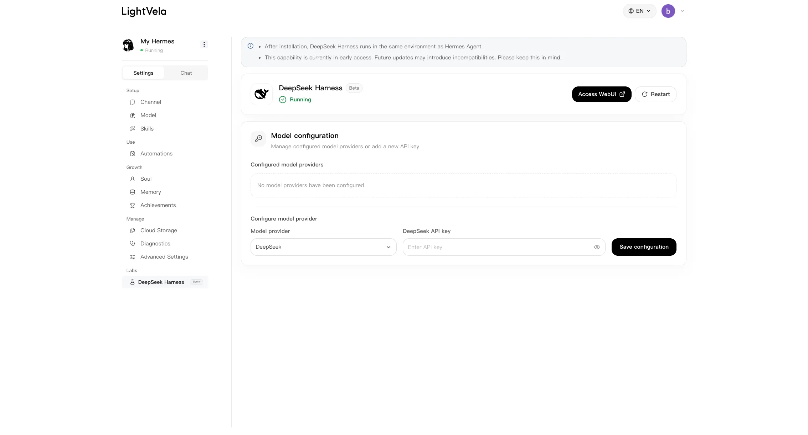

LightVela ให้จุดเริ่มต้นที่มีการจัดการสำหรับ DSH  
คุณไม่จำเป็นต้องติดตั้งแพ็กเกจด้วยตนเอง กำหนดค่าที่อยู่เซิร์ฟเวอร์สาธารณะ หรือใช้งานบริการ DSH จากเทอร์มินัล  
จากหน้าของ "DeepSeek Harness" ใน Labs คุณสามารถติดตั้ง runtime ที่มีการจัดการ ตรวจสอบว่าสุขภาพดีหรือไม่ กำหนดค่าผู้ให้บริการโมเดลที่ได้รับอนุมัติ เปิด WebUI เฉพาะตัวอย่าง และรีสตาร์ท DSH เมื่อจำเป็น

## ติดตั้ง DeepSeek Harness

1. เปิด [LightVela Agents](https://lightvela.ai/agents/). 
2. ในเมนูนำทางด้านซ้าย ไปที่ Labs และเลือก DeepSeek Harness. 
3. ตรวจสอบประกาศ Beta และเลือก ติดตั้งและลองใช้ตอนนี้. 
4. เก็บหน้านี้ไว้ในขณะที่การติดตั้งดำเนินอยู่ การติดตั้งปกติมักใช้เวลาประมาณหนึ่งถึงสามนาที.

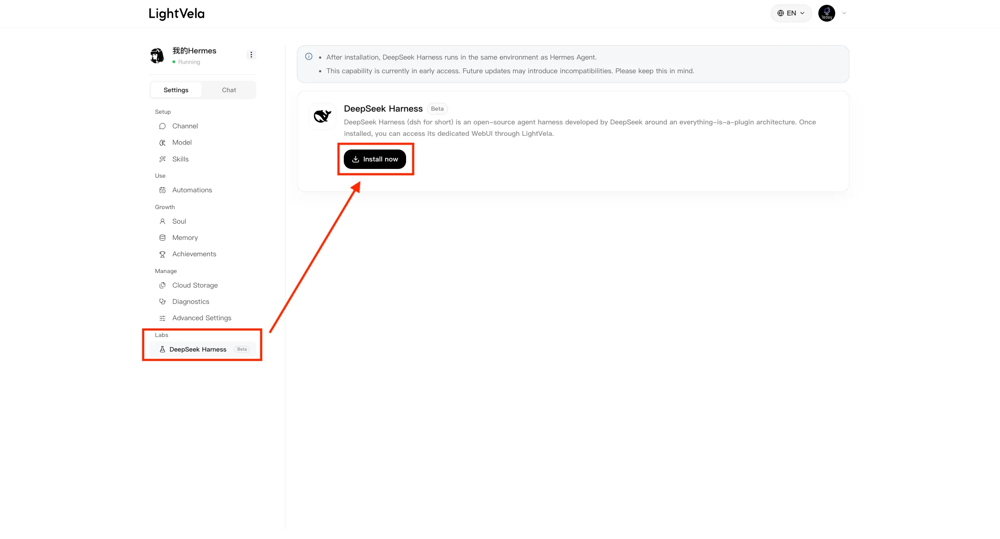

## การกำหนดค่าผู้ให้บริการโมเดล

หลังจากติดตั้ง DeepSeek Harness แล้ว การ์ดการกำหนดค่าโมเดลจะสามารถใช้งานได้ด้านล่างการ์ด DSH หลัก สำหรับไซต์ทั่วโลก รายชื่อผู้ให้บริการที่ได้รับการอนุมัติในปัจจุบันได้แก่:

- DeepSeek
- MiniMax
- MiniMax China
- Moonshot AI
- Moonshot AI China
- OpenRouter
- Anthropic
- Groq
- OpenAI

เพื่อเพิ่มผู้ให้บริการ:

1. เลือกผู้ให้บริการจากรายการผู้ให้บริการ
2. วางคีย์ API ของผู้ให้บริการลงในช่องคีย์ API
3. เลือก บันทึก
4. ยืนยันว่าผู้ให้บริการปรากฏในรายการผู้ให้บริการที่กำหนดค่าแล้ว

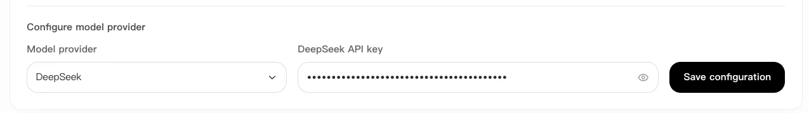

ในการลบผู้ให้บริการ ให้เลือกการดำเนินการลบของผู้ให้บริการนั้นและยืนยันการลบ หลังจากการลบ คุณสามารถเพิ่มผู้ให้บริการเดียวกันอีกครั้งในภายหลังด้วยคีย์ API ใหม่

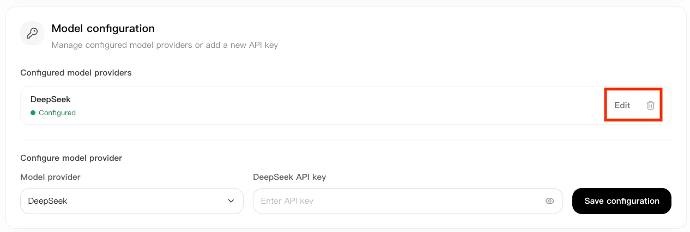

## เปิด DeepSeek Harness WebUI

เมื่อสถานะบริการกำลังทำงาน ให้เลือก เข้าถึง WebUI จากการ์ด DeepSeek Harness

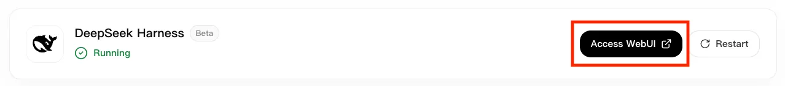

LightVela มีโดเมนการเข้าถึงเฉพาะและการตรวจสอบตัวตนในตัวสำหรับ DeepSeek Harness WebUI เพื่อให้แน่ใจว่า WebUI ของคุณสามารถเข้าถึงได้เฉพาะคุณเท่านั้น  
เมื่อยืนยันตัวตนแล้ว คุณสามารถเปิด WebUI สำหรับอินสแตนซ์ Agent ปัจจุบันของคุณและเริ่มต้นด้วยการทดสอบง่าย ๆ โดยใช้ผู้ให้บริการที่คุณได้ตั้งค่าไว้แล้ว  
หากคุณต้องการทดสอบ Agent Hermes ที่มีอยู่แยกต่างหาก ให้ใช้ [Chat](./agent-chat.md)

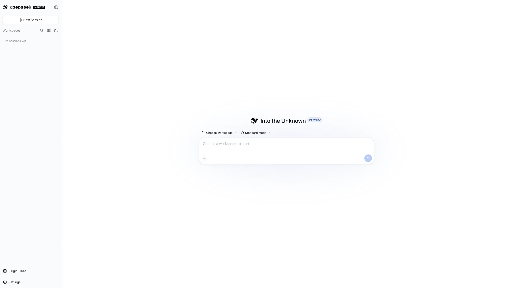

## ทำความเข้าใจปลั๊กอิน

DeepSeek Harness ใช้สถาปัตยกรรมแบบปลั๊กอินเป็นหลัก
ปลั๊กอินจะให้ความสามารถหรือการรวมเข้ากับโปรไฟล์ DSH เช่น แคตตาล็อกทักษะ ตัวเชื่อมต่อการส่งข้อความ หรือองค์ประกอบรันไทม์อื่น ๆ
คุณสามารถเยี่ยมชม Plugin Plaza ได้โดยคลิกที่ Plugin Plaza ที่มุมล่างซ้ายของหน้าของคุณใน DSH

### การติดตั้งและการใช้ปลั๊กอิน

จาก Plugin Plaza คุณสามารถสำรวจความสามารถเพิ่มเติมสำหรับสภาพแวดล้อม DeepSeek Harness ของคุณ เช่น เครื่องมือเบราว์เซอร์ หน่วยความจำ ระบบอัตโนมัติ การปรับปรุง UI และการรวมภายนอก

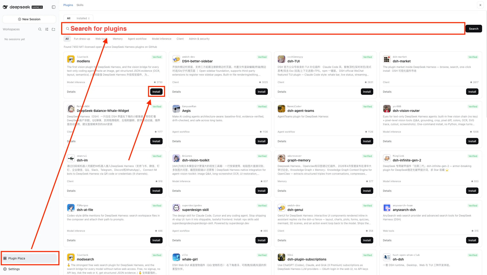

เปิดปลั๊กอินเพื่อดูว่ามันเพิ่มอะไร จากนั้นติดตั้งปลั๊กอินที่คุณต้องการใช้  
หลังจากติดตั้งปลั๊กอินแล้ว สามารถใช้ได้โดยตรงในพื้นที่ทำงานโดยไม่ต้องกล่าวถึงโดยชัดเจน  
สำหรับทักษะ LightVela-ที่จัดการโดย Hermes ดูที่ [การกำหนดค่าทักษะ](./skill.md)

### การเรียกดูปลั๊กอินที่ติดตั้งแล้ว

คุณสามารถดูรายการปลั๊กอินได้ที่ DSH WebUI > Plugin Plaza > Installed

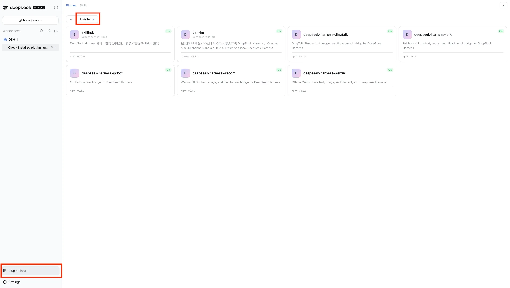

## ใช้พื้นที่ทำงาน

เวิร์กสเปซคือไดเรกทอรีของโครงการที่ DeepSeek Harness ใช้ทำงานระหว่างเซสชันของคุณ  
จาก WebUI คลิกที่ไอคอนเพิ่มเวิร์กสเปซเพื่อเปิดไดเรกทอรีของเวิร์กสเปซ

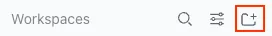

เมื่อเลือกแล้ว คุณสามารถสร้างโฟลเดอร์ใหม่หรือเลือกโฟลเดอร์ที่มีอยู่จากสภาพแวดล้อม DSH ที่โฮสต์บนคลาวด์ของคุณและตั้งค่าเป็นพื้นที่ทำงานสำหรับโครงการของคุณ จากนั้นเอเจนต์สามารถใช้ไฟล์ในพื้นที่ทำงานนั้นเพื่อทำความเข้าใจกับโครงการของคุณ แก้ไขไฟล์ รันคำสั่ง และดำเนินงานภายในพื้นที่ทำงานบนคลาวด์นั้นได้

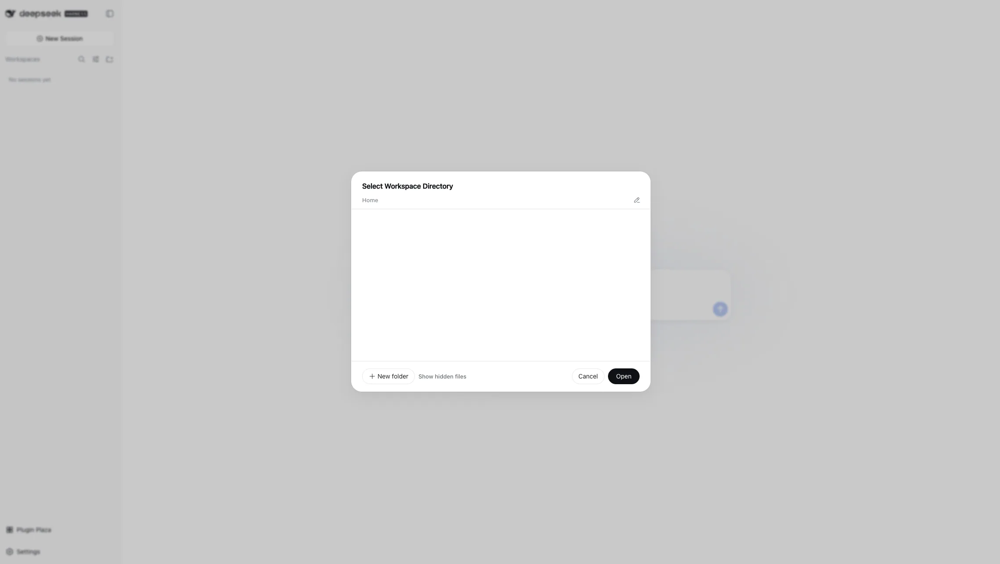

Workspaces ยังช่วยให้โครงการและเซสชันของพวกเขาเป็นระเบียบ เซสชันที่สร้างขึ้นสำหรับ workspace จะเชื่อมโยงกับไดเรกทอรีนั้น ดังนั้นคุณสามารถกลับไปยังโครงการเดียวกันและทำงานต่อกับประวัติของเซสชันที่เกี่ยวข้อง การดำเนินการที่ต้องการสิทธิ์เพิ่มเติมยังคงอยู่ภายใต้นโยบายสิทธิ์ DSH ที่ใช้งานอยู่และอาจขอการอนุมัติจากคุณใน WebUI สำหรับการจัดการไฟล์ LightVela นอก DSH โปรดดู [Cloud Storage](./files.md)

## เริ่มต้นใหม่ DeepSeek Harness

ใช้การเริ่มต้นใหม่เมื่อ DSH ถูกติดตั้งแต่จำเป็นต้องโหลดใหม่หลังจากมีการเปลี่ยนแปลงการกำหนดค่าหรือกู้คืนจากสถานะที่ไม่ปกติ
การดำเนินการเริ่มต้นใหม่นี้ใช้ได้เฉพาะกับบริการ DeepSeek Harness เท่านั้น
Hermes เอเจนต์ยังคงทำงานต่อไปอย่างอิสระ

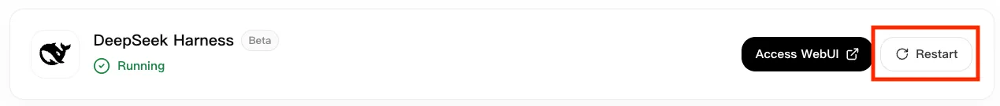

## ปัญหาที่พบบ่อย

| อาการ | สาเหตุที่เป็นไปได้ | สิ่งที่ควรทำ |
| --- | --- | --- |
| การติดตั้งไม่เสร็จสมบูรณ์ | งานติดตั้งแบบจัดการไม่ได้เสร็จสมบูรณ์อย่างสำเร็จ | ตรวจสอบข้อผิดพลาดบนหน้า รอสักครู่ แล้วลองใหม่จากหน้า DeepSeek Harness |
| WebUI ไม่เปิด | บริการยังไม่พร้อม หรือเซสชันปัจจุบันไม่มีสิทธิ์เข้าถึงอินสแตนซ์ | ยืนยันว่า DSH แสดงสถานะกำลังทำงาน แล้วเปิด WebUI ใหม่จากหน้าผลงาน Labs ขณะลงชื่อเข้าใช้ |
| โมเดลไม่สามารถตอบคำขอได้ | ไม่มีการกำหนดผู้ให้บริการ คีย์ไม่ถูกต้อง หรือบัญชีผู้ให้บริการไม่พร้อมใช้งาน | ตรวจสอบรายการผู้ให้บริการที่กำหนด อัปเดตคีย์ API หากจำเป็น แล้วลองรันคำขออย่างง่ายอีกครั้ง |
| คีย์ API ที่บันทึกไว้ไม่ปรากฏ | พฤติกรรมนี้เป็นเรื่องปกติ | คีย์ API เป็นแบบเขียนเท่านั้น ปล่อยให้ช่องว่างเพื่อเก็บคีย์ที่บันทึกไว้ หรือป้อนคีย์ใหม่เพื่อแทนที่ |
| ช่องไม่ได้เชื่อมต่อ | ปลั๊กอินมีอยู่ แต่การกำหนดค่าบัญชีไม่สมบูรณ์ | กำหนดค่าและอนุญาตช่องภายใน DSH WebUI. |
| DSH ปรากฏว่าไม่สุขภาพดีหลังจากการเปลี่ยนแปลง | อาจต้องรีโหลดบริการ | ใช้การรีสตาร์ท รอจนสถานะเป็น running แล้วตรวจสอบ WebUI และผู้ให้บริการอีกครั้ง. |

## ขอบเขตปัจจุบัน

DeepSeek Harness ใน LightVela ถูกออกแบบเป็นความสามารถของ Labs ที่มีการจัดการ  
มันให้บริการการติดตั้ง, สถานะ, การรีสตาร์ท, ข้อมูลประจำตัวของผู้ให้บริการที่ได้รับอนุมัติ, และจุดเข้า WebUI ที่ควบคุมได้

หน้าห้องทดลองปัจจุบันไม่รองรับการติดตั้งแพ็กเกจโดยอิสระ, การอัปโหลดปลั๊กอินแบบกำหนดเอง, การเข้าถึงพอร์ตเครือข่ายดิบ, จุดสิ้นสุดของผู้ให้บริการแบบกำหนดเอง, โปรโตคอลของผู้ให้บริการแบบกำหนดเอง, หรือการแก้ไขพารามิเตอร์ของโมเดลขั้นสูง  
ขอบเขตเหล่านี้ช่วยให้ instance ที่จัดการสามารถคาดการณ์ได้ ขณะที่ฟีเจอร์ยังอยู่ในช่วงเบต้า

ใช้ DeepSeek Harness เมื่อคุณต้องการสำรวจสภาพแวดล้อมเอเจนต์ที่ใช้ปลั๊กอิน การรวม SkillHub และส่วนประกอบช่องทางที่รองรับโดยไม่ต้องเปลี่ยนการตั้งค่าเอเจนต์ Hermes ที่มีอยู่ของคุณ

## คำถามที่พบบ่อย

### DeepSeek Harness จะมาแทน Hermes เอเจนต์หรือไม่?

ไม่  
มันทำงานเป็นบริการแยกต่างหากควบคู่กับ Hermes  
หน่วยความจำ ทักษะ ช่องทาง และการตั้งค่าที่มีอยู่ของคุณ Hermes ยังคงไม่เปลี่ยนแปลง

### ทำไมฉันถึงไม่สามารถเห็นปุ่ม API ที่บันทึกไว้ของฉันได้?

API คีย์เป็นแบบเขียนอย่างเดียว  
เว้นช่องว่างไว้เพื่อเก็บคีย์ที่มีอยู่หรือกรอกคีย์ใหม่เพื่อแทนที่

### ฉันสามารถเพิ่มผู้ให้บริการ โมเดล หรือ URL พื้นฐานที่กำหนดเองได้หรือไม่?

หน้าของ LightVela Labs ตอนนี้รองรับเฉพาะผู้ให้บริการที่แสดงในตัวเลือกของมันเท่านั้น สำหรับการกำหนดค่าโมเดลเพิ่มเติม รวมถึงโมเดลที่กำหนดเองหรือ Base URL คุณสามารถจัดการมันโดยตรงจาก DeepSeek Harness WebUI

### ทักษะ DeepSeek Harness เหมือนกับทักษะ Hermes หรือไม่?

ไม่ใช่
DeepSeek Harness และ Hermes Agent เป็นสภาพแวดล้อมแยกกัน
การติดตั้ง DeepSeek Harness จะไม่คัดลอกทักษะ Hermes อัตโนมัติไปยัง DSH และการกำหนดค่า plugin หรือทักษะของ DSH จะไม่เปลี่ยนแปลงการตั้งค่า Hermes Agent ของคุณ

### ทำไม DeepSeek Harness จึงถูกทำเครื่องหมายว่า Beta?

นี่คือฟีเจอร์ Labs เวอร์ชันเข้าถึงล่วงหน้า อัปเดตของ DSH หรือปลั๊กอินของมันอาจทำให้เกิดการเปลี่ยนแปลงความเข้ากันได้ ดังนั้นโปรดยืนยันกระบวนการทำงานของคุณหลังจากอัปเดต
