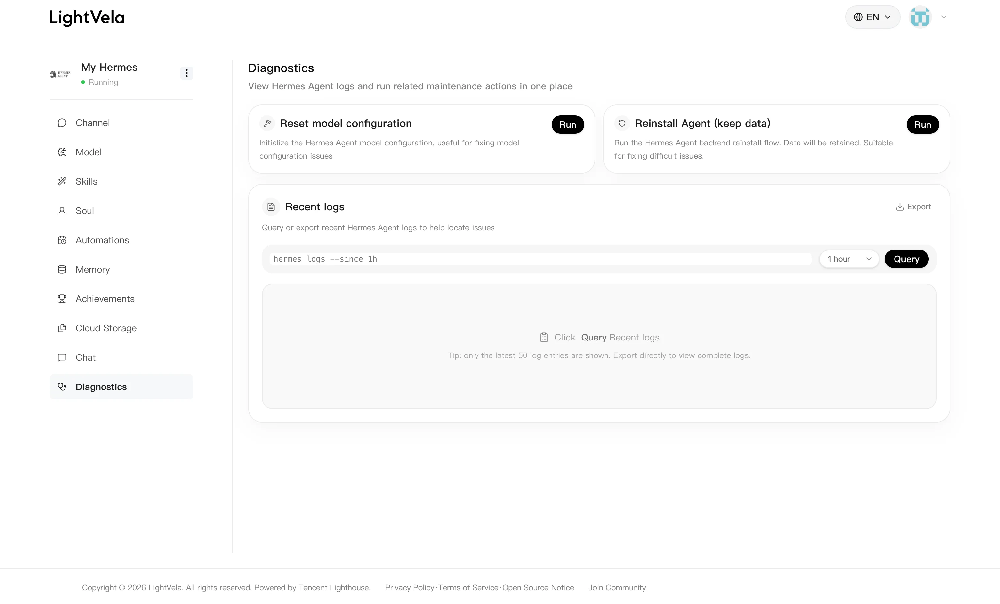
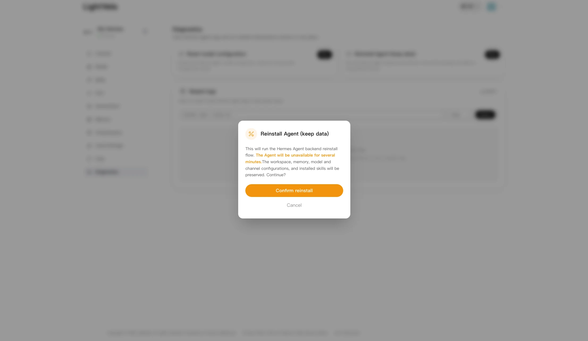

# การวินิจฉัย

## สรุป

**ศูนย์วินิจฉัยคือที่ที่คุณแก้ไขปัญหา Agent Hermes ที่ทำงานผิดปกติ ในที่เดียวคุณสามารถดูและส่งออกบันทึกล่าสุด รีเซ็ตการตั้งค่ารูปแบบ หรือทำการติดตั้ง Agent ใหม่โดยคงข้อมูลของคุณไว้ เมื่อ Agent หยุดตอบสนอง ตอบสนองแปลก ๆ หรือการเชื่อมต่อช่องทางล้มเหลว ให้ตรวจสอบที่นี่ก่อน: อ่านบันทึกเพื่อหาว่าเป็นการเรียกรูปแบบล้มเหลว ช่องทางขาดการเชื่อมต่อ หรือข้อผิดพลาดของทักษะ จากนั้นดำเนินการตามวิธีที่ตรงกัน การติดตั้งใหม่จะคงข้อมูลของคุณไว้ ดังนั้นความจำที่สะสมจะไม่สูญหาย**

---

การวินิจฉัยช่วยให้คุณตรวจสอบ Agent ที่ไม่ได้ทำงานตามที่คาดหวัง จากที่เดียว คุณสามารถตรวจสอบบันทึก Agent ล่าสุด Hermes ส่งออกเพื่อแชร์ รีเซ็ตการตั้งค่าโมเดล หรือ ติดตั้ง Agent ใหม่โดยเก็บข้อมูลของมันไว้

## หน้านี้ครอบคลุม

- การดูและส่งออกบันทึกล่าสุด
- การรีเซ็ตการกำหนดค่ารูปแบบที่เสียหาย
- การติดตั้ง Agent ใหม่พร้อมเก็บข้อมูลของมัน
- การรู้ว่าจะใช้ตัวเลือกการกู้คืนเมื่อไหร่และเมื่อไหร่ควรขอความช่วยเหลือ

> **ใช้การวินิจฉัยอย่างมีจุดมุ่งหมาย:** เริ่มจากบันทึกและการดำเนินการที่ปลอดภัยที่สุด การรีเซ็ตการตั้งค่าหรือการติดตั้ง Agent ใหม่ควรสงวนไว้สำหรับปัญหาที่เกิดขึ้นอย่างต่อเนื่อง

## ก่อนที่คุณจะเริ่ม

1. เปิดเอเจนต์ที่มีปัญหา  
2. บันทึกสิ่งที่เกิดขึ้น เวลาที่เริ่มเกิดปัญหา และตรวจสอบว่ามีผลต่อแชท ช่องทางที่เชื่อมต่ออยู่ หรือภารกิจเฉพาะอย่างใด  
3. หากโมเดลล้มเหลว ให้ตรวจสอบการตั้งค่าปัจจุบันใน [Configure Models](./model.md) ก่อนที่จะรีเซ็ตใด ๆ

## การวินิจฉัยแบบเปิด

1. เปิด **Agents** และเลือก Agent ที่ได้รับผลกระทบ
2. เปิดส่วน **Diagnostics**
3. เลือกช่วงเวลาสำหรับบันทึกล่าสุด: 1, 3, 6, 12 หรือ 24 ชั่วโมง
4. เลือก **Refresh** เพื่อโหลดบันทึก

เริ่มต้นด้วยช่วงเวลาที่สั้นที่สุดที่มีประโยชน์ หน้าต่างบันทึกที่แคบกว่าจะช่วยให้เชื่อมโยงข้อผิดพลาดกับการกระทำที่ทำให้เกิดได้ง่ายขึ้น

## ตรวจสอบและส่งออกบันทึก

ใช้ผลลัพธ์จากบันทึกเพื่อตรวจสอบว่า Agent ทำงานหรือไม่ และเพื่อระบุเวลาที่เกิดความล้มเหลว คุณสามารถส่งออกช่วงบันทึกปัจจุบันเป็นไฟล์เมื่อคุณต้องการเก็บบันทึกหรือแชร์กับผู้ติดต่อฝ่ายสนับสนุนของคุณ

เมื่อรายงานปัญหา ให้รวมถึง:

- เวลาประมาณที่เกิดขึ้น;
- สิ่งที่คุณขอให้เอเจนต์ทำ;
- ช่วงบันทึกที่เลือก; และ
- ข้อความข้อผิดพลาดที่เกี่ยวข้อง โดยไม่รวมความลับหรือคีย์ API

## ซ่อมแซมการตั้งค่ารูปแบบ

หาก Agent ไม่สามารถใช้โมเดลที่ตั้งค่าไว้ได้และปัญหายังคงอยู่หลังจากตรวจสอบผู้ให้บริการ การเลือกโมเดล และข้อมูลประจำตัว ให้เลือก **รีเซ็ตการกำหนดค่าโมเดล** ในการวินิจฉัย

สิ่งนี้จะรีเซ็ตเฉพาะโปรไฟล์ Hermes สำหรับบอทปัจจุบันเท่านั้น จะคืนค่าโมเดลในตัวของระบบและข้อมูลรับรองของมัน และลบโมเดล ผู้ให้บริการ และการสำรองที่ผู้ใช้เพิ่มเข้ามา บอทอื่น ๆ ในเอเจนต์เดียวกันจะไม่ถูกกระทบ หลังจากเสร็จสิ้น:

1. ส่งข้อความทดสอบสั้น ๆ ใน [แชท](./agent-chat.md) เพื่อยืนยันว่าโมเดลในตัวทำงานได้  
2. หากคุณยังต้องการโมเดลที่กำหนดเอง กลับไปที่ [กำหนดค่าโมเดล](./model.md) และเพิ่มหรือเลือกอีกครั้ง

> **ข้อควรระวัง:** การกำหนดค่าโมเดลที่ผู้ใช้เพิ่มจะไม่ถูกเก็บรักษาไว้ สิ่งนี้ไม่ควรเป็นคำตอบแรกต่อปัญหาชั่วคราวของผู้ให้บริการหรือเครือข่าย

## ติดตั้งเอเจนต์ใหม่โดยเก็บข้อมูลไว้

สำหรับปัญหาที่ยังคงมีอยู่หลังจากการตรวจสอบบันทึกและการตั้งค่าโมเดล Diagnostics มีตัวเลือก **ติดตั้งเอเจนต์ใหม่ (เก็บข้อมูลไว้)** ซึ่งจะเริ่มกระบวนการติดตั้งเอเจนต์ Hermes ใหม่พร้อมกับเก็บข้อมูลของมันไว้

1. อ่านคำอธิบายการดำเนินการใน Diagnostics
2. เริ่มการติดตั้งใหม่และเปิดหน้าต่างไว้ในขณะที่สถานะเปลี่ยน
3. เมื่อเสร็จสิ้น ให้รีโหลดคอนโซล Agent
4. ทดสอบงานง่าย ๆ ใน Chat จากนั้นตรวจสอบ Cloud Storage และการตั้งค่าที่ใช้ปกติของคุณ

เอเจนต์อาจไม่สามารถใช้งานได้ชั่วคราวในระหว่างการบำรุงรักษา หลีกเลี่ยงการเริ่มการซ่อมแซมอื่นในขณะที่การติดตั้งใหม่ยังดำเนินอยู่

## การสำรองข้อมูลและการกู้คืน เมื่อมีให้

บางบัญชีจะแสดงแผง **สำรอง & กู้คืน** ใน Diagnostics หากมีให้คุณใช้งาน ให้ทำตามคำแนะนำที่ปรากฏในคอนโซลของคุณเพื่อสร้างการสำรองข้อมูลหรือกู้คืนแพ็กเกจสำรองข้อมูล Hermes ที่สามารถใช้งานร่วมกันได้ อย่าสมมติว่าตัวเลือกนี้มีให้สำหรับทุก Agent หรือบัญชี

ก่อนการกู้คืน ให้เก็บสำเนาของไฟล์ที่คุณไม่สามารถแทนที่ได้ [Cloud Storage](./files.md) เป็นสถานที่ที่ดีในการตรวจสอบไฟล์ปัจจุบันของ Agent ก่อน

## ตรวจสอบการแก้ไข

ปัญหาน่าจะได้รับการแก้ไขเมื่อ:

- บันทึกล่าสุดโหลดได้โดยไม่มีความล้มเหลวซ้ำ;
- เอเจนต์สามารถตอบสนองต่อการทดสอบง่ายๆ ในแชทได้; และ
- โมเดลและไฟล์ที่คุณคาดหวังพร้อมใช้งานอีกครั้ง.

ถ้าเกิดข้อผิดพลาดเดียวกันขึ้นอีก ให้ส่งออกบันทึกที่เกี่ยวข้องและบันทึกเวลาที่เกิดขึ้นครั้งต่อไปก่อนที่จะส่งต่อเพื่อแก้ไข

## คำถามที่พบบ่อย

### ฉันควรเลือกช่วงลอกรายงานใด?

เลือกขอบเขตที่สั้นที่สุดที่ครอบคลุมปัญหา ใช้ขอบเขตที่ยาวกว่าก็ต่อเมื่อปัญหาเริ่มเกิดขึ้นก่อนหน้านี้หรือเกิดขึ้นเป็นช่วง ๆ

### การติดตั้งใหม่จะลบข้อมูลของเอเจนต์ของฉันหรือไม่?

การดำเนินการวินิจฉัยจะถูกติดป้ายว่า **ติดตั้งเอเจนต์ใหม่ (เก็บข้อมูล)** และออกแบบมาเพื่อรักษาข้อมูล อย่างไรก็ตาม ควรหลีกเลี่ยงการขัดจังหวะกระบวนการบำรุงรักษาและตรวจสอบเอเจนต์หลังจากที่กระบวนการเสร็จสิ้น

### ฉันควรรีเซ็ตการตั้งค่าโมเดลทุกครั้งที่เกิดข้อผิดพลาดของโมเดลหรือไม่?

ไม่ใช่ ก่อนอื่นตรวจสอบ [Configure Models](./model.md) สำหรับโมเดลที่เลือกและข้อมูลประจำตัว จากนั้นยืนยันว่าผู้ให้บริการพร้อมใช้งาน รีเซ็ตก็ต่อเมื่อจำเป็นต้องสร้างการกำหนดค่าใหม่เท่านั้น

## ขั้นตอนถัดไป

- กลับไปที่ [แชท](./agent-chat.md) เพื่อตรวจสอบเอเจนต์ที่ซ่อมแล้ว
- ตรวจสอบ [การกำหนดค่าโมเดล](./model.md) หรือ [การสลับโมเดล](./multiple-models.md) สำหรับปัญหาที่เกี่ยวข้องกับโมเดล
- ตรวจสอบ [คลาวด์สตอเรจ](./files.md) หากงานขึ้นอยู่กับไฟล์ที่หายไปหรือเข้าถึงไม่ได้
