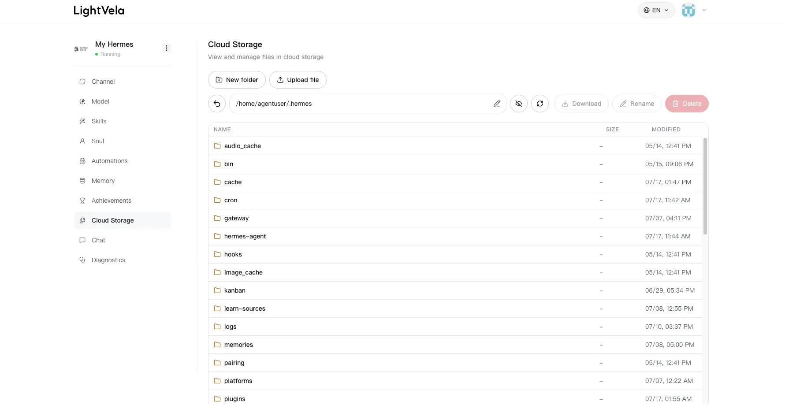

# การจัดเก็บข้อมูลบนคลาวด์

## สรุป

**พื้นที่เก็บข้อมูลบนคลาวด์คือพื้นที่ทำงานไฟล์ Agent ของคุณ Hermes คุณสามารถเก็บวัสดุสำหรับงานทั้งหมดไว้ที่เดียว อัปโหลดและจัดระเบียบไฟล์ หรือดาวน์โหลดสิ่งที่คุณต้องการไปยังเครื่องของคุณ ทั้งหมดนี้โดยไม่ต้องออกจาก LightVela ความจุขึ้นอยู่กับแผนของคุณ — Launch มีพื้นที่เก็บข้อมูลบนคลาวด์เฉพาะ 50 GB และ Cruise มีมากกว่า ไฟล์ที่ Agent อ่านและเขียนขณะทำงานก็อยู่ที่นี่ด้วย ซึ่งทำให้เป็นทั้งห้องสมุดเอกสารและไดเรกทอรีการทำงานของ Agent ของคุณ**

---

Cloud Storage คือพื้นที่ทำงานสำหรับไฟล์ของ Hermes Agent ของคุณ ใช้มันเพื่อเก็บไฟล์ที่ agent ต้องการในที่เดียว จากนั้นอัปโหลด จัดระเบียบ ดาวน์โหลด หรือ ลบไฟล์เหล่านั้นจากคอนโซล Agent โดยไม่ต้องออกจาก LightVela

## หน้านี้ครอบคลุม

- การเปิดที่จัดเก็บข้อมูลบนคลาวด์ของเอเจนต์ของคุณ
- การอัปโหลด การสร้าง และการจัดระเบียบไฟล์และโฟลเดอร์
- การดาวน์โหลด การเปลี่ยนชื่อ และการลบไฟล์
- การตรวจสอบว่าสถานที่ทำงานพร้อมสำหรับเอเจนต์ของคุณ

> **ควรรู้:** การจัดเก็บข้อมูลบนคลาวด์เป็นของเอเจนต์ที่เลือก เปิดเอเจนต์เดียวกันเมื่อใดก็ได้ที่คุณต้องการจัดการไฟล์ที่มันสามารถใช้ได้

## เมื่อใดควรใช้การจัดเก็บข้อมูลบนคลาวด์

การจัดเก็บข้อมูลบนคลาวด์มีประโยชน์เมื่อเจ้าหน้าที่ต้องการเอกสารอ้างอิง เอกสารทำงาน หรือที่เก็บไฟล์ให้เรียบร้อยระหว่างการทำงาน ตัวอย่างเช่น คุณสามารถอัปโหลดเอกสารสรุปโครงการก่อนที่จะขอให้เจ้าหน้าที่สรุป หรือสร้างโฟลเดอร์เพื่อแยกงานที่ทำซ้ำเป็นประจำ

มันแตกต่างจากบริบทที่เอเจนต์บันทึกไว้ ในการจัดการสิ่งที่เอเจนต์จำได้ระหว่างการสนทนา ดูที่ [หน่วยความจำ](./memory.md)

## ก่อนที่คุณจะเริ่ม

1. ตรวจสอบให้แน่ใจว่าคุณสามารถเปิดเอเจนต์ที่คุณต้องการทำงานด้วย  
2. เตรียมไฟล์ที่คุณต้องการเพิ่ม การอัปโหลดและดาวน์โหลดแต่ละไฟล์รองรับไฟล์ได้สูงสุด 1 GB  
3. กำหนดโครงสร้างโฟลเดอร์ที่เรียบง่ายหากคุณกำลังเพิ่มไฟล์ที่เกี่ยวข้องหลายไฟล์

## การเก็บข้อมูลบนคลาวด์แบบเปิด

1. เปิด **Agents** และเลือก Agent ที่คุณต้องการจัดการไฟล์ของมัน
2. เปิดส่วน **Cloud Storage** หรือ **Files** ของมัน
3. รอให้รายการไฟล์โหลดเสร็จก่อนเริ่มการอัปโหลดหรือการดำเนินการกับโฟลเดอร์

หากรายการไม่โหลด ให้รีเฟรชหน้าเว็บและลองใหม่อีกครั้ง หากปัญหายังคงอยู่ ให้ใช้ [Diagnostics](./diagnostics.md) เพื่อตรวจสอบบันทึกล่าสุดของเอเจนต์ก่อนทำการเปลี่ยนแปลงครั้งใหญ่

## อัปโหลดไฟล์และสร้างโฟลเดอร์

### อัปโหลดไฟล์

1. เลือก **อัปโหลด**
2. เลือกไฟล์หนึ่งไฟล์หรือมากกว่าจากคอมพิวเตอร์ของคุณ
3. เปิดหน้าต่างไว้จนการอัปโหลดเสร็จสิ้น แล้วยืนยันว่าไฟล์ปรากฏในโฟลเดอร์ปัจจุบัน

ใช้ชื่อที่ชัดเจนเพื่อให้ทั้งคุณและเจ้าหน้าที่สามารถจำไฟล์ได้ในภายหลัง หากไฟล์มีขนาดใหญ่เกินไป ให้ลดขนาดลงต่ำกว่า 1 GB หรือแยกไฟล์ก่อนอัปโหลด

### สร้างโฟลเดอร์หรือไฟล์

1. ในโฟลเดอร์ที่คุณต้องการไอเท็มใหม่ ให้เลือก **โฟลเดอร์ใหม่** หรือ **ไฟล์ใหม่**
2. ใส่ชื่อที่บรรยายได้
3. ยืนยันการกระทำ จากนั้นเปิดไอเท็มใหม่เพื่อทำงานต่อ

โครงสร้างเล็ก ๆ มักจะเพียงพอ: โฟลเดอร์หนึ่งสำหรับวัสดุต้นฉบับ หนึ่งสำหรับงานที่กำลังดำเนินการ และหนึ่งสำหรับไฟล์ที่เสร็จแล้ว หลีกเลี่ยงการซ้อนโฟลเดอร์ลึก ๆ เว้นแต่ว่ามันจะช่วยให้โครงการง่ายต่อการจัดการจริง ๆ

## จัดการไฟล์ที่มีอยู่

เลือกไฟล์หรือโฟลเดอร์เพื่อใช้การกระทำที่มีในรายการไฟล์:

- **เปิด** โฟลเดอร์เพื่อเรียกดูเนื้อหาของมัน
- **ดาวน์โหลด** ไฟล์เมื่อคุณต้องการสำเนาในเครื่อง
- **เปลี่ยนชื่อ** รายการเพื่อทำให้จุดประสงค์ชัดเจนขึ้น
- **ลบ** ไฟล์หรือโฟลเดอร์ที่คุณไม่ต้องการแล้ว

> **ข้อควรระวัง:** การลบรายการจะทำให้รายการนั้นหายไปจากที่เก็บข้อมูลบนคลาวด์ของเอเจนต์นี้ โปรดดาวน์โหลดสิ่งที่คุณอาจต้องการใช้ในภายหลัง ก่อนทำการลบ

ถ้าคุณใช้เครื่องมือที่สร้างไฟล์ซ่อน ให้เปิดการดูไฟล์ซ่อนเฉพาะเมื่อคุณต้องการตรวจสอบไฟล์เหล่านั้น การปิดมุมมองนี้จะทำให้การจัดการไฟล์ในชีวิตประจำวันง่ายขึ้น

## ตรวจสอบพื้นที่ทำงาน

คุณพร้อมที่จะใช้ Cloud Storage เมื่อ:

- ไฟล์หรือโฟลเดอร์ปรากฏในตำแหน่งที่คาดไว้;
- คุณสามารถเปิดหรือดาวน์โหลดไฟล์ได้สำเร็จ; และ
- ชื่อโฟลเดอร์ทำให้เห็นชัดเจนว่าวัสดุใดเป็นของงานปัจจุบัน

คุณสามารถกลับไปที่ [แชท](./agent-chat.md) และบอกเอเจนต์ว่าคุณต้องการทำอะไรกับไฟล์ได้แล้ว สำหรับงานที่ทำซ้ำได้ ให้รวมคำสั่งเดียวกันกับ [งานที่กำหนดเวลา](./automation.md) หรือ [ทักษะ](./skill.md)

## คำถามที่พบบ่อย

### ทำไมฉันถึงไม่สามารถอัปโหลดหรือดาวน์โหลดไฟล์ได้?

ตรวจสอบก่อนว่าข้อความไฟล์ไม่เกิน 1 GB และการเชื่อมต่อของคุณเสถียร รีเฟรชมุมมอง Cloud Storage แล้วลองทำอีกครั้ง หากยังล้มเหลว ให้เก็บข้อมูลล่าสุดใน [Diagnostics](./diagnostics.md)

### ฉันสามารถใช้ไฟล์ของเอเจนต์หนึ่งกับเอเจนต์อื่นได้หรือไม่?

การจัดเก็บข้อมูลบนคลาวด์ถูกจัดการจากคอนโซลของเอเจนต์ที่เลือก เปิดเอเจนต์ที่คุณตั้งใจจะใช้และเพิ่มไฟล์ที่นั่นเพื่อให้พื้นที่ทำงานยังคงเรียบร้อยและมีจุดประสงค์

### การลบไฟล์จะทำให้มันหายไปจากคอมพิวเตอร์ของฉันหรือไม่?

ไม่ การลบจาก Cloud Storage จะลบสำเนาที่จัดการสำหรับเอเจนต์นั้นเท่านั้น ไม่ได้ลบไฟล์ต้นฉบับบนคอมพิวเตอร์ของคุณ

## ขั้นตอนถัดไป

- ใช้ [Chat](./agent-chat.md) เพื่อทำงานกับไฟล์ที่คุณได้เตรียมไว้
- ตรวจสอบ [Memory](./memory.md) เมื่อเอเจนต์ควรรักษาบริบท ไม่ใช่แค่ไฟล์
- ใช้ [Diagnostics](./diagnostics.md) หากการดำเนินการจัดเก็บล้มเหลวบ่อยครั้ง
