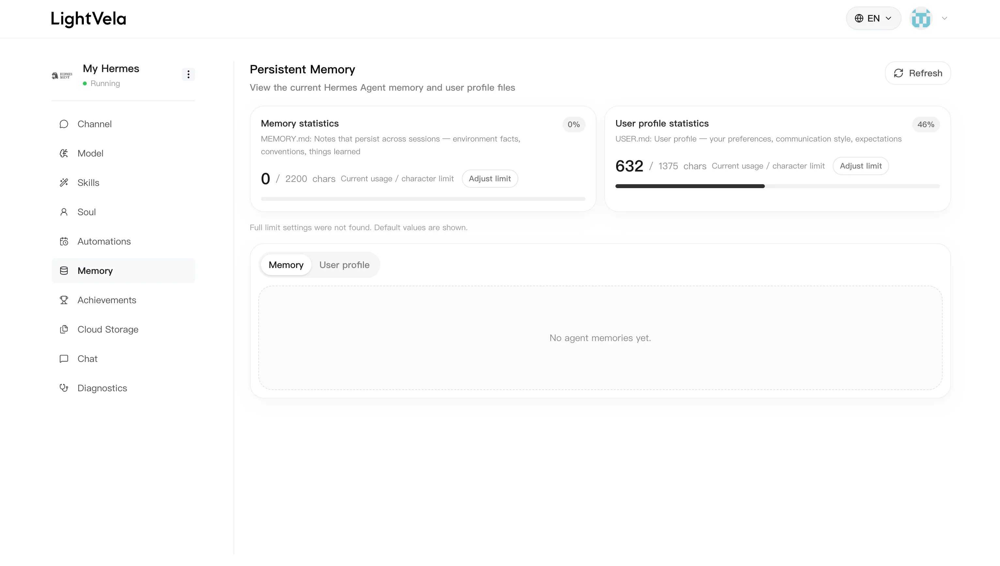

# การจัดการหน่วยความจำ

## สรุป

**ความจำคือสิ่งที่ทำให้ Hermes สามารถเก็บสิ่งที่สำคัญในระหว่างการสนทนาและอุปกรณ์ต่าง ๆ — ความชอบของคุณ ใคร่ตัวคุณ คือสิ่งที่คุณกำลังทำอยู่ และประสบการณ์ที่สะสมผ่านการทำงานร่วมกันในระยะยาว มันเป็นรากฐานที่เปลี่ยน Hermes จากการตอบคำถามแบบครั้งเดียวให้กลายเป็นผู้ช่วยที่เข้าใจคุณได้ดีขึ้นเมื่อเวลาผ่านไป ความจำอยู่ทั้งภายในตัวเอเจนต์และนอกโมเดล ดังนั้นการสลับโมเดลจะไม่ทำให้มันลืม คุณสามารถตรวจสอบความจำที่สะสมและการใช้ความจุได้บนหน้าความจำและโปรไฟล์ผู้ใช้ จากนั้นจึงสามารถถาม Hermes ในการสนทนาเพื่อจำหรือลืมรายละเอียดเฉพาะ; ช่องทางการส่งข้อความทั้งหมดของคุณใช้ความจำเพียงชุดเดียว**

---

หน่วยความจำช่วยให้ Hermes เก็บข้อมูลสำคัญตลอดการสนทนาและอุปกรณ์ต่างๆ—ความชอบของคุณ ตัวตน งานที่กำลังดำเนินอยู่ และประสบการณ์ที่มันพัฒนาผ่านการทำงานร่วมกันในระยะยาว นี่คือสิ่งที่เปลี่ยน Hermes จากเครื่องมือถาม-ตอบแบบครั้งเดียวให้กลายเป็นผู้ช่วยระยะยาวที่เข้าใจคุณได้ดีขึ้นเมื่อเวลาผ่านไป



LightVela ถูกโฮสต์บนคลาวด์ ดังนั้นความทรงจำเหล่านี้จะถูกเก็บไว้กับตัวอย่าง Hermes ของคุณบนคลาวด์ พวกมันจะไม่หายไปเมื่อคุณเปลี่ยนอุปกรณ์หรือสลับไปมาระหว่าง Telegram, WhatsApp, Discord, Slack และ WeChat หากคุณบอก Hermes บางสิ่งใน Telegram วันนี้ มันก็ยังสามารถจดจำได้เมื่อคุณดำเนินการสนทนาต่อใน WhatsApp ในวันพรุ่งนี้

## หน้าสารบัญของหน้านี้

- ปัญหาที่ความทรงจำช่วยแก้

- หน่วยความจำสองประเภท: หน่วยความจำของเอเจนต์และโปรไฟล์ผู้ใช้

- วิธีดูหน่วยความจำและการใช้งานความจุในคอนโซล

- วิธีปรับขีดจำกัดความจุหน่วยความจำ

- วิธีเพิ่มหรือลบความทรงจำผ่านการสนทนา

- คำถามที่พบบ่อย

> 💡 **ความจำสร้างขึ้นโดยอัตโนมัติ—คุณไม่จำเป็นต้องกรอกเอง**
>
> คุณไม่จำเป็นต้องกรอกแบบฟอร์มความจำ ในระหว่างการสนทนาปกติ Hermes จะตัดสินว่าข้อมูลใดมีประโยชน์พอที่จะเก็บไว้ หน้า Memory ในคอนโซลส่วนใหญ่ใช้สำหรับ **ทบทวน** สิ่งที่ Hermes จำได้ และ **ปรับความจุ** เมื่อจำเป็น

---

## ทำไมความทรงจำจึงสำคัญ

หากไม่มีความทรงจำ การสนทนาทุกครั้งกับผู้ช่วย AI จะเริ่มจากหน้าว่าง คุณต้องอธิบายว่าคุณเป็นใคร ชอบอะไร และการสนทนาครั้งล่าสุดสิ้นสุดที่ไหน ความทรงจำช่วยแก้ปัญหานั้น:

- **พูดซ้ำให้น้อยลง**: บอก Hermes ครั้งเดียวว่าคุณอาศัยอยู่ในสิงคโปร์และชอบรับบรีฟในตอนเช้า และคุณไม่จำเป็นต้องกล่าวซ้ำทุกครั้ง

- **รักษาความสม่ำเสมอในทุกช่องทาง**: Telegram, WhatsApp, Discord, Slack และ WeChat ใช้ความจำเดียวกัน เมื่อคุณสลับช่องทาง คุณยังคงพูดคุยกับผู้ช่วยเดียวกันที่เข้าใจคุณ

- **ปรับปรุงผ่านการใช้งานอย่างต่อเนื่อง**: ขณะคุณทำงานร่วมกัน, Hermes จะจำกิจวัตรของคุณ, ชื่อที่คุณชอบใช้, และโครงการที่กำลังทำอยู่ ทำให้การตอบสนองของมันมีความเกี่ยวข้องมากขึ้นเรื่อย ๆ

คิดถึงความทรงจำเหมือนสมุดบันทึกระยะยาวของ Hermes มันไม่ได้เก็บทุกข้อความที่ผ่านไปเฉยๆ; แต่มันเก็บรายละเอียดที่มีแนวโน้มว่าจะมีประโยชน์ในภายหลัง

---

## สองประเภทของความจำ

หน้าหน่วยความจำในคอนโซลมีสองแท็บ โดยแต่ละแท็บมีวัตถุประสงค์ที่แตกต่างกัน:

### ความจำ

สิ่งนี้ประกอบด้วย **ประสบการณ์และข้อเท็จจริง** Hermes ที่พัฒนาขึ้นผ่านความร่วมมือระยะยาว—ความชอบที่คุณได้แบ่งปัน วิธีการทำงานที่ตกลงกัน และความต้องการที่เกิดซ้ำตามเวลา Hermes จะบำรุงรักษาเนื้อหานี้โดยอัตโนมัติระหว่างการสนทนา และรายการเหล่านี้จะพัฒนาต่อไปเมื่อคุณยังคงใช้งานมัน

### โปรไฟล์ผู้ใช้

นี่คือบันทึกที่มั่นคงของ **ตัวตนของคุณ** เช่น ตัวตนของคุณ ตำแหน่ง ประวัติการทำงาน และความชอบระยะยาว เมื่อเทียบกับความทรงจำทั่วไป โปรไฟล์ผู้ใช้ทำงานเหมือนกับบัตรโปรไฟล์ที่สามารถคงอยู่ได้ ซึ่งช่วยให้ Hermes เข้าใจบริบทพื้นฐานของคุณได้อย่างรวดเร็วในการสนทนาใด ๆ

> ℹ️ **ความแตกต่างของพวกเขา**
>
> สั้น ๆ **โปรไฟล์ผู้ใช้** ตอบคำถามว่า “คุณเป็นคนแบบไหน?” ในขณะที่ **ความทรงจำ** ตอบคำถามว่า “เกิดอะไรขึ้นระหว่างเรา และเราตกลงอะไรกันบ้าง?” ทั้งสองช่วยให้ Hermes เข้าใจทั้งตัวคุณและประวัติของความร่วมมือของคุณ

---

## ดูความทรงจำและการใช้งานความจุ

1. ลงชื่อเข้าใช้ LightVela และคลิก “My Hermes” ที่มุมบนขวาเพื่อเปิดคอนโซล

2. ค้นหา “หน่วยความจำ” ในการนำทางการตั้งค่าและเปิดหน้าหน่วยความจำ

3. ที่ด้านบนของหน้า ตรวจสอบ **สถิติหน่วยความจำ**: ตัวอักษรที่ใช้อยู่ในปัจจุบัน ขีดจำกัดความจุ และเปอร์เซ็นต์ที่ใช้ไป

4. สลับระหว่างแท็บ “ความทรงจำ” และ “โปรไฟล์ผู้ใช้” เพื่อทบทวนเนื้อหาของแต่ละประเภท

หากประเภทใดประเภทหนึ่งว่าง หน้าเพจจะแสดงข้อความว่า “ไม่มีความจำของเอเจนต์” หรือ “ไม่มีโปรไฟล์ผู้ใช้” ซึ่งโดยปกติหมายความว่าคุณยังไม่ได้ทำงานกับ Hermes นานพอที่จะสร้างความจำประเภทนั้น เนื้อหาจะสะสมขึ้นตามเวลา

> 💡 **เปอร์เซ็นต์การใช้งานหมายถึงอะไร**
>
> หน่วยความจำมีขีดจำกัดด้านความจุ เมื่อการใช้งานใกล้ถึงขีดจำกัดนั้น Hermes จะให้ความสำคัญกับข้อมูลที่สำคัญมากกว่าและลบรายการที่ล้าสมัย การติดตามเปอร์เซ็นต์ช่วยให้คุณตัดสินใจได้ว่าจะเพิ่มความจุหรือเอาข้อมูลที่คุณไม่ต้องการออก

---

## ปรับขีดจำกัดความจุหน่วยความจำ

คุณสามารถเพิ่มขีดจำกัดความจุเมื่อคุณต้องการ Hermes เพื่อเก็บข้อมูลให้มากขึ้น หรือ ลดลงเมื่อเหมาะสม

- **หน่วยความจำ** สามารถตั้งค่าได้ตั้งแต่ 500 ถึง 4,000 ตัวอักษร

- **โปรไฟล์ผู้ใช้** สามารถตั้งค่าได้ตั้งแต่ 500 ถึง 3,000 ตัวอักษร

ขีดจำกัดใหม่จะมีผลหลังจากที่คุณบันทึกมัน

> ⚠️ **การบันทึกขีดจำกัดใหม่จะทำให้เกตเวย์รีสตาร์ทชั่วคราวและอาจรบกวนการสนทนาปัจจุบัน**
>
> เมื่อคุณบันทึกขีดจำกัดความจุใหม่ เกตเวย์ Hermes จะรีสตาร์ทชั่วคราวเพื่อใช้การตั้งค่า การสนทนาที่กำลังดำเนินอยู่อาจถูกขัดจังหวะชั่วครู่และจะกลับมาทำงานต่อได้ในภายหลัง ควรทำการเปลี่ยนแปลงในเวลาที่การหยุดชั่วคราวจะไม่ส่งผลต่อการทำงานของคุณ

---

## เพิ่มหรือลบหน่วยความจำผ่านการสนทนา

นอกจากการตรวจสอบเนื้อหาในคอนโซลแล้ว คุณยังสามารถขอให้ Hermes จำหรือลืมข้อมูลได้โดยตรง นี่มักจะเป็นวิธีที่เป็นธรรมชาติมากที่สุดในการรักษาความจำในระหว่างการใช้งานประจำวัน

**ขอให้มันจำ:**

```
Remember that I want my daily briefing at 8:00 AM.
```

```
Remember that I prefer concise, direct answers.
```

**ขอให้มันลืม:**

```
I no longer need the daily briefing we discussed. Please forget that preference.
```

Hermes แปลความตั้งใจของคุณ อัปเดตรายการความจำที่เกี่ยวข้อง และบอกคุณว่ามีอะไรเปลี่ยนแปลงบ้าง

> ℹ️ **เนื้อหาความจำปัจจุบันถูกบำรุงรักษาผ่านการสนทนา**
>
> LightVela ใช้โมเดลคลาวด์ที่มีการจัดการและไม่เปิดเผยการดำเนินการระบบไฟล์ต่อผู้ใช้ การเพิ่มหรือลบเนื้อหาความจำทำได้โดยหลักจากการพูดคุยกับ Hermes; ใช้คอนโซลเพื่อตรวจสอบเนื้อหาและปรับขีดจำกัดความจุ

---

## คำถามที่พบบ่อย

### ทำไม Hermes ถึงจำบางสิ่งที่ฉันไม่ได้ขอให้มันบันทึกโดยตรง?

นี่เป็นเรื่องที่คาดไว้ Hermes จะระบุข้อมูลที่อาจมีประโยชน์ตลอดเวลาโดยอัตโนมัติ เช่น ความชอบของคุณ ตัวตน และข้อตกลงในการทำงาน หากคุณไม่ต้องการให้มันเก็บอะไรไว้ ให้ขอมันลืมข้อมูลนั้นในการสนทนา

### ความทรงจำยังคงอยู่หรือไม่เมื่อตอนฉันเปลี่ยนอุปกรณ์หรือช่องทาง?

ใช่ ความจำถูกเก็บไว้กับอินสแตนซ์คลาวด์และเป็นอิสระจากอุปกรณ์หรือช่องทางใด ๆ Telegram, WhatsApp, Discord, Slack และ WeChat ทั้งหมดแชร์ความจำเดียวกัน

### เกิดอะไรขึ้นเมื่อหน่วยความจำเต็ม?

เมื่อการใช้งานใกล้ถึงขีดจำกัด Hermes จะให้ความสำคัญกับข้อมูลที่สำคัญมากขึ้นและค่อยๆ ลบรายการที่ล้าสมัยหรือมีประโยชน์น้อยลง หากคุณต้องการให้เก็บข้อมูลได้มากขึ้น ให้เพิ่มขีดจำกัดความจุในหน้าความทรงจำ

### ทำไมหน้าหน่วยความจำถึงบอกว่าไม่มีหน่วยความจำ?

ประเภทของความจำนั้นยังไม่ได้สะสมเนื้อหาใด ๆ เลย ให้ทำงานต่อกับ Hermes หรือถามมันโดยตรงให้จดจำรายละเอียดสำคัญ สิ่งต่าง ๆ จะเริ่มปรากฏขึ้น

### ทำไมการสนทนาของฉันถึงหยุดชะงักหลังจากที่ฉันเปลี่ยนขีดจำกัดความจุ?

การบันทึกขีดจำกัดใหม่จะทำให้เกตเวย์รีสตาร์ทชั่วครู่ ซึ่งอาจขัดจังหวะการสนทนาได้เพียงเล็กน้อย รอสักครู่ จากนั้นส่งข้อความอีกครั้ง

---

## ขั้นตอนถัดไป

ความทรงจำช่วย Hermes จำคุณได้ ต่อไป ให้มันมีวิธีการทำงานมากขึ้น:

- [ปรับแต่งทักษะ](./skill.md) — เพิ่มความสามารถ เช่น การค้นหาสภาพอากาศ บทสรุปข่าว และการท่องเว็บ

- [งานที่ตั้งเวลาไว้](./automation.md) — ให้ Hermes ทำงานโดยเชิงรุกตามกำหนดเวลา

- [ภาพรวมการกำหนดค่า](../05-configuration.md)
