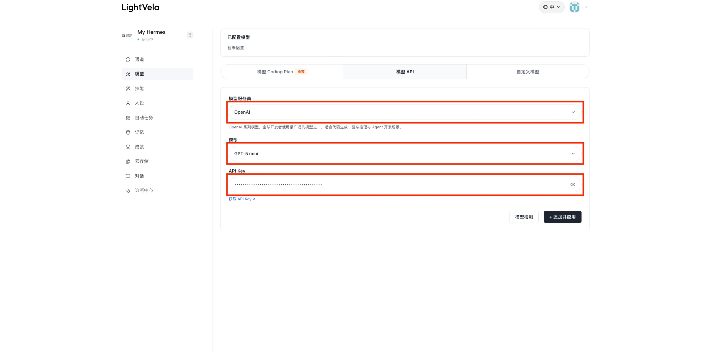

# กำหนดค่ารูปแบบ

## สรุป

**การตั้งค่าโมเดลเป็นสิ่งที่ไม่จำเป็น: แผนของคุณรวมเครดิตโมเดลรายเดือน ดังนั้นหลังจากที่คุณสร้างเอเจนต์และเชื่อมต่อช่องทางแล้ว คุณสามารถเริ่มพูดคุยได้ทันที และสามารถตั้งค่าโมเดลได้หลังจากเครดิตเหล่านั้นหมด ส่วน Models ในคอนโซลมีสามตัวเลือก: แผนรหัสโมเดล (รายเดือนหรือรายปี เหมาะสำหรับการใช้งานหนัก), โมเดล API (จ่ายตามที่ใช้ เหมาะสำหรับการใช้งานเบาหรือทดลอง), และโมเดลกำหนดเอง (เชื่อมต่อกับจุดสิ้นสุดที่รองรับ OpenAI) ทั้งสามต้องใช้คีย์ API ของคุณเองจากผู้ให้บริการที่เกี่ยวข้อง ขั้นตอนคือ: เลือกแหล่งข้อมูล, เลือกโมเดลเฉพาะ, วางคีย์ API และตั้งค่าเป็นค่าเริ่มต้น คุณสามารถเปลี่ยนโมเดลในภายหลังโดยไม่สูญเสียความจำ คีย์ API เป็นข้อมูลลับ — ห้ามโพสต์ในกลุ่มแชทหรือหน้าเว็บสาธารณะ, ห้ามเก็บลง Git repository, และยกเลิกหรือหมุนเวียนคีย์ในคอนโซลของผู้ให้บริการทันทีหากมีการรั่วไหล**

---

หน้านี้อธิบายวิธีการกำหนดค่าโมเดลภาษาขนาดใหญ่สำหรับ Hermes Agent รวมถึงความแตกต่างระหว่างวิธีการกำหนดค่าทั้งสาม วิธีการรับคีย์ API ขั้นตอนการกำหนดค่าคอนโซล โมเดลที่รองรับ และคำแนะนำในการเลือกโมเดล

> 💡 **การตั้งค่าเป็นไปได้โดยไม่บังคับ**
> 
> แผนการเปิดตัวรวมเครดิตทดลอง 100 หน่วย หลังจากสร้าง Hermes เอเจนต์และเชื่อมต่อช่องทางแล้ว คุณสามารถเริ่มแชทโดยตรงได้ ตั้งค่ารูปแบบหลังจากเครดิตหมด

---

## หน้านี้ครอบคลุม

- ความแตกต่างระหว่างสามวิธีการตั้งค่า (แผนการเข้ารหัส / API / แบบจำลองที่กำหนดเอง)
    
- วิธีการได้มาซึ่งกุญแจ API
    
- ขั้นตอนการตั้งค่าคอนโซล
    
- สลับโมเดล
    
- โมเดลที่รองรับ
    
- คำแนะนำในการเลือกแบบจำลอง
    

---

## สามวิธีการกำหนดค่า

เมนูแบบเลื่อนลงระดับแรกในบัตร “Model” ของคอนโซลมีตัวเลือกสามตัวเลือก:

| วิธีการ | โหมดการเรียกเก็บเงิน | API แหล่งคีย์ | กรณีการใช้งาน |
| --- | --- | --- | --- |
| แผนการเข้ารหัสโมเดล | รายเดือน / รายปี | ผู้ให้บริการ | การใช้งานความถี่สูง |
| โมเดล API | จ่ายตามการใช้งาน | ผู้ให้บริการ | การใช้งานความถี่ต่ำหรือทดลองใช้ |
| โมเดลที่กำหนดเอง | ขึ้นอยู่กับจุดเชื่อมต่อ | ผู้ใช้จัดหา | เชื่อมต่อโมเดลต่างประเทศหรือจุดเชื่อมต่อที่เข้ากันได้กับ OpenAI |

> ⚠️ **เตรียม API Key ของคุณเอง**
> 
> ทั้งสามวิธีต้องใช้ API Key ของคุณเอง โปรดลงทะเบียนกับผู้ให้บริการที่เกี่ยวข้องและสร้าง Key ก่อน

---

## กระบวนการทั่วไปสำหรับการขอรับกุญแจ API

อินเทอร์เฟซของผู้ให้บริการแตกต่างกัน แต่กระบวนการโดยทั่วไปเหมือนกัน:

1. **เยี่ยมชมเว็บไซต์ผู้ให้บริการ**: หลังจากเลือกโมเดลในบัตรโมเดลของคอนโซล ลิงก์ "รับ API KEY" จะปรากฏด้านล่าง คลิกที่ลิงก์เพื่อเปิดเว็บไซต์ผู้ให้บริการ
    
2. **ลงทะเบียนหรือเข้าสู่ระบบ**: แพลตฟอร์มจีนส่วนใหญ่รองรับการเข้าสู่ระบบด้วย WeChat หรือหมายเลขโทรศัพท์
    
3. **การยืนยันตัวตนด้วยชื่อจริงครบถ้วน**: ผู้ให้บริการโมเดลของจีนโดยทั่วไปจะต้องมีการยืนยันตัวตนด้วยชื่อจริงก่อนที่อนุญาตให้มีการโทร API
    
4. **เปิดหน้า API การจัดการคีย์**: โดยปกติจะอยู่ภายใต้ "คอนโซล → API การจัดการ / การจัดการคีย์ / ข้อมูลประจำตัว"
    
5. **สร้างคีย์ใหม่**: ตั้งชื่อคีย์ (ตัวอย่างเช่น `LightVela`) และคัดลอกทันทีหลังจากสร้าง ส่วนใหญ่แพลตฟอร์มจะแสดงคีย์ทั้งหมดเพียงครั้งเดียว
    
6. **กลับไปที่ LightVela และวางคีย์**
    

> ⚠️ **API กุญแจเป็นข้อมูลรับรองที่ละเอียดอ่อน**
>
> อย่าส่งกุญแจไปยังกลุ่มแชท เผยแพร่บนหน้าเว็บ หรือบันทึกลงในที่เก็บ Git หากกุญแจรั่วไหล ให้เพิกถอนหรือรีเซ็ตทันทีในคอนโซลของผู้ให้บริการ

---

## กำหนดค่าในคอนโซล

เข้าคอนโซลแล้วเปิดปุ่ม "Model"

### ขั้นตอนการกำหนดค่า

1. **เลือกแหล่งที่มา** (เมนูแบบเลื่อนชั้นแรก): แบบจำลอง API / แผนการเข้ารหัสแบบจำลอง / แบบจำลองกำหนดเอง
    
2. **เลือกโมเดลเฉพาะ** (เมนูแบบเลื่อนลงระดับที่สอง): โมเดลที่สามารถใช้งานได้จะแสดงตามแหล่งที่เลือกไว้ด้านบน
    
3. **ป้อนปุ่ม API**: วางกุญแจที่คุณได้รับไอคอนรูปตาทางขวาจะสลับการมองเห็น
    
4. **คลิก "เพิ่มเป็นค่าเริ่มต้น"**
    
5. บันทึกที่เกี่ยวข้องปรากฏในรายการ "โมเดลปัจจุบัน" แสดงถึงการกำหนดค่าที่สำเร็จ
    

### ฟิลด์เพิ่มเติมสำหรับโมเดลที่กำหนดเอง

เมื่อเลือก "โมเดลที่กำหนดเอง" คุณมักจะต้องกรอกช่องต่อไปนี้เพิ่มเติมจากคีย์ API:

- **URL พื้นฐาน**: ที่อยู่บริการโมเดล API ตัวอย่างเช่น `https://api.openai.com/v1`
    
- **ชื่อโมเดล**: ตัวระบุโมเดล เช่น `gpt-4o` หรือ `claude-3-5-sonnet-20241022`
    

ฟิลด์ที่แท้จริงขึ้นอยู่กับอินเทอร์เฟซคอนโซล

> 💡 **วิธีการกำหนดค่ารูปแบบที่กำหนดเอง (เช่น OpenAI GPT, Google Gemini เป็นต้น)**
>
> นอกเหนือจากรูปแบบที่พบเห็นกันทั่วไปในคอนโซล เช่น MiniMax, Kimi, และ Zhipu GLM ผู้ใช้ยังสามารถกำหนดค่า OpenAI GPT, Google Gemini, Claude หรือรูปแบบอื่นที่ไม่ได้แสดงในรายการผ่าน "Custom Model"

---

## โมเดลของสวิตช์

### วิธีการสลับ

เรียกใช้ขั้นตอนการกำหนดค่าซ้ำอีกครั้ง การดำเนินการ "เพิ่มเป็นค่าเริ่มต้น" ใหม่จะเขียนทับการกำหนดค่าก่อนหน้า

> ⚠️ **สามารถใช้งานโมเดลได้เพียงหนึ่งโมเดลเท่านั้น**
> 
> ปัจจุบัน เอเจนต์ Hermes แต่ละตัวสามารถมีโมเดลที่ใช้งานได้เพียงหนึ่งโมเดลเท่านั้น หากต้องการเปรียบเทียบประสิทธิภาพของโมเดลต่าง ๆ ให้ตั้งค่าและทดลองใช้งานทีละโมเดล

### ผลกระทบต่อความจำ

การเปลี่ยนโมเดลจะไม่ส่งผลต่อความจำในการสนทนา ความจำเป็นของเอเจนต์ Hermes เอง โมเดลมีหน้าที่เพียงสร้างการตอบสนองเท่านั้น

---

## โมเดลที่รองรับ

### แผนการเขียนโค้ดแบบโมเดล (รายเดือน)

| ชื่อ | ผู้ให้บริการ |
| --- | --- |
| Zhipu AI (GLM International - แผนการเขียนโค้ด) | Zhipu AI |
| แผนการเขียนโค้ด Kimi | Moonshot AI |
| แผนโทเค็น Xiaomi | Xiaomi |
| แผนการเขียนโค้ด Bailian | Alibaba Cloud Bailian |
| แผนการเขียนโค้ด Volcano Engine Ark | Volcano Engine (ByteDance) |

### โมเดล API (จ่ายตามการใช้งาน)

| ชื่อ | ผู้ให้บริการ |
| --- | --- |
| OpenAI | OpenAI |
| Anthropic | Anthropic |
| Google Gemini | Google |
| OpenRouter | OpenRouter |
| DeepSeek | DeepSeek |
| Bailian (Qwen) | Alibaba |
| MiniMax (International) | MiniMax |
| Moonshot AI (Kimi International) | Moonshot |
| Zhipu AI (GLM International) | Zhipu |
| Volcano Engine (Doubao) | ByteDance |
| Xiaomi MiMo | Xiaomi |

### โมเดลกำหนดเอง

สามารถเชื่อมต่อกับทุกจุดสิ้นสุดที่เข้ากันได้กับโปรโตคอล OpenAI Chat Completions รวมถึง:

- โมเดลที่โฮสต์เอง: vLLM, Ollama, LM Studio, และบริการอื่น ๆ ที่เปิดเผยจุดสิ้นสุดที่เข้ากันได้กับ OpenAI
    
- แพลตฟอร์มการรวม: OpenRouter เป็นต้น
    

---

## คำแนะนำในการเลือก

คำแนะนำในการเลือกสำหรับลำดับความสำคัญที่แตกต่างกัน:

| ความสำคัญ | แนวทางที่แนะนำ |
| --- | --- |
| โควตาฟรี | ผู้ให้บริการหลายรายมีโควตาฟรีสำหรับบัญชีใหม่ เริ่มจากการทดลอง |
| การประมวลผลบริบทยาว | เลือกโมเดลที่มีหน้าต่างบริบทใหญ่ขึ้น (เช่น Moonshot AI) |
| ความเร็วในการตอบสนอง | ผู้ให้บริการแตกต่างกันอย่างมาก ขึ้นอยู่กับประสบการณ์จริง |
| ความเข้าใจภาษาจีน | โมเดลภาษาจีนโดยทั่วไปสนับสนุนภาษาจีนได้ดีกว่า |
| การใช้งานความถี่สูง | เลือกแผน Coding รายเดือนของผู้ให้บริการที่เกี่ยวข้อง |

คำแนะนำ: ใช้เครดิตทดลองของแผน Launch สำหรับการสนทนาหลายครั้งก่อน หลังจากยืนยันว่า Hermes Agent ทำงานปกติแล้ว จึงตัดสินใจว่าจะใช้โมเดลใด

---

## คำถามที่พบบ่อย

| ปัญหา | สาเหตุที่เป็นไปได้ | วิธีแก้ไข |
| --- | --- | --- |
| "โมเดลปัจจุบัน" ยังคงว่างหลังจากกรอกคีย์ | รูปแบบคีย์ไม่ถูกต้องหรือมีช่องว่าง | คัดลอกและวางใหม่; ตรวจสอบว่าไม่มีช่องว่างด้านหน้าและด้านหลัง |
| ไม่มีการตอบกลับเป็นเวลานานหลังส่งข้อความ | ยอดเงินผู้ให้บริการไม่เพียงพอหรือคีย์ถูกปิดใช้งาน | ตรวจสอบยอดเงินและสถานะคีย์ในคอนโซลผู้ให้บริการ |
| เนื้อหาการตอบกลับผิดเพี้ยนหรือไม่มีความหมาย | จุดสิ้นสุดโมเดลที่กำหนดเองไม่เข้ากันกับโปรโตคอล OpenAI | ตรวจสอบการใช้งานจุดสิ้นสุดด้วยไคลเอนต์ที่เข้ากันกับ OpenAI ก่อน |
| "หมดเวลาในการตอบกลับของโมเดล" | ขีดจำกัดอัตราของผู้ให้บริการหรือความไม่เสถียรของเครือข่าย | ลองใหม่ภายหลังหรือเปลี่ยนไปใช้ผู้ให้บริการอื่น |
| ไม่แน่ใจเกี่ยวกับ Base URL ของโมเดลที่กำหนดเอง | — | ตรวจสอบเอกสารบริการ API ที่เกี่ยวข้อง; มักจะเป็น `https://xxx.com/v1` |

### ข้อผิดพลาดในการสนทนา "HTTP 401: การตรวจสอบสิทธิ์ไม่ถูกต้อง" หรือข้อผิดพลาด 401 ที่คล้ายกัน

หากเกิดข้อผิดพลาด `HTTP 401:InvalidAuthentication` หรือ `401 xxx` ขึ้นระหว่างการสนทนากับ OpenClaw มักเกิดจากสาเหตุดังต่อไปนี้:

1. กุญแจ API ของโมเดลถูกตั้งค่าไม่ถูกต้อง;
    
2. แผนการโค้ด API คีย์สับสนกับคีย์โมเดลปกติ API;
    
3. การเลือกเวอร์ชันภายในประเทศหรือเวอร์ชันระหว่างประเทศของผู้ให้บริการโมเดลไม่ถูกต้อง
    

เมื่อเกิดเหตุการณ์นี้ ให้ตรวจสอบการตั้งค่าโมเดลอีกครั้ง

---

## ขั้นตอนถัดไป

- [ตั้งค่าช่อง - WeChat](./channel-wechat.md)

- [ตั้งค่าช่อง - Telegram](./channel-telegram.md)

- [ตั้งค่าช่อง - WhatsApp](./channel-whatsapp.md)

- [ตั้งค่าช่อง - Discord](./channel-discord.md)

- [ตั้งค่าช่อง - Slack](./channel-slack.md)

- [กำหนดค่าช่อง - QQ](./channel-qq.md)

- [ตั้งค่าช่อง - WeCom](./channel-wecom.md)

- [ตั้งค่าช่อง - Lark](./channel-feishu.md)

- [กำหนดค่าทักษะ](./skill.md)
