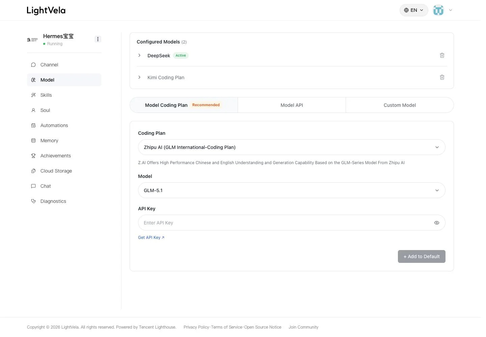

# การสลับโมเดล

## สรุป

**การสลับโมเดลช่วยให้คุณสามารถเลือกได้ว่าโมเดลที่คุณตั้งค่าไว้ไหนที่เอเจนต์ Hermes กำลังใช้อยู่ เมื่อมีงานที่ต้องการความเร็ว ความสามารถ ค่าใช้จ่าย หรือความพร้อมใช้งานของผู้ให้บริการต่างกัน คุณสามารถสลับโมเดลแทนการสร้างเอเจนต์ใหม่ วิธีนี้ใช้ได้เพราะบุคลิก ความทรงจำ ทักษะ และงานที่กำหนดเวลาไว้ทั้งหมดถูกเก็บไว้นอกโมเดล ดังนั้นการเปลี่ยนโมเดลเพียงแค่เปลี่ยนเครื่องมือการให้เหตุผล — ไม่มีสิ่งใดถูกเอาออกหรือถูกลบ และเอเจนต์ยังจำคุณได้ เอเจนต์แต่ละตัวมีโมเดลที่ใช้งานอยู่เพียงโมเดลเดียวในแต่ละครั้ง**

---

การสลับโมเดลช่วยให้คุณเลือกโมเดลที่กำหนดค่าซึ่งเอเจนต์ Hermes ของคุณใช้สำหรับงานถัดไปของมัน สลับได้เมื่อภารกิจต้องการความสมดุลที่แตกต่างกันระหว่างความเร็ว ความสามารถ ค่าใช้จ่าย หรือความพร้อมใช้งานของผู้ให้บริการ—โดยไม่ต้องสร้างเอเจนต์ใหม่

## หน้านี้ครอบคลุม

- เตรียมโมเดลที่ใช้งานได้มากกว่าหนึ่งโมเดล
- เลือกโมเดลที่ใช้งานสำหรับเอเจนต์
- ตรวจสอบการเปลี่ยนแปลงในแชท
- แก้ไขปัญหาโมเดลที่ไม่ปรากฏหรือไม่สามารถตอบสนองได้

> **ควรรู้:** เอเจนต์จะใช้โมเดลที่กำลังทำงานเพียงหนึ่งโมเดลในแต่ละครั้ง การสลับโมเดลที่กำลังทำงานจะไม่ลบความจำของเอเจนต์ ไฟล์ใน Cloud Storage ทักษะ หรือภารกิจที่กำหนดเวลาไว้

## ก่อนที่คุณจะเริ่ม

1. เปิดเอเจนต์ที่คุณต้องการอัปเดต  
2. ตรวจสอบให้แน่ใจว่าโมเดลเป้าหมายได้ถูกตั้งค่าและพร้อมใช้งานกับบัญชีของคุณแล้ว หากไม่ใช่ ให้ทำตาม [การกำหนดค่าโมเดล](./model.md) ก่อน  
3. เตรียมพร้อมคำสั่งทดสอบง่าย ๆ เพื่อที่คุณจะได้ยืนยันว่าโมเดลใหม่ตอบสนองตามที่คาดไว้

## สลับแบบจำลองที่ใช้งานอยู่

1. เปิด **Agents** และเลือก Agent
2. เปิดส่วน **Models**
3. เลือกโมเดลที่กำหนดค่าที่คุณต้องการให้ Agent ใช้
4. บันทึกหรือใช้การเปลี่ยนแปลง จากนั้นรอให้ Agent ปรับปรุงการกำหนดค่าที่ใช้งานอยู่เสร็จ



หากคุณกำลังเลือกโมเดลเป็นครั้งแรก ใช้ [ปรับแต่งโมเดล](./model.md) เพื่อเพิ่มผู้ให้บริการที่รองรับหรือโมเดลที่กำหนดเองก่อนกลับมาที่นี่

## ยืนยันการเปลี่ยนแปลง

เปิด [แชท](./agent-chat.md) และส่งข้อความสั้น ๆ ที่มีความเสี่ยงต่ำ เช่น:

```text
Reply with the name of the current model if it is available, then summarize this sentence in one line: Model switching is ready.
```

ยืนยันว่าเอเจนต์ตอบสนองตามปกติและโมเดลที่แสดงในคอนโซลเอเจนต์เป็นโมเดลที่คุณเลือก หากการตอบสนองครั้งแรกใช้เวลานานเล็กน้อยในขณะที่เอเจนต์กำลังอัปเดต ให้รอสักครู่แล้วลองอีกครั้งก่อนที่จะทำการเปลี่ยนแปลงอื่น

## เลือกเวลาที่เหมาะสมในการเปลี่ยน

| สถานการณ์ | สิ่งที่ควรพิจารณา |
| --- | --- |
| คุณต้องการร่างแรกที่เร็วขึ้น | เลือกโมเดลที่กำหนดค่าไว้ซึ่งเหมาะกับงานสั้น ๆ หรือเป็นกิจวัตร |
| งานต้องการเหตุผลที่แข็งแรงขึ้นหรือความช่วยเหลือเรื่องโค้ด | เลือกโมเดลที่คุณได้กำหนดค่าสำหรับงานประเภทนั้น |
| ผู้ให้บริการไม่สามารถใช้งานได้หรือติดข้อจำกัดอัตรา | เปลี่ยนไปใช้โมเดลที่กำหนดค่าไว้ตัวอื่น จากนั้นทดสอบใน Chat |
| คุณกำลังเปรียบเทียบคุณภาพของผลลัพธ์ | รันพรอมต์ขนาดเล็กเดียวกันหลังจากการเปลี่ยนแต่ละครั้งแล้วเปรียบเทียบผลลัพธ์ |

การสลับโมเดลจะเปลี่ยนเครื่องยนต์ที่ใช้สำหรับการตอบกลับในอนาคต มันจะไม่ย้ายประวัติการสนทนาของคุณ เขียนไฟล์ใหม่ใน [Cloud Storage](./files.md) หรือเปลี่ยน [ทักษะ](./skill.md) และ [งานที่กำหนดเวลา](./automation.md) ของคุณ

หากคุณต้องการสำรวจสภาพแวดล้อมเอเจนต์แบบปลั๊กอินก่อนแยกต่างหากควบคู่ไปกับ Hermes Agent โปรดดูที่ [DeepSeek Harness](./deepseek-harness.md)

## หากสวิตช์ไม่ทำงาน

1. กลับไปที่ [Configure Models](./model.md) และยืนยันว่าแบบจำลองเป้าหมาย ข้อมูลประจำตัว และการตั้งค่าผู้ให้บริการครบถ้วนแล้ว  
2. ยืนยันว่าแบบจำลองสามารถใช้งานกับบัญชีของคุณได้และมีโควต้าหรือเครดิตผู้ให้บริการเพียงพอ  
3. เลือกแบบจำลองที่ทราบว่าทำงานได้และทดสอบใน Chat  
4. หาก Agent ยังไม่สามารถตอบกลับ เปิด [Diagnostics](./diagnostics.md) และตรวจสอบบันทึกล่าสุดก่อนรีเซ็ตการกำหนดค่าแบบจำลอง

> **เคล็ดลับ:** เปลี่ยนทีละอย่าง การทดสอบหลังจากแต่ละครั้งทำให้สามารถบอกได้ง่ายขึ้นว่าปัญหาอยู่ที่โมเดล การตั้งค่าของมัน หรือที่ตัวงานเอง

## คำถามที่พบบ่อย

### ทำไมโมเดลที่ฉันต้องการถึงไม่มีอยู่ในรายการ?

สามารถเลือกได้เฉพาะโมเดลที่ถูกกำหนดค่าแล้ว เพิ่มหรือทำให้โมเดลสมบูรณ์ใน [กำหนดค่าโมเดล](./model.md) จากนั้นกลับไปที่ส่วนโมเดล

### การเปลี่ยนโมเดลจะลบความทรงจำของเอเจนต์ของฉันหรือไม่?

ไม่ใช่ โมเดลที่ใช้งานจะเปลี่ยนไป ในขณะที่ความจำและการตั้งค่าที่บันทึกของเอเจนต์ยังคงอยู่ คุณสามารถตรวจสอบความจำแยกต่างหากได้ใน [Memory](./memory.md).

### ฉันสามารถเปลี่ยนกลับได้ไหมถ้าฉันไม่ชอบผลลัพธ์?

ใช่ เลือกรูปแบบที่ตั้งค่าไว้แล้วอีกตัวหนึ่ง ใช้การเปลี่ยนแปลง และทดสอบด้วยพรอมต์เดียวกัน การรักษาพรอมต์ให้สอดคล้องกันจะช่วยให้คุณเปรียบเทียบได้อย่างมีประโยชน์มากขึ้น

## ขั้นตอนถัดไป

- ตั้งผู้นำเสนอเพิ่มเติมใน [กำหนดค่าโมเดล](./model.md)
- ใช้ [แชท](./agent-chat.md) เพื่อเปรียบเทียบการตอบสนองของโมเดลในงานจริง
- ใช้ [วินิจฉัย](./diagnostics.md) หากโมเดลที่กำหนดค่าไม่สามารถเริ่มทำงานได้ซ้ำ
