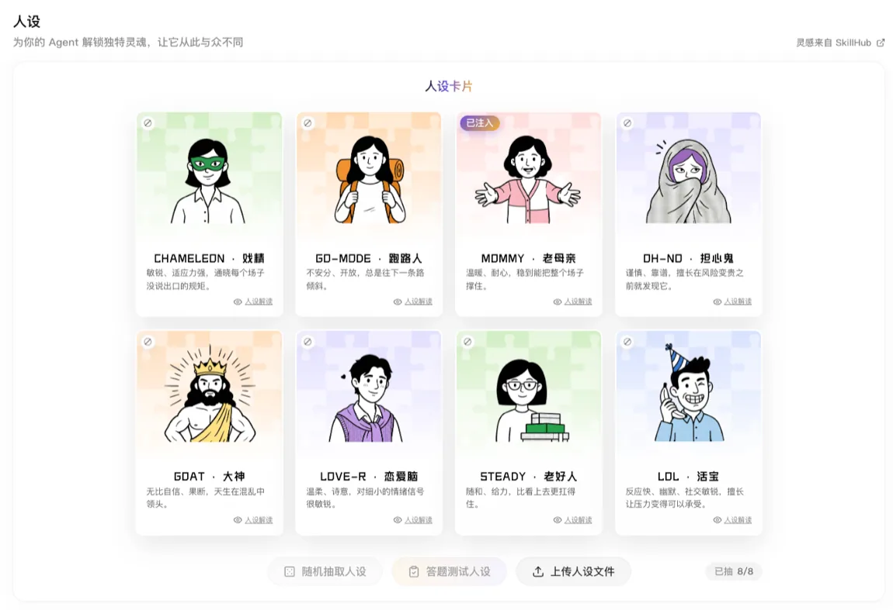
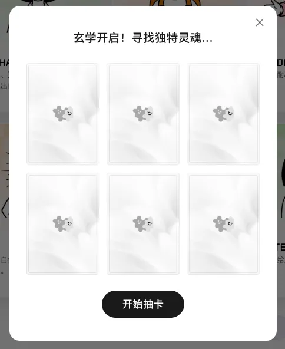
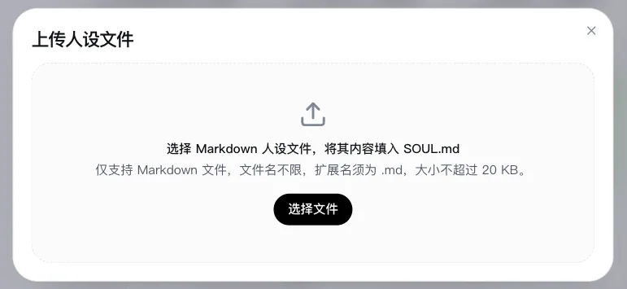

# วิญญาณ

## สรุป

**บุคลิกภาพกำหนดบทบาทที่มั่นคง, เสียง, ลำดับความสำคัญ, และขอบเขตพฤติกรรมสำหรับเอเจนต์ Hermes หนึ่ง.**

**เลือกจิตวิญญาณจากการตั้งค่าบุคลิกภาพของเอเจนต์ ตรวจสอบคำอธิบายของมัน และฉีดมันเพื่ออัปเดต `SOUL.md` ของเอเจนต์**

**มีจิตวิญญาณเพียงหนึ่งเดียวที่ทำงานสำหรับเอเจนต์ในแต่ละครั้ง และคุณควรเริ่มการสนทนาใหม่หลังจากเปลี่ยนมันเพื่อให้กฎที่อัปเดตถูกโหลด**



## หน้านี้ครอบคลุม

- การควบคุมบุคลิกภาพและจิตวิญญาณ
- การเลือกและฉีดจิตวิญญาณ
- การตรวจสอบว่าบุคลิกภาพใหม่กำลังทำงานอยู่
- การเก็บบุคลิกภาพ ความชอบของผู้ใช้ ความจำ และทักษะแยกจากกัน
- ข้อจำกัดทั่วไปและขั้นตอนการแก้ปัญหา

## บุคลิกภาพควบคุมอะไร

จิตวิญญาณคือบุคลิกที่ถูกเลือกซึ่ง LightVela เขียนไปยัง `SOUL.md` ของเอเจนต์ มันกำหนดว่าเอเจนต์คือใคร วิธีที่มันสื่อสารตามปกติ สิ่งที่มันให้ความสำคัญ และขอบเขตที่มันควรเคารพ

ใช้บุคลิกภาพสำหรับคำแนะนำที่มั่นคง เช่น "นำด้วยข้อสรุป" "ระบุความไม่แน่นอนอย่างชัดเจน" หรือ "ถามก่อนทำการกระทำภายนอก"  
อย่าใช้มันเป็นที่สำหรับเปลี่ยนข้อเท็จจริงของโครงการ คำขอครั้งเดียว หรือเครื่องมือแก้ไขไฟล์คลาวด์ทั่วไป

บุคลิกภาพเป็นของเอเจนต์ ไม่ใช่ของช่องทางการสนทนาเพียงช่องทางเดียว หากเอเจนต์เดียวกันเชื่อมต่อกับ Telegram และ WhatsApp การสนทนาใหม่ของมันทั้งสองช่องทางจะใช้จิตวิญญาณที่ใช้งานเดียวกัน

## ก่อนที่คุณจะเริ่ม

1. เปิด Hermes เอเจนต์ที่คุณต้องการกำหนดบุคลิกภาพ
2. ตรวจสอบให้แน่ใจว่าเอเจนต์มีโมเดลและมีช่องทางการสนทนาใช้งานได้อย่างน้อยหนึ่งช่องทาง เพื่อให้คุณสามารถตรวจสอบผลลัพธ์
3. ตัดสินใจบทบาท กลุ่มเป้าหมาย น้ำเสียง ลำดับความสำคัญ และการกระทำที่ควรต้องยืนยันเสมอ

คำสั้น ๆ โดยทั่วไปมักเพียงพอ  
ตัวอย่าง: “ผู้ช่วยวิจัยที่สั้น กระชับ ซึ่งให้ข้อสรุปก่อนหลักฐาน ระบุความไม่แน่นอน และถามก่อนส่งอะไรออกไปนอกการสนทนา”

## กำหนดค่าจิตวิญญาณ

### บุคลิกภาพเปิด

1. เปิด **Agents** ในคอนโซล LightVela
2. เลือก Agent Hermes ที่คุณต้องการกำหนดค่า
3. เปิดส่วน **บุคลิกภาพ (Personality)** ในการตั้งค่าของ Agent นั้น

การตั้งค่านี้ใช้ได้เฉพาะกับเอเจนต์ที่เลือกเท่านั้น  
สลับไปยังเอเจนต์อื่นก่อนปรับค่าหากคุณต้องการบทบาทหรือเสียงที่ต่างออกไปในส่วนอื่น

### เลือกวิญญาณ

ใช้ **สุ่มวิญญาณ** เพื่อสำรวจสไตล์บุคลิกภาพที่มีอยู่
ใช้ **ทดสอบบุคลิกภาพวิญญาณ** เมื่อคุณต้องการคำแนะนำตามความชอบในการสื่อสารและพฤติกรรมของคุณ



ตรวจสอบบทบาท เสียง คำอธิบายพฤติกรรม และขอบเขตในแต่ละการ์ดวิญญาณก่อนที่จะตัดสินใจเลือก เลือกวิญญาณที่ตรงกับข้อมูลสรุปที่คุณได้เตรียมไว้ แทนที่จะเลือกเพียงตามชื่อหรือโทนเสียงของมัน

### ฉีดวิญญาณ

1. เลือกวิญญาณที่คุณต้องการใช้  
2. เลือก **ฉีดวิญญาณ**  
3. ยืนยันผลการฉีดในส่วนบุคลิกภาพ  
4. กลับไปยังช่องสนทนาที่เชื่อมต่อและส่ง `/new`

เมื่อการฉีดสำเร็จ LightVela จะเขียนวิญญาณที่เลือกไปยัง `SOUL.md` ของเอเจนต์ปัจจุบันและเก็บสำรองก่อนที่จะแทนที่บุคลิกเดิม  
การสนทนาที่มีอยู่ยังคงสามารถเก็บภาพบุคลิกก่อนหน้าไว้ได้ ดังนั้น `/new` จะเริ่มการสนทนาที่อ่านวิญญาณที่อัปเดตแล้ว

### อัปโหลดวิญญาณของคุณเอง

ใช้ตัวเลือกนี้เมื่อคุณมี Markdown Soul อยู่แล้วที่คุณต้องการนำไปใช้แทนการเลือกการ์ดที่แนะนำ

1. เลือกเอเจนต์เป้าหมาย Hermes ในคอนโซล LightVela  
2. ใน **บุคลิกภาพ** ให้เลือก **อัปโหลดไฟล์บุคลิกภาพ**  
3. เลือกไฟล์ Markdown ที่มี Soul ของคุณ  
4. ตรวจสอบหรือแก้ไขเนื้อหา จากนั้นเลือก **ฉีด**  
5. หากเอเจนต์มี Soul อยู่แล้ว ให้ยืนยันว่าคุณต้องการแทนที่มัน  
6. กลับไปที่ช่องสนทนาที่เชื่อมต่ออยู่แล้วส่ง `/new`



ชื่อไฟล์ไม่จำเป็นต้องเป็น `soul.md` แต่ต้องใช้สกุลไฟล์ `.md` เข้ารหัส UTF-8 และขนาดไม่เกิน 20 KB  
LightVela จะแสดงเนื้อหาไฟล์ก่อนการฉีดเพื่อให้คุณสามารถแก้ไขขั้นสุดท้ายได้  
เมื่อคุณแทนที่ Soul ที่มีอยู่ LightVela จะสำรองข้อมูลก่อนเขียนเนื้อหาที่อัปโหลดไปยัง `SOUL.md` ของ Agent ที่เลือก

การอัปโหลดสามารถทำได้ก็ต่อเมื่อมีการเลือกเอเจนต์เท่านั้น  
หากคุณต้องการสำเนาที่ดาวน์โหลดได้ของ Soul ที่แนะนำเพราะยังไม่ได้เลือกเอเจนต์หรือตัวทดสอบเอเจนต์ไม่สามารถเขียนได้ ให้ใช้ไฟล์ `soul.md` เป็นไฟล์สำรองในเครื่องเท่านั้น  
การดาวน์โหลดไฟล์สำรองนั้นจะไม่อัปเดตเอเจนต์ด้วยตัวเอง

## เก็บแต่ละประเภทของบริบทไว้ในที่ที่เหมาะสม

| เก็บไว้ใน | ใช้สำหรับ | ตัวอย่าง |
| --- | --- | --- |
| บุคลิกภาพและ `SOUL.md` | บทบาท เสียง ลำดับความสำคัญ และขอบเขตพฤติกรรมที่มั่นคง | “ระบุความไม่แน่นอนอย่างชัดเจนและถามก่อนส่งข้อความภายนอก.” |
| โปรไฟล์ผู้ใช้ | ตัวตนของผู้ใช้ ตำแหน่ง ภาษา และความชอบในการสื่อสาร | “ใช้ภาษาอังกฤษเป็นค่าเริ่มต้นและแสดงกำหนดเวลาก่อน.” |
| ความทรงจำ | ข้อเท็จจริง การตัดสินใจ และบริบทโครงการระยะยาวที่เปลี่ยนแปลง | “การเปิดตัวโครงการปัจจุบันคือวันศุกร์.” |
| ทักษะ | ความสามารถและกระบวนการที่ใช้ซ้ำได้ | การค้นคว้าเว็บ การจัดระเบียบไฟล์ หรือเวิร์กโฟลว์รายงานประจำวัน |

ใช้ [การจัดการหน่วยความจำ](./memory.md) เพื่อตรวจสอบความจุของหน่วยความจำและโปรไฟล์ผู้ใช้  
ใช้ [กำหนดทักษะ](./skill.md) เมื่อเอเจนต์ต้องการความสามารถใหม่ แทนที่จะเป็นกฎบุคลิกภาพใหม่  
สำหรับคำอธิบายเชิงลึกเกี่ยวกับขอบเขตเหล่านี้ ดูที่ [ที่มาของบุคลิกภาพเอเจนต์ Hermes](../hermes-agent/10-persona-user-memory.md)

## ตรวจสอบให้แน่ใจว่าจิตวิญญาณกำลังทำงานอยู่

หลังจากส่ง `/new` แล้ว ทดสอบเอเจนต์ด้วยคำขอบางอย่างที่เผยพฤติกรรมที่ตั้งค่าไว้ของมัน

```text
What is your current role, main job, and default voice?
```

```text
How do you respond when you are uncertain about a fact?
```

```text
If I ask you to send a message to an external service, what do you do first?
```

Soul ใหม่จะทำงานเมื่อเอเจนต์ปฏิบัติตามบทบาท เสียง และขอบเขตที่ตั้งใจไว้ในบทสนทนาใหม่อย่างสม่ำเสมอ  
หากคุณต้องการคำแนะนำเฉพาะช่องทาง โปรดดูที่ [วิธีการกำหนดบทบาท บุคลิกภาพ และเสียงของเอเจนต์ IM ด้วย SOUL.md](../use-cases/im-agent-persona-soul-md.md)

## แก้ไขปัญหาทั่วไป

| ปัญหา | สาเหตุที่เป็นไปได้ | วิธีแก้ไข |
| --- | --- | --- |
| การตอบกลับยังคงใช้โทนเดิม | การสนทนาเริ่มขึ้นก่อนที่ Soul จะเปลี่ยน | ส่ง `/new` จากนั้นทดสอบพฤติกรรมอีกครั้งในการสนทนาใหม่ |
| Soul ที่เลือกไม่ตรงกับงานจริงของ Agent | การ์ด Soul ถูกเลือกตามสไตล์ ไม่ใช่บทบาทและขอบเขต | กลับไปที่ Personality, ตรวจสอบรายละเอียดการ์ด และใส่ Soul ที่ตรงกับข้อกำหนดของ Agent |
| Agent ลืมข้อเท็จจริงของโครงการ | ข้อเท็จจริงที่เปลี่ยนแปลงถูกวางใน Personality แทน Memory | เก็บกฎที่มั่นคงใน `SOUL.md` และขอให้ Hermes จำข้อเท็จจริงที่เปลี่ยนแปลง |
| Agent ไม่สามารถทำงานที่ต้องการได้ | Personality กำหนดพฤติกรรม แต่ไม่ใช่ความสามารถ | ติดตั้งหรือกำหนดค่า Skill ที่เหมาะสมหลังจากตรวจสอบแหล่งที่มาและสิทธิ์ |
| คอนโซลดาวน์โหลด `soul.md` แทนที่จะนำไปใช้ | ไม่มีการเลือกเอเจนต์ หรือ sandbox ของเอเจนต์ไม่สามารถเขียนการตั้งค่าใหม่ได้ | เลือกเอเจนต์ที่กำลังทำงานและลองฉีดซ้ำอีกครั้ง ไฟล์ที่ดาวน์โหลดไม่เปลี่ยนเอเจนต์ ส่ง `/new` เฉพาะหลังจากคอนโซลยืนยันว่าการฉีดสำเร็จแล้ว | 
| ฉันไม่สามารถอัปโหลดวิญญาณของตัวเอง | ไม่มีเอเจนต์ที่ถูกเลือก หรือไฟล์ไม่ใช่ไฟล์ Markdown UTF-8 ที่ถูกต้องและมีขนาดไม่เกิน 20 KB | เลือกเอเจนต์เป้าหมาย จากนั้นอัปโหลดไฟล์ `.md` ที่ตรงตามข้อกำหนดของไฟล์ |

## คำถามที่พบบ่อย

### เอเจนต์หนึ่งคนสามารถมีวิญญาณที่ใช้งานอยู่หลายดวงได้หรือไม่?

ไม่ใช่  
เอเจนต์หนึ่งคนมีจิตวิญญาณที่ใช้งานอยู่เพียงหนึ่งครั้งในแต่ละครั้ง  
สร้างเอเจนต์แยกต่างหากเมื่อคุณต้องการบทบาทที่แตกต่างกันจริง ๆ แทนที่จะเปลี่ยนบุคลิกของเอเจนต์เดียวซ้ำ ๆ

### ฉันสามารถแก้ไขเมฆ `SOUL.md` ด้วยตนเองได้หรือไม่?

การใช้งานปกติไม่จำเป็นต้องดำเนินการระบบไฟล์คลาวด์โดยตรง การตั้งค่า Personality จะสร้างและฉีด Soul แต่ไม่ใช่เครื่องมือแก้ไขสำหรับไฟล์คลาวด์ทั่วไป

### ฉันสามารถอัปโหลด `SOUL.md` ที่มีอยู่แล้วได้หรือไม่?

ใช่
ใช้ **อัปโหลดไฟล์บุคลิกภาพ** เพื่อเลือกไฟล์ Markdown แบบ UTF-8 ขนาดสูงสุด 20 KB ตรวจสอบหรือแก้ไขไฟล์ และฝังมันลงในเอเจนต์ที่เลือก
หากเอเจนต์มีจิตวิญญาณอยู่แล้ว LightVela จะขอการยืนยันและเก็บสำรองก่อนที่จะแทนที่

### การเปลี่ยนวิญญาณทำให้ติดตั้งความสามารถใหม่หรือไม่?

ไม่ใช่  
จิตวิญญาณเปลี่ยนพฤติกรรมของเอเจนต์ ในขณะที่ทักษะเพิ่มความสามารถที่เป็นรูปธรรมและขั้นตอนการใช้งานซ้ำได้

### จิตวิญญาณใหม่จะลบความทรงจำหรือประวัติการแชทหรือไม่?

ไม่ การฉีดจิตวิญญาณจะเป็นการแทนที่การตั้งค่าบุคลิกภาพปัจจุบันของเอเจนต์ มันจะไม่ลบความทรงจำระยะยาวหรือประวัติการสนทนาที่มีอยู่
