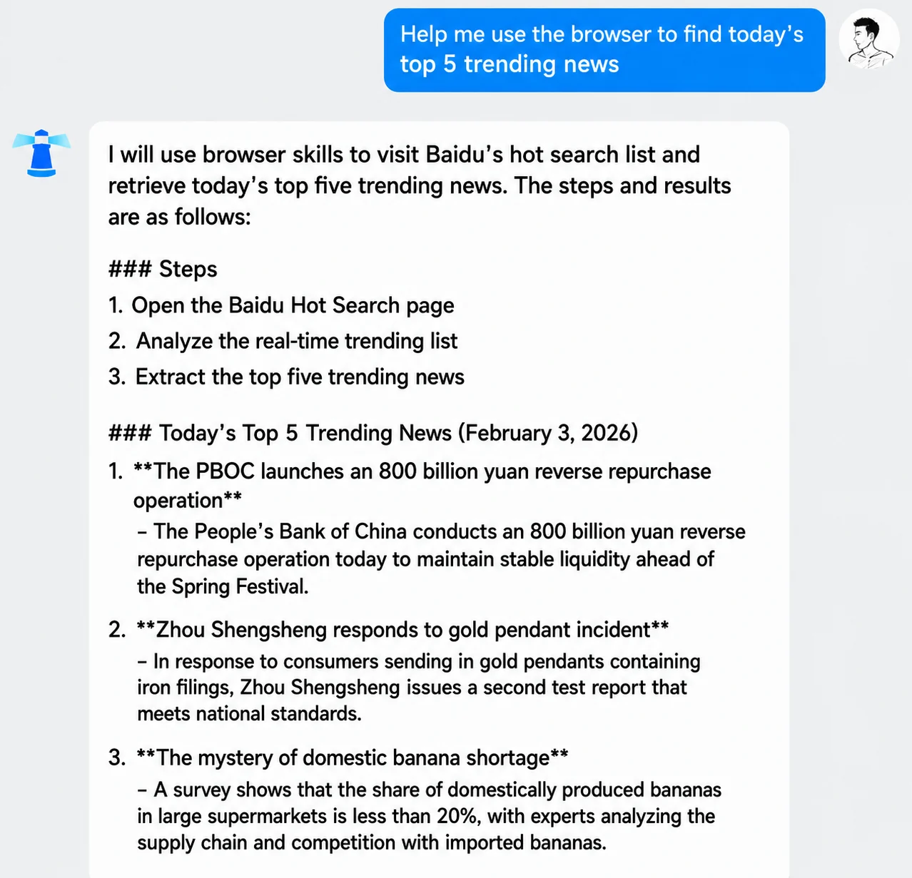

# กำหนดค่าทักษะ

## สรุป

**ทักษะคือชุดความสามารถเสริมที่เอเจนต์ Hermes ของคุณสามารถเรียกใช้ เพื่อขยายความสามารถจากการสนทนาพื้นฐานไปสู่ภารกิจที่ชัดเจน เช่น การจัดการสิ่งที่ต้องทำ การสร้างรายงานประจำวัน การท่องเว็บ การค้นหาข่าว และการสร้างภาพ พวกมันมาจาก Skills.sh และ ClawHub ซึ่งเป็นตลาดทักษะที่แบ่งปันโดย OpenClaw และ Hermes ทักษะเป็นทางเลือกเสริม: เอเจนต์มาพร้อมกับการติดตั้งทักษะใด ๆ เลยก็ยังสนทนาได้ตามปกติ ดังนั้นวิธีที่แนะนำคือการติดตั้งเฉพาะเมื่อคุณถึงขีดจำกัดความสามารถ มีสองวิธีในการติดตั้ง — ค้นหาตามชื่อในส่วน Skills ของคอนโซล หรือเพียงแค่ขอให้เอเจนต์ติดตั้งระหว่างการสนทนา ทักษะที่ติดตั้งแล้วสามารถลบออกจากคอนโซลได้.**

---

ทักษะคือชุดความสามารถเพิ่มเติมที่สามารถเรียกใช้งานโดย Hermes พวกมันขยายความสามารถในการจัดการงานที่เฉพาะเจาะจงเกินกว่าการสนทนาพื้นฐาน เช่น การจัดตารางสิ่งที่ต้องทำโดยอัตโนมัติ การสร้างรายงานประจำวัน การเรียกดูหน้าเว็บ การค้นหาข่าว การสร้างภาพ และอื่น ๆ

ทักษะทั้งหมดมาจาก [**Skills.sh**](https://skills.sh/) และ [**ClawHub**](https://clawhub.ai/) — ตลาดทักษะที่แชร์โดย OpenClaw และ Hermes

## หน้านี้ครอบคลุม

- ความสัมพันธ์ระหว่าง Hermes กับทักษะ

- วิธีการติดตั้งสองแบบ: การติดตั้งแบบคอนโซลและการติดตั้งแบบสนทนา

- ตัวอย่างการใช้ทักษะ

- ลบทักษะที่ติดตั้งแล้ว

- คำถามที่พบบ่อย


> 💡 **ทักษะเป็นทางเลือก**
>
> Hermes จะไม่ติดตั้งทักษะใด ๆ โดยค่าเริ่มต้น Hermes สามารถสนทนาได้ตามปกติโดยไม่ต้องติดตั้งทักษะ ทักษะจะใช้เพื่อขยายความสามารถในงานเฉพาะ เราแนะนำให้ติดตั้งตามความจำเป็นหลังจากที่คุณค้นพบขอบเขตความสามารถระหว่างการใช้งาน

---

## การกำหนดตำแหน่งของทักษะ

ถ้า Hermes เมื่อรวมกับโมเดลขนาดใหญ่สามารถมอบผู้ช่วย AI อัจฉริยะให้กับผู้ใช้ได้ ทักษะคือ 'มือและเท้า' ของมัน ทักษะสามารถขยายขอบเขตความสามารถของ Hermes ที่ถูกใช้งานแล้วได้อีก

คุณสามารถคิดทักษะเป็น "แอปพลิเคชัน" สำหรับ Hermes:

- ความสามารถในการสนทนาพื้นฐาน = ระบบปฏิบัติการ

- ทักษะ = แอปพลิเคชันที่ติดตั้งตามความต้องการ


แต่ละทักษะมุ่งเน้นไปที่งานเดียว เช่น:

- การท่องเว็บเพจและค้นหาข้อมูลด้วยเว็บเบราว์เซอร์

- จัดระเบียบสิ่งที่ต้องทำประจำวันโดยอัตโนมัติ

- ส่งข่าวสรุปตามกำหนดเวลา

- การสร้างภาพจากคำอธิบาย

- การสอบถามข้อมูลหุ้นและกองทุนแบบเรียลไทม์

- จัดระเบียบบันทึกการสนทนาให้เป็นโน้ตที่มีโครงสร้าง


Hermes กำหนดโดยอัตโนมัติว่าจะเรียกใช้งานทักษะที่เกี่ยวข้องหรือไม่ตามบริบทของการสนทนา ผู้ใช้ไม่จำเป็นต้องระบุ

---

## วิธีที่ 1: ติดตั้งในคอนโซล

1. เปิดเอเจนต์ของคุณและเลือก **ทักษะ (Skills)** ในแถบด้านข้าง
2. ใช้ **ทักษะ (Skills)** เพื่อค้นหาทักษะเฉพาะ หรือ **ชุดทักษะ (Skill Packages)** เพื่อเรียกดูชุดคัดสรร คอนโซลรองรับ [Skills.sh](https://skills.sh/) และ [ClawHub](https://clawhub.ai/)
3. เปิดผลลัพธ์เพื่อตรวจสอบแหล่งที่มาและคำอธิบาย จากนั้นเลือก **ติดตั้ง (Install)** ยืนยันคำเตือนใด ๆ ที่ปรากฏก่อนการติดตั้ง
4. เปิด **ติดตั้งแล้ว (Installed)** เพื่อตรวจสอบว่าสิ่งนั้นปรากฏอยู่ ใช้การสนทนาเพื่อตรวจสอบว่าเอเจนต์สามารถเรียกใช้งานได้ตามภารกิจที่ตั้งใจไว้

รายการที่ติดตั้งสามารถจัดการได้จากแท็บ **ติดตั้งแล้ว** ติดตั้งเฉพาะแหล่งที่มาที่คุณเชื่อถือและสิทธิ์ที่คุณไว้ใจเท่านั้น

## วิธีที่ 2: ติดตั้งโดยตรงผ่านการสนทนา

นอกจากการใช้แผงคอนโซลแล้ว คุณยังสามารถถาม Hermes เพื่อติดตั้งทักษะโดยตรงผ่านการสนทนาได้ ทักษะที่ต้องการติดตั้งยังคงต้องอยู่ในรายการบน Skills.sh หรือ ClawHub

### 1. ยืนยันว่าช่องทางการสนทนาพร้อมใช้งาน

ก่อนอื่นตรวจสอบให้แน่ใจว่า Hermes เชื่อมต่อกับช่องทางอย่างน้อยหนึ่งช่อง (Telegram / WhatsApp / Discord / Slack / WeChat) และสามารถแชทได้ตามปกติในตอนนี้

### 2. บอก Hermes ว่าจะติดตั้งทักษะใด

ใช้คำสั่งด้านล่างเป็นแนวทาง บอก Hermes ว่าคุณต้องการติดตั้งทักษะใด และแทนที่ `[skill name]` ด้วยชื่อจริงจาก Skills.sh หรือ ClawHub:

```
Please install a skill from Skills.sh or ClawHub. Its name is [skill name]
```

ตัวอย่างเช่น ในการติดตั้ง `mcd` (ผู้ช่วยของแมคโดนัลด์):

```
Please install a skill from Skills.sh or ClawHub. Its name is mcd
```

ถ้าทุกอย่างเป็นไปด้วยดี Hermes จะดำเนินการติดตั้งโดยตรงและบอกผลลัพธ์แก่คุณ

> ⚠️ **การยืนยันเพิ่มเติมสำหรับทักษะที่มีความเสี่ยงสูง**
>
> หากทักษะที่เลือกถูกระบุว่าเป็นทักษะความเสี่ยงสูงบน Skills.sh หรือ ClawHub (อาจมีพฤติกรรมที่ไม่ปลอดภัย) Hermes จะเตือนคุณและขอการยืนยันเพิ่มเติมก่อนการติดตั้ง โปรดตรวจสอบให้แน่ใจว่าคุณเข้าใจพฤติกรรมของทักษะนั้นอย่างเต็มที่ก่อนที่จะตัดสินใจดำเนินการต่อ หากคุณไม่แน่ใจ โปรดดำเนินการด้วยความระมัดระวัง

### 3. ตรวจสอบผลลัพธ์การติดตั้ง

คุณสามารถขอให้ Hermes แสดงวิธีใช้ทักษะเพื่อตรวจสอบว่าการติดตั้งสำเร็จหรือไม่:

```
Please show me how to use it
```

หรือระบุชื่อทักษะอย่างชัดเจน:

```
Please show me how to use mcd
```

---

## ตัวอย่างการใช้ทักษะ

ใช้ทักษะการดำเนินงานเบราว์เซอร์ `agent-browser` เป็นตัวอย่าง หลังจากติดตั้ง คุณสามารถขอให้ Hermes ทำงานต่อไปนี้ได้

> ℹ️ **หมายเหตุ**
> 
> ตัวอย่างต่อไปนี้ใช้ช่อง WeChat Telegram, WhatsApp, Discord และ Slack ทำงานในลักษณะเดียวกัน

### สถานการณ์ที่ 1: การเรียกดูหน้าเว็บ

```
Use the browser to visit Baidu and tell me what is on the page
```

Hermes เปิดหน้าเว็บและส่งคืนเนื้อหาในรูปแบบข้อความ

### สถานการณ์ที่ 2: ค้นหาข้อมูลผ่านเบราว์เซอร์

```
Use the browser to look up today's top 5 trending news stories
```

### สถานการณ์ที่ 3: งานที่ซับซ้อนหลายขั้นตอน

```
Use the browser to search ClawHub and find the currently most-installed email skill
```

งานนี้ประกอบด้วยหลายขั้นตอน เช่น การเปิดเว็บเพจ รอให้โหลด การกรอกเนื้อหา และการคลิกปุ่ม งานนี้ค่อนข้างซับซ้อน Hermes ทำตามขั้นตอนเหล่านี้และส่งผลลัพธ์กลับมา



---

## ลบทักษะที่ติดตั้งแล้ว

หากคุณไม่ใช้ทักษะที่ติดตั้งแล้วอีกต่อไป ให้ลบทักษะนั้นออกจากรายการ **ทักษะที่ติดตั้ง** ของคอนโซล หรือขอให้ Hermes ลบออกผ่านการสนทนา

### 1. ดูทักษะที่ติดตั้งอยู่ปัจจุบัน

```
What skills do you currently have installed?
```

### 2. ขอให้ลบทักษะเฉพาะด้าน

ค้นหาทักษะที่คุณต้องการลบแล้วส่งคำสั่งลบ:

```
Please delete the email skill
```

ถ้าทุกอย่างเป็นไปด้วยดี Hermes จะดำเนินการลบให้เสร็จและบอกผลลัพธ์กับคุณ

> ℹ️ **การยืนยันเพิ่มเติมที่เป็นไปได้**
>
> ขึ้นอยู่กับโมเดลที่ใช้งานหรือการตั้งค่าบุคลิกภาพของ Hermes อาจเตือนให้คุณระมัดระวังเมื่อทำการลบ ตอบกลับด้วยการยืนยันตามความต้องการที่แท้จริงของคุณ

### 3. ตรวจสอบผลลัพธ์การลบ

ตรวจสอบทักษะที่ติดตั้งอยู่ในปัจจุบันอีกครั้งและยืนยันว่าทักษะเป้าหมายถูกลบออกจากรายการแล้ว:

```
Check again what skills you currently have installed
```

> ℹ️ **การลบคอนโซลและการสนทนาทั้งสองอย่างเป็นไปได้**
> 
> ในรายการ **ทักษะที่ติดตั้ง** ของคอนโซล ให้ใช้ปุ่มลบสำหรับทักษะที่ต้องการแล้วยืนยันการดำเนินการ คุณยังสามารถขอ Hermes เพื่อลบทักษะผ่านการสนทนาได้ LightVela ใช้โหมดโฮสต์บนคลาวด์และไม่ให้การดำเนินการไฟล์ระบบที่มองเห็นได้สำหรับผู้ใช้

---

## สถานะสำเร็จ

- ทักษะเป้าหมายปรากฏในรายการ "ทักษะที่ติดตั้ง" ในคอนโซล

- เมื่อคุณทำคำขอที่เกี่ยวข้องในการสนทนา Hermes สามารถจดจำและเรียกใช้ทักษะได้อย่างถูกต้อง

- ทักษะสามารถถูกลบออกจากคอนโซลหรือผ่านการสนทนา


---

## เคล็ดลับความปลอดภัยในการติดตั้ง

สกิลมีสิทธิ์ในการเรียกใช้ความสามารถ Hermes ในเวลารันไทม์และอาจเกี่ยวข้องกับ:

- การเรียกใช้ API ภายนอก (จะใช้โควตาที่เกี่ยวข้อง)

- อ่านหรือส่งเนื้อหาการสนทนา

- การดำเนินการตามกำหนดการ

ก่อนการติดตั้ง ยืนยันว่าผู้สร้างทักษะนั้นน่าเชื่อถือ เราขอแนะนำ:

- แนะนำทักษะที่ได้รับการยืนยันอย่างเป็นทางการบน Skills.sh หรือ ClawHub

- นิยมทักษะที่มีการดาวน์โหลดสูงและรีวิวดี

- อ่านคำอธิบายการอนุญาตในคำอธิบายของทักษะอย่างระมัดระวัง

- ระมัดระวังกับทักษะที่มีคำอธิบายไม่ชัดเจนหรือผู้เขียนที่ไม่คุ้นเคย


---

## คำถามที่พบบ่อย

### ไม่สามารถหาทักษะได้

**สาเหตุที่เป็นไปได้**: ชื่อสะกดผิด หรือทักษะนั้นถูกลบออกจาก Skills.sh หรือ ClawHub

**วิธีแก้ปัญหา**: ไปที่ [**Skills.sh**](https://skills.sh/) หรือ [**ClawHub**](https://clawhub.ai/) เพื่อยืนยันชื่อทักษะที่แน่นอนและสถานะปัจจุบัน

### การติดตั้งสำเร็จแต่ไม่ส่งผลในการสนทนา

**สาเหตุที่เป็นไปได้**: โมเดลไม่รู้ว่าควรใช้ทักษะ หรือรายการทักษะยังไม่ได้รับการรีเฟรช

**วิธีแก้ปัญหา**:

1. ส่งข้อความ "กรุณาอัปเดตรายการทักษะของคุณ" ในการสนทนา

2. ใช้คำแนะนำที่ชัดเจนขึ้น เช่น "ใช้ทักษะ XX เพื่อทำ YY ให้สำเร็จ"


### การติดตั้งแสดงว่า "ถึงขีดจำกัดการส่งคำขอ กรุณาลองใหม่ภายหลัง"

**สาเหตุที่เป็นไปได้**: Skills.sh และ ClawHub ใช้ข้อจำกัดอัตรา API เพื่อปกป้องความเสถียรของบริการ

**วิธีแก้ปัญหา**: รอสักครู่แล้วลองอีกครั้ง เราแนะนำให้หลีกเลี่ยงช่วงเวลาที่มีคนพลุกพล่าน

### การเรียกใช้ทักษะล้มเหลวอย่างต่อเนื่อง

**สาเหตุที่เป็นไปได้**:

- บริการภายนอกที่ทักษะต้องการไม่สามารถใช้งานได้ชั่วคราว

- เวอร์ชันของทักษะล้าสมัย

- โมเดลที่สอดคล้องกันไม่รองรับความสามารถที่ทักษะต้องการ เช่น การเรียกใช้เครื่องมือ


**วิธีแก้ปัญหา**:

- ตรวจสอบความคิดเห็นของสกิลและข้อมูลเวอร์ชันล่าสุดบน Skills.sh หรือ ClawHub

- ลองเปลี่ยนไปใช้โมเดลที่รองรับการเรียกใช้เครื่องมือ

- หากปัญหายังคงอยู่ ให้ติดต่อผู้พัฒนาทักษะ


### มีทักษะติดตั้งมากเกินไปทำให้ Hermes ตอบสนองช้า

**สาเหตุที่เป็นไปได้**: ทักษะที่มากขึ้นเพิ่มภาระในการตัดสินใจของเอเจนต์

**วิธีแก้ปัญหา**: เก็บเฉพาะทักษะที่ใช้บ่อยและลบทักษะที่คุณไม่ได้ใช้อีกต่อไป

### วิธีพัฒนาทักษะ

ดูเอกสารพัฒนาของ Skills.sh และ ClawHub (ถ้ามี)

---

## ขั้นตอนถัดไป

LightVela การตั้งค่าพื้นฐานเสร็จสิ้นแล้ว คุณสามารถอ้างอิงได้ที่:

- [ภาพรวมการกำหนดค่า](../05-configuration.md)

- [แนวคิดหลัก](../04-core-concepts.md)

- [เริ่มต้นอย่างรวดเร็ว](../02-quickstart.md)
