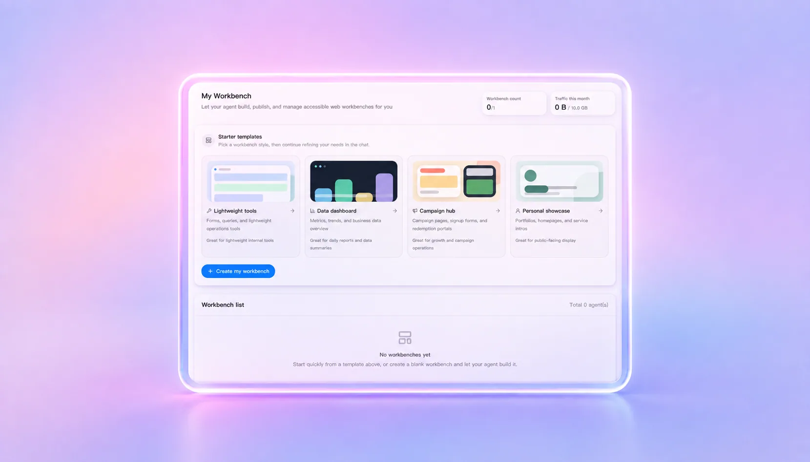
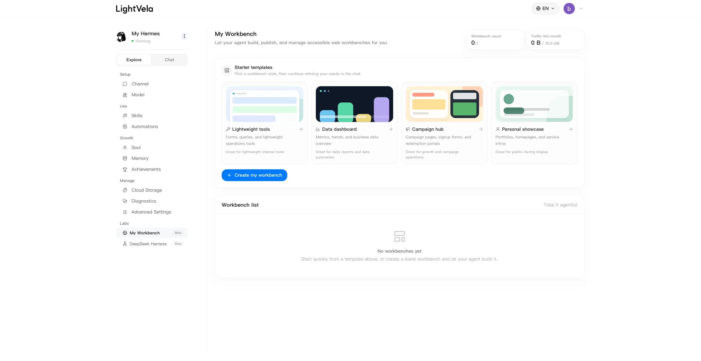
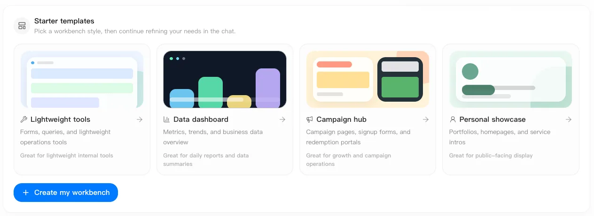
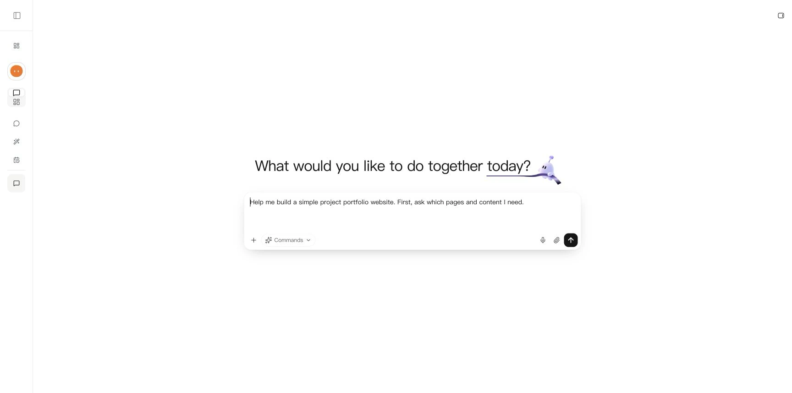
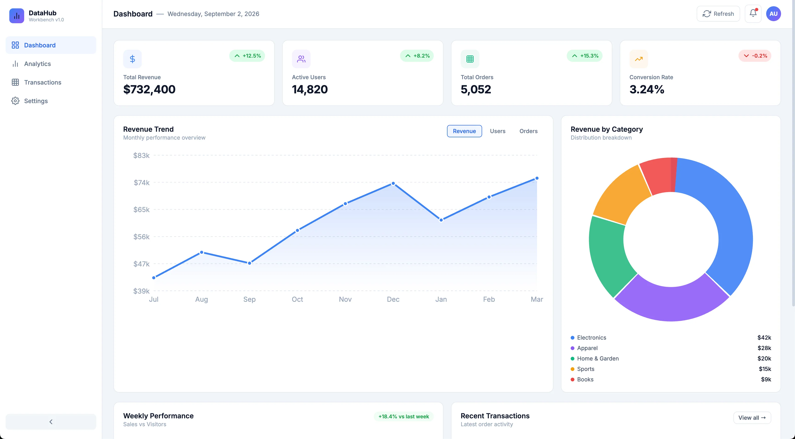

# เวิร์กเบนช์

## สรุป

**Workbench ของฉันช่วยให้คุณใช้เอเจนต์ AI ในการสร้าง ติดตั้ง และจัดการเว็บไซต์สแตติกใน LightVela เลือกเทมเพลตเริ่มต้นหรืออธิบายเว็บไซต์ตั้งแต่เริ่มต้น จากนั้นทำงานร่วมกับเอเจนต์เพื่อปรับปรุงและเผยแพร่เว็บไซต์นั้น**

หลังจากการปรับใช้งาน คุณสามารถดูที่อยู่สาธารณะ ตรวจสอบสถานะปัจจุบัน และจัดการเวิร์กเบนช์ที่มีอยู่จากที่เดียวได้

แจ้งเตือนเวอร์ชันทดสอบ: Workbench ของฉันเป็นฟีเจอร์เวอร์ชันทดสอบ ดังนั้นกระบวนการสร้างและการปรับใช้จึงอาจเปลี่ยนแปลงได้เมื่อฟีเจอร์พัฒนาไป

## สิ่งที่โต๊ะทำงานของฉันทำ

My Workbench เชื่อมต่อการสนทนาของเอเจนต์ของคุณกับเวิร์กโฟลว์เว็บไซต์สถิติจัดการ คุณสามารถเริ่ม "ไซต์ทำงาน" Workbench ของคุณเองหรือเลือกหนึ่งในแม่แบบที่มีให้ โต้ตอบกับเอเจนต์เพื่อปรับปรุง และดูตัวอย่างไซต์ของคุณด้วยลิงก์เฉพาะของคุณเอง

LightVela จัดการกระบวนการโฮสติ้ง ดังนั้นคุณไม่จำเป็นต้องตั้งค่าเซิร์ฟเวอร์โฮสติ้งหรือบัญชีคลาวด์แยกต่างหาก

## เปิดเวิร์กเบนช์ของฉัน

1. เปิด [https://lightvela.ai/agents/](https://lightvela.ai/agents/)  
2. ในเมนูนำทางด้านซ้าย เปิด My Workbench

หน้าร้านทำงานจะแสดงการใช้งานปัจจุบันของคุณ แม่แบบที่มีอยู่ และร้านทำงานที่มีอยู่

## เลือกแม่แบบเริ่มต้น

แม่แบบเริ่มต้นช่วยให้คุณเริ่มต้นด้วยทิศทางที่ชัดเจน คุณสามารถเลือกแม่แบบตามประเภทของเว็บไซต์ที่คุณต้องการสร้าง:

- แดชบอร์ดยูทิลิตี้ที่สะอาด: แบบฟอร์ม การค้นหาข้อมูล หรือเครื่องมือภายในที่น้ำหนักเบา
- แดชบอร์ดข้อมูล: เมตริกหลัก แนวโน้ม ภาพรวมธุรกิจ หรือรายงานประจำวัน
- หน้าแคมเปญ: หน้ากิจกรรม หน้าสมัคร หรือรายการแลกรางวัล
- การแสดงตัวบุคคล: พอร์ตโฟลิโอ หน้าแรกส่วนตัว หรือการแนะนำบริการ

เลือกเทมเพลตเพื่อเปิดแชทกับเอเจนต์ด้วยคำขอที่เตรียมไว้

คุณยังสามารถเลือกตัวเลือกว่างแล้วให้เอเจนต์ชี้แจงข้อกำหนดกับคุณทีละขั้นตอน

## สร้างเวิร์กเบนช์ด้วยแชทเอเจนต์

1. เลือกแม่แบบเริ่มต้น หรือเริ่มต้นด้วยโต๊ะทำงานว่างเปล่า
2. อธิบายวัตถุประสงค์ของเว็บไซต์ กลุ่มผู้ชม เนื้อหา และทิศทางการออกแบบ
3. ตอบคำถามของเอเจนต์เมื่อมันชี้แจงความต้องการ
4. ตรวจสอบผลลัพธ์ที่สร้างขึ้นและขอให้เอเจนต์ทำการเปลี่ยนแปลง
5. เมื่อเว็บไซต์พร้อม ให้ขอให้เอเจนต์เผยแพร่เวอร์ชันล่าสุด

กระบวนการทำงานปัจจุบันใช้ React, TypeScript, Tailwind CSS และไลบรารี UI ทั่วไปสำหรับเว็บไซต์ที่สร้างขึ้น

เอเจนต์ยังได้รับคำสั่งให้เก็บเนื้อหาให้สามารถแก้ไขได้ หลีกเลี่ยงการใช้ข้อมูลธุรกิจจำลองที่ตั้งไว้ล่วงหน้า และใช้ที่เก็บข้อมูลภายในเบราว์เซอร์เมื่อข้อมูลภายในชั่วคราวเหมาะสม

## ตรวจสอบสถานะของเวิร์กเบนช์

แต่ละโต๊ะทำงานมีสถานะการปรับใช้เพื่อให้คุณเห็นว่าพร้อมที่จะเยี่ยมชมหรือไม่

| สถานะ | คำอธิบาย |
| --- | --- |
| กำลังสร้าง | เว็บไซต์กำลังถูกสร้างหรือเตรียมการ |
| กำลังเผยแพร่ | เวอร์ชันล่าสุดกำลังถูกเผยแพร่ |
| ออนไลน์ | เว็บไซต์สามารถเข้าถึงได้ที่ที่อยู่สาธารณะ |
| การอัปเดตล้มเหลว | ความพยายามในการสร้างหรือเผยแพร่ล่าสุดล้มเหลว |
| ออฟไลน์ | เว็บไซต์ไม่สามารถเข้าถึงได้หรือถูกลบ |

เมื่อม้านั่งทำงานออนไลน์และมีที่อยู่สาธารณะ ให้เลือก เยี่ยมชม เพื่อเปิดมัน

หากโต๊ะทำงานยังอยู่ระหว่างการสร้างหรือการเผยแพร่ ให้รอกระบวนการเสร็จสิ้นและรีเฟรชหน้าหากจำเป็น

## จัดการม้านั่งทำงานที่มีอยู่

รายการโต๊ะทำงานที่มีอยู่แสดงชื่อเว็บไซต์ ที่อยู่สาธารณะ วันที่สร้าง และสถานะปัจจุบัน

ในการอัปเดตโต๊ะทำงาน ให้กลับไปที่แชทเอเจนต์และอธิบายการเปลี่ยนแปลงที่คุณต้องการ หลังจากตรวจสอบการเปลี่ยนแปลงแล้ว ให้ขอให้เอเจนต์เผยแพร่เวอร์ชันที่อัปเดต

ในการเอาโต๊ะทำงานออก:

1. ค้นหาโต๊ะทำงานในรายการ
2. เลือกการดำเนินการลบ
3. ยืนยันการลบ

การลบเวิร์กเบนช์จะทำให้เวิร์กเบนช์ออฟไลน์ทันทีและลบไฟล์ที่เกี่ยวข้อง การดำเนินการนี้ไม่สามารถย้อนกลับได้

## ข้อจำกัดด้านโควต้าและการโฮสต์ของเวิร์กเบนช์

ขีดจำกัดของ Workbench ของคุณขึ้นอยู่กับแผนของคุณ

- แผนการเปิดตัว: สร้างม้านั่งทำงาน 1 ตัว
- แผนการระดับสูง: สร้างม้านั่งทำงานได้สูงสุด 5 ตัว

หากคุณถึงขีดจำกัดของคุณ ให้ลบโต๊ะทำงานที่มีอยู่ก่อนสร้างใหม่หรืออัปเกรดแผนของคุณ

## ปัญหาที่พบบ่อย

| ปัญหา | สาเหตุที่เป็นไปได้ | สิ่งที่ต้องทำ |
| --- | --- | --- |
| หน้าจอ Workbench ขอให้คุณลงชื่อเข้าใช้ | เซสชันของคุณหมดอายุแล้ว | ลงชื่อเข้าใช้อีกครั้งและเปิด My Workbench อีกครั้ง |
| คุณไม่สามารถสร้าง Workbench อีกอันได้ | คุณอาจถึงขีดจำกัดของแผนการใช้งาน | ตรวจสอบการใช้งานของคุณหรือลบ Workbench ที่ไม่ได้ใช้งาน |
| สถานะยังคงเป็น กำลังสร้าง หรือ กำลังเผยแพร่ | การปรับใช้อยู่ระหว่างดำเนินการ | รอสักครู่ แล้วรีเฟรชหน้า |
| การดำเนินการเยี่ยมชมไม่สามารถใช้งานได้ | Workbench ยังไม่ออนไลน์ | รอจนกว่าสถานะจะเปลี่ยนเป็นออนไลน์ |
| สถานะเปลี่ยนเป็น อัปเดตล้มเหลว | การสร้างหรือการเผยแพร่ล่าสุดล้มเหลว | ตรวจสอบการตอบกลับจาก Agent ทำการแก้ไขที่จำเป็น และลองอีกครั้ง |
| ข้อมูลเว็บไซต์หายไปในเบราว์เซอร์อื่น | ข้อมูลถูกเก็บไว้ใน local storage ของเบราว์เซอร์ | ใช้บริการ backend หากเว็บไซต์ต้องการข้อมูลที่แชร์หรือคงอยู่
| โต๊ะทำงานที่ถูกลบยังปรากฏอยู่ในรายการ | การลบยังคงอยู่ระหว่างดำเนินการ | รอให้การล้างข้อมูลเสร็จสิ้นแล้วรีเฟรชหน้า |

## ขอบเขตปัจจุบัน

Workbench ของฉันมีวัตถุประสงค์เพื่อสร้างและโฮสต์เว็บไซต์แบบสแตติกผ่านการแชทของ Agent  
มันไม่ได้ให้บริการการจัดเก็บฝั่งเซิร์ฟเวอร์ ฐานข้อมูลที่จัดการแล้ว การจัดการแบบฟอร์มที่คงอยู่ บัญชีที่แบ่งปัน หรือบริการ backend แบบใดก็ได้  
จำนวน Workbench ปริมาณการใช้งาน การจัดเก็บ ขนาดแพ็กเกจ และจำนวนไฟล์ขึ้นอยู่กับแผนที่คุณใช้งานอยู่

## คำถามที่พบบ่อย

### ฉันสามารถสร้างเว็บไซต์ประเภทใดได้บ้าง?

คุณสามารถสร้างแผงควบคุม เครื่องมือภายใน หน้าแคมเปญ พอร์ตโฟลิโอ หน้า Landing Page และเว็บไซต์หน้าสถิตติด้านหน้าอื่น ๆ

### ฉันจำเป็นต้องมีประสบการณ์การเขียนโค้ดหรือไม่?

ไม่ คุณสามารถอธิบายในสิ่งที่คุณต้องการด้วยภาษาธรรมชาติและให้เอเจนต์แนะนำคุณผ่านขั้นตอนข้อกำหนด การสร้าง และการเผยแพร่ได้

### ฉันสามารถอัปเดตเวิร์กเบนช์ที่มีอยู่ได้หรือไม่?

ใช่  
กลับไปที่การสนทนากับเอเจนต์ อธิบายการเปลี่ยนแปลง ตรวจสอบผลลัพธ์ และขอเอเจนต์ให้เผยแพร่เวอร์ชันที่อัปเดต

### เว็บไซต์ของฉันสามารถบันทึกข้อมูลได้ไหม?

เว็บไซต์แบบสแตติกสามารถบันทึกข้อมูลชั่วคราวในเบราว์เซอร์ปัจจุบันด้วยการจัดเก็บภายในเครื่อง LightVela ไม่ได้ให้การจัดเก็บข้อมูลถาว่าฝั่งเซิร์ฟเวอร์สำหรับเว็บไซต์ Workbench

### ฉันต้องมีบัญชีโฮสติ้งแยกต่างหากหรือไม่?

ไม่
LightVela ให้บริการเวิร์กโฟลว์โฮสติ้งสำหรับเวิร์กเบนช์แบบคงที่ของคุณ

### ทำไมโต๊ะทำงานของฉันถึงไม่สามารถใช้งานได้ทันที?

การสร้างและการเผยแพร่อาจใช้เวลาสักครู่ ตรวจสอบสถานะปัจจุบันและรอจนกว่ามันจะเปลี่ยนเป็นออนไลน์ก่อนเปิดที่อยู่สาธารณะ
